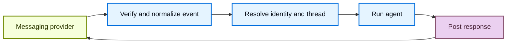

import ManagedDeepAgentsPublicBetaNote from '/snippets/javascript/langsmith/managed-deep-agents-public-beta-note.mdx';

A channel makes a managed deep agent available in an external messaging service. Messages from the service can start agent runs, and the agent's final responses return through the same service.

<ManagedDeepAgentsPublicBetaNote />

## Project structure

Channel declarations live in the project-level `channels/` directory:


```text
my-agent/
  agent.ts
  channels/
    slack.ts
```


## Understand channels

A channel combines three parts of an external messaging integration:

- **Inbound events**: Verify and normalize provider events, then start an agent run.
- **Outbound messaging**: Send the agent's response back to the originating conversation.
- **Provisioning**: Create and configure the provider resources that connect the service to the deployed agent.

In Managed Deep Agents, a channel connects a deployed agent to a messaging provider.

The managed runtime handles the channel lifecycle:



Provider adapters determine which events are accepted, how provider conversations map to Managed Deep Agents threads, and how responses are delivered. The channel declaration exposes the supported configuration for that provider.

### Send messages to a running agent

Steering lets a user add to a run that is already in progress. When the same user sends a message while the agent runs on that thread, the message joins the active run at its next model call. It does not start a new run.

<Note>
Steering is in beta and requires `managed-deepagents` 0.10.2 or later.
</Note>

For example, a user asks the agent to compare vendors and then sends "Only include SOC 2 compliant vendors" while the agent searches. The search finishes, and the model reads the new message together with the results so far. The same run continues with the narrower request.


#### How a message joins the run

A message sent during a run first waits on the thread as a queued run. Before each model call, the agent checks the thread for queued runs it can take. For each one, in the order the messages were sent, the agent:

1. Cancels the queued run with the reason `taken`, so the message does not also start its own run later.
2. Adds the run's messages to the active run's conversation.

Steering acts between steps. A tool call or model call that is already in progress finishes first.

After the model writes a final answer, the agent checks the thread once more. If a message arrived during that last model call, the run returns to the model with the message instead of ending.

#### Messages that run on their own

A queued run joins the active run only when it contains nothing but user messages from the same user. The following queued runs wait and start after the active run ends:

- A response to an interrupt, such as an approval.
- A message from a different user.
- A run that sets a webhook, forks from an earlier checkpoint, or sets input other than messages.

Only the main agent takes messages. While a subagent runs, new messages wait until the main agent's next model call.

If the agent cannot read or cancel the queued runs, the messages stay queued in order. The agent tries again at its next model call, and any message it does not take runs on its own after the active run ends.

## Declare channels in a project

Put each channel in a separate module under `channels/`.


Export a named `channel` from each file.


The file name becomes the configured channel name and identifies the channel within the deployment.


Do not name a declaration `channels/channel.ts`.


Channel names must be unique within a project.

The provider factory creates the declaration.


For example, `channels.slack()` creates a Slack channel.


See the provider guide for its declaration, app configuration, and deployment procedure.

## Distinguish channels from connectors

A channel receives messages that start agent runs and delivers responses. An [MCP connector](/langsmith/javascript/managed-deep-agents-mcp-connectors) gives the agent tools from a remote MCP server. A project can use either or both.

## Supported channels

<CardGroup cols={2}>
  <Card title="Slack" icon="brand-slack" href="/langsmith/javascript/managed-deep-agents-channels-slack">
    Start runs from Slack mentions, direct messages, and thread replies.
  </Card>
  <Card title="Custom (HTTP)" icon="webhook" href="/langsmith/javascript/managed-deep-agents-channels-http">
    Start runs from any service that can send a JSON webhook.
  </Card>
</CardGroup>

An HTTP adapter can also live in a community-maintained package. See [Share a channel adapter as a package](/langsmith/javascript/managed-deep-agents-channels-http#share-a-channel-adapter-as-a-package) to publish reusable provider code that users import into their channel declarations.

## See also

- [Identity](/langsmith/javascript/managed-deep-agents-identity): authenticate callers and scope channel runs to the resolved user.
- [Schedules](/langsmith/javascript/managed-deep-agents-schedules): deliver scheduled results through a configured channel.
- [Deploy an agent](/langsmith/javascript/managed-deep-agents-deploy): deploy project changes and configure secrets.
- [CLI reference](/langsmith/javascript/managed-deep-agents-cli): review channel project-file conventions.

---

<div className="source-links">
<Callout icon="terminal-2">
    [Connect these docs](/use-these-docs) to your agent of choice via MCP for real-time answers.
</Callout>
<Callout icon="edit">
    [Edit this page on GitHub](https://github.com/langchain-ai/docs/edit/main/src/langsmith/managed-deep-agents-channels.mdx) or [file an issue](https://github.com/langchain-ai/docs/issues/new/choose).
</Callout>
</div>
