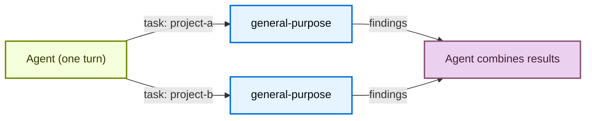

import ManagedDeepAgentsPublicBetaNote from '/snippets/python/langsmith/managed-deep-agents-public-beta-note.mdx';

Give a managed deep agent subagents to delegate specialized or context-heavy work, such as researching a topic, reviewing a change, or running a long task in the background with an async subagent while the agent keeps talking to the user. Each subagent has its own prompt and context window. It can also use its own model and tools.

<ManagedDeepAgentsPublicBetaNote />

There are two types of subagents:

| Type | How the agent uses it | Use it for |
| --- | --- | --- |
| Subagent | Calls it with `task` and waits for its answer | Focused work whose result the agent needs before it continues |
| Async subagent | Starts it with `start_async_task` and keeps working; the subagent reports back when it finishes | Long-running or parallel work the agent doesn't need to wait for |

A subagent runs inside the agent's graph. Managed Deep Agents builds each async subagent as its own graph in the same deployment. Both kinds work in the agent's [sandbox](/langsmith/python/managed-deep-agents-sandboxes). For how subagents work in the open source Deep Agents SDK, see [Subagents](/oss/python/deepagents/subagents) and [Async subagents](/oss/python/deepagents/async-subagents).

<Note>
Async subagents require `managed-deepagents>=0.10.0`.
</Note>

## The general-purpose subagent

Every agent gets a built-in `general-purpose` subagent, even when you omit `subagents` from the [agent definition](/langsmith/python/managed-deep-agents-agent-definition). The agent can delegate independent tasks to it at runtime, including [fanning out tasks in parallel](#fan-out-tasks-in-parallel), without declaring specialized subagents up front.

Unlike custom subagents, `general-purpose` inherits the agent's skills automatically, along with its model and tools. Like other subagents, it runs with its own prompt and context window, not the agent's conversation or [instructions](/langsmith/python/managed-deep-agents-instructions). Include all needed context, constraints, and expected output in each task's `description`.

Declare a custom subagent when a task needs a different model, a restricted tool set, or a reusable system prompt. For customization options, see [The general-purpose subagent](/oss/python/deepagents/subagents#the-general-purpose-subagent).

## Declare a custom subagent

Add subagent definitions to `subagents` in the agent definition. Each one needs a `name` and a `description`; the agent uses the description to decide when to delegate. To make a subagent async, add `async` to its definition:

<Tabs>
  <Tab title="Subagent">
```python agent.py
from managed_deepagents import define_deep_agent

agent = define_deep_agent(
    name="research-assistant",
    model="openai:gpt-6.1-sol",
    subagents=[
        {
            "name": "reviewer",
            "description": "Reviews a draft for accuracy and clarity.",
            "system_prompt": "Review the draft and list concrete fixes.",
        },
    ],
)
```
  </Tab>
  <Tab title="Async subagent">
```python agent.py
from managed_deepagents import define_deep_agent

agent = define_deep_agent(
    name="research-assistant",
    model="openai:gpt-6.1-sol",
    subagents=[
        {
            "name": "researcher",
            "description": "Researches a topic in the background.",
            "system_prompt": "Research the topic and report your findings.",
            "async": True,
        },
    ],
)
```
  </Tab>
</Tabs>


## Subagents

The agent runs a subagent with the `task` tool and waits for its answer. The subagent runs inside the agent's graph and works in the agent's [sandbox](/langsmith/python/managed-deep-agents-sandboxes).

### What a subagent inherits

A subagent starts from the agent's configuration and replaces what its definition sets:

| Setting | Behavior |
| --- | --- |
| `model`, `tools`, `permissions`, `interrupt_on` | Uses the agent's setting unless the subagent sets its own |
| `system_prompt` | Uses only the subagent's prompt, not the agent's [instructions](/langsmith/python/managed-deep-agents-instructions) |
| `skills` | Loads only the skills the subagent lists; list `"/skills/"` to load the agent's |
| `middleware`, `response_format` | Uses only the subagent's own |
| Memory | Not loaded |


A subagent in fork mode starts with a copy of the agent's conversation and also uses the agent's instructions, middleware, skills, and memory. See [Choose a launch mode](/oss/python/deepagents/async-subagents#choose-a-launch-mode).

### Fan out tasks in parallel

To fan out work in parallel, the agent issues multiple `task` calls in one turn. This works with the built-in `general-purpose` subagent or any declared custom subagent. Each call sets `subagent_type` and a distinct `description`, and runs in its own context window. The agent receives all results before its next turn and combines them into one answer. To keep working while tasks run in the background, the agent issues multiple `start_async_task` calls instead. See [Async subagents](#async-subagents).



For example, to investigate logs across multiple projects in parallel, add guidance to `instructions.md`:

```markdown instructions.md
When investigating multiple independent projects, delegate one task per project
to the general-purpose subagent in the same turn. Include the project, time
range, symptoms to look for, and expected output in each task description.
Wait for all results, then compare the findings and cite sources.
```

### Select MCP servers

Set `mcp` on a subagent to choose which [MCP server](/langsmith/python/managed-deep-agents-mcp-connectors) definitions give it tools. `mcp` does not affect the subagent's other tools.

<Note>
Subagent MCP selection requires `managed-deepagents>=0.10.2`.


</Note>

| `mcp` value | Subagent | Async subagent |
| --- | --- | --- |
| Omitted | Inherits the agent's tools | Inherits the agent's MCP servers |
| List of definitions | Keeps MCP tools only from these definitions. The agent must also load them. | Loads only these definitions |
| `[]` or `None` | No MCP tools | No MCP tools |


An async subagent connects only to the servers it selects and asks only for their credentials.

Only a [graph factory](/langsmith/python/managed-deep-agents-agent-definition#select-configuration-per-run) can set `mcp` on the agent.

```python agent.py expandable
from managed_deepagents import ManagedServerRuntime, connections, define_deep_agent, define_mcp

knowledge = define_mcp(
    servers={
        "langchainDocs": {"transport": "http", "url": "https://docs.langchain.com/mcp"},
        "notion": {
            "transport": "http",
            "url": "https://mcp.notion.com/mcp",
            "connection": connections.get("engineering-notion", {"type": "user"}),
        },
    },
)

planning = define_mcp(
    servers={
        "linear": {
            "transport": "http",
            "url": "https://mcp.linear.app/mcp",
            "connection": connections.get("engineering-linear", {"type": "user"}),
        },
    },
)

def agent(runtime: ManagedServerRuntime):
    return define_deep_agent(
        name="research-assistant",
        model="openai:gpt-5.5",
        mcp=[knowledge, planning],
        subagents=[
            {
                "name": "researcher",
                "description": "Answers questions from the docs and the team wiki.",
                "system_prompt": "Search the docs and Notion, and cite the pages you use.",
                "mcp": [knowledge],
            },
            {
                "name": "planner",
                "description": "Turns findings into Linear issues.",
                "system_prompt": "Create one Linear issue for each follow-up.",
                "mcp": [planning],
            },
        ],
    )
```


## Async subagents

An async subagent runs on its own thread while the parent agent keeps working, and reports back automatically when it finishes or pauses. See [Async subagents](/oss/python/deepagents/async-subagents) for the full lifecycle, [tools](/oss/python/deepagents/async-subagents#use-the-async-subagent-tools), and [options](/oss/python/deepagents/async-subagents#configure-async-subagents).

Managed Deep Agents builds each async subagent as its own graph in the same deployment (for example, `research-assistant--researcher`). Declare each one directly in `subagents` (or in a [graph factory](/langsmith/python/managed-deep-agents-agent-definition#select-configuration-per-run) that returns the definition directly) with a static `name` and `async` value, because the CLI discovers them at build time without executing your code. Agents served by `mda dev` or a deployment also get an async `general-purpose` subagent and the async task tools automatically.

Do not set `graph_id`, `url`, `headers`, or `runnable` on an `async` subagent; Managed Deep Agents wires the graph itself. `update_strategy`, `notify_parent`, `webhook`, and `mode` pass through to Deep Agents. To call an agent on another deployment as a [remote subagent](/oss/python/deepagents/async-subagents#http-transport-remote), omit `async` and pass its `graph_id` (its `name` for a Managed Deep Agent) and `url`.


- **Inheritance**: Follows the same [inheritance rules](#what-a-subagent-inherits) as sync subagents. In `fork` mode, it copies the conversation but keeps its own prompt, tools, and middleware.
- **Sandbox and traces**: Runs as the same user on a separate thread, sharing the agent's sandbox and nesting under the agent's trace in LangSmith. With [private threads](/langsmith/python/managed-deep-agents-identity), different users get separate sandboxes.
- **Channels and approvals**: Results return to the parent agent, which decides what to reply in the [channel](/langsmith/python/managed-deep-agents-channels) thread. On Slack, [approval interrupts](/langsmith/python/managed-deep-agents-tools#human-in-the-loop) appear in-thread; on other channels, resume the subagent's thread in Studio or through the API (see [Respond to an interrupt](/langsmith/python/managed-deep-agents-tools#respond-to-an-interrupt)).
- **Evaluations**: `mda eval` starts a local Agent Server for agents that declare async subagents (requires `managed-deepagents>=0.10.2` and the matching `mda` CLI). Evaluated agents without declared async subagents do not receive the async `general-purpose` subagent or async task tools.

## See also

- [Subagents](/oss/python/deepagents/subagents)
- [Async subagents](/oss/python/deepagents/async-subagents)
- [Agent definition](/langsmith/python/managed-deep-agents-agent-definition)
- [Sandboxes](/langsmith/python/managed-deep-agents-sandboxes)
- [Channels](/langsmith/python/managed-deep-agents-channels)

---

<div className="source-links">
<Callout icon="terminal-2">
    [Connect these docs](/use-these-docs) to your agent of choice via MCP for real-time answers.
</Callout>
<Callout icon="edit">
    [Edit this page on GitHub](https://github.com/langchain-ai/docs/edit/main/src/langsmith/managed-deep-agents-subagents.mdx) or [file an issue](https://github.com/langchain-ai/docs/issues/new/choose).
</Callout>
</div>
