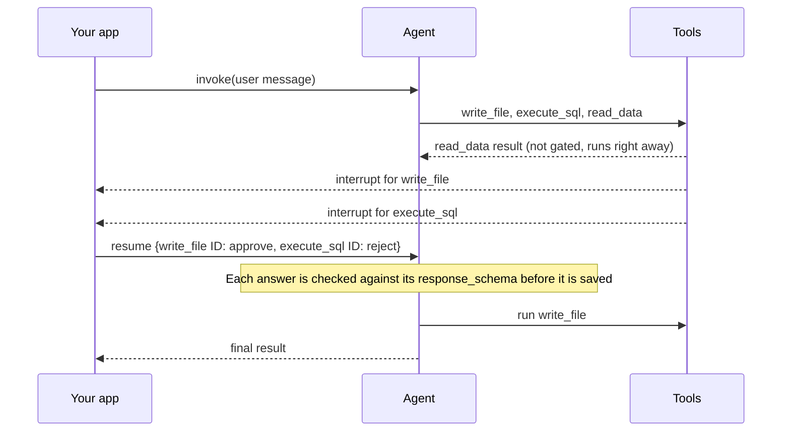

import HitlDecisionTypesTable from '/snippets/javascript/oss/hitl-decision-types-table.mdx';

- **Per-call**: One pause for each tool call that needs review.
- **Batched**: One pause per model turn, covering every tool call in that turn. Batched mode is the current default.

## Follow an approval from pause to resume

Every approval follows the same steps in either mode:

<HitlDecisionTypesTable />

The examples on this page use an agent with three tools. `write_file` allows every decision type. `execute_sql` allows only `approve` and `reject`. `read_data` runs without review. In one turn, the model calls all three.

## Review each tool call separately

In per-call mode, each tool call that needs review pauses on its own as it starts:

Each interrupt value describes one call and has `type: "tool_approval"`. The `execute_sql` interrupt looks like this:

LangGraph rejects an invalid answer before saving it, so the reviewer can correct it and answer again. Interrupts you do not answer stay pending, which lets a reviewer answer them one at a time.

## Review a whole turn at once

The interrupt has no `response_schema`. The middleware checks each decision only when it applies it, after LangGraph has saved the answer.

## Compare batched-mode problems

Batched mode matches answers to calls by position, and checks each answer only after saving it. Each row shows a problem the example agent hits in batched mode, and how per-call mode avoids it:

## Choose an interrupt mode

Use per-call mode for new agents. LangChain plans to make it the default in the next major release.

Keep batched mode while your approval UI reads the batched format, such as one built with the [`useStream` approval pattern](/oss/javascript/langchain/frontend/human-in-the-loop).

## See also

- [Human-in-the-loop in LangChain](/oss/javascript/langchain/human-in-the-loop): configure the middleware and answer each decision type.
- [Human-in-the-loop in Deep Agents](/oss/javascript/deepagents/human-in-the-loop): approvals for deep agents and their subagents.
- [Define an interrupt response schema](/oss/javascript/langgraph/interrupts#define-an-interrupt-response-schema): how LangGraph checks resume values.

---

<Callout icon="terminal-2">
    [Connect these docs](/use-these-docs) to your agent of choice via MCP for real-time answers.
</Callout>
<Callout icon="edit">
    [Edit this page on GitHub](https://github.com/langchain-ai/docs/edit/main/src/oss/concepts/human-in-the-loop.mdx) or [file an issue](https://github.com/langchain-ai/docs/issues/new/choose).
</Callout>

