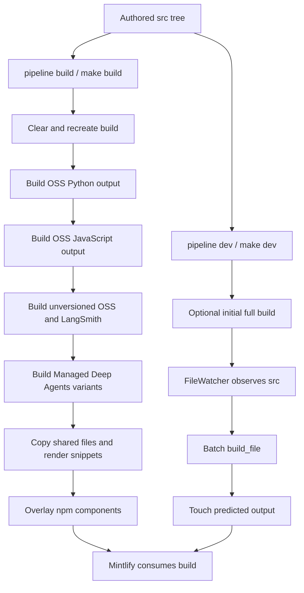

# Build and Preprocessing Architecture

The repository has two related but separate workflows:

- **Build and development** read authored `src/` content and produce the disposable `build/` tree consumed by Mintlify. Contributors edit `src/`, not `build/`.
- **Migration and maintenance tools** change or preview source documents. `migrate` and `migrate-docusaurus` are conversion tools, while `mv` moves a document and updates links; none is the dev server or the normal `pipeline build` path.

`pipeline/__main__.py` delegates to `pipeline.cli.main()`. The CLI dispatches `build`, `dev`, `mv`, `migrate`, and `migrate-docusaurus`.

## Build entrypoints and control flow

`make build` installs npm dependencies and runs `PYTHONPATH=$(CURDIR) uv run pipeline build`. The build handler verifies that `src/` exists, constructs `DocumentationBuilder(src, build)`, and calls `build_all()`. The parser exposes `--watch` for `build`, but `build_command` ignores that argument and performs one full build.

This flow distinguishes the authoritative full reconstruction from the narrower watch path. A full build clears `build/`, builds Python and JavaScript OSS content, builds unversioned OSS products and LangSmith, builds Managed Deep Agents variants, copies shared files, and overlays npm snippets. It does not generate `llms` artifacts.

## Route families and language selection

The builder reads `navigation` recursively from `src/docs.json` and caches the language route sets until the configuration modification time changes. Shared OSS Markdown listed only in one language navigation is emitted only for that language; a page listed in both or neither is emitted for both. Non-Markdown files are emitted for both. A `dir` navigation entry can stand for `dir/index`, unless a language-specific source owns that route. Missing or invalid `docs.json` falls back safely to both languages.

| Source family | Output and render target |
| --- | --- |
| Ordinary shared `src/oss/` content | `build/oss/python/...` and/or `build/oss/javascript/...`, selected from navigation. |
| `src/oss/python/` or `src/oss/javascript/` | Only the matching pass, with the language source segment removed from the route. |
| `src/oss/deepagents/code/` | One unprefixed `build/oss/deepagents/code/...` tree, rendered with Python conditions. |
| `src/oss/openwiki/` | One unprefixed `build/oss/openwiki/...` tree, rendered with Python conditions. |
| Ordinary `src/langsmith/` | One `build/langsmith/...` tree, rendered with Python conditions. |
| Direct `src/langsmith/managed-deep-agents*.mdx` | `build/langsmith/python/...` and `build/langsmith/javascript/...`; no unversioned page. |
| Root and shared inputs | Source-relative output under `build/`, built or copied once. |

Deep Agents Code and OpenWiki retain unprefixed routes and are skipped by OSS language-link rewriting. Managed Deep Agents is the LangSmith exception: its pages receive language-prefixed routes, and `src/docs.json` redirects unversioned Managed Deep Agents URLs to Python routes.

For language-targeted output, `/oss/path` becomes `/oss/python/path` or `/oss/javascript/path`. Already-prefixed links, image paths, and language-agnostic products are exempt. Versioned imports such as `from '/snippets/component.mdx'` are redirected to `/snippets/python/component.mdx` or `/snippets/javascript/component.mdx`.

## Supported files, Markdown, and preprocessing

The builder accepts Markdown/MDX, JSON/YAML, common media and text/HTML files, CSS/JS, JSX/TSX, and common fonts. `TEMPLATE.mdx` and unsupported extensions are skipped. `docs.yml` is converted to JSON; other supported non-Markdown files are copied with `copy2`. Markdown is processed for output and `.md` becomes `.mdx`.

Markdown processing runs in this order: standard preprocessing; language-specific snippet imports; OSS links; Managed Deep Agents links; contributor footer. Standard preprocessing resolves `@[LinkName]` through scope-specific `SCOPE_LINK_MAPS`, adds UTM parameters to selected `smith.langchain.com` CTA paths, and evaluates conditionals. Missing autolinks are logged without failing the build. UTM rewriting preserves existing queries, leaves functional paths unchanged, and skips fenced code.

`:::python` is retained for Python and removed for JavaScript; `:::js` behaves conversely. Unsupported labels remain intact, and escaped `\:::` is preserved as literal text. Conditional syntax is validated before rendering: nested, stray, or unclosed fences raise `ValueError`. The builder logs and re-raises Markdown-processing errors; the build therefore does not silently recover from malformed conditional structure.

The contributor callout is output-only: Markdown files get GitHub edit and issue links except the root `index.mdx` and anything beneath `snippets`.

## Shared files and generated snippets

`is_shared_file()` identifies `docs.json`, selected root pages, paths under `snippets`, `images`, `.well-known`, or `fonts`, and all `.js` and `.css` files. Full builds collect these once. Markdown snippets are emitted three ways: a source-relative copy with Python-resolved links, a Python copy under `build/snippets/python/`, and a JavaScript copy under `build/snippets/javascript/`. JSX/TSX components remain shared.

After source snippets are processed, npm components from `@langchain/docs-sandbox` are copied into `build/snippets/` and the build root, overwriting source-tree versions so the latest published components win. Missing package directories or mapped files are warnings.

Whole-tree collection rejects symlinks and accepts regular files only when their resolved paths remain under the requested source root. This prevents source-tree escapes into generated artifacts.

## Development lifecycle and incremental limits

`make dev` installs npm dependencies and starts `pipeline dev`. Unless `--skip-build` is supplied, dev performs a full build, creates `FileWatcher(src, build)`, and starts `mint dev --port 3000` with `build/` as its working directory. Initial-build failure, missing `mint`, a nonzero Mint exit, or an unexpected watcher stop returns failure; shutdown terminates Mint and escalates to kill after five seconds.

The watcher queues supported create/modify events, ignores editor backup and temporary files, debounces for 0.2 seconds, builds batches in worker threads (up to four), and touches predicted output files for hot reload. Incremental output is weaker than reconstruction:

- Deletion removes only the source-relative build path, not all language or special routes. Deleted versioned or Managed Deep Agents sources can leave variants until a full build.
- `build_file()` does not rerun shared-file collection or the npm overlay. Use a full build after navigation, package, cross-file, or deletion changes.
- Managed Deep Agents rebuilds both routes, but watcher touch logic treats LangSmith as unversioned and does not touch those emitted routes; use a full build if hot reload misses the edit.

## Migration and notebook conversion

`pipeline migrate PATH` converts MkDocs-oriented `.ipynb`, `.md`, and `.markdown`; `pipeline migrate-docusaurus PATH` additionally accepts `.mdx`. A directory is searched recursively. `--output` writes a parallel destination, `--dry-run` prints converted Markdown, and without `--output` the tool updates Markdown in place. Notebook input is converted to Markdown first and, on a successful in-place conversion, the original `.ipynb` is deleted.

Notebook conversion uses `nbformat` and `nbconvert`. It hides cells beginning with `# hide-cell`, normalizes notebook links, fixes image paths, marks code cells for execution, rewrites supported cell magics, removes `noqa` comments, escapes embedded fences, filters empty text output, and inlines supported attachments as data URLs. Unsupported cell-magic lines raise `NotImplementedError`; they are caught by the migration worker as unexpected per-file errors.

MkDocs input goes through `to_mint`; Docusaurus input goes through the Docusaurus parser, which converts admonitions, tabs, code blocks, imports, links, assets, and frontmatter. Both paths remove suffixes from links before writing. A `ParseError` is logged as a concise per-file parse error and marks that file failed; the migration loop continues with other files and reports aggregate failures. Other exceptions are logged with a traceback and likewise fail only that file. There is no undocumented recovery or partial rewrite of a failed file. In-place cleanup occurs only after successful processing.

The migration parsers are safe extension points for source-format conversion; the build-time extension boundary is the preprocessor chain and builder routing logic. Changes to routing, preprocessing, or generated output should be expressed through focused observable-output tests rather than edits to `build/`.

## Validation and focused tests

`make broken-links` builds first, runs `mint broken-links --check-redirects` from `build/`, filters deployment-time OpenAPI and standalone-snippet reports, and fails if filtered output still contains broken-link lines. The anchor target also checks anchors. OpenAPI endpoint pages are intentionally absent locally because Mintlify generates them at deployment. `make export` validates Mint export support and rejects Node major versions 25 or newer; `make htmltest` unpacks the export and checks external links only.

Focused builder tests cover navigation-aware selection, routing exceptions, snippet routing, symlink rejection, and Managed Deep Agents output. Watcher tests cover editor backup and temporary-file filtering. These tests are the right safety net for route or incremental-build changes; run them together with a full build.

## Related pages

- [Source map](/openwiki/architecture/source-map.md)
- [Mintlify integration](/openwiki/integrations/mintlify.md)
- [CLI tools](/openwiki/operations/cli-tools.md)
- [Testing overview](/openwiki/testing/test-overview.md)
