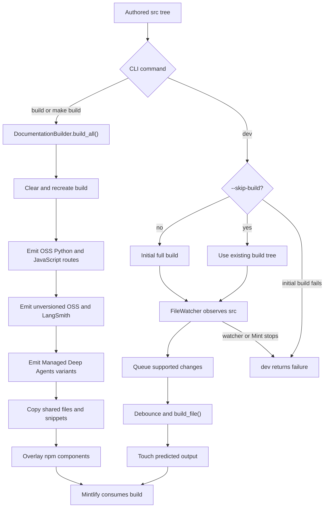

# Build and Preprocessing Architecture

The repository separates authored content from generated deployment output:

- **Source** is under `src/` and is the material contributors edit.
- **Output** is under `build/`, a disposable Mintlify tree that can be deleted and reconstructed. It must not be edited directly.
- **Migration tools** transform source documents; they are not part of the normal `build` or `dev` serving path.

`pipeline/__main__.py` delegates to `pipeline.cli.main()`. The CLI dispatches `build`, `dev`, `mv`, `migrate`, and `migrate-docusaurus`. The `docs build --watch` contract is not a watch mode: the parser accepts `--watch`, but `build_command` ignores it and performs one full build. Watching belongs to `docs dev` (or `make dev`).

## Entrypoints and control flow

`make build` installs npm dependencies and runs `PYTHONPATH=$(CURDIR) uv run pipeline build`. The build handler checks that `src/` exists, creates `build/` if needed, constructs `DocumentationBuilder(src, build)`, and calls `build_all()`. A missing source directory returns exit code 1.

This diagram shows the important distinction between authoritative reconstruction and the narrower watch path. A full build clears `build/`, builds Python and JavaScript OSS content, builds unversioned OSS products and LangSmith, builds Managed Deep Agents variants, copies shared files, and overlays npm snippets. It does not generate `llms` artifacts.

`docs dev` optionally performs that initial full build, creates `FileWatcher(src, build)`, and starts `mint dev --port 3000` with `build/` as its working directory. A missing `mint`, initial-build failure, nonzero Mint exit, or unexpected watcher stop is a failure. Shutdown terminates Mint and escalates to kill after five seconds. By contrast, `docs build --watch` does none of this: it is a single full build despite its accepted flag.

## Route families and language selection

The builder reads `navigation` recursively from `src/docs.json` and caches OSS route sets by `docs.json` modification time. For shared OSS Markdown, a page listed only in one language's navigation is emitted only for that language; a page listed in both or neither is emitted for both. Non-Markdown files are emitted for both. A directory navigation entry can represent `dir/index`, unless a language-specific source owns that route. Missing or invalid `docs.json` safely falls back to both languages.

| Source family | Output and render target |
| --- | --- |
| Ordinary shared `src/oss/` content | `build/oss/python/...` and/or `build/oss/javascript/...`, selected from navigation. |
| `src/oss/python/` or `src/oss/javascript/` | Only the matching pass, with the language source segment removed from the route. |
| `src/oss/deepagents/code/` | One unprefixed `build/oss/deepagents/code/...` tree, rendered with Python conditions. |
| `src/oss/openwiki/` | One unprefixed `build/oss/openwiki/...` tree, rendered with Python conditions. |
| Ordinary `src/langsmith/` | One `build/langsmith/...` tree, rendered with Python conditions. |
| Direct `src/langsmith/managed-deep-agents*.mdx` | `build/langsmith/python/...` and `build/langsmith/javascript/...`; no unversioned page. |
| Root and shared inputs | Source-relative output under `build/`, built or copied once. |

Deep Agents Code and OpenWiki retain unprefixed routes and are excluded from OSS language-link rewriting. Managed Deep Agents is the LangSmith exception: its pages receive language-prefixed routes, while `src/docs.json` redirects unversioned Managed Deep Agents URLs to Python routes.

For language-targeted output, `/oss/path` becomes `/oss/python/path` or `/oss/javascript/path`. Already-prefixed links, image paths, and language-agnostic product paths are exempt. Versioned imports such as `from '/snippets/component.mdx'` become `/snippets/python/component.mdx` or `/snippets/javascript/component.mdx`.

## Supported files and ordered Markdown processing

The builder accepts Markdown/MDX, JSON/YAML, common media and text/HTML files, CSS/JS, JSX/TSX, and common fonts. `TEMPLATE.mdx` and unsupported extensions are skipped. `docs.yml` is converted to JSON; other supported non-Markdown files are copied with `copy2`. Markdown is processed for output and `.md` becomes `.mdx`.

For Markdown, the order is:

1. **Standard preprocessing:** resolve `@[LinkName]` through scope-specific `SCOPE_LINK_MAPS`, add UTM parameters to selected `smith.langchain.com` CTA links, and render language conditionals.
2. **Language-specific snippet imports:** redirect unscoped snippet MDX imports for the target language.
3. **Route rewriting:** add the target language to eligible OSS links, then rewrite Managed Deep Agents links.
4. **Contributor callout:** append output-only GitHub edit and issue links, except for root `index.mdx` and anything under `snippets`.

Missing autolinks are logged without failing the build. UTM rewriting preserves existing query parameters, leaves functional paths unchanged, derives `utm_content` from the source path, and skips fenced code. `:::python` is retained for Python and removed for JavaScript; `:::js` behaves conversely. Unsupported labels remain intact, and escaped `\:::` is preserved as literal text. Nested, stray, or unclosed conditional fences raise `ValueError`; the builder logs and re-raises Markdown-processing errors rather than silently recovering.

## Shared files, snippets, and source boundaries

`is_shared_file()` identifies `docs.json`, selected root pages, paths under `snippets`, `images`, `.well-known`, or `fonts`, and all `.js` and `.css` files. Full builds collect these once. Shared Markdown snippets are emitted in three forms: a source-relative copy with Python-resolved links, a Python copy under `build/snippets/python/`, and a JavaScript copy under `build/snippets/javascript/`. JSX/TSX components remain shared.

After source snippets are processed, npm components from `@langchain/docs-sandbox` are copied into `build/snippets/` and the build root, overwriting source-tree versions so the latest published components win. Missing package directories or mapped files are warnings. Whole-tree collection rejects symlinks and accepts regular files only when resolved paths remain under the requested source root, preventing source-tree escapes into generated artifacts.

## Development lifecycle and incremental limits

The watcher queues supported create and modification events, ignores editor backup and temporary files, debounces for 0.2 seconds, and builds changed files in worker threads (up to four for a batch). It then touches predicted output files so Mintlify notices the change.

Incremental output is weaker than reconstruction:

- Deletion removes only the source-relative build path, not all language or special routes. Deleted versioned or Managed Deep Agents sources can leave generated variants until a full build.
- `build_file()` does not rerun shared-file collection or the npm overlay. Use a full build after navigation, package, cross-file, or deletion changes.
- Managed Deep Agents rebuilds both routes, but watcher touch logic treats LangSmith sources as unversioned and does not touch those emitted routes. Use a full build if hot reload misses the edit.

## Migration boundary

`pipeline migrate PATH` converts MkDocs-oriented `.ipynb`, `.md`, and `.markdown`; `pipeline migrate-docusaurus PATH` additionally accepts `.mdx`. Directory inputs are searched recursively. `--output` writes to a parallel destination, `--dry-run` prints converted Markdown, and without `--output` the tool updates files in place. Notebook input is converted to Markdown first and, on successful in-place conversion, the original `.ipynb` is deleted.

Notebook conversion uses `nbformat` and `nbconvert`: it hides cells beginning with `# hide-cell`, normalizes links and image paths, marks executable code, rewrites supported cell magics, removes `noqa` comments, escapes embedded fences, filters empty text output, and inlines supported attachments as data URLs. Unsupported cell-magic lines raise `NotImplementedError` and are isolated as per-file migration failures.

MkDocs input goes through `to_mint`; Docusaurus input goes through its parser, which converts admonitions, tabs, code blocks, imports, links, assets, and frontmatter. Parse errors and unexpected exceptions are logged per file; the migration continues and reports aggregate failures. Failed files are not inventedly recovered or partially rewritten, and in-place cleanup happens only after successful processing. The `mv` command is separate again: it moves a file and updates links.

## Validation and focused tests

`make broken-links` builds first, runs `mint broken-links --check-redirects` from `build/`, filters deployment-time OpenAPI and standalone-snippet reports, and fails when filtered output still contains broken-link lines. The anchor target also checks anchors. OpenAPI endpoint pages are intentionally absent locally because Mintlify generates them at deployment. `make export` validates Mint export support and rejects Node major versions 25 or newer; `make htmltest` unpacks the export and checks external links only.

Focused builder tests cover navigation-aware selection, routing exceptions, snippet routing, symlink rejection, and Managed Deep Agents output. Watcher tests cover editor backup and temporary-file filtering. These are the safety net for route, preprocessing, and incremental-build changes; run them with a full build rather than inspecting or editing generated `build/` files.

## Related pages

- [Preprocessing concepts](/openwiki/concepts/preprocessing.md)
- [Versioning concepts](/openwiki/concepts/versioning.md)
- [CLI tools](/openwiki/operations/cli-tools.md)
- [Builder tests](/openwiki/testing/builder-tests.md)
- [Local development](/openwiki/workflows/local-development.md)
