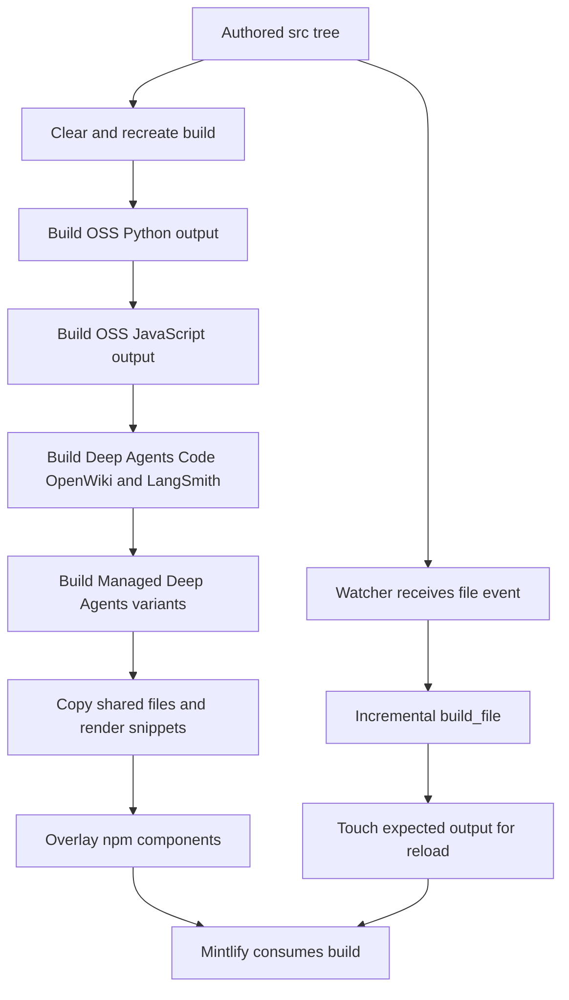

# Documentation Build System

`DocumentationBuilder` is the boundary between authored `src/` content and `build/`, the generated tree consumed by Mintlify. `build/` is disposable: a full build deletes it before recreating it. Edit `src/`, not `build/`.

## Entrypoints and full reconstruction

`make build` installs npm dependencies and invokes `uv run pipeline build`. The `docs` console script exposes the same CLI. The build handler verifies that `src/` exists, constructs `DocumentationBuilder(src, build)`, and calls `build_all()`; a missing source returns exit code 1.

This flowchart distinguishes the authoritative full reconstruction (top path) from the narrower watch path (bottom path).

A full build proceeds in the order shown: two ordinary OSS passes, unversioned Deep Agents Code and OpenWiki, ordinary LangSmith, Managed Deep Agents variants, shared-file copying, and the npm component overlay. The overlay runs last and can replace source-tree copies. The builder does not generate `llms` artifacts.

## Routing is content-aware

The source location selects a routing family, but ordinary shared OSS Markdown is not blindly duplicated. The builder recursively reads `navigation` from `src/docs.json`, collecting routes below `oss/python/` and `oss/javascript/`; the result is cached until the configuration modification time changes. A shared `.md` or `.mdx` page listed only in one language navigation is emitted only for that language. A page listed in both, in neither, or a non-Markdown asset is emitted for both. A navigation entry for `dir` can stand for `dir/index`, unless a language-specific `src/oss/python/dir.mdx` or `src/oss/javascript/dir.mdx` owns that route. If `docs.json` is missing or invalid, the safe fallback is both languages.

| Source family | Output and render target |
| --- | --- |
| Ordinary shared `src/oss/` content | `build/oss/python/...` and/or `build/oss/javascript/...`, selected from navigation; Python and JavaScript rendering respectively. |
| `src/oss/python/` or `src/oss/javascript/` content | Only the matching full-build language pass; the language source segment is removed from the output route. |
| `src/oss/deepagents/code/` | One unprefixed `build/oss/deepagents/code/...` tree, rendered with the Python target. |
| `src/oss/openwiki/` | One unprefixed `build/oss/openwiki/...` tree, rendered with the Python target. |
| Ordinary `src/langsmith/` | One `build/langsmith/...` tree, rendered with the Python target. |
| Direct `src/langsmith/managed-deep-agents*.mdx` | `build/langsmith/python/...` and `build/langsmith/javascript/...`; no unversioned page is emitted. |
| Root and shared inputs | Source-relative output under `build/`, built or copied once. |

Deep Agents Code and OpenWiki are deliberate OSS exceptions: they retain unprefixed routes and their `:::python` branch. Managed Deep Agents is the LangSmith exception. Direct Markdown/MDX files whose names begin `managed-deep-agents` get both language routes; `docs.json` supplies redirects from unversioned Managed Deep Agents URLs to the Python routes. The renderer also changes unprefixed Managed Deep Agents links to the current language route.

For language-targeted output, absolute `/oss/...` links are rewritten as `/oss/python/...` or `/oss/javascript/...`. Already-prefixed links, image paths, and Deep Agents Code and OpenWiki routes are exempt, because those destinations are not language-duplicated.

## Markdown transformation pipeline

Markdown and MDX are transformed only for output. Processing order is: standard preprocessing, language-specific snippet-import rewriting when there is a language target, OSS-link rewriting, Managed Deep Agents-link rewriting, then the contributor footer. `.md` inputs become `.mdx` output.

Standard preprocessing resolves `@[LinkName]` references using scope-specific `SCOPE_LINK_MAPS`, adds UTM parameters to selected LangSmith CTA links, then evaluates conditionals. `:::python` content is retained for Python and removed for JavaScript; `:::js` behaves conversely. Unsupported conditional labels remain intact, and escaped `\:::` is unescaped to literal text. A missing autolink is logged rather than making the build fail. The UTM pass preserves existing query parameters, leaves functional LangSmith paths alone, and skips fenced code.

The output-only contributor footer is omitted for the root `index.mdx` and any path containing `snippets`. Other Markdown includes calls to connect the documentation, edit the source on GitHub, or file an issue.

## Shared files and snippets

`is_shared_file()` identifies `docs.json`; selected root pages; every path under `snippets`, `images`, `.well-known`, or `fonts`; and `.js` and `.css` files. Full builds collect these from the whole source tree once. Supported types include Markdown, JSON and YAML, common image/video formats, CSS/JS, JSX/TSX, text/HTML, and common web fonts. `TEMPLATE.mdx` and unsupported extensions are skipped; `docs.yml` is converted to JSON and other supported non-Markdown files are copied with `copy2`.

Markdown snippets have a special contract. Each is written at its source-relative path with Python-resolved links, and also beneath `build/snippets/python/` and `build/snippets/javascript/` with the corresponding conditions and links. A language-targeted MDX page importing `from '/snippets/foo.mdx'` is rewritten to import the corresponding language-specific Markdown copy. JSX and TSX snippet components remain shared.

Finally, the builder copies `PatternEmbed.jsx` and `ExampleEmbed.jsx` from `node_modules/@langchain/docs-sandbox/dist` into `build/snippets/`, and `ChatLangChainEmbed.js` to the build root. Available package files overwrite copies previously obtained from `src`; missing package directories or mapped files are warnings.

## Development is incremental, not reconstruction

`make dev` installs npm dependencies and starts `pipeline dev`. Unless `--skip-build` is supplied, it performs the full build first, then watches `src/` recursively and runs `mint dev --port 3000` with `build/` as its working directory. It fails if initial construction fails, `mint` cannot be started, the Mint process exits nonzero, or the watcher stops unexpectedly; shutdown stops the watcher and terminates Mint, escalating to kill after five seconds.

The watcher queues supported created and modified files, rejects editor backups and temporary files, debounces events for 0.2 seconds, and builds a batch in worker threads (up to four). Afterwards it touches predicted output files so Mintlify detects the change. Incremental output is intentionally weaker than a full build:

- Deletion removes only the source-relative output path, not every language or special route. A deleted versioned or Managed Deep Agents source can therefore leave generated variants until the next full build.
- `build_file()` does not rerun whole-tree shared-file collection or the npm overlay. Use a full build after cross-file, navigation, package, or deletion changes.
- Managed Deep Agents pages rebuild into both routes, but the watcher treats LangSmith as unversioned for touching and does not touch those routes. Perform a full build if hot reload misses such an edit.

## Validation, safety, and change tests

Validation operates on generated output. `make broken-links` builds first, then runs `mint broken-links --check-redirects` from `build/`, filters known deployment-time OpenAPI and standalone-snippet reports, and fails if remaining broken-link lines exist. `make broken-links-with-anchors` also checks anchors. Deployment-time OpenAPI endpoint pages are intentionally absent from local output. `make export` runs Mint export from `build/` after verifying CLI support and rejecting Node major versions 25 or newer; `make htmltest` unpacks the export and checks external links only.

Whole-tree collection rejects symlinks—even symlinks to regular files—and only accepts regular files resolving beneath the requested source root. This prevents source-tree links from carrying host content into artifacts.

The focused builder tests cover navigation-aware selection, language-routing exceptions, link and snippet rewriting, Managed Deep Agents output, and symlink rejection. Watcher tests cover filtering editor backup and temporary names. When changing routing or generated output, update these observable-output tests and run a full build as well as the focused suite.

## Related pages

- [Preprocessing](/openwiki/concepts/preprocessing.md)
- [Versioning](/openwiki/concepts/versioning.md)
- [Mintlify integration](/openwiki/integrations/mintlify.md)
- [Builder tests](/openwiki/testing/builder-tests.md)
- [Local development](/openwiki/workflows/local-development.md)
