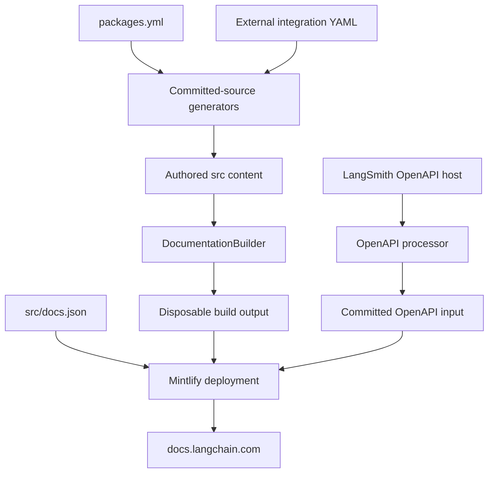

This repository builds the Mintlify site at `docs.langchain.com`. It does **not** build the separately generated `reference.langchain.com` site. The essential maintenance boundary is durable input versus output: `src/` is the authored documentation tree, `src/docs.json` is the Mintlify site contract, and `build/` is disposable deployment output. Never edit `build/`.

This shows the ownership distinction: authored and generated-but-committed source are repository inputs; `build/` is generated on each build; Mintlify generates configured OpenAPI endpoint pages at deployment; and the standalone API reference site is externally owned.

## Ownership and no-edit boundaries

| Concern | Durable owner | Result | Change safely by |
| --- | --- | --- | --- |
| Page prose, frontmatter, assets, UI fragments, and executable examples | `src/` | Builder input | Edit source, not `build/`. |
| Navigation, redirects, site settings, and OpenAPI declarations | `src/docs.json` | Mintlify menus, redirects, and deployment behavior | Make an explicit navigation and redirect decision in addition to adding a page. |
| Route construction and markdown transformation | `pipeline/` | Language-specific, shared, and unversioned build routes | Change code with focused pipeline tests. |
| Deployment artifact | `build/` | Files copied to `prod` for Mintlify | Regenerate; do not patch it. |
| Package catalogue | `packages.yml` | Provider overview, package links, and download-related tables | Edit metadata or a generator, then regenerate committed output. |
| Third-party integration listing data | `scripts/data/integration_external_docs.yaml` | Generated external rows in integration tables | Maintain the external record, never a generated MDX row. |
| Public LangSmith REST specification | `src/langsmith/langsmith-platform-openapi.json` and its processor | Mintlify-generated REST endpoint pages | Change processing policy or refresh the input, not endpoint MDX. |
| Verification and publication | `tests/`, `Makefile`, and `.github/workflows/` | Checks, scheduled maintenance PRs, and publication | Change the owner of the invariant rather than a produced artifact. |

## Site sources, configuration, and routes

`src/` is organized by authoring ownership, not as a URL mirror. Product pages include `src/langsmith/` and `src/oss/`; shared MDX and components are under `src/snippets/`; images and fonts are shared inputs; and `src/code-samples/` contains runnable programs. `AGENTS.md` treats `src/docs.json` as the navigation and site-configuration owner and requires a navigation update for a new page.

`DocumentationBuilder.build_all()` deletes and recreates `build/`, creates Python and JavaScript OSS variants, builds Deep Agents Code and OpenWiki once at unversioned OSS routes, emits LangSmith content, then copies shared files including `docs.json`. Regular OSS content therefore lands under `oss/python/` and `oss/javascript/`; `src/oss/openwiki/` and `src/oss/deepagents/code/` intentionally land only at unversioned paths. The Build navigation lists the same OpenWiki paths in both language dropdowns. Managed Deep Agents is a separate exception: matching `src/langsmith/managed-deep-agents*.mdx` files produce Python and JavaScript paths, and configured unversioned legacy URLs redirect to the Python route instead of receiving a third built page.

A page emitted by the builder is not automatically discoverable: `src/docs.json` independently owns navigation, redirects, and OpenAPI configuration. Keep a redirect when preserving an existing public URL.

### Markdown, snippets, and cross-references

The builder preprocesses MD/MDX before writing it. It resolves `@[...]` cross-references, adds UTM parameters to eligible LangSmith CTA links, selects the active `:::python` or `:::js` conditional content, and leaves unsupported conditional labels intact. The scoped mappings in `pipeline/preprocessors/link_map.py` are the curated authority for the symbols that `@[...]` can resolve to API-reference URLs. Missing entries remain literal text and are logged, rather than being guessed.

MDX snippets are shared source, but their Markdown output is language-aware: the build writes a default copy and Python/JavaScript copies, and rewrites a language-targeted page's snippet import to its matching copy. JSX and TSX snippet components remain shared. This avoids relative-link errors for snippets consumed at different route depths.

Source collection is deliberately containment-safe. The builder skips source-tree symlinks and any file whose resolved path leaves the collection root, preventing a committed link from importing host data into build output. Preserve this invariant when changing traversal or adding a collection.

## API reference boundaries

Do not conflate these surfaces:

- `reference.langchain.com` is generated and deployed outside this repository. This repository can route issue reports, but has no reference build output to modify.
- Mintlify reads the OpenAPI declarations in `src/docs.json` for Agent Server, Control Plane, and LangSmith REST. It creates their endpoint pages during deployment; those pages are neither authored MDX nor builder output.

The committed LangSmith REST specification is a generated-but-reviewed repository input. `scripts/process_langsmith_openapi.py` accepts a local input or fetches only its allow-listed LangSmith host, marks fleet, internal, and health operations hidden, applies groups and group ordering to tags, and normalizes visible operation titles (including v2 labels) before writing `src/langsmith/langsmith-platform-openapi.json`. Its daily workflow generates the candidate file, exits without a commit when it is unchanged, and appends to the existing `chore/refresh-langsmith-openapi` pull request when one is open. Change the policy or upstream contract; do not hand-edit deployment-generated endpoint pages.

## Development, CI, and publication

The `docs` console entry point invokes the pipeline CLI. `docs dev` runs an initial build unless `--skip-build` is selected, watches `src/`, and runs `mint dev` from `build/`; failure of the initial build stops server startup. Use `make build`, `make dev`, and the link-check targets as normal wrappers.

CI runs reusable test, lint, and link-validation workflows on pushes to `main` and pull requests, cancelling an older run for the same ref when a newer one arrives. Separate jobs check merge-conflict markers, cross-references, external integration URL schemes, and the generated provider overview. The reusable link workflow builds the site, validates links including anchors and redirects, and checks the Agent Server OpenAPI specification. The generated-file check deliberately regenerates `src/oss/python/integrations/providers/overview.mdx` and fails if it differs, except for its explicit automation/label bypasses.

Publication is separate from CI: a `main` push runs `make build`, verifies `build/`, nests it at `public/build`, and publishes that directory to the `prod` branch. This is why `build/` must remain reproducible and disposable.

## Samples and integration metadata

`src/code-samples/` is executable source, not a page collection. `make test-code-samples` runs it. `make code-snippets` extracts marked regions into the ignored `src/code-samples-generated/` intermediate and renders the committed display MDX under `src/snippets/code-samples/`. Edit and test the program, then regenerate; do not hand-edit either derived layer.

`packages.yml` is package metadata used by generated integration surfaces. Its provider and download metadata feeds the Python provider overview; CI regenerates that overview and rejects manual drift. The weekly package-download workflow refreshes download counts, regenerates the provider overview and integration download/featured snippets, optionally flags qualifying external integrations for hosted docs, and opens a PR only when tracked generated output changed.

Integration download tables also derive from hosted integration-page frontmatter plus `scripts/data/integration_external_docs.yaml`. An entry in that YAML represents a third-party listing: its `docs_url` becomes the name link instead of a hosted guide. URL validation accepts `https://`, `http://`, or a single-slash site-relative path and rejects protocol-relative and unsafe schemes. Use this data source for an eligible external row, not a handwritten table row.

The Monday integration-repository workflow runs the liveness checker with `--write` and manages the standing draft PR on `chore/dead-integration-repos`. For a dead third-party GitHub home, the checker can update to a live third-party GitHub replacement evidenced by PyPI, npm, or external docs; it preserves GitLab, partner-docs, and first-party alternatives for human attention. With no live alternate, it delists the package and removes related external entries, provider cards where unshared, and generated download rows.

## Change guide

1. **Add or move a page:** edit the relevant `src/` MDX, update `src/docs.json`, and add a redirect when retaining a public URL.
2. **Change routes, language rendering, snippets, or link preprocessing:** modify `pipeline/`, preserve containment safety, add a focused test, and rebuild.
3. **Change a runnable example:** edit and test `src/code-samples/`, run `make code-snippets`, and commit rendered snippet MDX rather than the ignored intermediate.
4. **Change provider or integration listings:** select `packages.yml`, hosted-page frontmatter, or `integration_external_docs.yaml` according to ownership, then regenerate instead of editing table output.
5. **Change Mintlify API reference:** change `src/docs.json`, the committed specification, or `process_langsmith_openapi.py`; never author endpoint MDX for deployment-generated reference pages.
6. **Investigate a broken API symbol link:** amend the appropriate scoped entry in `pipeline/preprocessors/link_map.py` and verify preprocessing, rather than pasting an ad hoc generated URL into build output.
7. **Change verification or scheduled maintenance:** update the workflow, script, and its tests together; preserve the standing-PR behavior of repository and OpenAPI refresh jobs.

## Related pages

- [Build system](/openwiki/architecture/build-system.md)
- [Versioning](/openwiki/concepts/versioning.md)
- [Mintlify](/openwiki/integrations/mintlify.md)
- [Reference docs](/openwiki/integrations/reference-docs.md)
- [Quickstart](/openwiki/quickstart.md)
- [Integration listing automation](/openwiki/workflows/integration-listing-automation.md)
- [LangSmith OpenAPI refresh](/openwiki/workflows/langsmith-openapi-refresh.md)
