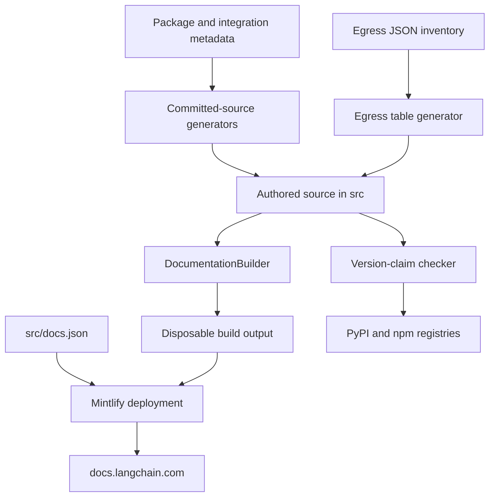

This repository builds the Mintlify site at `docs.langchain.com`; it does not build the separately generated `reference.langchain.com` site. The primary boundary is durable input versus output: `src/` is authored documentation, `src/docs.json` is the Mintlify site contract, and `build/` is disposable deployment output. Never edit `build/`.



*Authored and generated-but-committed inputs converge during the build; separate checks validate published package versions and generated egress tables before deployment.*

## Ownership boundaries

| Concern | Durable owner | Safe change |
| --- | --- | --- |
| Page prose, frontmatter, assets, UI fragments, and runnable examples | `src/` | Edit source, not `build/`. |
| Navigation, redirects, site settings, and OpenAPI declarations | `src/docs.json` | Update navigation deliberately as well as adding a page. |
| Routes and Markdown transformations | `pipeline/` | Change pipeline code with focused tests. |
| Deployment artifact | `build/` | Regenerate; never patch. |
| Package catalogue | `packages.yml` | Change metadata or its generator, then regenerate outputs. |
| External integration rows | `scripts/data/integration_external_docs.yaml` | Change the record, not a generated table row. |
| LangSmith REST specification | `src/langsmith/langsmith-platform-openapi.json` and its processor | Change policy or refresh the committed input, not deployment-generated endpoint MDX. |
| Egress-address data and public machine-readable artifact | `src/langsmith/egress-ip-addresses.json` | Edit validated inventory entries, then regenerate both embedded tables. |
| Cloud and Fleet changelog content | `src/langsmith/changelog.mdx`, `src/snippets/langsmith/fleet-changelog.mdx`, and the encrypted held-state ledger | Use the weekly proposal workflow or make a deliberate source edit; do not expose held state. |
| Release-watch product coverage | `docs-release-watch/tools/products.py`, matching skill, and schedule prompt | Add all three and redeploy the managed agent. |
| Verification and publication | `tests/`, `Makefile`, and `.github/workflows/` | Change the invariant owner alongside its focused checks. |

## Authored documentation, labels, and routes

`src/` is organized for authoring ownership, not as a URL or reader-navigation mirror. LangSmith content is in `src/langsmith/`, OSS content is in `src/oss/`, reusable MDX and components are in `src/snippets/`, and `src/code-samples/` holds runnable programs. Product and menu labels deliberately cross those directories: Build includes both OSS and LangSmith content, while Test, Deploy, and Monitor draw from LangSmith. Find the owner by directory; find reader-facing placement in `src/docs.json`.

Adding a source page does not make it discoverable. `src/docs.json` independently owns menus, redirects, and OpenAPI configuration, so an addition or move requires an explicit navigation decision and a redirect when retaining a public URL. The current contract has two products composed of menus rather than a flat tab list. Build has Python and TypeScript dropdowns; OpenWiki appears in both even though its pages are unversioned.

`DocumentationBuilder.build_all()` recreates `build/`, builds Python and JavaScript OSS variants, emits Deep Agents Code and OpenWiki once at unversioned OSS routes, builds LangSmith content, then copies shared files including `docs.json`. Regular OSS pages land under `oss/python/` and `oss/javascript/`. `src/oss/openwiki/` and `src/oss/deepagents/code/` intentionally land only at unversioned paths. Managed Deep Agents is distinct: matching `src/langsmith/managed-deep-agents*.mdx` files produce Python and JavaScript routes, while configured unversioned legacy URLs redirect to Python.

Source collection is containment-safe: the builder skips source-tree symlinks and files whose resolved path leaves the collection root. Preserve that safeguard when changing traversal or adding a collection.

### Authoring rules that affect ownership

The repository guidance applies to manually authored `src/` content, not generated output. Every MDX page needs YAML frontmatter with a concise title and a plain-text SEO description; adding a page also requires `src/docs.json`. Use Tabler icons, test code examples, and avoid fabricating examples or policy details. For shared OSS content, `:::python` and `:::js` fences select language-specific material; a shared page listed in only one language navigation is built only for that language, and a previously public omitted-language route needs a redirect.

Before writing MD or MDX, the builder resolves `@[...]` cross-references, adds UTM parameters to eligible LangSmith CTA links, and selects the target `:::python` or `:::js` content while leaving unsupported conditional labels intact. The scoped entries in `pipeline/preprocessors/link_map.py` are the authority for cross-reference symbols. An unresolved symbol is logged and left literal rather than receiving a guessed URL.

Snippets are shared source but have language-aware Markdown copies: the build writes the source-relative copy plus Python and JavaScript copies, and rewrites language-targeted MDX imports to the corresponding copy. JSX and TSX components stay shared.

## API-reference boundaries

Do not conflate three reference surfaces:

- `reference.langchain.com` is generated and deployed outside this repository. This repository only routes issue reports for it.
- `src/docs.json` declares Agent Server, Control Plane, and LangSmith REST OpenAPI sources. Mintlify creates their endpoint pages during deployment; they are neither authored MDX nor builder output.
- `src/langsmith/langsmith-platform-openapi.json` is a generated-but-reviewed committed input. Its processor fetches only an allow-listed LangSmith host, or reads a local input; hides fleet/internal and configured health operations; assigns and orders tag groups; and normalizes visible operation titles before writing the file.

The daily OpenAPI workflow runs that processor, makes no commit when the specification is unchanged, and appends changes to the existing `chore/refresh-langsmith-openapi` pull request. Change the processing policy or upstream contract rather than hand-editing endpoint pages.

## Egress inventory and generated documentation

`src/langsmith/egress-ip-addresses.json` is the single source for public LangSmith and LangSmith Deployment egress addresses. It is published unchanged at `/langsmith/egress-ip-addresses.json`; consumers filter `addresses` by `service`, `cloud`, and `region`, then allowlist every matching `cidr` and compare the deterministic `version` to detect changes. The two reader-facing tables are generated blocks in `src/langsmith/cloud.mdx` and `src/langsmith/cloud-platform-features.mdx`, not independent sources.

The generator accepts schema version 1 only. Inventory entries must have exactly `service`, `cloud`, `region`, and `cidr`; services map to those two target pages, clouds are `gcp` or `aws`, regions are `us`, `eu`, or `apac`, and each CIDR must be a distinct global IPv4 `/32`. It hashes a canonical sorted representation of `addresses` into `version`, renders only the populated cloud/region columns for each service, and requires exactly one begin/end marker pair per target page. `--check` reports inventory-version or table drift without writing; normal mode rewrites the hash and both tables. Run:

```bash
uv run python scripts/generate_egress_ip_tables.py
uv run python scripts/generate_egress_ip_tables.py --check
```

Commit the JSON and both regenerated pages together. Do not manually change a generated table or the hash. The focused egress tests cover malformed and duplicate entries, drift detection, and the build's byte-for-byte publication of the one unversioned JSON artifact.

## Version claims

Minimum package versions in prose are claims that a release exists, not instructions for automation to select a newer floor. `scripts/check_version_claims.py` scans MDX for `>=` and `==` package specifiers and queries PyPI or npm concurrently. A scoped `@name/package` is npm-only and extras brackets are PyPI-only; otherwise the nearest explicit language label wins, followed by a `:::python`/`:::js` fence, language-bearing path, the small JS-only page override set, and finally PyPI. This ordering matters because packages such as `deepagents` have divergent package/version lines across registries.

The checker accepts exact releases and truncated series floors when a published release shares that dotted prefix. It records all occurrence lines for a specifier, uses a fixed allowlist before lookup, and refuses registry URL construction for unsafe package names. Registry failures are unresolved notes rather than false claims; a version is a failure only when its package resolves and no published release satisfies the exact version or series. Use `--advisory-only` for a report that always exits successfully.

On pull requests that touch docs/checker configuration, `check-version-claims.yml` computes changed `src/**/*.mdx` files from the merge base and blocks only those pages on nonexistent releases. The scheduled external-version workflow runs the complete checker in advisory mode, so stale untouched content and registry availability do not make the scheduled sweep fail. Add an ignore entry only for a documented, intentional unresolvable example; normally correct the page.

## Development, verification, and publication

The `docs` console script exposes the pipeline CLI. `docs dev` builds initially unless `--skip-build` is selected, watches `src/`, and starts `mint dev` in `build/`; an initial build failure prevents server startup. `make build`, `make dev`, and the link-check targets are the standard wrappers.

CI calls reusable test, lint, and link-validation workflows and cancels an older run for the same workflow and ref when a newer push arrives. Separate jobs check merge-conflict markers, cross-references, external integration URL schemes, and generated provider output. The link workflow builds the site, validates links with anchors and redirects, and checks the Agent Server OpenAPI specification. The generated-file check regenerates `src/oss/python/integrations/providers/overview.mdx` and rejects drift except for its stated automation and label bypasses.

Publication is separate from CI: a `main` push runs `make build`, verifies `build/`, places it at `public/build`, and publishes it to the `prod` branch. Reproducibility, rather than edits to output, is therefore the operational requirement.

## Runnable samples and derived snippets

`src/code-samples/` owns executable documentation examples. `make test-code-samples` executes them; `make code-snippets` extracts marked regions to the ignored `src/code-samples-generated/` intermediate and renders committed display MDX under `src/snippets/code-samples/`. Edit and test the program, then regenerate; do not hand-edit either derived layer.

Snippet markers make the source-to-display relationship deterministic. For example, `rag-deep.py` marks `rag-deep-index-py`, whose display fragment is `src/snippets/code-samples/rag-deep-index-py.mdx`. The extractor removes marked non-display regions and errors on an unclosed removal marker; repair markers in the runnable source. The generator supports Python, TypeScript, Java, Kotlin, Go, and shell intermediates.

The agent-registration guide demonstrates the boundary: `create-an-agent.mdx` imports `create-agent-py.mdx`, derived from a marked region in `src/code-samples/langsmith/create-an-agent.py`. That sample points the SDK at a loopback fixture and asserts create and retrieve requests, so running it does not create a live agent.

## Package and integration metadata

`packages.yml` is package metadata for generated integration surfaces. The partner-package generator writes the Python provider overview, and CI rejects manual edits to it. The weekly package-download workflow updates metadata, regenerates the overview plus download and featured snippets, and creates a pull request only when tracked outputs changed.

Integration download tables combine hosted integration-page frontmatter with `scripts/data/integration_external_docs.yaml`. An external entry's validated `docs_url` supplies the name link instead of a hosted guide; CI validates allowed schemes. Use the YAML entry for a third-party row, not a handwritten generated row.

The Monday repository-liveness workflow runs the checker with `--write` and maintains one standing draft PR on `chore/dead-integration-repos`. For a dead third-party GitHub home, the checker can adopt a live third-party replacement evidenced by PyPI, npm, or external documentation. It keeps live GitLab, partner-documentation, and first-party alternatives for human attention; with no live alternate, it delists the package and removes associated listing surfaces.

## Changelog state and release-watch automation

The weekly changelog pipeline owns proposed Cloud and Fleet updates. It collects merged `feat` and `fix` pull requests from `langchain-ai/langchainplus` for a Monday-to-Monday window, classifies customer relevance, and writes only through `weekly --write`. The destination files are `src/langsmith/changelog.mdx` and `src/snippets/langsmith/fleet-changelog.mdx`; flag-gated candidates are retained in `scripts/.changelog_held.json.enc` until rollout checks allow publication. The ledger is encrypted because the public repository must not disclose unreleased work.

`docs-release-watch/` is a separately deployable Managed Deep Agent, not a Mintlify build input. Its registry maps each covered product to an upstream repository, documentation boundary, release-tag filter, source prefixes, language scope, and durable memory file. It watches OpenWiki, Deep Agents Python, Deep Agents Code, and Deep Agents JS. For an eligible release published 7–30 days earlier, it compares tagged source with the owned documentation boundary and prepares one Linear DOC ticket and one draft documentation PR per feature; people review before merge. To extend coverage, add the registry entry, a matching product skill, and a schedule prompt, then run `uv run mda deploy`.

## Change guide

1. **Add or move a page:** edit the owning `src/` MDX, then update `src/docs.json` and redirects; do not infer navigation from the directory name.
2. **Change routes, language rendering, snippets, or preprocessing:** modify `pipeline/`, preserve containment safety, add a focused test, and rebuild.
3. **Change a runnable example:** edit and test `src/code-samples/`, run `make code-snippets`, and commit rendered snippet MDX, not the ignored intermediate.
4. **Change egress addresses:** validate the JSON change, run the egress generator, commit the JSON and two tables, and verify the public artifact after deployment.
5. **Change package version text:** use an accurate human-chosen floor, put ecosystem-specific claims in the right language fence or label, and run the checker on the edited MDX.
6. **Change provider or integration listings:** choose `packages.yml`, hosted-page frontmatter, or `integration_external_docs.yaml` by ownership, then regenerate.
7. **Change Mintlify API reference:** change `src/docs.json`, the committed specification, or `process_langsmith_openapi.py`; never author deployment-generated endpoint MDX.
8. **Change verification or scheduled maintenance:** update the workflow, script, and tests together; preserve standing-PR behavior where it is part of the workflow contract.

## Related pages

- [Versioning](/openwiki/concepts/versioning.md)
- [Mintlify integration](/openwiki/integrations/mintlify.md)
- [Version-claim checks](/openwiki/operations/version-claims.md)
- [Code sample lifecycle](/openwiki/workflows/code-sample-lifecycle.md)
- [Egress IP inventory](/openwiki/workflows/egress-ip-inventory.md)
- [Quickstart](/openwiki/quickstart.md)
