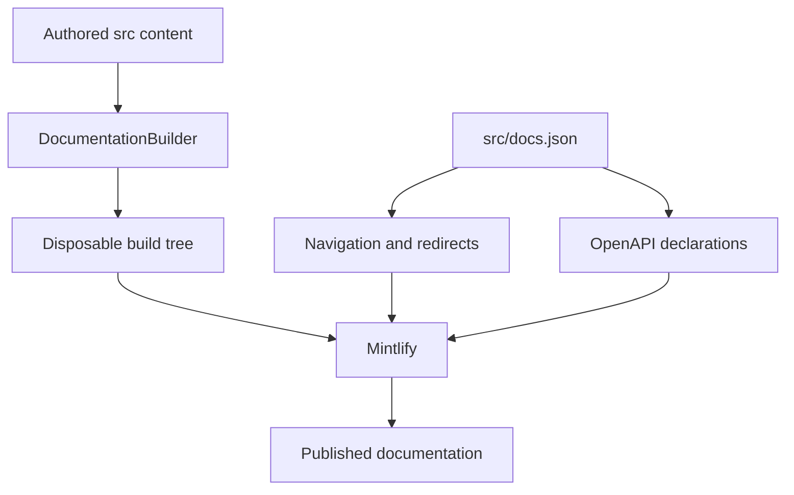

`src/` is the source of record; `build/` is a disposable Mintlify handoff. A public documentation URL is the product of independent ownership planes:

1. **Route emission:** `DocumentationBuilder` chooses an output route and preprocesses authored files.
2. **Navigation and compatibility:** `src/docs.json` explicitly owns Mintlify menus, ordering, labels, redirects, and OpenAPI declarations.
3. **Deployment-generated API reference:** Mintlify turns declared specifications into endpoint pages during deployment.
4. **External SDK reference:** `reference.langchain.com` is built outside this repository.

The diagram shows separate inputs to the published site. Emitting a page does not put it in navigation, and a deployment-generated endpoint is not authored MDX.

## Source families and emitted routes

A full build clears and recreates `build/`, emits route families, copies shared inputs, then overlays npm snippet components. Do not edit `build/`.

| Authored input | Emitted route family | Important rule |
| --- | --- | --- |
| Shared `src/oss/` content | `/oss/python/...` and `/oss/javascript/...` | Built twice, with language-specific conditional content. |
| `src/oss/python/` and `src/oss/javascript/` | Only the corresponding language tree | The source language directory is removed from the output path. |
| `src/oss/openwiki/` | `/oss/openwiki/...` | Built once using the Python conditional branch. |
| `src/oss/deepagents/code/` | `/oss/deepagents/code/...` | Built once using the Python conditional branch. |
| Ordinary `src/langsmith/` | `/langsmith/...` | Built once using the Python conditional branch. |
| Direct `src/langsmith/managed-deep-agents*.mdx` | `/langsmith/python/...` and `/langsmith/javascript/...` | Excluded from ordinary LangSmith output and rendered for both targets. |
| Root pages, `src/snippets/`, assets, fonts, JS/CSS, and `docs.json` | Source-relative shared output | Supporting input; it does not imply a sidebar entry. |

The builder accepts supported document and asset formats, preprocesses Markdown and MDX, and copies supported non-Markdown files. It converts a `docs.yml` input to JSON and emits `.md` documents as `.mdx`; unsupported files and `TEMPLATE.mdx` are skipped. Whole-tree collection rejects symlinks and regular files resolving outside the collection root, preventing a committed source link from bringing host data into generated artifacts.

### Language and route exceptions

For a normal language render, absolute `/oss/...` links become `/oss/python/...` or `/oss/javascript/...`. Already-qualified links and image paths remain unchanged. The builder also preserves the unversioned `/oss/openwiki` and `/oss/deepagents/code` roots, since those products have only one output.

**OpenWiki** is a single unversioned output, although `docs.json` lists the same routes in both Python and TypeScript Build dropdowns. Those are two navigation references, not two copies of a page. Its overview is authored at `src/oss/openwiki/overview.mdx` and links to other OpenWiki routes without a language prefix.

**Managed Deep Agents** is the inverse. Direct, top-level `langsmith/managed-deep-agents*.mdx` sources produce Python and JavaScript variants; `docs.json` redirects unversioned Managed Deep Agents URLs to the Python route. Change and validate both variants plus the redirects—do not add an unversioned duplicate.

**Deep Agents Code** is another unversioned OSS family, but its navigation belongs under Products and setup rather than the Build language dropdowns.

### Content transformation boundary

Before a Markdown file is written, the pipeline resolves `@[LinkName]` references, adds UTM parameters to eligible LangSmith CTA links, and resolves `:::python` and `:::js` blocks for the target. Escaped conditional delimiters become literal delimiters. On language-targeted pages, unqualified MDX imports from `/snippets/` are redirected to the corresponding `/snippets/python/` or `/snippets/javascript/` Markdown copy; imports already scoped to a language are left untouched.

This makes snippets an input family rather than standalone navigation pages. A language-specific page importing a snippet must be tested in its target output, not solely from the source file.

## `docs.json`: navigation, redirects, and generated reference

`src/docs.json` is an explicit Mintlify configuration and navigation manifest, not a directory scan. It owns menu placement, ordering, redirects, and OpenAPI declarations independently from `DocumentationBuilder`, which emits authored source families into build routes; therefore emitting a source page does not itself add a navigation entry. Product taxonomy need not match the source directory: for example, Build draws from both OSS and LangSmith sources.

Current projections worth checking when changing route families:

- Build has separate Python and TypeScript dropdowns. Their Integration group structures differ, so a component landing page needs explicit placement in the appropriate language menu.
- Shared `src/oss/langchain/mcp/` content emits for both language trees and appears in both Build menus. The JavaScript-specific `src/oss/javascript/migrate/langchain-mcp-adapters.mdx` belongs only to the JavaScript migration route.
- OpenWiki is listed in both Build language dropdowns but remains unversioned output.
- Managed Deep Agents is listed at its language-specific LangSmith routes and has compatibility redirects from legacy unversioned URLs.
- Deep Agents Code is listed at unversioned `/oss/deepagents/code/...` routes in Products and setup.

When a page is added, moved, or renamed, separately decide: its source family and output route, its explicit menu location, and whether incoming URLs require redirects. Updating only one leaves an orphaned page, a broken route, or an invisible page.

### OpenAPI endpoint surfaces

Mintlify generates endpoint pages at deployment from three declared OpenAPI groups. They are neither authored Markdown nor normal local builder output.

| Surface | Input | Configured location |
| --- | --- | --- |
| Agent Server API | Committed `src/langsmith/agent-server-openapi.json` | `langsmith/agent-server-api` |
| Control Plane API | `https://api.host.langchain.com/openapi.json` | Mintlify default location |
| LangSmith REST API | Committed `src/langsmith/langsmith-platform-openapi.json` | `langsmith/smith-api` |

The committed Agent Server and LangSmith REST files are OpenAPI 3.1 specifications. Change a generated endpoint through its specification and `docs.json` declaration, then inspect a hosted deployment; do not create synthetic endpoint MDX. The SDK-reference site is a distinct external build and is not produced by either these declarations or this repository's MDX.

The LangSmith REST specification is a committed, post-processed input: the processor allow-lists the live LangSmith host, hides fleet/internal/health operations, assigns and orders tag groups, and normalizes visible operation titles before writing `src/langsmith/langsmith-platform-openapi.json`. The daily workflow runs that processor, makes no commit when the committed specification is unchanged, and appends changes to an existing `chore/refresh-langsmith-openapi` pull request so only one refresh PR remains open.

## Safe change procedure

1. Begin with the public URL and classify it as authored output, navigation, redirect, deployment-generated OpenAPI reference, or external SDK reference.
2. Put authored content in the source family that owns its desired route. Check both outputs for normal OSS content, but only the unversioned route for OpenWiki and Deep Agents Code.
3. Update `src/docs.json` explicitly for navigation, labels, ordering, redirects, and OpenAPI configuration. A built file is not automatically discoverable.
4. For Managed Deep Agents, check Python and JavaScript output and preserve the unversioned-to-Python compatibility redirects.
5. For Markdown changes with language-aware links, conditionals, or snippets, verify the generated target-specific output rather than assuming source links remain literal.
6. For API reference changes, update the correct OpenAPI input or refresh processor and validate the hosted endpoint surface. Do not confuse it with `reference.langchain.com`.
7. Extend focused builder tests when changing routing, link rewriting, snippet copying, special-family handling, or source-tree safety.

## Related pages

- [Build system](/openwiki/architecture/build-system.md)
- [Versioning](/openwiki/concepts/versioning.md)
- [Mintlify integration](/openwiki/integrations/mintlify.md)
- [Reference docs](/openwiki/integrations/reference-docs.md)
- [Adding pages](/openwiki/operations/adding-pages.md)
- [LangSmith OpenAPI refresh](/openwiki/workflows/langsmith-openapi-refresh.md)
