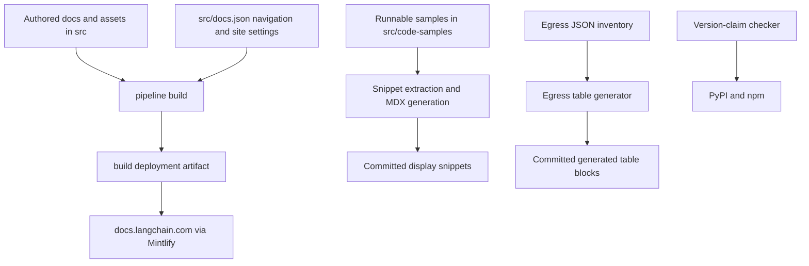

This repository owns the source and build pipeline for `docs.langchain.com`, hosted by Mintlify. It does **not** build `reference.langchain.com`: that API reference site is generated and deployed outside this repository. The central safe-change rule is to identify the durable owner first. `src/` and configuration or metadata inputs are source; `build/` and explicitly generated documentation are outputs that must not be edited.



*Authored inputs, regenerated committed content, and navigation converge in the disposable deployment artifact; external registries and the external API-reference site remain outside that build.*

## Durable ownership boundaries

| Concern | Durable owner | Safe change boundary |
| --- | --- | --- |
| Documentation prose, page frontmatter, reusable MDX, assets, and executable examples | `src/` | Edit the owning source. `src/langsmith/` owns LangSmith material, `src/oss/` owns open-source product material, `src/snippets/` owns reusable MDX, and `src/code-samples/` owns executable examples. |
| Navigation, redirects, Mintlify settings, and OpenAPI declarations | `src/docs.json` | A page addition or move needs a deliberate navigation and redirect decision; directory layout is not the navigation model. |
| Package registry metadata and integration presentation inputs | `packages.yml` plus the scripts and pipeline tools that consume it | Change package metadata at the registry; regenerate download, partner-package, or integration tables rather than hand-editing their generated content. |
| Route shaping, preprocessing, language variants, and copied build content | `pipeline/` | Change implementation and its focused tests together, then rebuild. |
| Deployment output | `build/` | Regenerate with `make build` or `make dev`; never patch it. |
| Agent-wide editing invariants | `AGENTS.md` | Keep its derived instruction copies synchronized when changing the sections it identifies. |
| Task-specific agent procedures | `.agents/skills/<name>/SKILL.md` | Add or revise the skill at this canonical path; run `make skills` for Claude Code's local symlink view. |
| Automation, validations, and scheduled maintenance | `scripts/`, `Makefile`, `.github/workflows/`, and their focused tests | Treat script, workflow, input data, and test as one operational contract. |
| Release-watch service | `docs-release-watch/` | It is separately deployed with `uv run mda deploy`, not an input to the Mintlify build. |

The repository has two distinct documentation surfaces. The local pipeline emits the Mintlify site from `src/` to `build/`. `reference.langchain.com` is generated and deployed elsewhere; this repository provides an issue-routing path for defects in that external service, but has no reference build output to modify. Do not edit generated endpoint pages or any other generated deployment output; change their OpenAPI or upstream input instead.

## Source, navigation, and build control flow

`src/docs.json` is more than a page list: it supplies site configuration and product/menu navigation. Product labels deliberately do not mirror source directories—for example, lifecycle menus draw from both `src/oss/` and `src/langsmith/`. `src/index.mdx` is the home page, while the reader-facing lifecycle and product menus are defined under `navigation.products` in `docs.json`. Therefore source directory determines content ownership, while `docs.json` determines reader-facing placement. Adding a source page without registering it there does not make it discoverable.

The `docs` console entrypoint routes `build` and `dev` to the pipeline. A full `DocumentationBuilder.build_all()` deletes and recreates `build/`, produces Python and JavaScript OSS variants, emits the unversioned Deep Agents Code and OpenWiki surfaces once, builds LangSmith content and Managed Deep Agents language variants, then copies shared configuration and assets. The builder preprocesses Markdown before writing it, including language-specific snippet-import and link rewriting. This makes `build/` a reproducible artifact rather than a co-owned editing surface.

Use the repository entrypoints rather than calling Mintlify from the source root:

```bash
make build
make dev
make test
make broken-links-with-anchors
```

The Make targets run the Python pipeline and run Mintlify link validation from `build/`; the checked link command also asks Mintlify to validate redirects. `make test` runs the Python suite with sockets disabled except for Unix sockets. Publication is separate from CI: a push to `main` builds, verifies that `build/` exists, stages it below `public/build`, and publishes that directory to the `prod` branch.

## Generated and committed-source boundaries

Some files under `src/` are committed so that they can be reviewed and deployed, but must be regenerated from a different durable input. Do not hand-edit the generated side of any of these relationships.

### Runnable examples to display snippets

`src/code-samples/` is the owner of runnable example programs. `make test-code-samples` runs them; `make code-snippets` first extracts marked regions into `src/code-samples-generated/`, then renders imported MDX into `src/snippets/code-samples/`. The intermediate directory is ignored, while the rendered MDX is committed. Edit and test the program, then regenerate and commit the rendered snippets; do not edit either output manually.

The extractor recognizes `:snippet-start:`/`:snippet-end:` markers in Python, TypeScript, Java, Kotlin, Go, and shell files, plus removal markers and optional code-group metadata. It fails rather than silently producing a partial sample when a removal or snippet marker is unclosed. The sample harness can run concurrently, but serializes samples that share datasets, experiments, prompts, or other fixtures; tracing is opt-in through `CODE_SAMPLE_TRACING=1`.

### Egress address inventory to documentation tables

`src/langsmith/egress-ip-addresses.json` is the durable inventory for public egress addresses. The generator writes its deterministic version and replaces marked table blocks in `src/langsmith/cloud.mdx` and `src/langsmith/cloud-platform-features.mdx`. It accepts only schema version 1 with distinct public IPv4 `/32` records in its closed service/cloud/region schema, computes a SHA-256 version from canonical addresses, and makes `--check` fail on inventory-version or table drift.

```bash
uv run python scripts/generate_egress_ip_tables.py
uv run python scripts/generate_egress_ip_tables.py --check
```

Commit the JSON inventory and both regenerated pages together. The focused tests exercise malformed or duplicate records, check-mode drift, and byte-for-byte publication of the unversioned JSON artifact.

### Package metadata and integration tables

`packages.yml` is a metadata registry, not the API-reference source. Its package rows carry names, repositories, provider-page and JavaScript-package mappings, integration/highlight/reference-doc flags, and machine-maintained download timestamps. The weekly download workflow refreshes stale counts, regenerates the partner package table and integration download snippets, and uploads those files as an artifact. The package registry and its consumers therefore form one maintenance boundary: change the YAML or generator policy, then regenerate the derived MDX.

### OpenAPI and deployment-generated endpoint pages

Mintlify generates endpoint pages from OpenAPI declarations at deployment time. Those endpoints are neither authored MDX nor local pipeline output. The committed `src/langsmith/langsmith-platform-openapi.json` is itself refreshed by a scheduled processor workflow; update the processor policy or refreshed input rather than deployment-generated endpoint pages. `make check-openapi` validates the Agent Server specification after a build.

## Agent skills and release automation

`AGENTS.md` owns always-applicable rules for manually authored documentation: do not edit `build/`, update `src/docs.json` when adding a page, use valid frontmatter and supported icons, and test examples. It also identifies instruction files derived from selected sections; changing those sections requires updating their copies in the same pull request.

`.agents/skills/` complements that always-on context with opt-in, task-specific procedures. Each skill is a directory containing `SKILL.md` in the Agent Skills format. Most supported agents consume that path directly. Claude Code instead needs `make skills`, which symlinks skill directories into the ignored `.claude/skills/` tree; the target is intended to be rerun after a skill change or in a new worktree. Skills should link to `AGENTS.md` for shared invariants instead of duplicating them.

`docs-release-watch/` is a Managed Deep Agent deployed independently of the site. Its product registry joins an upstream repository, release tag prefix, source-path scope, documentation boundary, language scope, and durable agent-memory location. For eligible releases published 7–30 days earlier, its read-only research phase compares tagged source differences to current docs; the shipping agent can then create one Linear DOC ticket and one draft documentation PR per evidenced feature. Add coverage by changing the product registry, adding the matching product skill, adding a schedule prompt, and redeploying. Draft PRs remain subject to human review.

## Verification and external-data checks

Tests are ownership checks, not a substitute source of truth. `tests/unit_tests/` includes focused coverage for pipeline behavior and maintenance scripts; add a focused test when changing a builder transformation, validator, or generator invariant. The Makefile collects standard build, lint, test, sample, snippet, cross-reference, and link-validation entrypoints; workflows apply those checks and run scheduled maintenance.

Version text in documentation has a special external boundary. `scripts/check_version_claims.py` finds `>=` and `==` specifiers in MDX and chooses PyPI or npm from package syntax, nearby labels, conditional language fences, language-bearing paths, and defaults. It queries registries concurrently, reports inaccessible registries as unresolved, and fails ordinary runs only when a successful release lookup proves that the named version does not exist. It does not select or bump version floors: that remains an authoring decision.

The pull-request version workflow computes changed `src` MDX files from the merge base and checks only those pages. The scheduled external-version sweep checks all pages using `--advisory-only`, writes the report to the job summary, and does not fail simply because a scheduled sweep finds stale text or a registry is unavailable. Keep intentionally unresolvable examples in the documented ignore configuration; otherwise correct the page.

## Safe-change checklist

1. **Page or route change:** edit the owner in `src/`, update `src/docs.json`, and add or preserve redirects as needed.
2. **Build behavior change:** modify `pipeline/`, add focused tests under `tests/`, rebuild, and run the appropriate link check.
3. **Code sample change:** modify and test `src/code-samples/`, run `make code-snippets`, and commit regenerated display MDX—not `src/code-samples-generated/`.
4. **Egress change:** edit the JSON inventory, run the egress generator, commit its generated table blocks, and run check mode.
5. **Package or integration metadata change:** edit `packages.yml` or the owning generator, run the relevant download/table maintenance commands, and review generated MDX together.
6. **OpenAPI change:** update the specification or processor/workflow boundary; do not author Mintlify-generated endpoint pages.
7. **Skill or agent procedure change:** decide whether it is a global invariant (`AGENTS.md`) or opt-in procedure (`.agents/skills/`), maintain required mirrors, and rerun `make skills` locally if using Claude Code.
8. **Release-watch coverage change:** update registry, product skill, and schedule together, then run `uv run mda deploy` from `docs-release-watch/`.

## Related pages

- [Build system](/openwiki/architecture/build-system.md)
- [Versioning](/openwiki/concepts/versioning.md)
- [Mintlify integration](/openwiki/integrations/mintlify.md)
- [Agent skills](/openwiki/operations/agent-skills.md)
