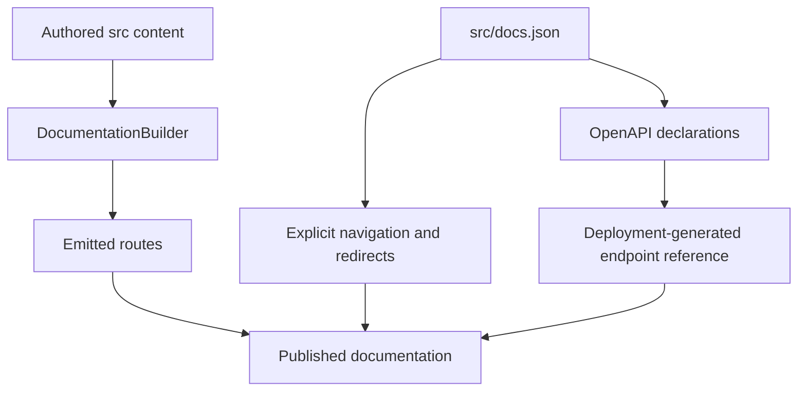

`src/` is authored input, not the published-site hierarchy. Four independent ownership planes determine what readers see:

1. **Route emission:** `DocumentationBuilder` preprocesses and writes disposable build routes.
2. **Navigation and compatibility:** `src/docs.json` explicitly defines Mintlify menu placement, labels, ordering, redirects, and OpenAPI declarations.
3. **Deployment-generated reference:** Mintlify turns declared OpenAPI specifications into endpoint pages during deployment.
4. **Product taxonomy:** authored MDX can be presented under a product label unrelated to its directory.

The inputs are intentionally independent: emitting MDX does not make it navigable, and a generated endpoint page is not authored MDX. Do not treat `build/` as durable source.

## Route-emission ownership

A full build deletes and recreates the build directory, emits Python and JavaScript OSS trees, emits the unversioned and Managed Deep Agents exceptions, then copies shared inputs. Markdown is preprocessed; supported non-Markdown files are copied. During collection, the builder rejects source-tree symlinks and files resolving outside the requested root, preventing committed links from adding host data to build artifacts.

| Authored family | Emitted route family | Change implication |
| --- | --- | --- |
| Shared `src/oss/` content, including Deep Agents except Code | `/oss/python/...` and `/oss/javascript/...` | Both language outputs must be considered; conditional content is selected per target. |
| `src/oss/python/` or `src/oss/javascript/` | Only the matching language tree | The authored language directory is removed from the emitted path. |
| `src/oss/openwiki/` | `/oss/openwiki/...` | One unversioned family, rendered with the Python branch. |
| `src/oss/deepagents/code/` | `/oss/deepagents/code/...` | One unversioned family, rendered with the Python branch. |
| Ordinary `src/langsmith/` | `/langsmith/...` | One unversioned family, rendered with the Python branch. |
| Direct `src/langsmith/managed-deep-agents*.mdx` | `/langsmith/python/...` and `/langsmith/javascript/...` | These are excluded from ordinary LangSmith output and rendered for both language targets. |
| `src/index.mdx`, `src/snippets/`, images, fonts, `docs.json`, JS, and CSS | Shared build inputs | They support the site but do not imply sidebar placement. |

Preprocessing scopes unqualified MDX snippet imports under `/snippets/python/` or `/snippets/javascript/` and rewrites eligible `/oss/` links. Images, already-qualified links, and the unversioned OpenWiki and Deep Agents Code roots stay unprefixed.

### Important exceptions

**OpenWiki** and **Deep Agents Code** each have one unversioned OSS output. `docs.json` can reference an OpenWiki route from both Build language dropdowns; those are two menu references, not two emitted pages. Deep Agents Code is instead a Products and setup item.

**Managed Deep Agents** is the inverse: direct `langsmith/managed-deep-agents*.mdx` sources emit Python and JavaScript variants. The unversioned Managed Deep Agents URLs are compatibility redirects to Python; do not add an unversioned MDX duplicate. Verify both variants and redirects after changing this family.

## `docs.json`: explicit navigation, redirects, and API declarations

`src/docs.json` is navigation configuration, not a directory scan. It independently owns Mintlify navigation, redirects, and OpenAPI declarations, while `DocumentationBuilder` emits routes. A route may be built but unlisted; a redirect is a compatibility rule rather than content. Adding or moving `index.mdx` does not establish reader-facing placement.

### Build navigation

The Python and TypeScript Build integration menus use different group structures, so component landing pages require explicit language-qualified placement. Shared `src/oss/langchain/mcp/` emits for both language trees and is listed in both Build menus. The JavaScript-specific `src/oss/javascript/migrate/langchain-mcp-adapters.mdx` is emitted and navigated only at the JavaScript migration route.

### LangSmith and product projections

Ordinary `src/langsmith/` output is unversioned even when the product menu label is different. This mapping is public taxonomy, not a reason to relocate authored files.

| Authored route cluster | Current explicit projection |
| --- | --- |
| `langsmith/application-structure` | Deploy → Agent Server → **Develop your application** |
| `langsmith/sandboxes` and managed sandbox usage pages | Deploy → **Sandboxes** tab |
| `langsmith/enable-self-hosted-sandboxes` plus architecture, scaling, operations, and egress proxy | Products and setup → LangSmith setup → self-hosted → Additional features → **Enable Sandboxes** |
| `langsmith/self-host-smithdb*.mdx` | Self-hosted **SmithDB** group |
| `langsmith/llm-gateway*.mdx` | Products and setup → **LLM Gateway**: Get started, Core capabilities, Administration and governance, and Advanced |
| `langsmith/fleet/` | Products and setup → **No-code agents** |
| `langsmith/engine*.mdx` | Products and setup → **Engine**, including a self-hosted subgroup |
| `langsmith/agents.mdx` and related environment, navigation, creation, UI, and deployment pages | Products and setup → LangSmith setup → Overview → **Agent-based workspaces** (Beta) |
| `langsmith/managed-deep-agents*.mdx` | Build → language-specific **Managed Deep Agents** tabs |
| `oss/deepagents/code/` | Products and setup → **Deep Agents Code**, with `configuration` as an expanded root and its configuration children |

### Deployment-generated API reference

The Agent Server, Control Plane, and LangSmith REST OpenAPI declarations generate endpoint pages at deployment; they are separate from authored MDX and do not exist as local builder output. Authored overview/reference landing pages remain ordinary routes.

| Surface | Specification input | Generated route location |
| --- | --- | --- |
| Agent Server API | Committed `src/langsmith/agent-server-openapi.json` | `langsmith/agent-server-api` |
| Control Plane API | `https://api.host.langchain.com/openapi.json` | `/api-reference/` |
| LangSmith REST API | Committed `src/langsmith/langsmith-platform-openapi.json` | `langsmith/smith-api` |

The LangSmith REST specification is a committed, post-processed publication input. `scripts/process_langsmith_openapi.py` allow-lists its live host, hides Fleet/internal/health operations, assigns and orders tag groups, and normalizes visible operation titles. The daily refresh runs that processor, exits without a commit when the specification is unchanged, and appends changes to the standing `chore/refresh-langsmith-openapi` pull request.

Do not confuse these OpenAPI endpoint references with the external SDK-reference site: the latter is a separate site and is not produced from the deployed Mintlify OpenAPI declarations or authored MDX in this repository.

## Snippets, runnable samples, and generated artifacts

`src/snippets/` is authored reusable MDX and component input, rather than a page family selected by `docs.json`. The builder copies it as shared input, emits Markdown snippets at their source-relative path plus Python and JavaScript copies, and rewrites unqualified MDX imports in language-targeted pages to the matching copy. Keep an import intended to vary by language in the `from '/snippets/...'` form; JSX and TSX snippet components remain shared. Snippets have no contribution footer because they are embedded in another page.

`src/code-samples/` has a different owner and lifecycle. It holds executable example programs; it is not a `DocumentationBuilder` route family and is not selected by a navigation entry. `make test-code-samples` tests the source, and `make code-snippets` extracts marked regions through the ignored `src/code-samples-generated/` intermediate into generated MDX in `src/snippets/code-samples/`. Edit and test the executable source, then regenerate and review the snippet output; do not hand-edit either derived layer.

| Intended change | Durable owner(s) that change together | Do not edit |
| --- | --- | --- |
| New or moved authored page | The selected `src/` MDX file and its explicit `src/docs.json` menu entry; redirects when a public URL changes | `build/` |
| Shared OSS content | One `src/oss/` page, both language menu entries, and both rendered routes | Two copied source pages or a language prefix on an OpenWiki/Deep Agents Code route |
| Managed Deep Agents page | Direct `src/langsmith/managed-deep-agents*.mdx`, both language menu routes, and compatibility redirects when applicable | An unversioned duplicate MDX page |
| Reusable prose or UI fragment | `src/snippets/` source and consuming imports | Generated snippet copies in `build/` |
| Runnable displayed example | `src/code-samples/` program, shared language dependency metadata if changed, and regenerated `src/snippets/code-samples/` output | `src/code-samples-generated/` or generated snippet MDX by hand |
| LangSmith REST API reference | Processor or its upstream policy, committed spec, and OpenAPI declaration as appropriate | Deployment-generated endpoint MDX |

## Product and operational boundaries represented by source families

### Agent Server and deployment planes

`application-structure.mdx` defines the deployable application contract: graph implementation, `langgraph.json`, dependency definition, and optional `.env`. A single configuration can name multiple graph IDs sharing a deployment's dependencies, environment, and image; Agent Server creates a default assistant for each graph.

The control plane stores Agent Server deployment desired state. The data-plane listener polls control-plane APIs and reconciles deployments, revisions, and deletion; the control plane never directly connects to the data plane. These are ordinary unversioned LangSmith pages, even though their subject is operational architecture.

### Gateway, Sandboxes, and SmithDB

LLM Gateway authenticates and authorizes a call, resolves its route and credential, enforces governance policy, translates formats when needed, invokes the provider, and records trace and usage metadata. Direct model access retains authentication, credential resolution, policy enforcement, and tracing but skips translation. Gateway Credits use LangChain-hosted models through the standard gateway with a LangSmith API key and no provider secret; provider-prefixed model IDs use configured bring-your-own-provider secrets.

Keep similarly named sandbox sources distinct:

- **LangSmith Sandboxes** are managed isolated resources. Restricted egress applies by default to non-Enterprise organizations and organizations that request it; the managed allowlist still blocks destinations merely named in proxy configuration.
- **Managed Deep Agents sandboxes** use LangSmith Sandboxes. A `sandbox/` declaration enables the managed capability and reuse is one sandbox per durable thread.
- **Deep Agents Code remote sandboxes** retain the local `dcode` LLM loop, memory, and tool dispatch, while filesystem and command tools execute remotely.
- **Self-hosted Sandboxes** use Firecracker microVMs managed by `sandbox-host` pods on dedicated KVM-capable Kubernetes nodes. Shared storage makes persistent state independent of a particular node.

SmithDB is an opt-in columnar trace datastore for self-hosted LangSmith, using object storage and per-pod disk cache and able to serve alongside ClickHouse. Its rollout is service deployment, dual ingestion, optional historical migration, and query cutover. Dual ingestion alone does not enable SmithDB-gated features: queries must use SmithDB.

### Managed Deep Agents and Deep Agents Code

Managed Deep Agents runs the OSS Deep Agents harness but moves compilation and managed infrastructure to the `mda` CLI and runtime. Runtime server information carries verified caller identity; client-provided context is not an authorization source. `mda deploy` compiles the project into a managed LangGraph app, synchronizes deploy-owned context to Context Hub, uploads compiled source, and triggers a hosted Agent Server deployment with its API and MCP endpoint. It routes instructions and skills to deploy-owned context, non-reserved `.env` values to hosted secrets without archiving them, source to a `.mda/build` archive, and schedules to LangSmith cron jobs after deployment. CI needs a target-region API key because it cannot use browser sign-in.

Deep Agents Code is an unversioned terminal-agent documentation cluster. General settings resolve, in order, from administrator-managed `managed_config.toml`, `DEEPAGENTS_CODE_` overrides, canonical environment variables where applicable, user `config.toml`, then defaults. Its profile root is a trust boundary: `DEEPAGENTS_HOME` is captured before dotenv loading, so a project dotenv cannot relocate it.

### OSS state concepts

LangGraph checkpointers persist graph state per thread, while stores hold application-defined key-value data across threads; Agent Server handles both when hosting a graph. Deep Agents long-term memory is filesystem-backed, with the backend determining storage and access; short-term conversation memory is thread-scoped state.

## Safe change procedure

1. Start from the public URL and classify it as emitted MDX, navigation, redirect, deployment-generated OpenAPI reference, or external SDK-reference content.
2. For ordinary OSS content, check both Python and JavaScript output. For OpenWiki and Deep Agents Code, check the one unversioned output and preserve unprefixed links.
3. Update `src/docs.json` explicitly for labels, ordering, placement, redirects, and OpenAPI declarations. Builder output does not imply any of them.
4. For Managed Deep Agents, check both language outputs plus the unversioned-to-Python redirects.
5. Keep LangSmith source in `src/langsmith/`; use `docs.json` to project it into Gateway, No-code agents, Engine, Sandboxes, or self-hosted taxonomy.
6. Change an endpoint reference through its OpenAPI input and declaration, never by creating generated endpoint MDX. Review the processor and refresh workflow for LangSmith REST changes.
7. For a displayed runnable example, modify and test `src/code-samples/`, then regenerate `src/snippets/code-samples/`; neither generated snippets nor the intermediate are authoritative.
8. Extend focused `tests/unit_tests/test_builder.py` coverage for source-family routing, preprocessing, special-family behavior, or source-tree safety changes.

## Related pages

- [Build system](/openwiki/architecture/build-system.md)
- [Versioning](/openwiki/concepts/versioning.md)
- [Reference docs](/openwiki/integrations/reference-docs.md)
- [Adding pages](/openwiki/operations/adding-pages.md)
- [Quickstart](/openwiki/quickstart.md)
- [Code sample lifecycle](/openwiki/workflows/code-sample-lifecycle.md)
- [Versioned content](/openwiki/workflows/versioned-content.md)
