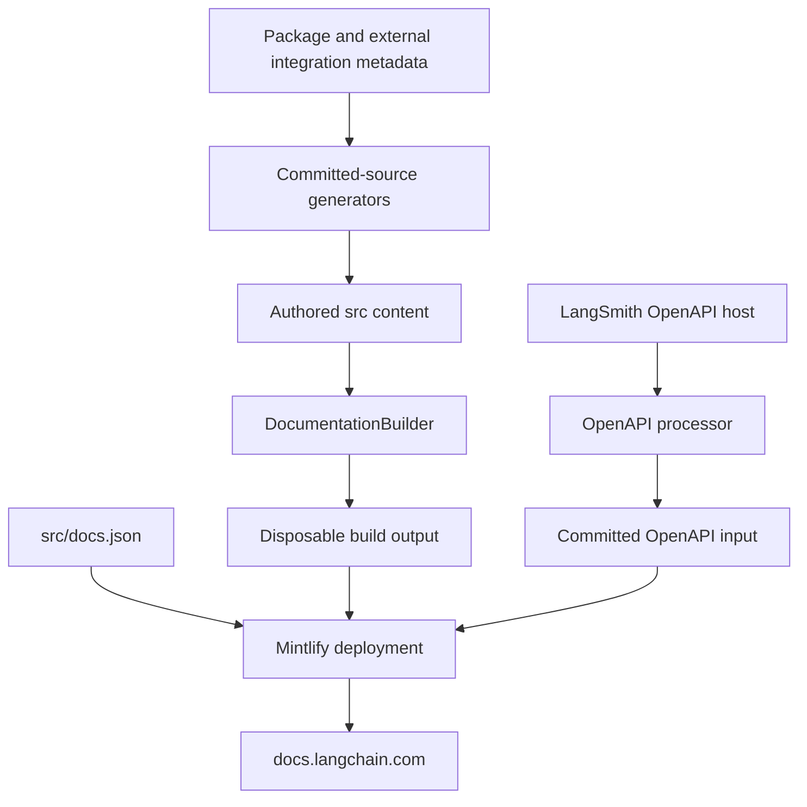

This repository builds the Mintlify site at `docs.langchain.com`; `reference.langchain.com` is generated and deployed outside this repository. The primary maintenance boundary is input versus output: `src/` is documentation input, `src/docs.json` is the Mintlify site contract, and `build/` is disposable deployment output. Never edit `build/`.

The diagram distinguishes authored and generated-but-committed inputs from disposable build output and deployment-time OpenAPI pages.

## Ownership boundaries

| Concern | Durable owner | Safe change boundary |
| --- | --- | --- |
| Product prose and frontmatter | `src/langsmith/` and `src/oss/` | Edit the source MDX and navigation deliberately. |
| Shared snippets, assets, fonts, UI fragments | `src/snippets/`, `src/images/`, `src/fonts/`, and shared source files | Edit source, then rebuild; snippets may have language-specific build copies. |
| Navigation, redirects, site settings, and OpenAPI declarations | `src/docs.json` | Make an explicit configuration change in addition to adding or emitting a page. |
| Route construction and content transformation | `pipeline/` | Change the builder or preprocessors with focused tests. |
| Runnable examples and displayed fragments | `src/code-samples/` | Test the program and regenerate snippets; do not edit derived output. |
| Package catalogue and provider overview | `packages.yml` and its generator | Change metadata or generator, then regenerate. |
| Third-party integration listing rows | `scripts/data/integration_external_docs.yaml` | Maintain external listing data, not generated MDX rows. |
| LangSmith REST reference input | `src/langsmith/langsmith-platform-openapi.json` and its processor | Change processing policy or refresh the committed input, not endpoint MDX. |
| Deployment artifact | `build/` | Regenerate only. |
| Verification, publication, and scheduled upkeep | `tests/`, `Makefile`, `.github/workflows/`, and automation scripts | Change the invariant owner and relevant test or workflow. |

## Routes, navigation, and authored source

`DocumentationBuilder.build_all()` deletes and recreates `build/`, builds OSS content for Python and JavaScript, builds unversioned Deep Agents Code and OpenWiki content, builds LangSmith content, creates Managed Deep Agents variants, and then copies shared files. Regular `src/oss/` content therefore produces `oss/python/` and `oss/javascript/` routes. `src/oss/openwiki/` and `src/oss/deepagents/code/` are intentional exceptions: each emits once at an unversioned OSS path and resolves conditional language blocks using Python.

Managed Deep Agents is a different exception. Files named `src/langsmith/managed-deep-agents*.mdx`, including the identity and custom-frontend guides, emit Python and JavaScript route variants only. The unversioned Managed Deep Agents URLs redirect to Python, so the builder does not create orphaned third copies. `src/docs.json` lists the OpenWiki routes in both Build-language dropdowns even though the route itself is shared.

`src/docs.json` independently owns Mintlify navigation, redirects, site settings, and the OpenAPI declarations. Builder output alone does not make a new page navigable. When adding or moving a page, update the appropriate product, menu, language dropdown, tab, and group there; preserve a redirect when an existing public URL must remain valid. Product labels do not necessarily follow source directory names, so locate authored content by its `src/` family rather than the navigation label.

## Build transformations and invariants

Before writing Markdown or MDX, the pipeline resolves `@[...]` references, adds UTM parameters to eligible LangSmith CTA links, and selects only the target `:::python` or `:::js` block. It preserves unsupported conditional labels. Scoped entries in `pipeline/preprocessors/link_map.py` are the authority for `@[...]` targets; an unknown symbol is logged and left literal rather than receiving a guessed URL.

Shared MDX snippets are copied at their source-relative path plus Python and JavaScript copies. Imports in language-targeted MDX are rewritten to the corresponding copy; JSX and TSX snippet components stay shared. This supports snippets imported by pages at different nesting depths without relying on fragile relative links.

Source collection is containment-safe: the builder skips every source-tree symlink and rejects a source file whose resolved path escapes the collection root. Preserve that behavior when adding a collection or traversal, because it prevents host files from entering deployment output.

## API reference boundaries

Do not conflate these independent surfaces:

- `reference.langchain.com` is outside this repository's build and deployment ownership.
- Mintlify reads Agent Server, Control Plane, and LangSmith REST OpenAPI configuration from `src/docs.json`, then generates endpoint pages at deployment. Those endpoints are neither authored MDX nor `DocumentationBuilder` output.
- `src/langsmith/langsmith-platform-openapi.json` is a committed, generated-but-reviewed input for the LangSmith REST surface.

`scripts/process_langsmith_openapi.py` accepts local input or fetches only its allow-listed LangSmith host. It hides fleet, internal, and health operations; assigns and orders human-readable tag groups; and normalizes visible operation titles before writing the committed specification. The daily refresh workflow does nothing when that file is unchanged. Otherwise it creates or appends to the one open `chore/refresh-langsmith-openapi` pull request.

## Examples and generated documentation

`src/code-samples/` contains executable documentation programs rather than page-collection content. For example, `deepagents/rag-deep.py` marks extractable regions with snippet markers while retaining test-only setup and assertions outside the rendered fragments. `make test-code-samples` executes samples. `make code-snippets` extracts marked regions into `src/code-samples-generated/` and renders the committed MDX imports under `src/snippets/code-samples/`. Edit and test the program first; do not hand-edit either derived layer.

`packages.yml` is the package metadata source for generated integration surfaces. The partner-package generator writes the Python provider overview, and CI regenerates it to reject manual drift. The weekly download workflow refreshes package metadata, regenerates the provider overview and integration download and featured snippets, and opens a PR only when tracked output changes.

Integration download tables also combine hosted integration-page frontmatter with `scripts/data/integration_external_docs.yaml`. An external row's name links to its validated `docs_url`, not to a hosted guide. The URL check accepts `https://`, `http://`, or a single-slash site-relative path, and rejects protocol-relative and unsafe schemes.

The weekly integration-repository checker runs with `--write` and maintains the standing draft PR on `chore/dead-integration-repos`. For a dead third-party GitHub home, it can adopt a live third-party GitHub replacement evidenced by PyPI, npm, or external documentation. Live GitLab, partner-documentation, and first-party alternatives remain attention cases; only packages without a live alternate are delisted, with associated external rows, unshared provider cards, and generated download rows removed.

## Local operation, verification, and publication

The `docs` console script exposes the pipeline CLI. `docs dev` builds first unless `--skip-build` is selected, watches `src/`, and serves `build/` through `mint dev`; a failed initial build prevents server startup.

Main CI invokes reusable test, lint, and link-validation workflows, cancels an older run for the same workflow and ref on a newer push, and separately checks merge-conflict markers, cross-references, external integration URL schemes, and generated files. The link workflow builds the site, validates links with anchors, and checks the Agent Server OpenAPI specification.

Publication is separate: a push to `main` builds the output, verifies `build/`, nests it below `public/build`, and publishes that directory to the `prod` branch. This lifecycle is why `build/` must be reproducible and disposable.

## Change guide

1. **Add or move content:** edit the appropriate source MDX, update `src/docs.json`, and add a redirect for a retained public URL.
2. **Change routes, language rendering, links, or snippets:** modify `pipeline/`, preserve symlink containment, add focused coverage, and rebuild.
3. **Change a runnable example:** edit and test `src/code-samples/`, run `make code-snippets`, and commit rendered snippet MDX rather than the intermediate.
4. **Change integration discovery:** choose `packages.yml`, hosted-page frontmatter, or `integration_external_docs.yaml` according to ownership, then regenerate output.
5. **Change API reference behavior:** change `src/docs.json`, the committed specification, or `process_langsmith_openapi.py`; never author Mintlify-generated endpoint MDX.
6. **Repair an API symbol cross-reference:** update the correct scoped `link_map.py` entry and verify preprocessing instead of modifying build output.
7. **Change maintenance automation:** update the workflow, script, and tests together, retaining the standing-PR behavior for OpenAPI and dead-integration maintenance.

## Related pages

- [Versioning](/openwiki/concepts/versioning.md)
- [Mintlify](/openwiki/integrations/mintlify.md)
- [Quickstart](/openwiki/quickstart.md)
- [Code sample lifecycle](/openwiki/workflows/code-sample-lifecycle.md)
- [Integration listing automation](/openwiki/workflows/integration-listing-automation.md)
- [Versioned content](/openwiki/workflows/versioned-content.md)
