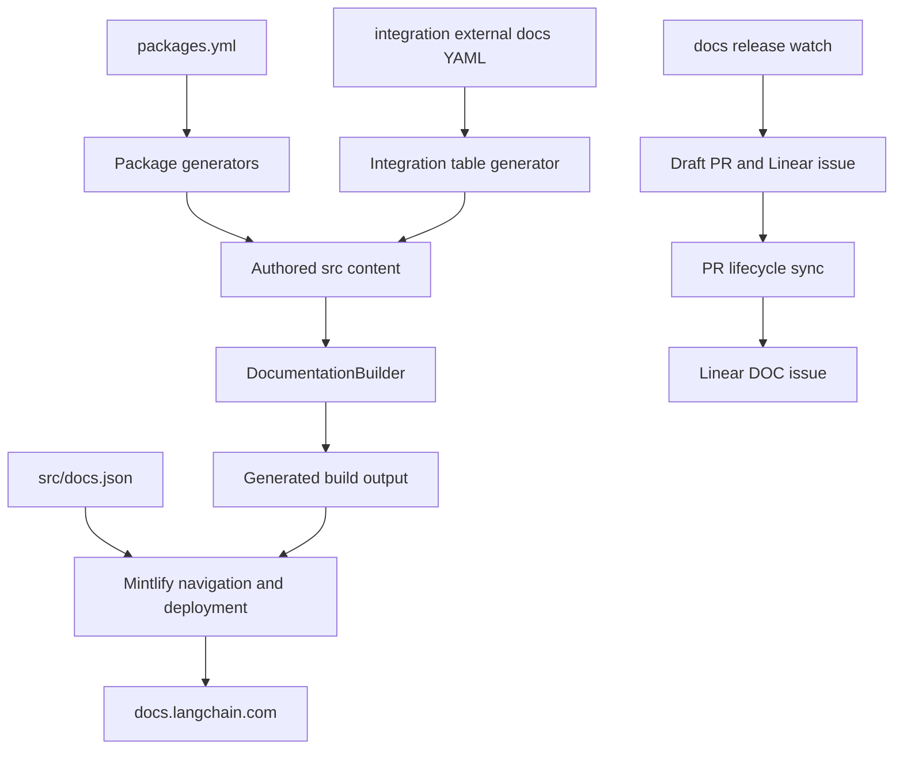

This repository produces the Mintlify site at `docs.langchain.com`; it does not own the separately generated `reference.langchain.com` site. The important boundary is between durable inputs and their outputs: `src/` is primarily authored documentation, `src/docs.json` is Mintlify configuration, and `build/` is disposable deployment output. Do not edit `build/`.

This flow separates authored input, generated committed source, deployment-generated reference pages, and externally owned information. The PR-to-Linear path is operational automation, not part of the documentation build.

## Ownership boundaries

| Concern | Durable owner | Produced or controlled surface | Safe change boundary |
| --- | --- | --- | --- |
| Documentation prose, page frontmatter, assets, components, and runnable examples | `src/` | Content copied or transformed into the site | Edit source, never `build/`. |
| Navigation, redirects, site settings, and OpenAPI declarations | `src/docs.json` | Mintlify menus, compatibility routes, and endpoint-reference configuration | A new page needs both source content and an explicit navigation decision. |
| Routes and MDX transformation | `pipeline/` | Language-specific and unversioned build paths | Change with focused pipeline tests and preserve traversal safety. |
| Deployment artifact | `build/` | The files published beneath `prod` | Regenerate locally or in CI; it is deleted and recreated on every full build. |
| Package catalogue | `packages.yml` | Provider overview and package-linked integration presentation | Change metadata or its generator, then regenerate derived files. |
| Third-party integration listing data | `scripts/data/integration_external_docs.yaml` | Rows in generated download tables that point away from the hosted site | Maintain validated external URLs and capabilities here; do not treat the generated MDX row as source. |
| Public LangSmith API input | `src/langsmith/langsmith-platform-openapi.json` plus its processor | Deployment-generated Mintlify endpoint pages | Change the processor policy or refresh input, not endpoint MDX. |
| Release-watch agent | `docs-release-watch/` | Evidence-gated draft PRs and Linear DOC issues | Update registry, skills, tools, schedules, then redeploy the separate Managed Deep Agent project. |
| Verification and publication | `tests/`, `Makefile`, and `.github/workflows/` | Tests, validation, automation PRs, and the `main` to `prod` publish path | Select the workflow that owns the invariant. |

## Authored pages, configuration, and build routes

`src/` contains LangSmith material in `src/langsmith/`, OSS material in `src/oss/`, reusable fragments and UI in `src/snippets/`, assets, fonts, and executable programs in `src/code-samples/`. It is not a URL mirror. `src/docs.json` independently supplies Mintlify identity, navigation, redirects, and OpenAPI declarations. A builder-emitted page is therefore not automatically discoverable in a menu.

`DocumentationBuilder.build_all()` clears `build/`, emits Python and JavaScript OSS variants, emits the language-agnostic Deep Agents Code and OpenWiki families once, emits LangSmith content, then copies shared inputs including `docs.json`. In particular, normal OSS routes have language prefixes, while `src/oss/openwiki/` and `src/oss/deepagents/code/` are intentionally unversioned and OpenWiki is listed in both Build language dropdowns. Managed Deep Agents source files receive Python and JavaScript variants; unversioned Managed Deep Agents URLs redirect to Python rather than creating a third copy.

Markdown preprocessing resolves `@[...]` references, adds UTM parameters to relevant LangSmith CTA links, and resolves the target-language `:::python` / `:::js` blocks. Markdown snippets are emitted both at their normal source-relative path and as language copies, so a language-targeted MDX import receives a matching preprocessed snippet. JSX and TSX snippet components stay shared. Source traversal rejects symlinks and files resolving outside the collection root; retain that invariant when changing collection or copy logic.

### Generated reference surfaces

There are two kinds of API reference that must not be confused:

- `reference.langchain.com` is externally generated and deployed outside this repository.
- Mintlify generates endpoint pages during deployment for the Agent Server, Control Plane, and LangSmith REST OpenAPI declarations in `src/docs.json`. Those pages are neither authored MDX nor local builder output.

The committed LangSmith REST specification is a generated-but-reviewed repository input. `scripts/process_langsmith_openapi.py` fetches only from its allow-listed live host (or reads a local file), hides internal, fleet, and health operations, groups and orders tags, and normalizes visible operation summaries before writing `src/langsmith/langsmith-platform-openapi.json`. The daily refresh workflow does nothing if that file is unchanged and appends to the standing `chore/refresh-langsmith-openapi` PR when one is open. Change the policy or upstream contract rather than hand-editing the resulting JSON.

## Local development, validation, and publication

The `docs` console script exposes the pipeline CLI. `docs dev` builds first unless explicitly skipped, watches `src/`, and runs `mint dev` against `build/`; an initial build failure prevents startup. `make build` and `make dev` remain the usual wrappers.

CI calls reusable test, lint, and link-validation workflows, then checks cross-references, external integration URL schemes, and generated files. The link workflow builds and validates links with anchors from `build/` and validates the Agent Server OpenAPI specification. The production workflow is distinct: on `main`, it runs `make build`, verifies `build/`, nests it under `public/build`, and publishes it to `prod`.

## Samples and integration metadata lifecycle

`src/code-samples/` is executable source rather than a page collection. `make test-code-samples` runs it. `make code-snippets` extracts marked regions to ignored `src/code-samples-generated/` and renders displayed MDX under `src/snippets/code-samples/`. Edit and test the program, then regenerate; do not hand-edit either derived layer.

`packages.yml` is the source catalogue for package identity, repository, provider mapping, JavaScript counterpart, reference availability, and download metadata. It feeds the generated Python provider overview; CI regenerates that overview and rejects manual edits. The weekly download job updates metadata, regenerates the overview and integration table snippets, and opens a PR only if tracked output changes.

Generated integration tables have a second input plane. `scripts/refresh_integration_downloads.py` reads hosted integration page frontmatter and merges third-party rows from `scripts/data/integration_external_docs.yaml`. The latter is intentionally external-facing metadata: its `docs_url` becomes the name link instead of a hosted guide and must be `https://`, `http://`, or a single-slash site-relative URL. CI invokes `--check-docs-urls`; use the YAML for a third-party integration that does not qualify for a hosted guide, not a manual row in generated snippets.

The Monday repository-liveness job scans third-party GitHub homes in `packages.yml`. When the recorded home is dead, it can adopt a live third-party GitHub replacement evidenced by PyPI, npm, or external docs; it retains live GitLab, partner-documentation, and first-party alternatives for human attention. It delists only when no live alternate remains, then produces its scoped changes in the standing draft PR on `chore/dead-integration-repos`.

## Release watch and Linear handoff

`docs-release-watch/` is a separately deployed Managed Deep Agent project. Its product registry currently separates OpenWiki, Deep Agents Python, Deep Agents Code, and Deep Agents JS by release feed, relevant source paths, documentation scope, language fence scope, and persistent tracking memory. Its research subagent is read-only and must compare an eligible release diff and tagged source with existing docs before the shipping agent can create a Linear issue and draft documentation PR. Its write tools recheck evidence and constrain edits; credentials are held in ignored environment configuration and memory retains tracking URLs rather than secrets.

<!-- openwiki: broken internal link [<issue url>] file "<issue url>" does not exist. Fix the href or restore the target, then delete this comment. -->
A draft PR links its ticket with `Closes [DOC-N](<issue url>)`. `.github/workflows/sync-linear-issue-from-pr.yml` runs only for same-repository PRs, so forks do not receive `LINEAR_API_KEY`; it skips safely when the secret is absent and writes JSON results to the job summary. The script detects linked DOC identifiers in the title or body, resolves the target state against that issue's own team workflow, and changes draft, review-ready, merged, and unmerged-closed PRs to In Progress, In Review, Done, and Canceled respectively. It avoids no-op updates, but fails an intended sync when the team lacks a matching target state. This lets GitHub own lifecycle observation while Linear remains the ticket-state owner.

## Change guide

1. **New or moved page:** edit the appropriate `src/` MDX, update `src/docs.json`, and add a redirect if preserving a public URL.
2. **Route, language, or preprocessing behavior:** change `pipeline/`, preserve symlink containment, add focused tests, and rebuild.
3. **Reusable prose or UI:** edit `src/snippets/`; rely on language-aware snippet imports instead of copied fragments.
4. **Runnable example:** edit and test `src/code-samples/`, run `make code-snippets`, and commit rendered snippet MDX, not the ignored intermediate.
5. **Provider, hosted integration, or external row:** use `packages.yml`, hosted page frontmatter, or `scripts/data/integration_external_docs.yaml` according to ownership; regenerate tables rather than edit their output.
6. **OpenAPI reference:** change `src/docs.json`, the specification, or its processing policy; do not create endpoint MDX for deployment-generated pages.
7. **Release automation or ticket handoff:** change `docs-release-watch/` and deploy it, or change the repository PR-sync workflow/script for lifecycle mapping. Preserve same-repository secret isolation and the `Closes DOC-N` convention.

## Related pages

- [Build system](/openwiki/architecture/build-system.md)
- [Versioning](/openwiki/concepts/versioning.md)
- [GitHub Actions](/openwiki/integrations/github-actions.md)
- [Quickstart](/openwiki/quickstart.md)
- [Integration listing automation](/openwiki/workflows/integration-listing-automation.md)
- [LangSmith OpenAPI refresh](/openwiki/workflows/langsmith-openapi-refresh.md)
- [Release watch](/openwiki/workflows/release-watch.md)
