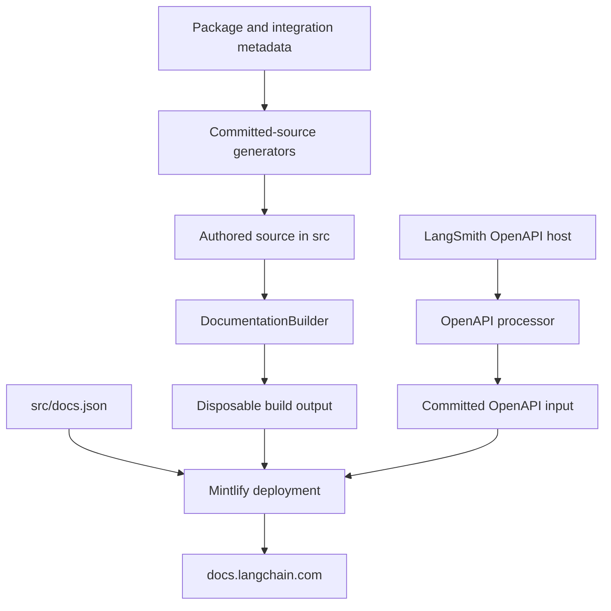

This repository builds the Mintlify site at `docs.langchain.com`; it does not build the separately generated `reference.langchain.com` site. The primary boundary is durable input versus output: `src/` is authored documentation, `src/docs.json` is the Mintlify site contract, and `build/` is disposable deployment output. Never edit `build/`.

This flow distinguishes authored and generated-but-committed inputs from deployment output. Mintlify generates configured OpenAPI endpoint pages during deployment; `reference.langchain.com` is an external build.

## Ownership boundaries

| Concern | Durable owner | Safe change |
| --- | --- | --- |
| Page prose, frontmatter, assets, UI fragments, and runnable examples | `src/` | Edit source, not `build/`. |
| Navigation, redirects, site settings, and OpenAPI declarations | `src/docs.json` | Update navigation deliberately as well as adding a page. |
| Routes and Markdown transformations | `pipeline/` | Change pipeline code with focused tests. |
| Deployment artifact | `build/` | Regenerate; never patch. |
| Package catalogue | `packages.yml` | Change metadata or its generator, then regenerate outputs. |
| External integration rows | `scripts/data/integration_external_docs.yaml` | Change the record, not a generated table row. |
| LangSmith REST specification | `src/langsmith/langsmith-platform-openapi.json` and its processor | Change policy or refresh the committed input, not deployment-generated endpoint MDX. |
| Verification and publication | `tests/`, `Makefile`, and `.github/workflows/` | Change the invariant owner alongside its focused checks. |

## Authored documentation, labels, and routes

`src/` is organized for authoring ownership, **not** as a URL or reader-navigation mirror. For example, LangSmith content is in `src/langsmith/`, OSS content is in `src/oss/`, reusable MDX and components are in `src/snippets/`, images and fonts are shared inputs, and `src/code-samples/` holds runnable programs. Reader-facing product and menu labels deliberately cross those directories: the Build menu includes both OSS and LangSmith content, while Test, Deploy, and Monitor draw from LangSmith. Find the owner by directory; find the reader-facing location in `src/docs.json`.

A page emitted by the builder is not automatically discoverable. `src/docs.json` independently owns menus, redirects, and OpenAPI configuration, so adding or moving a page requires an explicit navigation decision and a redirect when retaining a public URL.

`DocumentationBuilder.build_all()` recreates `build/`, builds Python and JavaScript OSS variants, emits Deep Agents Code and OpenWiki once at unversioned OSS routes, builds LangSmith content, then copies shared files including `docs.json`. Regular OSS pages land under `oss/python/` and `oss/javascript/`. `src/oss/openwiki/` and `src/oss/deepagents/code/` intentionally land only at unversioned paths; the Build navigation lists the OpenWiki paths under both language dropdowns. Managed Deep Agents is a distinct exception: matching `src/langsmith/managed-deep-agents*.mdx` files produce Python and JavaScript routes, while configured unversioned legacy URLs redirect to the Python route.

Source collection is containment-safe: the builder skips source-tree symlinks and files whose resolved path leaves the collection root. Preserve that safeguard when changing traversal or adding a collection.

### Markdown, snippets, and cross-references

Before writing MD or MDX, the builder resolves `@[...]` cross-references, adds UTM parameters to eligible LangSmith CTA links, and selects the target `:::python` or `:::js` content while leaving unsupported conditional labels intact. The scoped entries in `pipeline/preprocessors/link_map.py` are the authority for cross-reference symbols. An unresolved symbol is logged and left literal rather than receiving a guessed URL.

Snippets are shared source but have language-aware Markdown copies: the build writes the source-relative copy plus Python and JavaScript copies, and rewrites language-targeted MDX imports to the corresponding copy. JSX and TSX components stay shared.

## API-reference boundaries

Do not conflate three reference surfaces:

- `reference.langchain.com` is generated and deployed outside this repository. This repository only routes issue reports for it.
- `src/docs.json` declares Agent Server, Control Plane, and LangSmith REST OpenAPI sources. Mintlify creates their endpoint pages during deployment; they are neither authored MDX nor builder output.
- `src/langsmith/langsmith-platform-openapi.json` is a generated-but-reviewed committed input. Its processor fetches only an allow-listed LangSmith host (or reads a local input), hides fleet/internal and configured health operations, assigns and orders tag groups, and normalizes visible operation titles before writing the file.

The daily OpenAPI workflow runs that processor, makes no commit when the specification is unchanged, and appends changes to the existing `chore/refresh-langsmith-openapi` pull request. Change the processing policy or upstream contract rather than hand-editing endpoint pages.

## Development, verification, and publication

The `docs` console script exposes the pipeline CLI. `docs dev` builds initially unless `--skip-build` is selected, watches `src/`, and starts `mint dev` in `build/`; an initial build failure prevents server startup. `make build`, `make dev`, and the link-check targets are the standard wrappers.

CI calls reusable test, lint, and link-validation workflows and cancels an older run for the same workflow and ref when a newer push arrives. Separate jobs check merge-conflict markers, cross-references, external integration URL schemes, and generated provider output. The link workflow builds the site, validates links with anchors and redirects, and checks the Agent Server OpenAPI specification. The generated-file check regenerates `src/oss/python/integrations/providers/overview.mdx` and rejects drift except for its stated automation and label bypasses.

Publication is separate from CI: a `main` push runs `make build`, verifies `build/`, places it at `public/build`, and publishes it to the `prod` branch. That makes reproducibility, rather than edits to output, the operational requirement.

## Runnable samples and derived snippets

`src/code-samples/` owns executable documentation examples. `make test-code-samples` executes them; `make code-snippets` extracts marked regions to the ignored `src/code-samples-generated/` intermediate and renders committed display MDX under `src/snippets/code-samples/`. Edit and test the program, then regenerate; do not hand-edit either derived layer.

Snippet markers make the source-to-display relationship deterministic. For example, `rag-deep.py` marks `rag-deep-index-py`, whose display fragment is `src/snippets/code-samples/rag-deep-index-py.mdx`. The extractor removes marked non-display regions and errors on an unclosed removal marker; repair markers in the runnable source. The generator supports Python, TypeScript, Java, Kotlin, Go, and shell intermediates.

The agent-registration guide demonstrates the boundary: `create-an-agent.mdx` imports `create-agent-py.mdx`, derived from a marked region in `src/code-samples/langsmith/create-an-agent.py`. That sample points the SDK at a loopback fixture and asserts create and retrieve requests, so running it does not create a live agent.

## Package and integration metadata

`packages.yml` is package metadata for generated integration surfaces. The partner-package generator writes the Python provider overview, and CI rejects manual edits to it. The weekly package-download workflow updates metadata, regenerates the overview plus download and featured snippets, and creates a pull request only when tracked outputs changed.

Integration download tables combine hosted integration-page frontmatter with `scripts/data/integration_external_docs.yaml`. An external entry's validated `docs_url` supplies the name link instead of a hosted guide; CI validates allowed schemes. Use the YAML entry for a third-party row, not a handwritten generated row.

The Monday repository-liveness workflow runs the checker with `--write` and maintains one standing draft PR on `chore/dead-integration-repos`. For a dead third-party GitHub home, the checker can adopt a live third-party replacement evidenced by PyPI, npm, or external documentation. It keeps live GitLab, partner-documentation, and first-party alternatives for human attention; with no live alternate, it delists the package and removes associated listing surfaces.

## Change guide

1. **Add or move a page:** edit the owning `src/` MDX, then update `src/docs.json`; do not infer navigation from the directory name.
2. **Change routes, language rendering, snippets, or preprocessing:** modify `pipeline/`, preserve containment safety, add a focused test, and rebuild.
3. **Change a runnable example:** edit and test `src/code-samples/`, run `make code-snippets`, and commit the rendered snippet MDX—not the ignored intermediate.
4. **Change provider or integration listings:** choose `packages.yml`, hosted-page frontmatter, or `integration_external_docs.yaml` by ownership, then regenerate.
5. **Change Mintlify API reference:** change `src/docs.json`, the committed specification, or `process_langsmith_openapi.py`; never author deployment-generated endpoint MDX.
6. **Fix an API symbol link:** amend the scoped mapping in `pipeline/preprocessors/link_map.py` and verify preprocessing rather than pasting a guessed URL into output.
7. **Change verification or scheduled maintenance:** update the workflow, script, and tests together; preserve the standing-PR behavior of OpenAPI and integration-repository maintenance.

## Related pages

- [Build system](/openwiki/architecture/build-system.md)
- [Versioning](/openwiki/concepts/versioning.md)
- [Reference docs](/openwiki/integrations/reference-docs.md)
- [Adding pages](/openwiki/operations/adding-pages.md)
- [Code sample lifecycle](/openwiki/workflows/code-sample-lifecycle.md)
