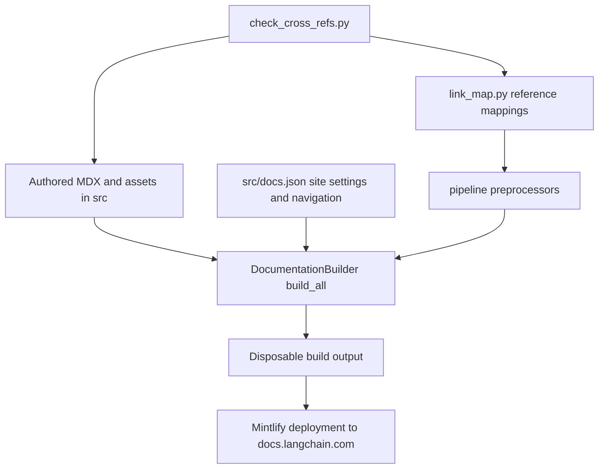
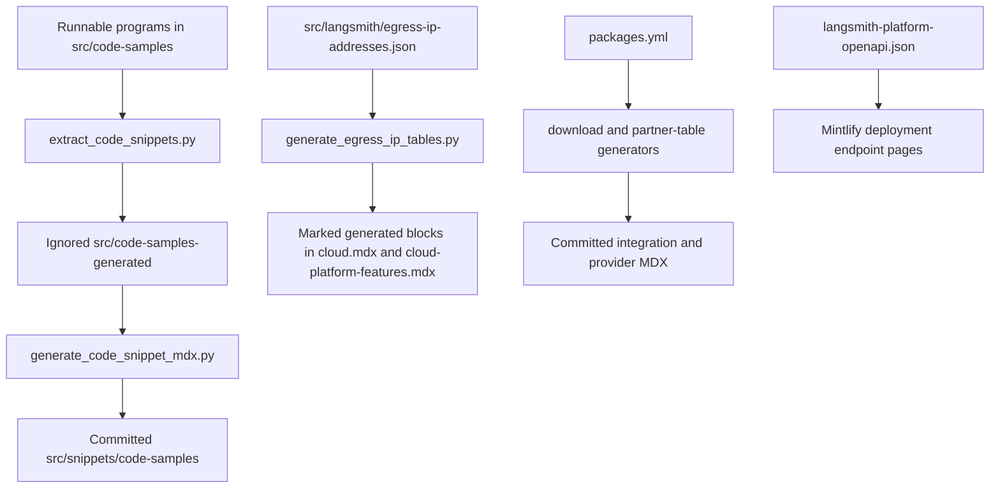

This repository owns the source and build pipeline for `docs.langchain.com`, hosted by Mintlify. It does **not** build `reference.langchain.com`: that API reference site is generated and deployed outside this repository. The safe-change rule is to identify the durable owner first. `src/`, configuration, metadata, and committed inputs are sources; `build/` and explicitly generated documentation are outputs.

## Source-to-build control flow



This diagram shows how authored content, navigation, preprocessing, and cross-reference validation converge in the local deployment artifact.

The builder deletes and recreates `build/`, creates versioned Python and JavaScript OSS routes, emits unversioned Deep Agents Code and OpenWiki content, builds LangSmith and Managed Deep Agents variants, and copies shared files. The root `pyproject.toml` provides the `docs` console entrypoint and requires Python 3.13 or newer. Use repository entrypoints rather than editing or invoking a generated route directly:

```bash
make build
make dev
make test
make broken-links-with-anchors
make check-cross-refs
```

The Makefile runs link validation from `build/` with redirect and anchor checks, and runs the Python suite with network sockets disabled except Unix sockets. The publication workflow builds on `main`, verifies that `build/` exists, stages it below `public/build`, and publishes that directory to the `prod` branch. `build/` is therefore a reproducible deployment artifact, not an editing surface.

## Durable ownership boundaries

| Concern | Durable owner | Safe change boundary |
| --- | --- | --- |
| Documentation prose, frontmatter, reusable MDX, assets, and executable examples | `src/` | Edit the owning source. `src/langsmith/` owns LangSmith material, `src/oss/` owns open-source material, `src/snippets/` owns reusable MDX, and `src/code-samples/` owns executable examples. |
| Site settings, navigation, and redirects | `src/docs.json` | Add or move a page deliberately in the reader-facing navigation; directory layout alone does not make a page discoverable. |
| Package registry and integration presentation inputs | `packages.yml` plus its consumers | Change metadata at the registry, then regenerate download, partner-package, and integration outputs. |
| Route shaping, language variants, preprocessing, and copied build content | `pipeline/` | Change implementation and focused tests together, then rebuild. |
| Deployment output | `build/` | Regenerate with `make build` or `make dev`; never patch it. |
| Always-applicable authoring rules | `AGENTS.md` | Keep the instruction copies named there synchronized when their mirrored sections change. |
| Task-specific agent procedures | `.agents/skills/<name>/SKILL.md` | Edit the canonical skill; run `make skills` to refresh Claude Code's local symlink view. |
| Automation and maintenance checks | `scripts/`, `Makefile`, `.github/workflows/`, and focused tests | Treat workflow, script, input data, and test as one operational contract. |
| Release-watch service | `docs-release-watch/` | Deploy independently with `uv run mda deploy`; it is not a Mintlify build input. |
| External API reference | Upstream reference generation service | Report defects through the repository's reference-docs issue template; there is no local reference build output to edit. |

`src/docs.json` independently owns Mintlify settings and reader-facing product/menu navigation. Its product labels do not mirror source directories: lifecycle menus can combine `src/oss/` and `src/langsmith/`. `src/index.mdx` is the home page, while `navigation.products` determines placement. Adding an MDX file without registering it in `docs.json` does not make it discoverable.

## Preprocessing and cross-references

`pipeline/preprocessors/link_map.py` is the durable map for `@[name]` references. It assembles Python and JavaScript scopes, prefixes relative targets with the corresponding external reference host, and preserves absolute URLs. `handle_auto_links.py` converts resolved entries to Markdown links, logs unknown names, and falls back from the special `global` scope to Python with an error log. `scripts/check_cross_refs.py` chooses defaults from source paths, changes scope inside `:::python` and `:::js` fences, and requires shared references to resolve in every applicable scope.

Change the map and focused preprocessing/check tests together. The map is not generated from `reference.langchain.com`; that site is an external boundary.

## Generated-artifact control flow



This diagram shows which committed files are generated views and which inputs must be changed instead.

### Runnable examples and snippets

`src/code-samples/` is the executable owner. `make test-code-samples` runs samples; `make code-snippets` extracts marked regions to the ignored `src/code-samples-generated/` intermediate and renders committed MDX under `src/snippets/code-samples/`. The extractor supports Python, TypeScript, Java, Kotlin, Go, and shell markers, including removal markers and code-group metadata, and fails on unclosed markers rather than emitting a partial example. Edit and test the program, regenerate the display snippets, and commit the rendered MDX—not the intermediate.

The sample harness is operationally separate from rendering. It supports `FILES`, `CODE_SAMPLE_PATHS`, four workers by default, opt-in `CODE_SAMPLE_TRACING=1`, bounded timeouts and rate-limit retries, and ordered serial chains for samples sharing datasets, experiments, or hub prompts. Trace collection is locked so parallel samples do not clobber the shared manifest.

### Egress inventory and public JSON

`src/langsmith/egress-ip-addresses.json` is the durable inventory for two generated documentation tables and the public JSON artifact. The generator accepts only schema version 1 with distinct global IPv4 `/32` records and the closed `service`, `cloud`, `region`, and `cidr` fields. It computes a SHA-256 version from canonical addresses, replaces exactly one marked block in each owning page, and makes `--check` fail on inventory-version or table drift. The builder copies the JSON bytes to the unversioned `build/langsmith/egress-ip-addresses.json`; that published file is a view, not a second data store.

```bash
uv run python scripts/generate_egress_ip_tables.py
uv run python scripts/generate_egress_ip_tables.py --check
```

Change the JSON inventory and regenerate both pages together. Do not hand-edit the tables or the build artifact.

### Package metadata and integration tables

`packages.yml` is a package metadata registry, not an API-reference source. Rows carry package identity, repositories, provider-page and JavaScript mappings, integration/highlighting/reference-doc policy, and machine-maintained download timestamps. The scheduled download workflow refreshes stale counts, generates the partner package table and integration download snippets, flags qualifying external integrations, and uploads the changed YAML and MDX as an artifact before creating a PR. The partner table applies its own exclusions and a 100,000-download inclusion threshold, bypassed for highlighted packages. Change the registry or generator policy, then review regenerated MDX.

### OpenAPI-generated endpoint pages

Mintlify generates endpoint pages from OpenAPI declarations at deployment time. Those pages are neither authored MDX nor local pipeline output. The committed `src/langsmith/langsmith-platform-openapi.json` is refreshed daily by a workflow running `process_langsmith_openapi.py`; it fetches the platform specification, filters fleet/internal endpoints, applies public-documentation processing, and opens or updates a refresh PR. Change the refreshed input or processing policy; never edit generated endpoint pages. `make check-openapi` validates the Agent Server specification after a build.

## Agent instructions and release watch

`AGENTS.md` owns always-applicable rules: do not edit `build/`, update `src/docs.json` for new pages, use valid frontmatter and supported icons, and test examples. It also identifies instruction files that must be synchronized. `.agents/skills/` supplies opt-in task procedures; most agents read it directly, while Claude Code uses the symlinks created by `make skills`. Skills should link to `AGENTS.md` rather than duplicate global invariants.

`docs-release-watch/` is a separately deployed Managed Deep Agent. Its product registry scopes OpenWiki, Deep Agents Python, Deep Agents Code, and Deep Agents JS by upstream repository, release tag prefix, source path, documentation path, language scope, and memory file. For releases 7–30 days old, the read-only Sonnet research phase uses release diffs, tagged source files, and docs coverage checks. The Opus shipping agent can then create one Linear DOC issue and one draft documentation PR per evidenced feature. Write tools re-verify citations and surgical edits; humans review draft PRs. Extending coverage means changing the product registry, matching product skill, and schedule prompt, then redeploying.

## External version checks and focused verification

`scripts/check_version_claims.py` resolves MDX package specifiers to PyPI or npm using syntax, nearby labels, conditional fences, and page-language defaults. Registry failures are unresolved; non-advisory runs fail only when a successfully fetched release set proves that a version is absent. The pull-request workflow checks only changed `src` MDX files selected from the merge base. The scheduled sweep checks all pages with `--advisory-only`, publishes its report, and does not fail the job for stale text or unavailable registries.

Focused tests under `tests/unit_tests/` protect builder transformations and maintenance invariants, including version claims, egress validation, and generated artifact convergence. Add or update a focused test when changing a generator, validator, or preprocessing rule.

## Safe-change checklist

1. **Page or route:** edit the owner in `src/`, update `src/docs.json`, and preserve redirects.
2. **Build behavior:** change `pipeline/`, add focused tests, rebuild, and run link checks.
3. **Cross-reference:** update `link_map.py` and run `make check-cross-refs`.
4. **Code sample:** modify and test `src/code-samples/`, run `make code-snippets`, and commit generated MDX.
5. **Egress:** edit the JSON inventory, regenerate, and run `--check`.
6. **Package metadata:** edit `packages.yml` or its generator and review generated MDX.
7. **OpenAPI:** update the specification or processor/workflow boundary, not generated endpoint pages.
8. **Agent procedure:** choose `AGENTS.md` for a global rule or `.agents/skills/` for an opt-in procedure, then maintain mirrors.
9. **Release watch:** update registry, skill, and schedule, then run `uv run mda deploy`.

## Related pages

- [Build system](/openwiki/architecture/build-system.md)
- [Preprocessing](/openwiki/concepts/preprocessing.md)
- [Mintlify integration](/openwiki/integrations/mintlify.md)
- [Reference docs](/openwiki/integrations/reference-docs.md)
- [Code sample lifecycle](/openwiki/workflows/code-sample-lifecycle.md)
