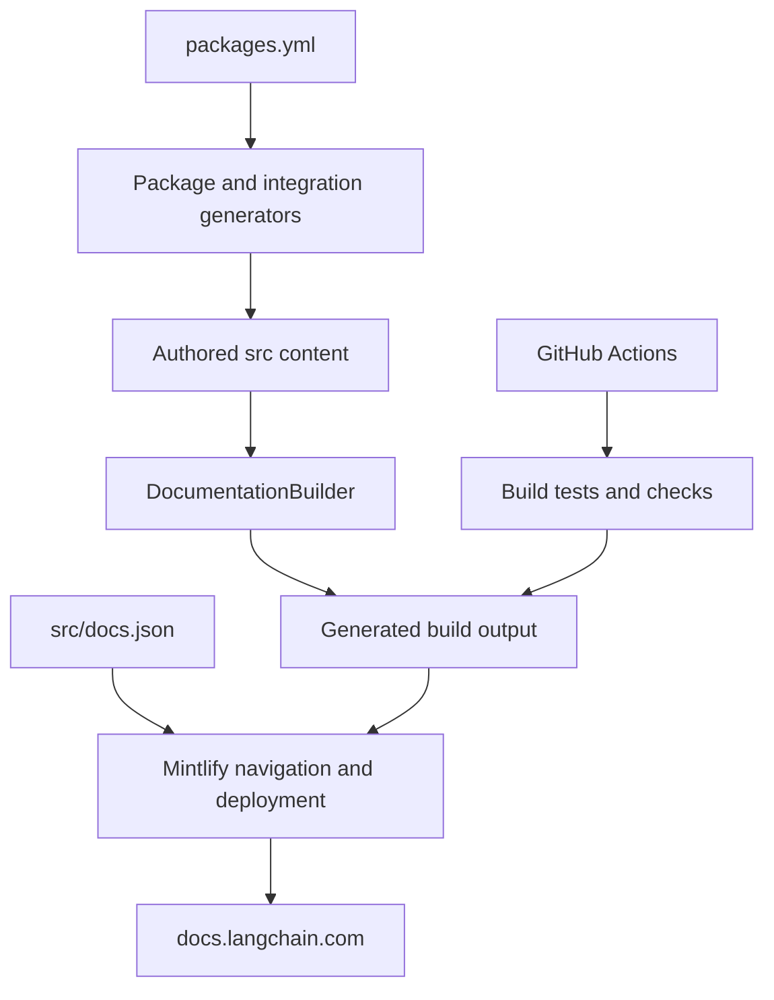

This repository produces the Mintlify site at `docs.langchain.com`; it does not produce the separate API-reference site at `reference.langchain.com`. The durable documentation inputs live primarily under `src/`. `build/` is a disposable deployment artifact: the builder removes and recreates it, and Mintlify deploys from it. Never edit `build/`; change its owning source and regenerate it.

This shows the publication boundary: authored content and configuration are transformed into `build/`, while CI verifies the transformation before the production workflow publishes it.

## Ownership boundaries

| Concern | Durable owner | Produced or controlled surface | Safe change boundary |
| --- | --- | --- | --- |
| Page prose, frontmatter, assets, reusable fragments, and executable examples | `src/` | Content copied or transformed into the Mintlify site | Edit authored inputs, not `build/`. |
| Site identity, navigation, redirects, and deployed OpenAPI sections | `src/docs.json` | Reader-visible menus, route compatibility, and API-reference declarations | Add or move a page with its explicit navigation and redirects. |
| Route layout and source transformation | `pipeline/` | Language-specific and unversioned build routes; preprocessed MDX | Change routing or preprocessing with focused pipeline tests. |
| Contributor commands | `Makefile`, `pyproject.toml` | `make` tasks and the installed `docs` CLI | Keep command wrappers aligned with the Python pipeline. |
| Package catalogue, generated integration displays, and repository liveness | `packages.yml`, generators in `pipeline/tools/` and `scripts/`, scheduled integration check | Provider overview, integration-download snippets, and repair or delist PRs | Change metadata or generator, then regenerate; let the liveness automation make its scoped repairs rather than hand-editing its derived listings. |
| Release-driven docs maintenance agent | `docs-release-watch/` | Draft PRs and Linear tickets for eligible product releases | Maintain its product registry, skills, schedules, and tools as one deployed project. |
| Verification and publication | `tests/`, `.github/workflows/` | Unit tests, link checks, generated-file checks, and production publication | Choose the workflow that owns the invariant rather than treating CI as one monolith. |

## Authored documentation and navigation

`src/` is not a mirror of public URLs. It holds LangSmith material in `src/langsmith/`, OSS product material in `src/oss/`, reusable MDX and components in `src/snippets/`, visual assets in `src/images/`, fonts, and runnable programs in `src/code-samples/`. `src/docs.json` is a separate ownership plane: it supplies Mintlify settings and declares navigation, redirects, and OpenAPI sections. Therefore, a page can be emitted but not appear in navigation, and a navigation label need not resemble the source directory.

`DocumentationBuilder` emits shared OSS material for both Python and JavaScript, drops a language-specific source-directory segment when applicable, and resolves `:::python` or `:::js` blocks for the selected target. It has deliberate exceptions: `src/oss/openwiki/` and `src/oss/deepagents/code/` are emitted once at unversioned paths using the Python branch, while direct `src/langsmith/managed-deep-agents*.mdx` files emit a Python and a JavaScript route. The unversioned Managed Deep Agents URLs are redirects rather than duplicate pages.

The preprocessing phase resolves `@[...]` references, adds tracking to relevant LangSmith CTA links, and selects conditional blocks. It also gives snippets special handling: Markdown snippets are available at their source-relative location and language-specific copies; imports from language-targeted pages select the matching copy, whereas JSX and TSX snippet components remain shared. Use source-relative snippet imports where a fragment needs language-specific preprocessing.

### Reference surfaces and OpenAPI inputs

The repository has two distinct reference concepts:

- `reference.langchain.com` is generated and deployed outside this repository.
- Mintlify generates endpoint pages at deployment from the three OpenAPI declarations in `src/docs.json`: the committed Agent Server specification, the remote Control Plane specification, and the committed LangSmith REST specification. Those endpoint pages are not local authored MDX or local `build/` output.

The LangSmith REST specification is intentionally committed after policy-oriented processing. The refresh script filters and organizes the upstream schema; its scheduled workflow writes only a changed specification and reuses a single open refresh PR. Update the processing policy or upstream contract, rather than manually maintaining the resulting JSON.

## Build, local development, and failure boundaries

The installed `docs` console script routes `docs build` to `DocumentationBuilder` and `docs dev` through the same initial build plus a file watcher and `mint dev` in `build/`. `make build` and `make dev` are the usual contributor entrypoints. A failed initial build prevents development mode from starting; `docs dev --skip-build` can use existing output but warns when no `build/` directory exists.

The builder clears `build/` first, then creates both language trees, the unversioned exception families, normal LangSmith output, Managed Deep Agents variants, and shared inputs. This full replacement is why generated output cannot retain manual changes. Its source traversal rejects symlinks and files resolving outside the collection root, so a committed link cannot cause an unrelated host file to enter a build.

For verification, use the generated site rather than raw `src/`: `make broken-links-with-anchors` builds first and runs Mintlify from `build/`, including redirect validation. It filters known false positives for deployment-generated OpenAPI routes and standalone snippets, whose absolute language routes only resolve after inclusion in a page. `make check-openapi` validates the Agent Server specification from the build tree.

## Snippets and runnable sample lifecycle

`src/code-samples/` is executable source, not a page collection. `make test-code-samples` runs the samples. `make code-snippets` extracts marked regions into the ignored `src/code-samples-generated/` intermediate and then renders MDX into `src/snippets/code-samples/`. The marker syntax supports language-specific comment forms, omission regions, and optional CodeGroup metadata. The displayed MDX is derived from the executable program: edit and test the program, regenerate, and review the result; do not hand-edit either derived layer.

## Package metadata and generated integration content

`packages.yml` is the catalogue of package identity, repository location, optional JavaScript counterpart, provider-page mapping, reference-doc availability, and download metadata. It is consumed to generate the Python provider overview and other integration presentation. The provider-table generator applies inclusion policy, download threshold, highlighting, and link resolution; CI detects manual edits to its generated overview and directs maintainers to change the generator or `packages.yml` instead.

The weekly package-download workflow refreshes download metadata, regenerates the provider overview and integration download snippets, uploads those outputs between jobs, and opens an automated PR only when the tracked files differ. This means download numbers and derived tables are a coordinated update, not independent documentation edits.

A separate Monday liveness workflow scans third-party GitHub homes recorded in `packages.yml`. When a home is gone, the checker can adopt a live third-party GitHub replacement evidenced by PyPI, npm, or external documentation, and it can update permanent external-documentation redirects. It does not auto-adopt a first-party replacement or delist an integration with a live GitLab project or partner documentation; it fully delists only when no live source-control or partner-docs home remains, removing related external-listing rows and unshared provider cards. The workflow runs with `--write`, reports its evidence, and creates or appends to one standing draft PR on `chore/dead-integration-repos` only when the working tree changed.

## Automation projects and CI entrypoints

`docs-release-watch/` is a nested Managed Deep Agent project, operationally separate from the documentation build. Its registry maps each watched product to release tags, source paths, documentation paths, language scope, skill, and persistent tracking location. On its Monday, Wednesday, and Friday schedules it considers eligible releases from seven to thirty days old. A read-only research subagent establishes release-diff and source evidence and checks existing coverage before the shipping agent may create one Linear ticket and one draft PR per feature. Credentials stay in ignored environment configuration and memory retains tracking URLs rather than secrets.

The primary repository CI entrypoint is `.github/workflows/ci.yml`, which invokes reusable test, lint, and documentation link-check workflows, then runs cross-reference and generated-file checks. The link workflow uses `make broken-links-with-anchors` and `make check-openapi`; the unit suite exercises the Python pipeline through `make test`. The production workflow is separate: pushes to `main` run `make build`, verify `build/`, nest it beneath `public/build`, and publish that directory to the `prod` branch.

## Change guide

1. **New or moved page:** edit the MDX under the appropriate `src/` family, update `src/docs.json`, and add a redirect when preserving a public URL.
2. **Route or language behavior:** change `pipeline/`, retain source-tree safety, and extend focused `tests/unit_tests/` coverage before rebuilding.
3. **Reusable prose or UI:** change `src/snippets/`; use the language-aware import behavior rather than maintaining copied fragments.
4. **Runnable example:** edit and test `src/code-samples/`, run `make code-snippets`, and commit the regenerated snippet MDX—not the ignored extraction intermediate.
5. **Package listing or download display:** change `packages.yml` or the responsible generator and regenerate the corresponding overview/snippets. For a stale third-party repository, use the integration-repository checker’s policy and review its draft PR rather than applying an unscoped listing edit.
6. **OpenAPI endpoint reference:** change the declaration or specification pipeline; never create endpoint MDX for deployment-generated pages.
7. **Validation or deployment behavior:** locate the workflow that invokes the relevant `make` target. Preserve the distinction between CI validation and the `main`-to-`prod` publication path.

## Related pages

- [Build system](/openwiki/architecture/build-system.md)
- [Versioning](/openwiki/concepts/versioning.md)
- [GitHub Actions](/openwiki/integrations/github-actions.md)
- [Adding pages](/openwiki/operations/adding-pages.md)
