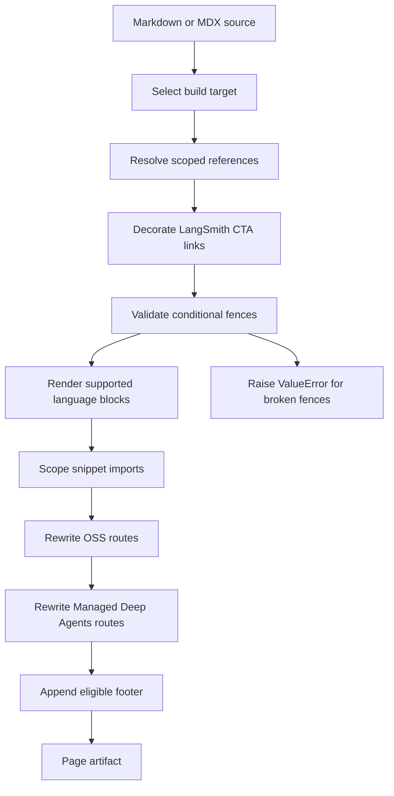

# Markdown Preprocessing

`DocumentationBuilder` transforms source Markdown and MDX while writing build artifacts; it does not edit files under `src/`. The pipeline allows a shared page to yield Python and JavaScript variants while applying source-level API links and CTA attribution before route-aware output rewriting.

For a regular Markdown file, `preprocess_markdown()` resolves scoped cross-references, decorates eligible LangSmith CTA links, validates and renders conditional blocks, then returns content to the builder. The builder scopes snippet imports, rewrites routes, appends an eligible source footer, and writes the artifact.

The diagram shows the regular-page ordering; validation occurs immediately before final conditional rendering and stops the build path when the conditional structure is broken.

## Entry points and target selection

`_process_markdown_file()` reads a `.md` or `.mdx` input, delegates content work to `_process_markdown_content()`, appends the footer, converts `.md` output to `.mdx`, and writes the result. `_process_markdown_content()` calls `preprocess_markdown()`, scopes Markdown snippet imports when a target is supplied, then rewrites OSS and Managed Deep Agents routes.

The preprocessing target keys are `python` and `js`; `DocumentationBuilder.language_url_names` turns them into the route segments `python` and `javascript`. If `preprocess_markdown()` receives no target, it uses `TARGET_LANGUAGE`, defaulting to `python`; its `default_scope` likewise defaults to that target. Conditional rendering rejects any other target with `ValueError`.

Build routing selects those targets deliberately:

- A shared `oss/` Markdown page is emitted for both Python and JavaScript unless `docs.json` navigation lists its route in exactly one language; then it is emitted only for that language. Files below `oss/python/` or `oss/javascript/` are selected only for their matching target.
- `oss/deepagents/code` and `oss/openwiki` are emitted once with Python selection and retain language-agnostic routes. Ordinary LangSmith Markdown uses Python selection; Managed Deep Agents pages emit Python and JavaScript routes.
- Each Markdown snippet has Python and JavaScript copies and a Python-default unprefixed copy for unversioned consumers.

For the wider route model, see [Language Versioning Strategy](/openwiki/concepts/versioning.md) and [Build System Architecture](/openwiki/architecture/build-system.md).

## Source-level transformations

### 1. Scoped cross-references

Authors can write `@[link_name]`, `@[title][link_name]`, and `@[`link_name`]`. `replace_autolinks()` looks up the key in `SCOPE_LINK_MAPS` and produces a Markdown link; a custom title is retained, and the simple backticked form retains backticks in its generated link text. Prefix a reference with `\` to show it literally: it is not resolved, and the final pass removes the escape.

Resolution starts in `default_scope`. A `:::python` or `:::js` line changes the active scope; a bare closing `:::` resets it to the default scope. Regular backtick and tilde code fences prevent both reference replacement and scope changes within their content. An unclosed regular fence protects the remaining input from reference replacement.

`SCOPE_LINK_MAPS` is assembled by scope from host-and-scope `LINK_MAPS` entries: relative targets are joined to the entry host, while absolute targets remain absolute. The maps deliberately allow one key to resolve differently in Python and JavaScript and include compatibility aliases where shared prose needs the other language's API spelling. Python includes MCPAdapter, tool conversion, `MultiServerMCPClient`, MCP loading, interceptor, callback, and connection/session references; JavaScript includes `MCPAdapter` and `MCPAdapter.listTools`. The special runtime `global` scope logs an error and falls back to Python.

A missing key is deliberately non-fatal during a build: preprocessing logs it at info level with file, line, key, and scope, then leaves the authored marker literal. Add or correct mappings in `pipeline/preprocessors/link_map.py`, then run the strict source-validation gate described below. See [Cross-Reference Links](/openwiki/operations/cross-references.md).

### 2. LangSmith CTA attribution

`add_utm_to_cta_links()` recognizes only Markdown-link URLs beginning `https://smith.langchain.com` whose parsed path is empty, `/`, `/agents`, or `/agents/`. It adds `utm_source=docs`, `utm_medium=cta`, `utm_campaign=langsmith-signup`, and `utm_content`, derived from the file path after `src/`; for example, `src/langsmith/home.mdx` produces `langsmith-home`. Existing query parameters and an optional Markdown link title are preserved.

Functional routes such as settings, hub, projects, public traces, and Studio are not decorated. Links on another host, including `api.smith.langchain.com`, are unchanged.

### 3. Validated conditional language blocks

Only `:::python ... :::` and `:::js ... :::` are conditional language branches. They are processed after reference resolution and CTA decoration: a target-matching block emits its content without the fences and the other supported block is removed. The implementation deliberately leaves a complete block with an unsupported label unchanged; an unsupported label is **not** a language selector.

Before that regular-expression rendering pass, `_validate_conditional_fences()` scans the complete input and rejects malformed structure. It raises `ValueError` headed `Broken conditional fences:` when a block opens inside another open block, a closer has no open block, or an open block is never closed; diagnostics identify the relevant line and, for nesting, the earlier opening line. Thus an unclosed `:::python` block now fails preprocessing rather than being silently retained. The validator uses the same permissive closer shape as the renderer: text following `:::` is accepted, and a compact `::::::js` is treated as a close followed by another opening marker.

Escaped `\:::` markers are ignored by validation and rendering, then unescaped in output so syntax examples can remain literal. The validator and renderer are whole-input mechanisms, not normal-code-fence-aware parsers: an apparent conditional marker inside a backtick or tilde code example can participate in validation or rendering. Escape literal markers in examples that must not be interpreted. See [Conditional Rendering Tests](/openwiki/testing/conditional-rendering.md).

### Fence invariant shared by the line scanners

Autolink and CTA processing use a separate, lightweight Boolean code-fence state. A line matching at least three backticks or tildes toggles state; the scanners do not pair an opening delimiter with a matching closing delimiter. Well-formed, balanced regular fences are therefore an authoring invariant: mixed or malformed markers can change which later lines those two passes treat as code. This protection does not extend to conditional validation or rendering.

## Validation and fence boundaries

`make check-cross-refs` is the strict authoring gate for missing mappings, intentionally distinct from the non-fatal behavior of build-time reference replacement. It runs `scripts/check_cross_refs.py` on Markdown and MDX under `src/`, sharing the cross-reference and regular-fence patterns. It skips regular code fences, escaped references, `snippets/code-samples/`, and paths containing `node_modules`; files that cannot be decoded as UTF-8 are skipped with a warning.

The validator checks every shared, unfenced `oss/` reference against both Python and JS maps, independent of navigation-based build selection. `oss/python/` and `oss/javascript/` use one default scope, as do supported language fences. A reference must resolve in all applicable scopes, so a Python-only reference in shared unfenced OSS content fails rather than silently becoming literal in a JavaScript variant. Any unresolved reference makes the command exit with status 1.

## Output-time rewrites

After source preprocessing, the regular-file path applies these transformations in order:

1. **Snippet import scoping.** An MDX import from `/snippets/...md` or `.mdx` becomes `/snippets/{python|javascript}/...` for a language build. Imports already prefixed with `python/` or `javascript/` remain unchanged.
2. **OSS route rewriting.** Markdown URLs and HTML `href` values beginning `/oss/` receive the selected language segment. Paths already prefixed with a language, paths containing `images`, and the language-agnostic `/oss/deepagents/code` and `/oss/openwiki` paths remain unchanged.
3. **Managed Deep Agents routes.** Bare Markdown or HTML `/langsmith/managed-deep-agents...` URLs become `/langsmith/{language}/managed-deep-agents...`. Already language-qualified URLs do not match the bare-route pattern.
4. **Source footer.** `_add_suggested_edits_link()` appends a Mintlify callout with a documentation/MCP connection link and GitHub edit and issue links only for files below `src/`. It excludes the root `index.mdx` and paths with a `snippets` path segment.

Snippet Markdown is processed separately for each language, with preprocessing plus OSS and Managed Deep Agents rewriting, then written below `build/snippets/{python|javascript}/`. A Python-default base copy is also written for unversioned imports. This path does not add the source footer.

## Failure behavior and safe changes

- Missing references are non-fatal during preprocessing, but should fail `make check-cross-refs` before merge.
- Invalid conditional targets, malformed conditional fences, and exceptions from regular content or file processing are logged and re-raised, stopping that build path.
- Source-footer generation is best-effort: an internal failure is logged and the original content is returned.
- The builder rejects symlinks and paths resolving outside a scanned source root, so a documentation build cannot follow a committed link to host content.

When extending the pipeline, preserve its order. Scope-sensitive references must resolve while supported conditional fences still exist, while validation must run before rendering can conceal malformed structure. Keep route-rewrite exclusion guards: removing them can double-prefix routes or break deliberately language-agnostic products. New reusable Markdown snippets must retain language-specific copies because importing pages can be deeply nested. When adding a shared reference, ensure its key exists in both maps or place the use in the supported language branch.

## Focused regression coverage

`tests/unit_tests/test_conditional_fences.py` verifies successful rendering of balanced blocks, the accepted compact closer forms, ignored escaped markers, and line-specific `ValueError` failures for nested, stray, malformed, and unclosed conditional fences. `tests/unit_tests/test_handle_auto_links.py` covers replacement outside regular fences, preservation inside backtick, tilde, extended, indented, and unclosed fences, conditional-looking lines inside code, and escaping. `tests/unit_tests/test_utm_links.py` covers CTA allowlisting, path-derived attribution, query and title preservation, exclusions, and fence skipping.

`tests/unit_tests/test_check_cross_refs.py` covers scope-aware validation, the both-scope requirement for shared OSS content, titled and backticked references, and exclusions. Builder tests cover language route insertion and exemptions, scoped snippet copies, and Managed Deep Agents variants. See [Test Overview](/openwiki/testing/test-overview.md) for the wider suite.
