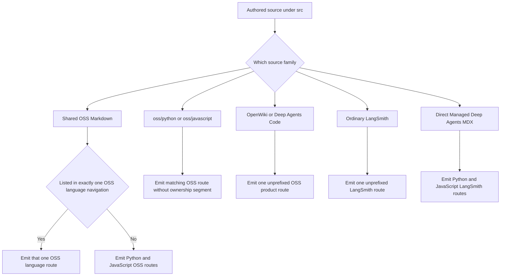

# Documentation Routes and Language Versioning

`DocumentationBuilder` turns `src/` into the disposable `build/` tree. A page's source family establishes its route family, while `src/docs.json` has two distinct responsibilities: it supplies reader navigation and redirects, and it selects the emitted language set for **shared OSS Markdown**. It is copied to the build as a shared file; it does not itself emit a page.

Keep these contracts separate:

1. **Source family** determines the route shape and preprocessing target.
2. **Navigation** determines where a reader sees a route and, for shared OSS Markdown, can suppress an unwanted language copy.
3. **Redirects** retain retired URLs; they neither create artifacts nor grant source ownership.
4. **The language switcher** is client-side navigation between recognized paired routes; it does not validate or generate routes.

This distinction matters because Build menus combine OSS and LangSmith content. For example, Managed Deep Agents is authored in `src/langsmith/`, OpenWiki in `src/oss/openwiki/`, and both appear in Build navigation.

## Choose the source family first

This diagram shows the clean full-build decision. `docs.json` is an input only at the shared-OSS navigation decision; elsewhere it projects routes into menus and defines redirects.

| Authored source family | Full-build output | Rendering target |
| --- | --- | --- |
| Shared `src/oss/` Markdown, excluding special and owned trees | One or both of `/oss/python/...` and `/oss/javascript/...` | `python` and/or `js` |
| `src/oss/python/...` | `/oss/python/...`, removing `python/` from the source remainder | `python` |
| `src/oss/javascript/...` | `/oss/javascript/...`, removing `javascript/` from the source remainder | `js` |
| `src/oss/deepagents/code/...` | `/oss/deepagents/code/...` | `python` |
| `src/oss/openwiki/...` | `/oss/openwiki/...` | `python` |
| Ordinary `src/langsmith/...` | `/langsmith/...` | `python` |
| Direct `src/langsmith/managed-deep-agents*.mdx` | `/langsmith/python/...` and `/langsmith/javascript/...` | `python` and `js` |

### Shared OSS navigation selection

For a shared `.md` or `.mdx` page, the builder recursively collects `/oss/python/...` and `/oss/javascript/...` routes from `docs.json` navigation and caches the result until the file changes. If the page is listed in exactly one language, it emits only that variant. If it is listed in both languages—or in neither—it emits both. Non-Markdown shared OSS files always emit for both languages.

A directory navigation entry can stand for `dir/index`, but it does not select a shared index for a language when a language-owned `src/oss/<language>/dir.mdx` or `.md` owns that route. This prevents a shared landing page from colliding with a language-specific page. If `docs.json` is unreadable, the builder intentionally falls back to both variants rather than risk producing an empty or incorrect one-language output.

Language-owned directories are ownership boundaries, not menu controls during a full build. Their files are emitted only to their matching tree regardless of navigation, with the ownership directory removed. `build_file()` applies the same navigation-derived selection as `build_all()` for shared OSS pages, so a targeted development rebuild can check that rule.

`build_all()` first recreates `build/`, then emits ordinary OSS variants, the two unversioned OSS products, ordinary LangSmith content, Managed Deep Agents variants, shared files, and npm snippets. Treat a clean full build as the final route-shape check, especially after moving a source between families. Source collection rejects symlinks and files resolving outside the requested root, so source-tree links cannot place host files in build artifacts.

## Conditional content and transformations

Shared pages can contain `:::python` and `:::js` blocks. For the selected target, a closed matching block contributes its content without its fences; a closed nonmatching supported block is removed. Escaped `\:::` becomes literal `:::`, while unsupported labels and unclosed blocks stay intact. An unknown target language raises `ValueError`.

The conditional implementation is a whole-document regular-expression transform, not a Markdown-code-fence-aware parser. Do not nest conditional blocks, and escape a marker that must be displayed literally. The shared `src/oss/deepagents/async-subagents.mdx` illustrates why this matters: it is listed under Delegation in both Deep Agents navigation projections, but its output may differ by conditional branch.

For Markdown and MDX, the processing order is:

1. Resolve `@[]` autolinks with the target as the default scope.
2. Add UTM parameters to LangSmith CTA links.
3. Apply conditional rendering.
4. For a language target, point eligible snippet imports at its language-scoped copy.
5. Rewrite eligible OSS links, then Managed Deep Agents links.

The internal `js` target maps to the `javascript` URL segment. A `.md` source writes an `.mdx` artifact.

### Links and snippets

An eligible absolute `/oss/...` Markdown destination or quoted `href` gains `/oss/python/` or `/oss/javascript/`. Image paths, already-prefixed routes, and the unversioned `/oss/deepagents/code` and `/oss/openwiki` families are preserved. Consequently, an unversioned product or ordinary LangSmith page rendered with the Python target links to ordinary OSS Python content by default without incorrectly prefixing links back into either unversioned product.

Bare Managed Deep Agents links are similarly rewritten to the current target; an already prefixed link stays pinned to its stated language. This lets a Managed Deep Agents page link to its companion variant and to matching OSS content without authoring target prefixes repeatedly.

Shared Markdown snippets are special because consumers can be nested at arbitrary URL depths. The builder writes Python and JavaScript copies below `build/snippets/python/` and `build/snippets/javascript/`, with conditional rendering and absolute rewritten links for each target. Language-targeted pages rewrite eligible `from '/snippets/...mdx'` imports to those copies; already scoped imports remain unchanged. The original snippet path is also written with Python-targeted links as the default for unversioned importers.

## Unversioned products and ordinary LangSmith

Deep Agents Code and OpenWiki are explicit OSS exceptions. They emit exactly once at `/oss/deepagents/code/...` and `/oss/openwiki/...`; their Python target selects Python conditional content but does not create a Python route. OSS link rewriting preserves both product families while prefixing ordinary OSS links. `docs.json` lists the same unprefixed OpenWiki pages in both Build dropdowns, and `language-toggle.js` hides the language dropdown at `/oss/openwiki` and its descendants.

Deep Agents Code is separately projected as a Products and setup menu item. `docs.json` keeps compatibility redirects from former Python and JavaScript Code roots and wildcard descendants to its unprefixed route family, as well as older CLI aliases. Those redirects are public URL compatibility only.

Ordinary LangSmith files emit once below `/langsmith/` with the Python target. Managed Deep Agents is the exception: `build_file()` recognizes a direct top-level `managed-deep-agents*.md` or `.mdx` source and emits its Python and JavaScript variants, while the ordinary LangSmith pass excludes it. The full build discovers only direct `.mdx` files, so a Managed Deep Agents page intended for a full build must be a direct `.mdx` file.

The Managed Deep Agents tabs are parallel Python and TypeScript projections with **Get started**, **Agent capabilities**, and **Build and deploy** groups. They include Identity, nested Channels, and Custom frontend in both projections. The representative runtime source uses `:::python` and `:::js` sections for its language-specific type names and nullability. Unversioned landing aliases and the listed unversioned per-page routes redirect to Python; that compatibility default does not remove the JavaScript artifacts.

Ordinary LangSmith agent-workspace guides remain unversioned. `docs.json` projects `agents`, `agent-environments`, `navigate-agents`, `create-an-agent`, `build-an-agent`, and `deploy-to-agent-environment` together as **Agent-based workspaces** under **Products and setup → LangSmith setup**. Do not infer a paired route merely from language-specific examples inside such a page.

## Reader language selection

The language-toggle script recognizes only two prefix pairs: `/oss/python/` ↔ `/oss/javascript/` and `/langsmith/python/` ↔ `/langsmith/javascript/`. A click on Python, TypeScript, or JavaScript records the current path and hash with a timestamp in `sessionStorage`. When there is a counterpart, the capture-phase handler navigates directly to it and preserves the hash; otherwise the pending record can survive a full reload and is consumed on the next navigation.

Pending switches expire after eight seconds and are consumed at most once. An unprefixed route has no computed language counterpart, so the script leaves Mintlify's landing-page navigation in place. The selector is neither a builder nor a redirect system: it does not establish that a matching artifact exists. Verify navigation, generated artifacts, and redirects independently.

## Change and verify safely

1. Choose the source family before editing navigation. Use an owned OSS directory for intrinsically SDK-specific pages; use shared OSS plus `docs.json` language membership when one shared source should exist in only one menu and output.
2. Update both navigation projections where a paired route is intended. For an unversioned product, intentionally use its unprefixed route in each relevant projection.
3. Add redirects only for externally supported or retired URLs. A redirect must point to an emitted route but does not substitute for creating it.
4. Run a clean full build. Check required artifacts and the absence of prohibited sibling artifacts, including shared pages selected for only one language.
5. Inspect target outputs for conditional content, scoped snippet imports, OSS links, and Managed Deep Agents links. Run `make broken-links-with-anchors`; after changing `@[]` references, run `make check-cross-refs`.
6. Extend focused builder tests when changing source classification, navigation-derived language selection, transformations, or route shape. Test selector changes separately for both supported prefix pairs, hash preservation, reload fallback, expiry, and unversioned exceptions.

## See also

- [Build system](/openwiki/architecture/build-system.md)
- [Source map](/openwiki/architecture/source-map.md)
- [Adding pages](/openwiki/operations/adding-pages.md)
- [Conditional rendering](/openwiki/testing/conditional-rendering.md)
- [Changing versioned content](/openwiki/workflows/versioned-content.md)
