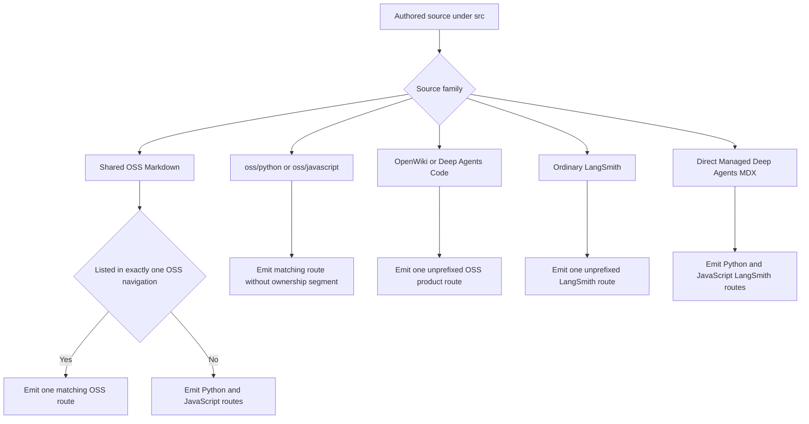

# Documentation Routes and Language Versioning

`DocumentationBuilder` turns authored `src/` files into the disposable `build/` tree. **Source ownership** establishes a page's route family; `src/docs.json` supplies reader navigation and redirects and, only for shared OSS Markdown, can select which language artifacts are emitted. It is copied as a shared file; navigation and redirects do not themselves create pages.

Treat `build/` as regenerated output, never as an authoring surface.

Do not conflate these contracts:

1. **Source family** determines route shape and the preprocessing target.
2. **Navigation** determines where readers find a route and, only for shared OSS Markdown, may select a single emitted language.
3. **Redirects** preserve public URLs; they neither create artifacts nor assign source ownership.
4. **The language switcher** is client-side navigation between recognized route prefixes. It does not verify artifacts or create them.
5. **Route language is not a package-compatibility claim.** `/oss/python/` and `/oss/javascript/` identify an output target. Dependency versions, compatibility, and release policy require their own evidence.

This distinction matters for the Build menus: Managed Deep Agents is authored in `src/langsmith/` yet has paired language routes, while OpenWiki is authored in `src/oss/openwiki/` and is unversioned.

## Choose source ownership first

The route decision during a full build. `docs.json` participates only in the shared-OSS navigation decision; elsewhere it projects routes into menus and defines redirects.

| Authored source family | Full-build output | Rendering target |
| --- | --- | --- |
| Shared `src/oss/` Markdown, excluding special and owned trees | One or both of `/oss/python/...` and `/oss/javascript/...` | `python` and/or `js` |
| `src/oss/python/...` | `/oss/python/...`, removing `python/` from the source remainder | `python` |
| `src/oss/javascript/...` | `/oss/javascript/...`, removing `javascript/` from the source remainder | `js` |
| `src/oss/deepagents/code/...` | `/oss/deepagents/code/...` | `python` |
| `src/oss/openwiki/...` | `/oss/openwiki/...` | `python` |
| Ordinary `src/langsmith/...` | `/langsmith/...` | `python` |
| Direct `src/langsmith/managed-deep-agents*.mdx` | `/langsmith/python/...` and `/langsmith/javascript/...` | `python` and `js` |

### Shared OSS navigation selection

For shared `.md` and `.mdx` pages, the builder recursively collects `/oss/python/...` and `/oss/javascript/...` navigation routes from `docs.json`, caching them until that file's modification time changes. A page listed in exactly one language emits only that variant. A page listed in both—or neither—emits both. Non-Markdown shared files always emit for both targets.

A directory navigation entry can mean `dir/index`, but cannot select that shared index for a language when `src/oss/<language>/dir.mdx` or `.md` owns the corresponding directory route. Language-owned directories are ownership boundaries, not full-build menu controls: their files emit only into their matching tree with the ownership segment removed. If `docs.json` is absent or invalid, the safe fallback is both shared-OSS variants.

`build_all()` recreates `build/`, emits ordinary OSS variants, both unversioned OSS products, ordinary LangSmith, Managed Deep Agents variants, shared files, and npm snippets. Source collection skips symlinks and files resolving outside the requested root, so source-tree links cannot place host files in build artifacts.

## Conditional content and transformations

Shared sources may contain `:::python` and `:::js` blocks. For the selected target, a closed matching block contributes its content without fences and a closed nonmatching supported block is removed. Escaped `\:::` becomes literal `:::`, whereas unsupported labels and unclosed blocks remain intact. An unknown target raises `ValueError`.

The implementation is a whole-document regular-expression transform, not a code-fence-aware Markdown parser. Do not nest conditional blocks, and escape a marker that must be displayed literally. The shared Async subagents page has both language branches and is listed under Delegation in both Deep Agents navigation projections; its route pair is intentional rather than evidence of two independently authored pages.

For Markdown and MDX, the transformation order is:

1. Resolve `@[]` autolinks using the target as the default scope.
2. Add UTM parameters to LangSmith CTA links.
3. Apply conditional rendering.
4. Scope eligible snippet imports to the target language.
5. Rewrite eligible OSS links, then Managed Deep Agents links.

The internal `js` target maps to the `javascript` URL segment. A `.md` source writes an `.mdx` artifact.

### Links and snippets

Eligible absolute `/oss/...` Markdown destinations and quoted `href` values gain `/oss/python/` or `/oss/javascript/`. Image paths, already-prefixed routes, and `/oss/deepagents/code` and `/oss/openwiki` routes remain unchanged. Thus an unversioned product or ordinary LangSmith page rendered with the Python target defaults ordinary OSS links to Python without prefixing a link back into an unversioned product.

Bare Managed Deep Agents links are rewritten to the current target; an already-prefixed link remains pinned. Shared Markdown snippets have Python and JavaScript copies under `build/snippets/python/` and `build/snippets/javascript/`, each conditionally rendered with absolute rewritten links. Language-targeted pages import those copies; already scoped imports remain unchanged. The original snippet path is a Python-targeted default for unversioned consumers.

## Product exceptions and their navigation

### OpenWiki and Deep Agents Code

Deep Agents Code and OpenWiki are explicit OSS exceptions. Each emits once under `/oss/deepagents/code/...` or `/oss/openwiki/...`; Python conditional selection affects content but does not create a Python URL. OpenWiki's `personal-mode.mdx`, for example, belongs to this unprefixed family rather than to an SDK-language route. OSS link rewriting preserves both exceptional families while prefixing eligible ordinary OSS links.

Both Python and TypeScript Build dropdowns project the same OpenWiki tab and unprefixed OpenWiki routes. The switcher hides its dropdown on `/oss/openwiki` and descendants. Deep Agents Code retains compatibility redirects from former Python and JavaScript Code roots and wildcard descendants to the unprefixed Code family. These are URL compatibility provisions, not emitted content.

### LangSmith and Managed Deep Agents

Ordinary LangSmith files emit once below `/langsmith/` using the Python target. Managed Deep Agents is the exception: a direct top-level `managed-deep-agents*.md` or `.mdx` file is recognized by a single-file build and emits both language variants; the ordinary LangSmith pass excludes it. The full-build variant pass discovers only direct `.mdx` files, so a page intended for full-build discovery must be direct and use `.mdx`.

`docs.json` projects parallel Python and TypeScript Managed Deep Agents tabs. Each has beta-tagged **Get started**, **Agent capabilities**, and **Build and deploy** groups. The current projections include Migrate in Get started; Agent definition, Memory, Identity, Browser use, and a nested Channels group in capabilities; and Custom frontend, Context Hub, CLI, and Changelog in build and deploy. Unversioned overview aliases and listed unversioned per-page URLs redirect to Python; that default does not remove JavaScript artifacts.

The paired outputs are purposeful source rendering, not package-version routing. `managed-deep-agents-agent-definition.mdx` has Python and JavaScript branches for the root entry filename and the `define_deep_agent`/`defineDeepAgent` APIs. `managed-deep-agents-memory.mdx` likewise branches for `memory.py`/`memory.ts` and their language-native declarations. The quickstart has target-specific `mda init` commands, and the runtime page branches for native type names and absent-sandbox values. These differences are selected during the build under the two corresponding URLs.

Agent Registry is not a versioned counterpart of Managed Deep Agents. It is an ordinary `/langsmith/agent-registry` page in **Products and setup → LangSmith setup → Agent-based workspaces**, alongside environments, navigation, creation, UI building, and deployment. Its inclusion in an agent workflow does not imply a language-specific package or route.

## Reader language selection

The language-toggle script recognizes only `/oss/python/` ↔ `/oss/javascript/` and `/langsmith/python/` ↔ `/langsmith/javascript/`. On a Python, TypeScript, or JavaScript selection it records the current path, hash, intended target, and timestamp in `sessionStorage`. If a counterpart prefix is computable, the capture-phase click handler navigates directly and preserves the hash; otherwise the pending record can survive the menu's reload and is considered on the next navigation.

Pending switches expire after eight seconds and are consumed at most once. An unprefixed page has no computed counterpart, so Mintlify's landing-page navigation remains in control. The selector does not prove that a paired artifact exists: validate generated artifacts, navigation references, and redirects independently.

## Change and verify safely

1. Choose source ownership before editing navigation. Use `oss/python` or `oss/javascript` for intrinsically SDK-specific pages. Use shared OSS plus language navigation membership only when one shared source needs selective output.
2. Update both navigation projections for a paired route. For an unversioned product, intentionally reference its unprefixed route in each relevant projection. Do not infer package support or compatibility from a route prefix.
3. Add redirects only for externally supported or retired URLs, and point each at an emitted route. A redirect cannot substitute for creating an artifact.
4. Run a clean full build. Assert required artifacts and prohibited sibling artifacts, especially for single-language shared pages and unversioned products.
5. Inspect both target outputs for fenced content, scoped snippet imports, OSS links, and Managed Deep Agents links. Run `make broken-links-with-anchors`; after changing `@[]` references, run `make check-cross-refs`.
6. Extend focused builder tests for source classification, navigation-derived selection, transformations, and route shape. Test switcher changes separately for both prefix pairs, hash preservation, reload fallback, expiry, and unversioned exceptions.

## See also

- [Build system](/openwiki/architecture/build-system.md)
- [Preprocessing](/openwiki/concepts/preprocessing.md)
- [Adding pages](/openwiki/operations/adding-pages.md)
- [Changing versioned content](/openwiki/workflows/versioned-content.md)
- [Mintlify integration](/openwiki/integrations/mintlify.md)
