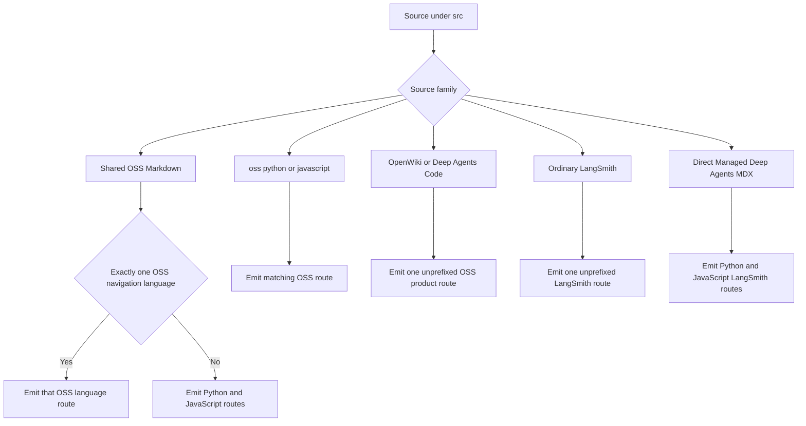

# Documentation Routes and Language Versioning

`DocumentationBuilder` transforms `src/` into the disposable `build/` tree. A source file's family determines its route family; `src/docs.json` supplies reader navigation and redirects, and additionally selects the emitted language set for **shared OSS Markdown**. It is copied as a shared build file, not treated as a page source.

Keep these boundaries distinct:

- **Source family** owns route shape and rendering target.
- **Navigation** decides where readers see a route. Only shared OSS Markdown uses it to suppress an otherwise generated language copy.
- **Redirects** preserve public URLs; they neither emit an artifact nor establish source ownership.
- **The language switcher** is client-side counterpart navigation, not a route generator or existence check.

This is important because the Build menu mixes source families: Managed Deep Agents is authored under `src/langsmith/`, whereas OpenWiki is authored under `src/oss/openwiki/`.

## Route selection during a full build

This diagram shows the full-build decision. `docs.json` affects artifact selection only at the shared-OSS navigation decision; elsewhere it projects routes into menus and supplies redirects.

| Source family | Full-build output | Rendering target |
| --- | --- | --- |
| Shared `src/oss/` Markdown, excluding special and owned trees | One or both of `/oss/python/...` and `/oss/javascript/...` | `python` and/or `js` |
| `src/oss/python/...` | `/oss/python/...`, with `python/` removed from the source remainder | `python` |
| `src/oss/javascript/...` | `/oss/javascript/...`, with `javascript/` removed | `js` |
| `src/oss/deepagents/code/...` | `/oss/deepagents/code/...` | `python` |
| `src/oss/openwiki/...` | `/oss/openwiki/...` | `python` |
| Ordinary `src/langsmith/...` | `/langsmith/...` | `python` |
| Direct `src/langsmith/managed-deep-agents*.mdx` | `/langsmith/python/...` and `/langsmith/javascript/...` | `python` and `js` |

`build_all()` deletes and recreates `build/`, builds ordinary OSS variants, Deep Agents Code, OpenWiki, ordinary LangSmith content, and Managed Deep Agents variants, then copies shared files and npm snippets. Source collection rejects symlinks and any file that resolves outside its requested source root, preventing source-tree links from placing host files in build artifacts.

### Shared OSS pages: navigation is an output selector

For a shared `.md` or `.mdx` file, the builder recursively collects `/oss/python/...` and `/oss/javascript/...` entries from the `navigation` object in `docs.json`, caching them until the file modification time changes. A page in exactly one language navigation emits only that target. A page in both navigations—or in neither—emits both. Non-Markdown shared files emit both variants.

A directory entry such as `langchain/rag` can select a shared `langchain/rag/index` page. It does **not** do so if a language-owned `src/oss/<language>/langchain/rag.mdx` or `.md` owns that route. This avoids a collision between a language-specific page and a shared directory landing page. If `docs.json` cannot be parsed, the builder deliberately falls back to both variants rather than incorrectly suppressing one.

Language-owned directories are route-ownership boundaries, not navigation controls: their files emit only to the matching target whether or not navigation lists them. `build_file()` applies the same shared-page selection as the full build, which makes targeted development rebuilds representative.

## Rendering one shared source for two languages

Use `:::python` and `:::js` fences in shared OSS pages. For the requested target, a closed matching block contributes its contents without the fence; a closed supported nonmatching block is removed. Escaped `\:::` becomes literal `:::`, while unsupported labels and unclosed blocks remain intact. An invalid target raises `ValueError`.

The implementation is a whole-document regular-expression transform rather than a Markdown code-fence-aware parser. Do not nest conditional blocks; escape a marker that must be literal. The shared Async subagents page contains both Python and JavaScript branches and is listed under Delegation in both language navigation projections.

For Markdown and MDX, the builder's transformation order is:

1. Resolve `@[]` autolinks using the target as the default scope.
2. Add UTM parameters to LangSmith CTA links.
3. Apply conditional rendering.
4. For a language target, scope eligible snippet imports to that language.
5. Rewrite eligible OSS links, then Managed Deep Agents links.

The internal `js` target maps to the `javascript` URL segment. A `.md` source produces an `.mdx` artifact.

### Links and snippets

Eligible absolute `/oss/...` Markdown destinations and quoted `href` values gain `/oss/python/` or `/oss/javascript/`. The rewrite leaves image paths, already language-prefixed paths, and the unversioned Deep Agents Code and OpenWiki families untouched. Thus, a Python-rendered unversioned product or ordinary LangSmith page links to ordinary OSS Python content by default without breaking an unversioned-product link.

Bare Managed Deep Agents links are rewritten to the current target. Already prefixed Managed Deep Agents links remain pinned, so an author can intentionally link across languages.

Shared Markdown snippets are emitted three ways: language-specific copies under `build/snippets/python/` and `build/snippets/javascript/`, plus the original path rendered with Python-targeted links for unversioned importers. Language-targeted page imports are rewritten to the scoped copies; already scoped imports stay unchanged. Absolute rewritten links make nested consumers resolve consistently.

## Unversioned exceptions and Managed Deep Agents

Deep Agents Code and OpenWiki are explicit OSS exceptions. They emit once at `/oss/deepagents/code/...` and `/oss/openwiki/...`; rendering them with the Python target selects Python conditional content but does not add a language route. OSS link rewriting preserves those families while still prefixing ordinary OSS links.

`docs.json` lists the same unprefixed OpenWiki routes in the Python and TypeScript Build dropdowns. `language-toggle.js` hides the language dropdown for `/oss/openwiki` and descendants. Deep Agents Code is separately placed under Products and setup, and compatibility redirects map retired Python and JavaScript Code routes, including wildcard descendants, to the unprefixed Code family.

Ordinary LangSmith files emit once below `/langsmith/` with the Python target. Managed Deep Agents is the exception: a direct top-level `langsmith/managed-deep-agents*.md` or `.mdx` file is recognized by single-file classification and emitted for both targets, while the ordinary LangSmith pass excludes it. The full build discovers only direct `.mdx` files, so pages intended for full-build emission must be direct `.mdx` files.

The Python and TypeScript Managed Deep Agents tabs have parallel **Get started**, **Agent capabilities**, and **Build and deploy** groups, including Identity, nested Channels, and Custom frontend. Shared sources deliberately produce distinct output where they use language fences; for example, the runtime page presents target-specific runtime type names and the no-sandbox value. `docs.json` redirects listed unversioned Managed Deep Agents URLs to Python routes, including the landing aliases and page routes; this compatibility default does not remove JavaScript artifacts.

Ordinary LangSmith agent-workspace guidance remains unversioned. Under **Products and setup → LangSmith setup → Overview → Agent-based workspaces**, navigation lists agent registry, environments, navigation, creation, UI building, and deployment routes. Do not infer a language-paired route from language-specific examples in an unversioned LangSmith page.

## Reader language selection

The language-toggle script recognizes only `/oss/python/` ↔ `/oss/javascript/` and `/langsmith/python/` ↔ `/langsmith/javascript/`. When a reader selects Python, TypeScript, or JavaScript, it records the current path, hash, requested language, and timestamp in `sessionStorage`. If it can compute a counterpart, its capture-phase click handler prevents Mintlify's normal navigation and goes straight there, preserving the hash. Otherwise the pending record remains available across a full reload and is considered on the next navigation.

A pending switch expires after eight seconds and is consumed at most once. An unprefixed route has no computed counterpart, so the script leaves normal landing-page navigation intact. The selector cannot prove that an equivalent artifact exists; verify emitted artifacts, navigation, and redirects independently.

## Safe change procedure

1. Choose the source family before editing navigation. Put intrinsically SDK-specific material in an owned OSS directory. Use shared OSS plus `docs.json` membership when one source should emit only for one language.
2. Update `src/docs.json` whenever adding a page; do not infer reader navigation from its source directory. Update both projections for an intended pair, or deliberately use the unprefixed product route in each projection for an exception.
3. Add redirects only for externally supported or retired URLs. A redirect must target an emitted route; it cannot replace route creation.
4. Run a clean full build and check required artifacts and forbidden siblings, especially a shared page selected for one language.
5. Inspect both target outputs for conditional content, snippet imports, OSS links, and Managed Deep Agents links. Run `make broken-links-with-anchors`; after `@[]` changes, run `make check-cross-refs`.
6. Extend focused builder tests for classification, navigation selection, transformations, and route shape. Test switcher changes separately for both prefix pairs, hash preservation, reload fallback, expiry, and unversioned paths.

## See also

- [Build system](/openwiki/architecture/build-system.md)
- [Source map](/openwiki/architecture/source-map.md)
- [Adding pages](/openwiki/operations/adding-pages.md)
- [Conditional rendering](/openwiki/testing/conditional-rendering.md)
- [Changing versioned content](/openwiki/workflows/versioned-content.md)
