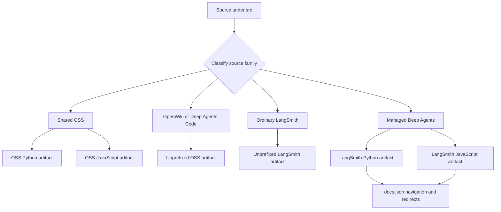

# Language Variants and Route Versioning

`DocumentationBuilder` derives artifacts from paths below `src/`. `src/docs.json` is an independent public configuration for Mintlify navigation and compatibility redirects; the builder copies it as a shared file rather than using it to decide what source files emit. Treat source ownership, emitted artifacts, navigation, and redirects as separate contracts. Author under `src/` and never modify `build/`, which a full build deletes and recreates.

## Route families

| Authored family | Emitted route family | Markdown target |
| --- | --- | --- |
| Shared `src/oss/` content, including Deep Agents outside `code/` | `/oss/python/...` and `/oss/javascript/...` | `python` and `js` |
| `src/oss/python/...` or `src/oss/javascript/...` | Matching language family only, without the ownership segment | Matching target |
| `src/oss/deepagents/code/...` | `/oss/deepagents/code/...` | `python` fallback |
| `src/oss/openwiki/...` | `/oss/openwiki/...` | `python` fallback |
| Ordinary `src/langsmith/...` | `/langsmith/...` | `python` fallback |
| Direct `src/langsmith/managed-deep-agents*.mdx` | `/langsmith/python/...` and `/langsmith/javascript/...` | `python` and `js` |

This flow shows source-path route emission followed by the separately configured navigation and redirect projection.

`build_all()` clears `build/`, renders ordinary OSS for Python and JavaScript, renders Deep Agents Code and OpenWiki once, renders ordinary LangSmith and Managed Deep Agents variants, then copies shared files and npm snippets. This clean lifecycle prevents stale artifacts after a page changes family or location. `build_file()` applies equivalent classification to one file; it raises `AssertionError` for a missing path. Shared and root-level files copy once.

Full-build source collection rejects symlinks and any file that resolves outside the requested source root, so source-tree links cannot place host files in artifacts.

## Shared and language-owned OSS

Most OSS source files are shared: one input is rendered for both language targets. Shared LangChain, LangGraph, and Deep Agents sources can use `:::python` and `:::js` branches; examples include the customer-support handoff tutorial and the LangGraph persistence and Functional API pages.

A file under `src/oss/python/` or `src/oss/javascript/` is language-owned instead. The other pass skips it and its own pass strips the ownership directory. For example, `src/oss/python/concepts/example.mdx` emits as `/oss/python/concepts/example`, not `/oss/python/python/concepts/example`. Use this ownership boundary for a page that belongs only to one SDK, not to control sidebar placement.

## Per-artifact transformation contract

For Markdown and MDX, standard preprocessing runs first. A language-targeted artifact then scopes eligible MDX snippet imports, rewrites OSS links, and finally rewrites Managed Deep Agents links. The internal target key `js` maps to the `javascript` URL segment; `.md` source is emitted as `.mdx`.

This flow shows the ordered content transforms for one artifact.

### Conditional rendering

Conditional rendering accepts only `:::python` and `:::js`. A matching block contributes its content without fences and a nonmatching supported block is removed. Escaped `\:::` markers become literal `:::`. Unsupported labels and unclosed blocks remain unchanged. Invalid target keys raise `ValueError`.

This is a whole-document regex transform, not a code-fence-aware parser. Do not nest conditionals or assume a Markdown code fence protects literal conditional syntax; escape literal markers instead. Autolinks and CTA decoration run before this rendering, while the conditional fence still supplies autolink scope.

### Links and snippets

In a language-targeted artifact, eligible `/oss/...` Markdown destinations and quoted `href` values gain `/oss/python/` or `/oss/javascript/`. The rewrite skips images, already-prefixed routes, and the deliberately unversioned `/oss/deepagents/code/` and `/oss/openwiki/` families. This makes a bare ordinary OSS link from an unversioned page resolve to Python, while a link within an unversioned product remains unprefixed.

An import such as `from '/snippets/component.mdx'` is similarly changed to `/snippets/python/component.mdx` or `/snippets/javascript/component.mdx`; an already scoped import is unchanged. Shared Markdown snippets are emitted as Python and JavaScript copies with target-specific preprocessing and absolute rewritten links, plus a Python-targeted base copy for unversioned importers. This avoids depth-dependent link resolution for nested consumers.

For any language-targeted artifact, bare `/langsmith/managed-deep-agents...` Markdown links and quoted `href` values are rewritten into the matching language family. Already-prefixed URLs are intentionally pinned. The HTTP-channel and deployment sources demonstrate the authored bare URLs, including quoted card `href` values.

## Unversioned OSS products

Deep Agents Code and OpenWiki are explicit exceptions to ordinary OSS duplication. Each builds exactly once at `/oss/deepagents/code/...` or `/oss/openwiki/...`; the Python target is only a deterministic conditional-content fallback, not a Python route. Former Deep Agents Code Python and JavaScript roots and wildcard descendants are compatibility redirects to the single Code family, not generated language variants.

OpenWiki is emitted only at its unprefixed routes. The current Python and TypeScript Build dropdowns both list those same OpenWiki route strings, and the client-side language toggle hides its switcher below `/oss/openwiki`. Those UI projections do not create another artifact.

## LangSmith and Managed Deep Agents

Ordinary LangSmith files emit once under `/langsmith/`, using Python preprocessing. Managed Deep Agents is the inverse exception: a direct `src/langsmith/` file named `managed-deep-agents*` with a `.md` or `.mdx` extension emits only `/langsmith/python/...` and `/langsmith/javascript/...` for a single-file build. The ordinary LangSmith pass excludes it.

The full Managed Deep Agents pass discovers only direct `managed-deep-agents*.mdx` files. Thus a matching `.md` file is eligible for `build_file()` but omitted by the bulk pass; use a direct `.mdx` source for a page that must appear in the full build.

`docs.json` lists parallel Managed Deep Agents tabs in the Python and TypeScript Build dropdowns. Both use matching language-prefixed suffixes and organize the family as **Get started**, **Agent capabilities**—including nested **Channels** pages—and **Build and deploy**. Add menu entries only after verifying the artifacts exist; configuration describes reader discovery, not source ownership.

No unversioned Managed Deep Agents artifact is generated. Instead, `docs.json` redirects current unversioned paths, such as the overview, quickstart, HTTP-channel, and deployment routes, to Python. It also maps selected older invoke, SDK, API, channel, and connector aliases to Python destinations. Python is therefore the legacy default without eliminating the JavaScript routes.

## Safe changes and regression coverage

When adding or moving a page, first choose its source family, then change `src/docs.json` for every intended navigation entry and any retired public URL. A shared OSS or Managed Deep Agents page normally needs paired language navigation; a language-owned or unversioned product page needs only its emitted route, although one unversioned route can deliberately appear in more than one menu. Do not use a redirect as a substitute for emitting a maintained page.

For a route-related change, run a clean build and inspect both variants when applicable. Verify route presence and prohibited siblings, selected conditional content, scoped links and imports, and navigation and redirect entries. Use `make broken-links` (or `make broken-links-with-anchors` when anchors matter) and run `make check-cross-refs` after changing `@[...]` references. Do not edit `build/`.

Focused builder tests cover the unversioned Deep Agents Code and OpenWiki outputs and link behavior, language-scoped snippet imports and copies, Managed Deep Agents dual routes, target-specific links and conditional snippet content, quoted-`href` rewriting, and source-collection symlink rejection. Extend `tests/unit_tests/test_builder.py` when changing classification, transforms, or route emission.

## See also

- [Source map](/openwiki/architecture/source-map.md)
- [Documentation preprocessing](/openwiki/concepts/preprocessing.md)
- [Adding and maintaining pages](/openwiki/operations/adding-pages.md)
- [Conditional rendering tests](/openwiki/testing/conditional-rendering.md)
- [Changing versioned content](/openwiki/workflows/versioned-content.md)
