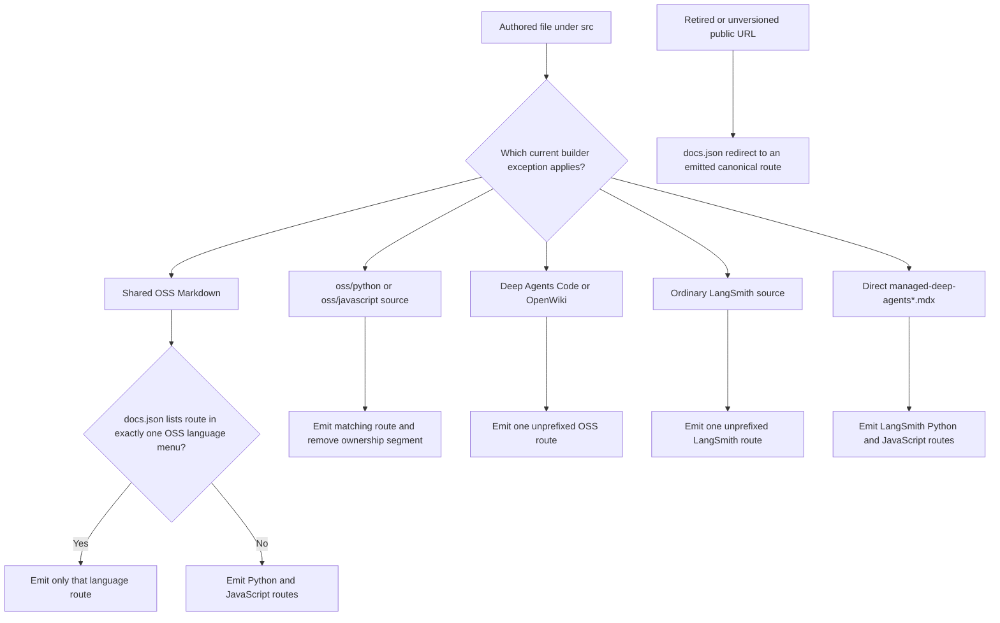

# Content Versioning and Navigation Model

The repository has separate contracts for authored content, public routes, navigation, and redirects. `AGENTS.md` is the authority for the lifecycle menu model and says to edit `src/` rather than Mintlify `build/`; `src/docs.json` is the authority for reader-facing placement and redirects. Directory names are useful ownership hints, but they do not prove where a page appears or whether a language sibling is emitted.

A route prefix identifies the documentation output target, not a package release version. `/oss/python/` and `/oss/javascript/` mean Python and TypeScript output; compatibility and package-version claims require separate evidence.

## Route selection and redirect decision

*The diagram shows build-time route selection and the separate redirect path; a redirect preserves a URL but does not create an artifact.*

### What the builder emits

`DocumentationBuilder.build_all()` removes and recreates `build/`, then builds shared OSS content for Python and JavaScript, the two unversioned OSS products, ordinary LangSmith content, Managed Deep Agents variants, shared files, and npm snippets. `src/docs.json` is copied as a shared file; it is configuration and navigation, not a page source.

| Source family | Full-build public route | Rendering target |
| --- | --- | --- |
| Shared `src/oss/` Markdown, excluding exceptions and language-owned trees | One or both of `/oss/python/...` and `/oss/javascript/...` | `python` and/or `js` |
| `src/oss/python/...` | `/oss/python/...`, with `python/` removed from the source remainder | `python` |
| `src/oss/javascript/...` | `/oss/javascript/...`, with `javascript/` removed from the source remainder | `js` |
| `src/oss/deepagents/code/...` | `/oss/deepagents/code/...` | `python` |
| `src/oss/openwiki/...` | `/oss/openwiki/...` | `python` |
| Ordinary `src/langsmith/...` | `/langsmith/...` | `python` |
| Direct `src/langsmith/managed-deep-agents*.mdx` | `/langsmith/python/...` and `/langsmith/javascript/...` | `python` and `js` |

The `js` preprocessing target maps to the `javascript` URL segment. A `.md` source is written as an `.mdx` artifact.

## How `docs.json` controls shared OSS output

For shared `.md` and `.mdx` files, the builder recursively collects `oss/python/...` and `oss/javascript/...` entries from the `navigation` object and caches the result until `docs.json` changes. A page listed in exactly one language menu emits only that language. A page listed in both menus, or in neither, emits both. Non-Markdown shared files emit for both.

A directory entry can select a shared `dir/index` route only when a language-owned `src/oss/<language>/dir.mdx` or `.md` does not own that directory route. This is a route-ownership exception, not a general rule inferred from directory names. If `docs.json` is missing or invalid, the builder safely falls back to both shared OSS variants. Focused tests cover one-language selection, directory ownership, and the invalid-configuration fallback.

Language-owned sources are an ownership boundary: they emit only into their matching language tree, with the source ownership segment removed. Do not place a page in `src/oss/python/` merely to choose a sidebar. The menu must also be updated in the matching Python or TypeScript projection.

The current `AGENTS.md` lifecycle map describes two Build dropdowns—Python and TypeScript—with matching tabs. Most tabs use language-versioned OSS routes, while Managed Deep Agents and OpenWiki are exceptions. It also warns that lifecycle menus mix `src/oss/` and `src/langsmith/`; menu labels do not mirror source directories. For example, the Build overview is the shared `src/build-overview.mdx` entry, LangGraph navigation points at `oss/python/langgraph/...` or `oss/javascript/langgraph/...`, and the same OpenWiki paths appear in both Build dropdowns.

## Explicit unversioned exceptions

### OpenWiki and Deep Agents Code

OpenWiki and Deep Agents Code are explicit unversioned products, not language-owned pages inferred from their parent directories. Their source trees emit once at `/oss/openwiki/...` and `/oss/deepagents/code/...`; conditional content uses the Python target as a deterministic rendering fallback, not as a claim that the products are Python-only. OSS link rewriting preserves these route families while prefixing eligible ordinary OSS links.

`docs.json` keeps the same OpenWiki routes in both Build dropdowns. The language-toggle script hides the language dropdown on `/oss/openwiki` and descendants. Former Python and JavaScript Deep Agents Code roots and wildcard descendants are redirected to the unprefixed Code family. These redirects preserve public URLs; they do not create duplicate artifacts.

### Managed Deep Agents

Managed Deep Agents is a LangSmith exception. The ordinary LangSmith pass excludes direct `managed-deep-agents*.mdx` files, and the dedicated pass emits Python and JavaScript routes. Full-build discovery is direct and `.mdx`-only; individual-file classification also recognizes `.md`, but a direct `.mdx` file is required for full-build discovery.

The current `docs.json` has parallel Python and TypeScript Managed Deep Agents tabs. Each has **Get started**, **Agent capabilities**, **Build and deploy**, and **Templates** groups. **Agent capabilities** includes Identity and a nested Channels group; **Build and deploy** includes Custom frontend. The same source can therefore produce deliberately different commands or types: the quickstart uses `uvx --from managed-deepagents mda init` for Python and npm-family `managed-deepagents init` commands for JavaScript, while runtime content uses language fences for native types and absent-sandbox values.

Unversioned Managed Deep Agents overview and legacy per-page URLs in `docs.json` redirect to Python routes because no unprefixed Managed Deep Agents artifact is emitted. This default does not remove the JavaScript artifacts. Shared OSS Async subagents is listed in both language projections and contains corresponding conditional content, so it remains a paired output rather than two independently authored pages.

Agent Registry is a different case: it is ordinary unversioned `/langsmith/agent-registry` content, listed under Products and setup → LangSmith setup → Overview → Agent-based workspaces. It documents centralized agent registration, environments, stable identifiers, and display names; it is not a language-specific counterpart of Managed Deep Agents.

## Preprocessing, links, and snippets

Before language rendering, standard Markdown preprocessing resolves `@[]` autolinks and adds UTM parameters to LangSmith CTA links. It then validates and applies `:::python` and `:::js` conditionals. The builder subsequently scopes eligible snippet imports, rewrites ordinary OSS links, and rewrites bare Managed Deep Agents links.

Conditional fences are structurally validated before the regular-expression renderer runs. Nested opens, stray closes, and unclosed blocks raise `ValueError` with line diagnostics. A matching supported block keeps its contents and removes the other supported branch; escaped `\:::` markers become literal markers. Keep blocks balanced and non-nested, and escape markers that must appear in displayed code or prose.

An eligible absolute `/oss/...` link is prefixed with the active `/oss/python/` or `/oss/javascript/` route unless it is already language-qualified, is an image, or points into OpenWiki or Deep Agents Code. Bare Managed Deep Agents links similarly follow the active `/langsmith/python/` or `/langsmith/javascript/` target; an already-qualified link remains pinned. Shared snippets receive Python and JavaScript copies with target preprocessing and absolute rewritten links, while the original snippet path is a Python-targeted default for unversioned importers.

## Reader-side language switching

`src/language-toggle.js` recognizes only these paired prefixes:

- `/oss/python/` ↔ `/oss/javascript/`
- `/langsmith/python/` ↔ `/langsmith/javascript/`

On a resolvable paired page, the capture-phase click handler navigates directly to the counterpart and preserves the hash. It also records the source path, target language, and timestamp in `sessionStorage` so a full reload can complete the switch. The pending record is consumed once and expires after eight seconds. An unprefixed page such as `/build-overview` has no computed counterpart, so the normal landing-page navigation remains in control.

The switcher is navigation convenience, not artifact validation. It does not prove that a sibling exists; inspect build output, menu entries, and redirects independently. OpenWiki is intentionally hidden from the language dropdown, while its routes remain present in both Build menus.

## Safe change and verification workflow

1. Classify source ownership from the builder and the explicit exceptions above; do not infer a public route from a directory name alone.
2. Update the appropriate `src/docs.json` lifecycle menu. For a shared OSS page, inspect both language projections: exactly one entry intentionally produces one output, while both or neither produces two.
3. Add redirects only for retired or externally supported URLs, and point them at emitted canonical routes. A redirect cannot substitute for a page artifact.
4. Keep conditional fences balanced and use complete semantic units inside each language branch.
5. Run a clean build and check both required and intentionally absent artifacts. Inspect generated links, snippets, and language-specific content.
6. Run `make check-cross-refs` after changing autolinks and `make broken-links-with-anchors` after route or anchor changes. Never edit `build/`.
7. Extend focused tests in `tests/unit_tests/test_builder.py` for route classification and transformations, and `tests/unit_tests/test_conditional_fences.py` for fence failures. Test the language toggle separately for both prefix pairs, hash preservation, reload fallback, expiry, and unversioned exceptions.

Source collection also rejects symlinks and files resolving outside the requested source root, preventing host files from entering build artifacts.

## Related pages

- [Repository source map](/openwiki/architecture/source-map.md)
- [Mintlify integration](/openwiki/integrations/mintlify.md)
- [Adding pages](/openwiki/operations/adding-pages.md)
- [Maintaining versioned content](/openwiki/workflows/versioned-content.md)
