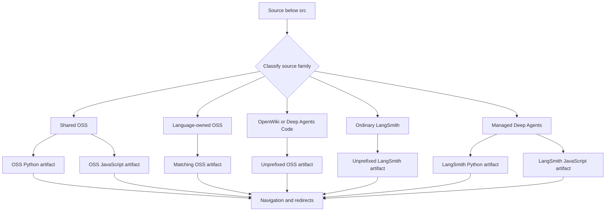
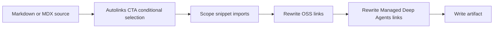

# Documentation Route and Language Versioning

`DocumentationBuilder` derives emitted routes from source ownership below `src/`. `src/docs.json` is copied as a shared file and separately defines reader navigation and compatibility redirects. It does not choose the source family that emits a route. Treat these as four independent contracts:

1. **Authoring family** — the source-tree location and filename pattern.
2. **Emitted route** — the artifact created in `build/`.
3. **Navigation** — a `docs.json` projection of a route into a menu, tab, or group.
4. **Redirect** — a compatibility mapping from a retired URL to a canonical route.

A label or menu does not establish ownership. The Build menu deliberately combines `src/oss/` and `src/langsmith/` material: Managed Deep Agents is authored under `src/langsmith/`, whereas OpenWiki is authored in `src/oss/openwiki/`.

## Source ownership determines route shape

| Authored source family | Full-build output | Render target |
| --- | --- | --- |
| Shared `src/oss/` content, including Deep Agents outside `code/` | `/oss/python/...` and `/oss/javascript/...` | `python` and `js` |
| `src/oss/python/...` | Only `/oss/python/...`, with `python/` removed from the remainder | `python` |
| `src/oss/javascript/...` | Only `/oss/javascript/...`, with `javascript/` removed from the remainder | `js` |
| `src/oss/deepagents/code/...` | `/oss/deepagents/code/...` | `python` fallback |
| `src/oss/openwiki/...` | `/oss/openwiki/...` | `python` fallback |
| Ordinary `src/langsmith/...` | `/langsmith/...` | `python` fallback |
| Direct `src/langsmith/managed-deep-agents*.mdx` | `/langsmith/python/...` and `/langsmith/javascript/...` | `python` and `js` |

This is the controlling direction: source classification produces artifacts; `docs.json` projects the resulting routes and preserves old URLs. It is not an input to classification.

`build_all()` removes and recreates `build/`, emits ordinary OSS variants, then unversioned Deep Agents Code and OpenWiki, ordinary LangSmith, Managed Deep Agents variants, shared files, and npm snippets. Use this clean full build as the route-shape authority: it removes stale artifacts after a page changes families. Source collection skips symlinks and files resolving outside the requested root, so a source-tree link cannot put host content into build artifacts.

Do not use `build_file()` as the route-shape check for language-owned OSS content. Its ordinary OSS branch writes both language output paths from the path below `oss/`, retaining a `python` or `javascript` component. The full-build loop instead skips the nonmatching ownership tree and removes that component. Validate published language-owned routes with a clean full build.

## Target-specific content and links

Shared OSS normally renders once for each target. Use `:::python` and `:::js` for an SDK-specific unit of prose, imports, or examples. Put an entire page in `src/oss/python/` or `src/oss/javascript/` only when it belongs to one language; those directories are ownership boundaries, not menu controls.

Conditional rendering recognizes only `:::python` and `:::js`. A matching closed block contributes its contents without fences; a closed supported block for the other target is removed. Escaped `\:::` markers become literal `:::`. Unsupported labels and unclosed blocks remain intact, and an invalid target raises `ValueError`.

The renderer is a whole-document regular-expression transform, not a Markdown code-fence-aware parser. Do not nest conditional blocks or expect an ordinary code fence to protect literal conditional syntax; escape markers that must be displayed. Standard preprocessing resolves autolinks, adds LangSmith CTA parameters, and then selects conditional content.

For a language-targeted Markdown or MDX artifact, the builder preprocesses, scopes eligible MDX snippet imports, rewrites OSS links, then rewrites Managed Deep Agents links. The internal key `js` maps to the `javascript` route segment, and a `.md` input is written as `.mdx`.

This is the ordered transformation path for a language-targeted artifact.

An eligible bare `/oss/...` Markdown destination or quoted `href` gains `/oss/python/` or `/oss/javascript/`. The rewrite preserves images, already-prefixed routes, and the unversioned `/oss/deepagents/code` and `/oss/openwiki` families. An unversioned page rendered with the Python target therefore defaults ordinary OSS links to Python but retains unprefixed product links. Bare Managed Deep Agents links similarly follow the target; an already prefixed route is deliberately pinned.

The builder scopes an eligible import such as `from '/snippets/component.mdx'` to `/snippets/python/component.mdx` or `/snippets/javascript/component.mdx`, leaving a scoped import unchanged. Shared Markdown snippets are emitted as Python and JavaScript copies with target-specific preprocessing and absolute rewritten links. Their original path is a Python-targeted default for unversioned importers, avoiding depth-dependent relative links.

## Unversioned product exceptions

### OpenWiki and Deep Agents Code

Deep Agents Code and OpenWiki each emit once at `/oss/deepagents/code/...` and `/oss/openwiki/...`. Their Python target selects Python conditional content; it does not create Python routes.

`docs.json` lists the same unprefixed OpenWiki routes in an OpenWiki tab in both Build dropdowns, and the language-toggle script hides its switcher for `/oss/openwiki` and descendants. This is intentional repeated discovery of one artifact, not dual output. The Deep Agents tab also contains language-versioned `deepagents/openwiki` entries under Context management; that page family is distinct from the OpenWiki product tab. Deep Agents Code is separately exposed as its own product-menu item.

Compatibility redirects map former Python and JavaScript Deep Agents Code roots and wildcard descendants to the unprefixed Code family. Redirects also cover earlier moved Code pages; a redirect maintains an old URL but does not create or own a page.

### Managed Deep Agents

Ordinary LangSmith content emits once below `/langsmith/` using Python preprocessing. Managed Deep Agents is the inverse exception: a direct top-level `src/langsmith/managed-deep-agents*` `.md` or `.mdx` file is recognized by `build_file()` and emits only Python and JavaScript variants; the ordinary LangSmith pass excludes it.

The full Managed Deep Agents pass discovers only direct `managed-deep-agents*.mdx` files. A matching `.md` file can be built through the targeted path but is absent from `build_all()`. Use a direct `.mdx` source for a page intended for the published full build.

The Build navigation must remain a paired projection. Both Python and TypeScript contain a **Managed Deep Agents** tab with equivalent **Get started**, **Agent capabilities**, and **Build and deploy** groups. Agent capabilities contains the nested **Channels** group; Build and deploy contains local development, tutorial, deployment, MCP endpoint, custom frontend, Context Hub, CLI, and changelog routes. The matching route prefixes are `langsmith/python/` and `langsmith/javascript/`, even though the reader-facing dropdown says TypeScript.

Unversioned current and selected historical Managed Deep Agents URLs redirect to Python routes. No unversioned Managed Deep Agents artifact exists: Python is the compatibility default, not a substitute for the JavaScript artifact. When adding a Managed Deep Agents page, add both emitted navigation entries and decide separately whether an unversioned or historical URL needs a redirect.

## Change and verify safely

When adding or moving a page, select its source family before its navigation label. Update `src/docs.json` for every intended navigation entry and retired public URL, but do not infer a source directory, emitted variant, or route from a product menu. A menu can list the same unversioned route in both language dropdowns; it cannot create alternate output.

For a versioning change:

1. Run a clean full build rather than relying on `build_file()` for route shape.
2. Verify required routes and the absence of prohibited siblings, especially for language-owned and unversioned pages.
3. Inspect each variant for selected conditional content, language-scoped snippets, and rewritten OSS and Managed Deep Agents links.
4. Check parallel Managed Deep Agents navigation entries group-for-group; check unversioned OpenWiki entries use the unprefixed route in both Build dropdowns.
5. Verify redirects against the canonical emitted route, not against source placement.
6. Run `make broken-links-with-anchors`; after changing `@[...]` references, also run `make check-cross-refs`.

Focused builder tests cover unversioned outputs and link exclusions, snippet import scoping and copies, Managed Deep Agents dual routes, link rewriting, and symlink rejection. Extend focused builder tests when changing classification, transformation order, or emitted route shape.

## See also

- [Build system](/openwiki/architecture/build-system.md)
- [Source map](/openwiki/architecture/source-map.md)
- [Documentation preprocessing](/openwiki/concepts/preprocessing.md)
- [Adding pages](/openwiki/operations/adding-pages.md)
- [Conditional rendering tests](/openwiki/testing/conditional-rendering.md)
- [Changing versioned content](/openwiki/workflows/versioned-content.md)
