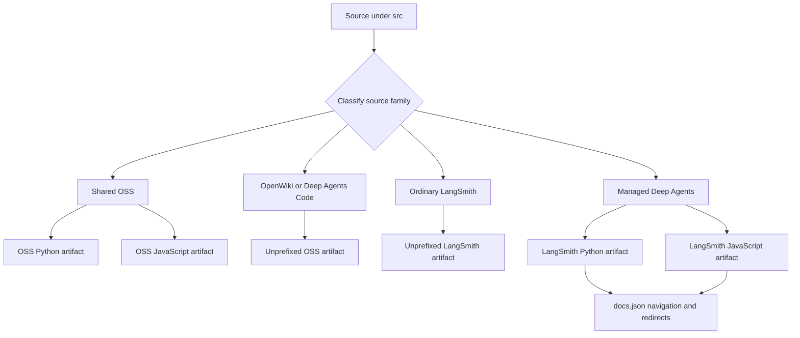
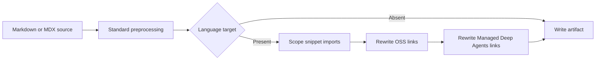

# Language Versions and Route Variants

`DocumentationBuilder` determines emitted pages from source ownership below `src/`. `src/docs.json` is a separate Mintlify configuration that supplies navigation and redirects and is copied as a shared file. It does not decide which source family emits a route. Treat ownership, output artifacts, navigation, and compatibility redirects as separate contracts.

## Choose the source family

| Source family | Full-build output | Rendering target |
| --- | --- | --- |
| Shared `src/oss/` content, including Deep Agents outside `code/` | `/oss/python/...` and `/oss/javascript/...` | `python` and `js` |
| `src/oss/python/...` | Only `/oss/python/...`, with `python/` removed from the remainder | `python` |
| `src/oss/javascript/...` | Only `/oss/javascript/...`, with `javascript/` removed from the remainder | `js` |
| `src/oss/deepagents/code/...` | `/oss/deepagents/code/...` | `python` fallback |
| `src/oss/openwiki/...` | `/oss/openwiki/...` | `python` fallback |
| Ordinary `src/langsmith/...` | `/langsmith/...` | `python` fallback |
| Direct `src/langsmith/managed-deep-agents*.mdx` | `/langsmith/python/...` and `/langsmith/javascript/...` | `python` and `js` |

This flow distinguishes the builder's path-based artifact generation from the configuration's navigation and redirect projection.

A full `build_all()` removes and recreates `build/`, builds the two ordinary OSS variants, builds Deep Agents Code and OpenWiki once, builds ordinary LangSmith and Managed Deep Agents, then copies shared files and npm snippets. A clean full build is therefore the route-shape authority and avoids stale artifacts after a source moves between families.

Do not use `build_file()` as an equivalent check for a language-owned OSS page. Its ordinary-OSS path creates Python and JavaScript copies from the path relative to `oss/`; unlike the full-build loop, it neither skips the other language-owned tree nor removes the `python` or `javascript` ownership segment. Use a clean full build to validate the published routes for those pages.

Full-build collection rejects symlinks and files that resolve outside its requested root. This prevents source-tree links from placing host files in emitted artifacts.

## Render shared and language-owned content

Shared OSS is the normal case: one source is rendered for both targets. Use `:::python` and `:::js` blocks for prose, imports, or examples that differ by SDK. Place a page under `src/oss/python/` or `src/oss/javascript/` only when the page itself belongs to that language; the directory is an ownership boundary, not a navigation control.

### Resolve conditional blocks

Conditional rendering recognizes only `:::python` and `:::js`. A matching, closed block contributes its contents without fences; a closed block for the other supported language is removed. Escaped `\:::` markers become literal `:::`. Unsupported labels and unclosed blocks remain unchanged, and an invalid target key raises `ValueError`.

The implementation is a whole-document regular-expression transform, not a Markdown code-fence-aware parser. Do not nest conditional blocks or place literal conditional syntax in a code fence and expect it to be protected. Escape literal markers instead. Standard preprocessing resolves autolinks and adds CTA tracking before conditional rendering.

### Apply the artifact transforms in order

For a Markdown or MDX artifact with a target language, the builder preprocesses first, then scopes eligible MDX snippet imports, rewrites OSS links, and rewrites bare Managed Deep Agents Markdown links and quoted `href` values. The internal key `js` maps to the `javascript` route segment, and `.md` input is written as `.mdx`.

This flow shows the ordered transforms applied to a language-targeted artifact.

For targeted output, eligible bare `/oss/...` Markdown destinations and quoted `href` values gain `/oss/python/` or `/oss/javascript/`. The rewrite excludes images, already-prefixed paths, and the deliberately unversioned `/oss/deepagents/code` and `/oss/openwiki` families. A bare ordinary OSS link authored in an unversioned product therefore resolves to Python, while a link to an unversioned product stays unprefixed.

The builder similarly scopes an eligible import such as `from '/snippets/component.mdx'` to `/snippets/python/component.mdx` or `/snippets/javascript/component.mdx`; already scoped imports stay pinned. Shared Markdown snippets are emitted in Python and JavaScript copies with their own conditional rendering and absolute rewritten links. The original snippet path is a Python-targeted default for unversioned importers, which avoids depth-dependent relative links.

For targeted artifacts, bare `/langsmith/managed-deep-agents...` Markdown links and quoted `href` values are rewritten to the current language family. A link already containing a language prefix is intentionally unchanged.

## Handle the route exceptions

### Keep OpenWiki and Deep Agents Code unversioned

Deep Agents Code and OpenWiki are exceptions to ordinary OSS duplication. Each is emitted once at `/oss/deepagents/code/...` or `/oss/openwiki/...`. The Python target used during rendering selects Python conditional content; it does not make a Python route.

`docs.json` lists the same OpenWiki routes in both the Python and TypeScript Build dropdowns. The language-toggle script hides the switcher at `/oss/openwiki` and beneath it, so this shared menu projection does not imply that an alternate page exists. Former Python and JavaScript Deep Agents Code roots and wildcard descendants redirect to the unprefixed Code family.

### Keep Managed Deep Agents paired

Ordinary LangSmith content emits once at `/langsmith/` with Python preprocessing. Direct `src/langsmith/managed-deep-agents*` files with `.md` or `.mdx` extensions are classified as Managed Deep Agents by a single-file build and emit only language-prefixed routes. The ordinary LangSmith path excludes them.

The full Managed Deep Agents pass discovers only direct `managed-deep-agents*.mdx` files. A matching `.md` file can be built through the targeted path but is omitted from `build_all()`. Use a direct `.mdx` source for any page intended for the published full build.

The current `docs.json` configuration projects Managed Deep Agents into matching Python and TypeScript tabs. Both have **Get started**, **Agent capabilities** with a nested **Channels** group, and **Build and deploy**. It redirects current unversioned Managed Deep Agents URLs and selected historical aliases to Python routes; no unversioned Managed Deep Agents artifact is generated. Python is the compatibility default, not a replacement for the TypeScript variant.

## Navigation and language switching

The language toggle recognizes only the paired `/oss/python/` ↔ `/oss/javascript/` and `/langsmith/python/` ↔ `/langsmith/javascript/` prefixes. When a reader chooses Python or TypeScript, it derives the equivalent path and preserves the fragment identifier. It records a short-lived pending switch in `sessionStorage` before navigation so that an intercepted Mintlify navigation or a full reload can still complete the switch; the record is consumed once and ignored after eight seconds. A shared or unversioned path has no equivalent prefix and is not rewritten by the toggle.

This client-side behavior is a navigation convenience, not evidence that both pages exist. The builder and `docs.json` must still supply the matching route families; the OpenWiki switcher is explicitly hidden because its single unprefixed route has no language sibling.

## Preserve the published-route invariants

When adding or moving a page, choose its source family first. Then update `src/docs.json` for every intended navigation entry and each retired public URL. Navigation can deliberately list an unversioned page in both language menus, but that does not change source ownership. A redirect maintains an old URL; it does not substitute for an emitted, maintained page.

For a versioning change:

1. Run a clean full build, rather than relying on a targeted build for route shape.
2. Check expected routes and the absence of prohibited siblings, especially for language-owned and unversioned pages.
3. Inspect each applicable variant for selected conditional content, language-scoped snippets, and rewritten OSS and Managed Deep Agents links.
4. Verify every `docs.json` menu and redirect path against the generated route family.
5. Run `make broken-links-with-anchors`; after changing `@[...]` references, run `make check-cross-refs`.

Focused builder tests cover unversioned Deep Agents Code and OpenWiki outputs and links, scoped snippet imports and copies, Managed Deep Agents dual routes, target-specific link rewriting, quoted `href` rewriting, conditional snippet content, and symlink rejection. Extend `tests/unit_tests/test_builder.py` when changing classification, transformation order, or route emission.

## See also

- [Source map](/openwiki/architecture/source-map.md)
- [Documentation preprocessing](/openwiki/concepts/preprocessing.md)
- [Adding and Maintaining Documentation Pages](/openwiki/operations/adding-pages.md)
- [Conditional rendering tests](/openwiki/testing/conditional-rendering.md)
- [Changing versioned content](/openwiki/workflows/versioned-content.md)
