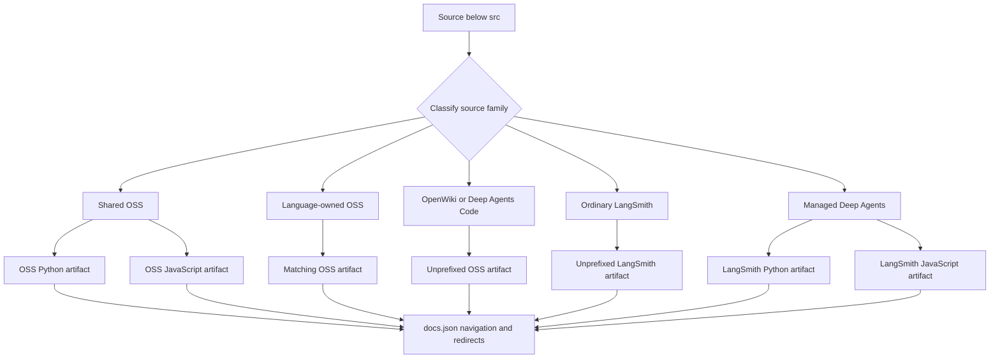
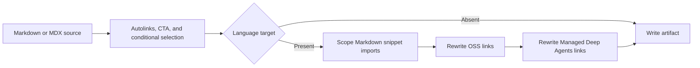

# Language Variants and Route Ownership

`DocumentationBuilder` derives emitted routes from source ownership below `src/`. `src/docs.json` is copied as a shared file and separately defines navigation and compatibility redirects. It does not decide which source family emits a route. Treat source ownership, generated artifacts, reader-facing navigation, and redirects as independent contracts.

A navigation label is not a source-path contract. For example, the **No-code agents** menu item maps to `src/langsmith/fleet/`, while **Deep Agents Code** is authored under `src/oss/deepagents/code/`. Find ownership from the source family, then configure the desired product and menu projection separately.

## Select a source family

| Authored source family | Full-build output | Rendering target |
| --- | --- | --- |
| Shared `src/oss/` content, including Deep Agents outside `code/` | `/oss/python/...` and `/oss/javascript/...` | `python` and `js` |
| `src/oss/python/...` | Only `/oss/python/...`, with `python/` removed from the remainder | `python` |
| `src/oss/javascript/...` | Only `/oss/javascript/...`, with `javascript/` removed from the remainder | `js` |
| `src/oss/deepagents/code/...` | `/oss/deepagents/code/...` | `python` fallback |
| `src/oss/openwiki/...` | `/oss/openwiki/...` | `python` fallback |
| Ordinary `src/langsmith/...` | `/langsmith/...` | `python` fallback |
| Direct `src/langsmith/managed-deep-agents*.mdx` | `/langsmith/python/...` and `/langsmith/javascript/...` | `python` and `js` |

This shows route emission from the source family first. `docs.json` projects the resulting routes into navigation and preserves retired URLs; it is not an input to classification.

`build_all()` deletes and recreates `build/`, emits ordinary OSS variants, emits Deep Agents Code and OpenWiki once, emits ordinary LangSmith and Managed Deep Agents, then copies shared files and npm snippets. A clean full build is the route-shape authority and prevents stale artifacts after a page moves between families. Its source collection skips symlinks and any file resolving outside the requested root, so a source-tree link cannot place host content in the build.

Do not use `build_file()` as the route-shape check for language-owned OSS content. Its ordinary OSS branch writes both language output paths from the path below `oss/`, retaining the `python` or `javascript` segment. The full-build loop instead skips the nonmatching ownership tree and strips that segment. Use a clean full build to validate a published language-owned route.

## Render shared and language-owned pages

Shared OSS is the normal case: one source renders for both targets. Use `:::python` and `:::js` blocks for an SDK-specific prose unit, import, or example. Put a page below `src/oss/python/` or `src/oss/javascript/` only when the entire page belongs to that language. These directories are route-ownership boundaries, not navigation controls.

### Select conditional content

Conditional rendering recognizes only `:::python` and `:::js`. A matching closed block contributes its content without fences; a closed block for the other supported language is removed. Escaped `\:::` markers become literal `:::`. Unsupported labels and unclosed blocks remain intact, while an invalid target key raises `ValueError`.

The renderer is a whole-document regular-expression transform, not a Markdown code-fence-aware parser. Do not nest conditional blocks or expect a normal code fence to protect literal conditional syntax. Escape the markers when they must be shown. Standard preprocessing resolves scoped autolinks, adds LangSmith CTA parameters, and then performs conditional selection.

Cross-reference scope is evaluated before selection. `:::python` and `:::js` change the active autolink-map scope while the source is scanned, so an SDK-specific `@[...]` belongs in its matching branch. An unfenced reference in shared OSS must resolve for both Python and JavaScript when `make check-cross-refs` validates the source. This source-level validation is distinct from route rewriting, which applies later to ordinary documentation links.

### Apply output transforms in order

For a Markdown or MDX artifact with a target language, the builder preprocesses first, scopes eligible MDX snippet imports, rewrites OSS links, then rewrites Managed Deep Agents links. The internal key `js` maps to the `javascript` route segment, and a `.md` input is written as `.mdx`.

This is the ordered transformation path for a language-targeted page artifact.

An eligible bare `/oss/...` Markdown destination or quoted `href` gains `/oss/python/` or `/oss/javascript/`. The rewrite leaves images, already-prefixed routes, and the unversioned `/oss/deepagents/code` and `/oss/openwiki` families unchanged. Thus an unversioned page rendered with the Python target links to ordinary OSS Python documentation by default, while links to an unversioned product remain unprefixed.

The builder scopes an eligible import such as `from '/snippets/component.mdx'` to `/snippets/python/component.mdx` or `/snippets/javascript/component.mdx`; already scoped imports remain pinned. Shared Markdown snippets are emitted as Python and JavaScript copies with target-specific preprocessing and absolute rewritten links. The original snippet path is a Python-targeted default for unversioned importers, avoiding depth-dependent relative links.

Bare `/langsmith/managed-deep-agents...` Markdown links and quoted `href` values similarly become the current language route. An already prefixed Managed Deep Agents link is deliberately unchanged, so it can intentionally target a particular variant.

## Keep the exceptions distinct

### Keep OpenWiki and Deep Agents Code unversioned

Deep Agents Code and OpenWiki are exceptions to ordinary OSS duplication. Each source tree emits once at `/oss/deepagents/code/...` or `/oss/openwiki/...`. The Python target selects Python conditional content; it does not create a Python route.

`docs.json` lists the same OpenWiki paths in both the Python and TypeScript Build dropdowns, while the language-toggle script hides its switcher at `/oss/openwiki` and below. Those two menu projections do not imply alternative emitted pages. Deep Agents Code is instead projected as a **Products and setup** item. Compatibility redirects map former Python and JavaScript Deep Agents Code roots and descendants to the unprefixed Code family.

### Keep Managed Deep Agents paired

Ordinary LangSmith content emits once below `/langsmith/` with Python preprocessing. Managed Deep Agents is the inverse exception: a direct top-level `src/langsmith/managed-deep-agents*` `.md` or `.mdx` file is recognized by a targeted build and emits only the Python and JavaScript route variants; the ordinary LangSmith pass excludes it.

The full Managed Deep Agents pass discovers only direct `managed-deep-agents*.mdx` files. A matching `.md` file can be built through the targeted path but is omitted by `build_all()`. Use a direct `.mdx` source for a page intended for the full published build.

`docs.json` projects Managed Deep Agents into corresponding Python and TypeScript tabs, including **Get started**, **Agent capabilities** with **Channels**, and **Build and deploy** groups. It redirects current unversioned and selected historical Managed Deep Agents URLs to Python routes. No unversioned Managed Deep Agents artifact is generated: Python is the compatibility default, not a replacement for the JavaScript variant.

## Preserve route and link invariants

When adding or moving a page, choose source ownership before choosing a navigation label. Then update `src/docs.json` for each desired navigation entry and each retired public URL. Navigation may list an unversioned page in multiple language menus, but it cannot change ownership or create alternate output. A redirect preserves a previous URL; it does not substitute for an emitted maintained page.

For a versioning change:

1. Run a clean full build, rather than relying on a targeted build for route shape.
2. Verify required routes and the absence of prohibited siblings, especially for language-owned and unversioned pages.
3. Inspect every applicable variant for selected conditional content, scoped cross-references, language-scoped snippets, and rewritten OSS and Managed Deep Agents links.
4. Verify every `docs.json` navigation entry and redirect against the generated route family, without inferring location from its reader-facing label.
5. Run `make broken-links-with-anchors`. After changing `@[...]` references, also run `make check-cross-refs`.

Focused builder tests cover unversioned Deep Agents Code and OpenWiki outputs and link exclusions, snippet import scoping and copies, Managed Deep Agents dual routes, target-specific OSS and Managed Deep Agents rewriting, and symlink rejection. Lexer tests separately recognize conditional open and close tokens, including indentation. Extend the focused builder tests when changing source classification, transform order, or emitted route shape.

## See also

- [Source map](/openwiki/architecture/source-map.md)
- [Documentation preprocessing](/openwiki/concepts/preprocessing.md)
- [Cross-references](/openwiki/operations/cross-references.md)
- [Conditional rendering tests](/openwiki/testing/conditional-rendering.md)
- [Changing versioned content](/openwiki/workflows/versioned-content.md)
