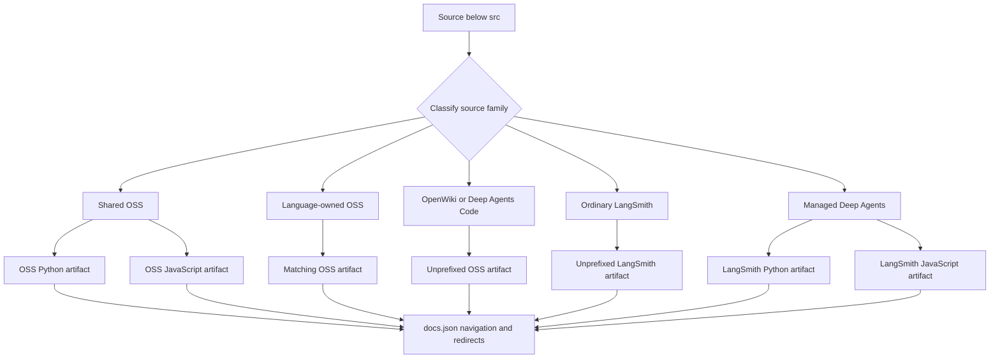
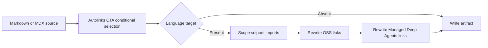

# Documentation Route and Language Versioning

`DocumentationBuilder` derives an emitted route from a source's ownership below `src/`. `src/docs.json` is copied as a shared file and independently supplies navigation and compatibility redirects. It does not decide which source family emits a route. Keep these four contracts separate:

1. **Source location** decides the builder's route family and rendering target.
2. **Emitted artifact** is the generated file beneath disposable `build/`.
3. **Navigation membership** is the reader-facing projection in `docs.json`.
4. **Redirect** preserves an old public URL; it neither emits a page nor grants source ownership.

**Do not infer ownership from a menu label.** The Build menus project sources from both `src/oss/` and `src/langsmith/`: Managed Deep Agents is authored in `src/langsmith/`, OpenWiki in `src/oss/openwiki/`, and ordinary agent-workspace guides such as `src/langsmith/agents.mdx` remain ordinary unversioned LangSmith pages. Determine ownership first, then configure the intended menu placement and retired URLs separately.

## Route families

| Authored source family | Clean full-build output | Rendering target |
| --- | --- | --- |
| Shared `src/oss/` content, including Deep Agents outside `code/` | `/oss/python/...` and `/oss/javascript/...` | `python` and `js` |
| `src/oss/python/...` | Only `/oss/python/...`, with `python/` removed from the remainder | `python` |
| `src/oss/javascript/...` | Only `/oss/javascript/...`, with `javascript/` removed from the remainder | `js` |
| `src/oss/deepagents/code/...` | `/oss/deepagents/code/...` | `python` fallback |
| `src/oss/openwiki/...` | `/oss/openwiki/...` | `python` fallback |
| Ordinary `src/langsmith/...` | `/langsmith/...` | `python` fallback |
| Direct `src/langsmith/managed-deep-agents*.mdx` | `/langsmith/python/...` and `/langsmith/javascript/...` | `python` and `js` |

This shows the controlling direction: source family produces artifacts; `docs.json` projects known routes into navigation and preserves retired URLs. It is not an input to route classification.

`build_all()` removes and recreates `build/`, emits ordinary OSS variants, then unversioned Deep Agents Code and OpenWiki, ordinary LangSmith, Managed Deep Agents variants, shared files, and npm snippets. Use this clean full build as the route-shape authority: it prevents stale artifacts after a page moves between families. Source collection skips symlinks and files resolving outside its requested root, preventing a source-tree link from putting host content in build artifacts.

Do not use `build_file()` as the route-shape check for language-owned OSS content. Its ordinary OSS branch writes both language output paths from the path below `oss/`, retaining a `python` or `javascript` path component. The full-build loop instead skips the nonmatching ownership tree and removes that component. Validate published language-owned routes with a clean full build.

## Conditional content and transformations

Shared OSS normally renders once for each target. Use `:::python` and `:::js` for an SDK-specific unit of prose, imports, or examples. For example, `src/oss/deepagents/async-subagents.mdx` is projected under Delegation in both Deep Agents tabs while its Python-only implementation details are fenced; a shared source is not evidence that both rendered variants contain identical prose. Put an entire page in `src/oss/python/` or `src/oss/javascript/` only when it belongs to one language; those directories are ownership boundaries, not menu controls.

Conditional rendering recognizes only `:::python` and `:::js`. A matching closed block contributes its contents without fences; a closed supported block for the other language is removed. Escaped `\:::` markers become literal `:::`. Unsupported labels and unclosed blocks remain intact, and an invalid target raises `ValueError`.

The renderer is a whole-document regular-expression transform, not a Markdown code-fence-aware parser. Do not nest conditional blocks or expect an ordinary code fence to protect literal conditional syntax; escape markers that must be displayed. Standard preprocessing resolves autolinks, adds LangSmith CTA parameters, and then selects conditional content.

For a target-language Markdown or MDX artifact, the builder preprocesses, scopes eligible MDX snippet imports, rewrites OSS links, and finally rewrites Managed Deep Agents links. The internal key `js` maps to the `javascript` route segment, and a `.md` input is written as `.mdx`.

This is the ordered transformation path for a language-targeted artifact.

An eligible bare `/oss/...` Markdown destination or quoted `href` gains `/oss/python/` or `/oss/javascript/`. The rewrite preserves images, already-prefixed routes, and the unversioned `/oss/deepagents/code` and `/oss/openwiki` families. Thus an unversioned page rendered with the Python target defaults links to ordinary OSS Python documentation but continues to link to unversioned products without a prefix. Bare Managed Deep Agents links are likewise rewritten to the current language; an already prefixed link remains pinned to its specified variant.

The builder scopes an eligible import such as `from '/snippets/component.mdx'` to `/snippets/python/component.mdx` or `/snippets/javascript/component.mdx`, leaving a scoped import unchanged. Shared Markdown snippets are emitted as Python and JavaScript copies with target-specific preprocessing and absolute rewritten links. Their original paths are Python-targeted defaults for unversioned importers, avoiding depth-dependent relative links.

## Reader-facing projections

### Language selector behavior

The language-toggle script recognizes only paired `/oss/python/` ↔ `/oss/javascript/` and `/langsmith/python/` ↔ `/langsmith/javascript/` prefixes. When a reader chooses Python or TypeScript, it records the source path and hash in `sessionStorage`, attempts an immediate equivalent-route navigation, and consumes a fresh pending switch after client-side or full-page navigation. A shared landing page or another unprefixed route has no computed counterpart, so the script leaves Mintlify's selected landing-page navigation in place.

This selector is navigation behavior, not a route generator or a redirect system. It cannot prove that a counterpart artifact exists; paired menus and generated output must still be checked. OpenWiki is explicitly excluded from the switcher on `/oss/openwiki` and descendants because it is one unversioned product despite appearing in both Build dropdowns.

### Ordinary LangSmith and the expanded agent surface

Ordinary LangSmith sources emit once below `/langsmith/` using the Python target. The agent-workspace guides—`agents`, `agent-environments`, `navigate-agents`, `create-an-agent`, `build-an-agent`, and `deploy-to-agent-environment`—are projected as the **Agent-based workspaces** group under **Products and setup → LangSmith setup**, rather than as language variants. Their `src/langsmith/` location and their unprefixed menu routes agree; the presence of Python and REST examples inside a guide does not make it a paired language route.

This keeps the newly expanded LangSmith agent documentation distinct from Managed Deep Agents. For example, `agents.mdx` links directly to `/langsmith/create-an-agent`, and `create-an-agent.mdx` uses a Python/REST content tab while remaining one ordinary source and one emitted route. Do not add `/langsmith/python/agents` or `/langsmith/javascript/create-an-agent` entries merely because the language switcher supports a different, Managed Deep Agents route family.

### OpenWiki and Deep Agents Code

Deep Agents Code and OpenWiki each emit once at `/oss/deepagents/code/...` and `/oss/openwiki/...`. Their Python target selects Python conditional content; it does not create Python routes.

`docs.json` lists the same unprefixed OpenWiki route family in the OpenWiki tab of both Build-language dropdowns, and the language-toggle script hides its switcher at `/oss/openwiki` and below. At the same time, each Deep Agents tab includes a language-versioned `deepagents/openwiki` source-navigation page, while Deep Agents Code is a separate product-menu item. These are reader-facing projections, not evidence of alternative ownership or generated route families.

Compatibility redirects map former Python and JavaScript Deep Agents Code roots and wildcard descendants to the unprefixed Code family. Redirects also cover earlier `cli` aliases and selected moved Code pages; a redirect maintains an old URL but does not create or own a page.

### Managed Deep Agents

Managed Deep Agents is the LangSmith exception: a direct top-level `src/langsmith/managed-deep-agents*` `.md` or `.mdx` file is recognized by `build_file()` and emits only Python and JavaScript variants; the ordinary LangSmith pass excludes it. The full Managed Deep Agents pass discovers only direct `managed-deep-agents*.mdx` files. A matching `.md` file can be built through the targeted path but is absent from `build_all()`. Use a direct `.mdx` source for a page intended for the published full build.

`docs.json` projects Managed Deep Agents into corresponding Python and TypeScript tabs with the same three groups: **Get started**, **Agent capabilities**, and **Build and deploy**. The current projection includes Identity under Agent capabilities and Custom frontend under Build and deploy in both tabs, alongside the nested Channels group. Their direct `src/langsmith/managed-deep-agents-identity.mdx` and `managed-deep-agents-custom-frontend.mdx` sources therefore produce both language routes and must remain represented in both navigation projections.

Compatibility redirects send the unversioned Managed Deep Agents landing URL, earlier aliases, and listed unversioned per-page URLs—including Identity and Custom frontend—to the corresponding Python route. No unversioned Managed Deep Agents artifact exists; Python is the compatibility default, not a replacement for the JavaScript variant. A redirect is a public-URL contract only: it does not cause the builder to emit a page or remove the JavaScript route.

## Change and verify safely

When adding or moving a page, choose its source family before choosing a navigation label. Update `src/docs.json` for every intended navigation entry and retired public URL, but do not infer a source directory, emitted variant, or route from a product menu. A menu can list an unversioned route in both language dropdowns; it cannot create alternative output.

For a versioning change:

1. Run a clean full build rather than relying on `build_file()` for route shape.
2. Verify required routes and the absence of prohibited siblings, especially for language-owned and unversioned pages.
3. Inspect each applicable variant for selected conditional content, language-scoped snippets, and rewritten OSS and Managed Deep Agents links.
4. Verify navigation entries, selector expectations, and redirects against the generated route family.
5. Run `make broken-links-with-anchors`; after changing `@[...]` references, also run `make check-cross-refs`.

Focused builder tests cover unversioned outputs and link exclusions, snippet import scoping and copies, Managed Deep Agents dual routes, link rewriting, and symlink rejection. Extend focused builder tests when changing classification, transformation order, or emitted route shape. Test selector changes against both supported prefix pairs, hash preservation, pending-switch expiry, and unversioned exceptions; builder tests cannot validate browser navigation behavior.

## See also

- [Source map](/openwiki/architecture/source-map.md)
- [Adding pages](/openwiki/operations/adding-pages.md)
- [Builder tests](/openwiki/testing/builder-tests.md)
- [Changing versioned content](/openwiki/workflows/versioned-content.md)
