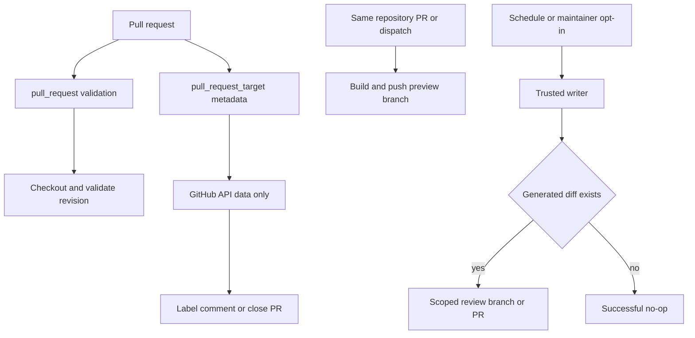
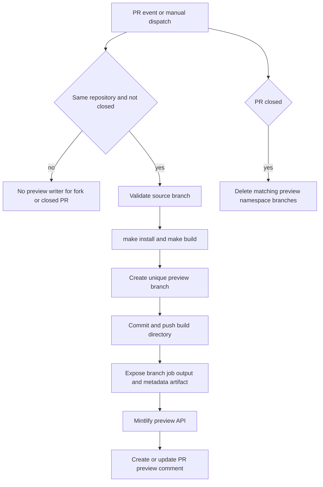

## Trust and permission model

Workflow event selection is a security boundary. The repository separates untrusted revision validation, metadata mutation, and trusted repository writers:

| Role | Event and authority | Boundary |
| --- | --- | --- |
| Revision validation | `pull_request`, pushes to `main`, and manual dispatch | Check out and test the revision. Fork code may run here, but must not receive repository-writing authority or provider credentials. |
| PR metadata automation | `pull_request_target` | Read GitHub API metadata and label, comment on, or close a PR. Do not check out or execute the PR head in this context. |
| Generated deployment handoff | Same-repository `pull_request` or manual dispatch | Build a trusted checkout, then write only the generated preview branch. Fork PRs do not enter this writer path. |
| Scheduled or maintainer-authorized writer | Schedule, manual dispatch, or maintainer-approved event | Generate a narrowly scoped, reviewable branch or PR; exit successfully when there is no diff. |



*Automation separates contributed-code execution, metadata mutation, deployment handoff, and repository-writing authority.*

The integration-submission workflow demonstrates the maintainer-gated writer boundary. Opening an issue does not start the agent: a maintainer must apply `integration-run` or manually dispatch the workflow, and the workflow verifies that the triggering actor has `admin`, `maintain`, or `write` permission. It parses issue-form values as untrusted listing metadata. The agent is required to leave local changes uncommitted and cannot push, create a PR, or comment. Failures, blockers, invalid forms, and no-diff outcomes are reported without a PR.

Only after the agent produces a real diff does the workflow mint a GitHub App token. That token, rather than the agent, is used by `create-pull-request` to create `integration/issue-<number>` and the review PR. This limits agent access to GitHub mutation and avoids a `GITHUB_TOKEN`-created PR waiting for manual approval before its pull-request workflows run. The persistent `integration-automation` label and per-issue non-cancelling concurrency prevent duplicate processing. See [Integration Listing Automation](/openwiki/workflows/integration-listing-automation.md) and [Agent Skills](/openwiki/operations/agent-skills.md) for the intake contract and skill boundary.

## Core CI and reusable checks

`ci.yml` runs on pull requests, pushes to `main`, and manual dispatch. It calls reusable test, lint, and documentation-link workflows and separately checks conflict markers, cross references, external integration `docs_url` values, and generated output. Its concurrency group is the workflow plus ref, so a newer push cancels an obsolete run for the same branch or PR.

The reusable test and lint workflows accept a Python version and working directory, check out shallowly, synchronize the `test` dependency group, and run `make test` or `make lint`. The link workflow is read-only and limited to 20 minutes; it installs the test dependencies and Node 22, runs `make broken-links-with-anchors`, then runs `make check-openapi`.

The generated-file job regenerates `src/oss/python/integrations/providers/overview.mdx` with `pipeline/tools/partner_pkg_table.py` and fails if it differs. Correct `packages.yml` or the generator and commit the regenerated result rather than hand-editing the overview. The workflow deliberately skips this check for the expected package-download bot PR title or a `bypass-auto-check` label.

A focused pull-request-only companion, `check-external-doc-links.yml`, runs when Markdown, MDX, its script, or its workflow changes. It calls `scripts/check-legacy-doc-links.sh`, which scans the authored `src/` documentation tree rather than only changed lines and fails on retired documentation hosts, except the Helm-chart path. Use root-relative documentation links or `https://reference.langchain.com/` as the script directs.

For local triage, use the same boundaries as CI:

```bash
make test
make lint
make check-cross-refs
make broken-links-with-anchors
make check-openapi
uv run python scripts/refresh_integration_downloads.py --check-docs-urls
uv run python pipeline/tools/partner_pkg_table.py
```

See [Testing and Validation Overview](/openwiki/testing/test-overview.md) for the contract each check establishes, and [Local Documentation Development](/openwiki/workflows/local-development.md) for the generated-tree workflow.

## Mintlify preview branch lifecycle

`create-preview-branch.yml` is a generated deployment handoff, not a general-purpose fork-preview workflow. It runs for PR open, synchronization, reopen, and close events and can be manually dispatched. The workflow default is only `contents: read` plus `actions: read`; job-level permissions elevate only where needed:

- `create-preview` gets `contents: write` to create the generated branch. It runs only for a same-repository PR or `workflow_dispatch`, and never for a closed PR.
- `comment-on-pr` receives only `pull-requests: write`; it cannot push repository content. It runs after a successful creation job only for a PR and skips Dependabot-authored PRs.
- `cleanup-preview-branches` gets `contents: write` only on the PR-close path.

The creation job derives `SOURCE_BRANCH` and the source SHA from the PR head (or the dispatched ref), rejects branch names outside `[.a-zA-Z0-9/_-]` and lengths over 100, checks out that branch, then runs `make install` and `make build`. It constructs `preview-<six-alphanumeric-character-prefix>-<unix-timestamp>-<seven-character-sha>`, verifies that no remote branch already has that exact name, and creates a branch from the checkout. It force-adds the otherwise ignored `build/` directory, commits it if nonempty, and pushes the branch even when there were no build changes to commit. The generated branch is a Mintlify handoff and must not be merged to `main` or edited as authoring state.



*The preview workflow builds trusted same-repository content, hands the generated tree to Mintlify through a temporary branch, then reports the hosted preview on the PR.*

The branch name is both a job output and the contents of the `preview-branch-metadata` artifact, along with the PR number when applicable. Within this workflow, the comment job consumes the job output directly; the artifact makes the branch/PR association available to a downstream workflow without recomputing it. A consumer must treat that metadata as an identifier for the generated handoff, not as permission to modify the source branch.

### Deployment API and PR comment

After creation succeeds, `comment-on-pr` checks `MINTLIFY_API_KEY`, `MINTLIFY_PROJECT_ID`, and the branch output, then POSTs `{"branch":"<preview branch>"}` to `https://api.mintlify.com/v1/project/preview/${MINTLIFY_PROJECT_ID}` with a bearer token. Invalid JSON fails the job. An API response with an `error` but neither `statusId` nor `previewUrl` also fails; a response that has either field is accepted, and the `previewUrl` is used when present.

The PR-comment code reads changed files with the GitHub API rather than checking out the PR again. It considers Markdown/MDX below `src/`, excludes `code-samples` and `snippets`, maps `index` pages and ordinary OSS paths to site routes, ranks routable changed pages by diff size, and includes at most five deep links. It maintains one bot comment using `<!-- mintlify-docs-preview -->`, recognizes older preview formats, removes duplicate bot preview comments, and edits the existing body rather than posting a notification-producing comment for every push. A missing preview URL therefore still records the generated branch, but cannot produce site or page links.

### Cleanup boundary

On a closed or merged PR, cleanup sanitizes the PR head branch to its first six alphanumeric characters, lists remote branches matching `preview-<prefix>-*`, and attempts to delete each. Before every deletion it requires the name to begin with `preview-`; a failed delete is only warned because the branch may already be gone. This deliberately protects non-preview branches, but the match is a source-prefix namespace rather than a PR number or full branch identity. Do not weaken the namespace check, and do not assume cleanup selects one branch exclusively when extending naming or retention behavior.

Preview runs use `create-preview-${{ github.ref_name }}` concurrency with cancellation enabled. A newer run for the same ref can cancel an older one; creation checks exact remote-name collision separately. For fork PRs, use local `make build` and link validation or a maintainer-controlled same-repository branch rather than adding write credentials or Mintlify secrets to the fork path. See [Mintlify Integration](/openwiki/integrations/mintlify.md) for the source-to-`build/` ownership boundary and hosted-only behavior.

## PR metadata, contributors, and code samples

Two `pull_request_target` workflows intentionally operate without checking out a contributor branch. `tag-external-contributions.yml` mints an organization-membership App token to distinguish active `langchain-ai` members from external authors, labels new issues and PRs as `internal` or `external`, and treats membership lookup errors as external. The App token is necessary because private organization membership requires organization read access; configured internal bots are explicitly treated as internal.

`external-integration-pr-comment.yml` similarly reads changed-file metadata and, only when needed, the head MDX content through the GitHub API. For a non-draft external PR adding integration documentation or changing the external-listing YAML, it adds the `integration` label. A new hosted page avoids closure only when its frontmatter is `featured: true` or its declared package has at least 50,000 monthly downloads. Otherwise the workflow posts one marker-based redirect to the integration-listing issue form and closes the open PR. API-fetched content remains data, not executable source.

The code-sample workflow is a separate credentialed test boundary. It runs only for relevant paths on PRs, manually, or monthly; it skips forks because some samples require secrets. Same-repository PRs test changed eligible samples, while manual and scheduled runs test all samples with a PostgreSQL service and language toolchains. Full runs can trace samples and regenerate trace-linked snippet MDX; only when the controlled artifact paths differ does it create or update the standing trace-refresh PR. See [Code Sample Lifecycle](/openwiki/workflows/code-sample-lifecycle.md).

## Scheduled review writers

Scheduled automation proposes changes for review; it is not publication authorization. `check-integration-repos.yml` runs Monday at 09:15 UTC or manually. It uses an App token for checkout and PR operations because bot-token-created PRs otherwise wait for manual approval, but provides the scan itself only the workflow token for authenticated external GitHub checks. The scan writes an evidence report to the job summary and, if there is a working-tree diff, restores those changes onto the single `chore/dead-integration-repos` draft-PR branch. Later scans append to that open PR and refresh its evidence body; no diff means no PR.

The checker skips first-party `langchain-ai/*` repositories. For unavailable third-party GitHub homes, it can repair a confirmed third-party replacement found from PyPI, npm, or existing docs metadata. A live GitLab project or partner documentation is an attention case rather than a delist. It only proposes full removal when no live GitHub, GitLab, or partner-documentation alternative exists, and updates external documentation URLs only for permanent `301` or `308` redirects. Review its evidence and every resulting deletion before merging.

`refresh-langsmith-openapi.yml` runs daily or manually with `contents` and pull-request write permission. It mints an App token before checkout, regenerates the public LangSmith specification, and preserves one review surface: it appends to an open `chore/refresh-langsmith-openapi` PR or creates it when the generated file differs. An unchanged specification exits without a commit.

`update-package-downloads.yml` separates generation from mutation. Its read-only generation job refreshes package counts, regenerates the provider overview and integration snippets, then uploads only the tracked outputs as a one-day artifact. The dependent writer job downloads that artifact, exits on no diff, and otherwise creates a timestamped package-download PR and enables squash auto-merge. This artifact boundary avoids giving the external-data and generation steps repository-write permissions.

## OpenWiki update behavior

`openwiki-update.yml` runs daily at 08:00 UTC and can be dispatched manually. It checks out full history because `openwiki code --update` needs the revision previously documented to calculate its change set; a shallow checkout would make that comparison empty. The generator alone receives provider, LangSmith-connector, and optional tracing credentials.

After generation, the workflow mints a GitHub App token and creates or updates the fixed `openwiki/update` PR. Its `add-paths` allowlist confines the commit to `openwiki`, `AGENTS.md`, and `.github/workflows/openwiki-update.yml`. Treat `docs: update OpenWiki` as generated, reviewable documentation: inspect claims and source coverage before merge, and do not broaden the allowlist merely to capture incidental workspace edits.

## Safe-change checklist

1. Keep `pull_request` validation, `pull_request_target` metadata actions, same-repository preview writers, and scheduled writers separate.
2. Never check out or execute fork-head code from a `pull_request_target` workflow, and do not add Mintlify secrets or write permission to fork-preview paths.
3. Keep the preview job permissions split: branch creation may write contents, comments may write PRs, and cleanup may write contents only on close.
4. Preserve branch validation, collision checking, build-before-handoff, and the generated `build/` commit when changing preview naming or deployment.
5. Preserve the Mintlify API response failure rules and marker-based in-place comment update; treat a missing `previewUrl` as no hosted-link result.
6. Keep cleanup inside the `preview-` namespace. Its six-character source-prefix selection is not a unique PR key, so strengthen identity before relying on single-PR deletion semantics.
7. Preserve maintainer authorization, untrusted-form handling, local-edit-only agent behavior, and post-agent App-token minting in integration submission.
8. Preserve no-op exits, narrow path staging or artifacts, evidence reports, and human review for scheduled writers.
9. Keep the OpenWiki writer's full-history checkout and three-path PR allowlist.

## Related pages

- [Repository Source Map](/openwiki/architecture/source-map.md)
- [Mintlify Integration](/openwiki/integrations/mintlify.md)
- [Repository Wiki Quickstart](/openwiki/quickstart.md)
- [Testing and Validation Overview](/openwiki/testing/test-overview.md)
- [Code Sample Lifecycle](/openwiki/workflows/code-sample-lifecycle.md)
- [Local Documentation Development](/openwiki/workflows/local-development.md)
