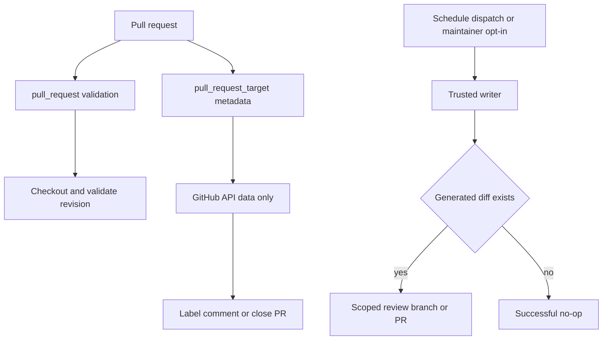
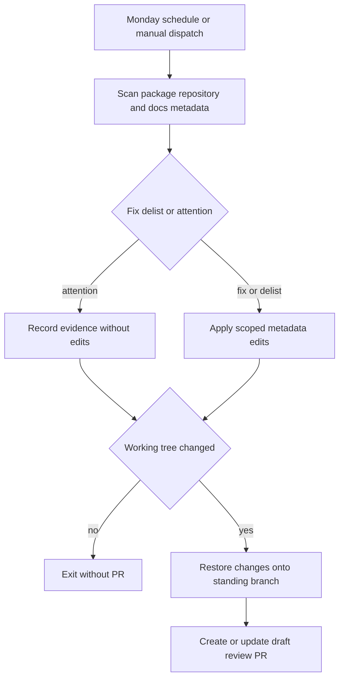

## Trust and permission model

Workflow event selection is a security boundary. This repository separates untrusted revision validation from metadata actions and trusted writers:

| Role | Event and authority | Boundary |
| --- | --- | --- |
| Revision validation | `pull_request`, pushes to `main`, and manual dispatch | Check out and test the revision with read-only contents access. Fork code may run here, but it must not receive write authority or provider credentials. |
| PR metadata automation | `pull_request_target` | Read GitHub API metadata and label, comment, or close a PR, including a fork PR. Do not check out or execute the PR head in this event context. |
| Trusted writer | Scheduled/manual run or a maintainer-authorized event | Generate a reviewable branch or PR with narrowly scoped credentials and a successful no-change path. |



This separates contributed code execution, metadata mutation, and repository-writing authority.

The integration-submission workflow demonstrates the strongest boundary. Opening an issue does not start the agent: a maintainer must apply `integration-run` or manually dispatch the workflow, and the workflow verifies that the triggering actor has `admin`, `maintain`, or `write` permission. It parses the issue form before the agent runs and presents values as untrusted listing metadata. The agent is required to leave local changes uncommitted and cannot push, create a PR, or comment. Failures, blockers, invalid forms, and no-diff outcomes are reported without a PR.

Crucially, the GitHub App token is minted **after** the agent has produced a real diff. That token, rather than the agent, is used by `create-pull-request` to create `integration/issue-<number>` and the review PR. This both limits agent access to GitHub mutation and avoids a `GITHUB_TOKEN`-created PR waiting for manual approval before its pull-request workflows run. The persistent `integration-automation` label and per-issue non-cancelling concurrency prevent duplicate processing. See [Integration Listing Automation](/openwiki/workflows/integration-listing-automation.md) and [Agent Skills](/openwiki/operations/agent-skills.md) for the intake contract and skill boundary.

## Core CI and reusable checks

`ci.yml` runs on pull requests, pushes to `main`, and manual dispatch. It calls reusable test, lint, and documentation-link workflows and separately checks conflict markers, cross references, external integration `docs_url` values, and generated output. Its concurrency group is the workflow plus ref, so a newer push cancels an obsolete run for the same branch or PR.

The test and lint reusable workflows accept a Python version and working directory, make a shallow checkout, synchronize the `test` dependency group, and run `make test` or `make lint`. The link workflow is read-only and limited to 20 minutes; it installs the test dependencies and Node 22, runs `make broken-links-with-anchors`, then runs `make check-openapi`.

The generated-file job regenerates `src/oss/python/integrations/providers/overview.mdx` with `pipeline/tools/partner_pkg_table.py` and fails if it differs. Correct `packages.yml` or the generator and commit the regenerated result rather than hand-editing the overview. The workflow deliberately skips this check for the expected package-download bot PR title or a `bypass-auto-check` label.

A focused pull-request-only companion, `check-external-doc-links.yml`, runs when Markdown, MDX, its script, or its workflow changes. It calls `scripts/check-legacy-doc-links.sh`, which scans the authored `src/` documentation tree rather than only changed lines and fails on retired documentation hosts, except the Helm-chart path. Use root-relative documentation links or `https://reference.langchain.com/` as the script directs.

For local triage, use the same boundaries as CI:

```bash
make test
make lint
make check-cross-refs
make broken-links-with-anchors
make check-openapi
uv run python scripts/refresh_integration_downloads.py --check-docs-urls
uv run python pipeline/tools/partner_pkg_table.py
```

See [Testing and Validation Overview](/openwiki/testing/test-overview.md) for what each check does and does not establish.

## PR metadata, contributors, and previews

Two `pull_request_target` workflows intentionally operate without checking out a contributor branch. `tag-external-contributions.yml` mints an organization-membership App token to distinguish active `langchain-ai` members from external authors, labels new issues and PRs as `internal` or `external`, and treats membership lookup errors as external. The App token is necessary because private organization membership requires organization read access; configured internal bots are explicitly treated as internal.

`external-integration-pr-comment.yml` similarly reads changed-file metadata and, only when needed, the head MDX content through the GitHub API. For a non-draft external PR adding integration documentation or changing the external-listing YAML, it adds the `integration` label. A new hosted page avoids closure only when its frontmatter is `featured: true` or its declared package has at least 50,000 monthly downloads. Otherwise the workflow posts one marker-based redirect to the integration-listing issue form and closes the open PR. API-fetched content remains data, not executable source.

`create-preview-branch.yml` uses the ordinary `pull_request` event and gives write permissions only to the relevant jobs. It does not create a preview for a fork PR; a same-repository PR or manual run validates the branch name, builds the docs, writes build artifacts to a collision-resistant `preview-<prefix>-<timestamp>-<sha>` branch, and asks the Mintlify API to deploy it. The comment job updates one marker-based PR comment rather than notifying subscribers on every push, and lists up to five changed routable Markdown pages. On closure, the cleanup job deletes only branches matching the sanitized source prefix and refuses to delete a branch outside the `preview-` namespace.

## Scheduled review writers

Scheduled automation proposes changes for review; it is not a publication authorization. `check-integration-repos.yml` runs Monday at 09:15 UTC or manually. It uses an App token for checkout and PR operations because bot-token-created PRs otherwise wait for manual approval, but provides the scan itself only the workflow token for authenticated external GitHub checks. The scan writes an evidence report to the job summary and, if there is a working-tree diff, restores those changes onto the single `chore/dead-integration-repos` draft-PR branch. Later scans append to that open PR and refresh its evidence body; no diff means no PR.

The checker skips first-party `langchain-ai/*` repositories. For unavailable third-party GitHub homes, it can repair a confirmed third-party replacement found from PyPI, npm, or existing docs metadata. A live GitLab project or partner documentation is an attention case rather than a delist. It only proposes full removal when no live GitHub, GitLab, or partner-documentation alternative exists, and updates external documentation URLs only for permanent `301` or `308` redirects. Review its evidence and every resulting deletion before merging.



This flow preserves remote evidence while keeping all catalogue changes reviewable.

## OpenWiki update behavior

`openwiki-update.yml` runs daily at 08:00 UTC and can be dispatched manually. It checks out full history because `openwiki code --update` needs the revision previously documented to calculate its change set; a shallow checkout would make that comparison empty. The generator alone receives provider, LangSmith-connector, and optional tracing credentials.

After generation, the workflow mints a GitHub App token and creates or updates the fixed `openwiki/update` PR. Its `add-paths` allowlist confines the commit to `openwiki`, `AGENTS.md`, and `.github/workflows/openwiki-update.yml`. Treat `docs: update OpenWiki` as generated, reviewable documentation: inspect claims and source coverage before merge, and do not broaden the allowlist merely to capture incidental workspace edits.

## Safe-change checklist

1. Keep `pull_request` validation, `pull_request_target` metadata actions, and trusted writers separate.
2. Never check out or execute fork-head code from a `pull_request_target` workflow.
3. Preserve maintainer authorization, untrusted-form handling, local-edit-only agent behavior, and post-agent App-token minting in integration submission.
4. Preserve no-op exits, narrow path staging, evidence reports, and human review for scheduled writers.
5. Keep membership and external-integration classification fail-safe: an uncertain membership is external, and fetched PR content is data only.
6. Do not expose provider or write credentials to a workflow merely to make fork validation convenient.
7. Keep the OpenWiki writer's full-history checkout and three-path PR allowlist.

## Related pages

- [Source Map](/openwiki/architecture/source-map.md)
- [Agent Skills](/openwiki/operations/agent-skills.md)
- [Testing and Validation Overview](/openwiki/testing/test-overview.md)
- [Integration Listing Automation](/openwiki/workflows/integration-listing-automation.md)
- [LangSmith OpenAPI Refresh](/openwiki/workflows/langsmith-openapi-refresh.md)
