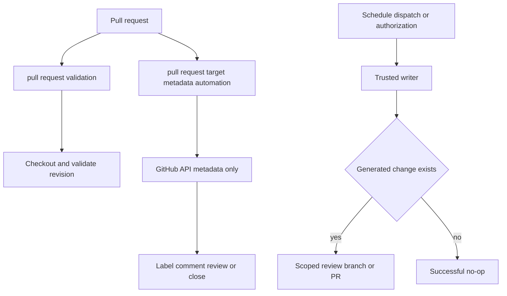
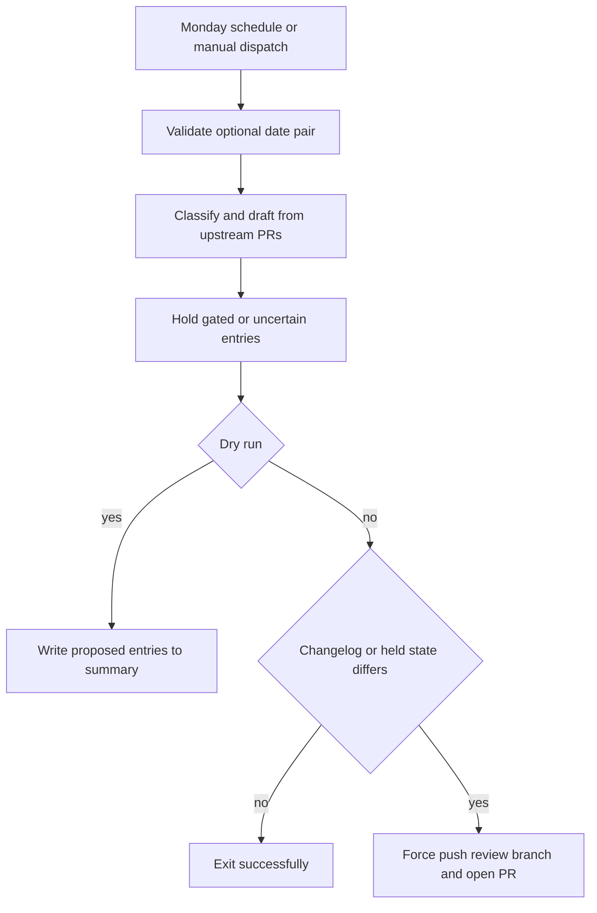

## Trust boundaries

GitHub event selection is a security boundary. This repository uses three distinct roles:

| Role | Entrypoints | Authority and safe boundary |
| --- | --- | --- |
| Revision validation | `pull_request`, push to `main` | Check out and validate the proposed revision without relying on secrets or repository writes. |
| Metadata-only PR automation | `pull_request_target` | Read base policy and GitHub API metadata to label, comment, request review, or close; never check out, source, or execute fork-head code. |
| Trusted writer | Scheduled run, manual dispatch, or maintainer authorization | Use narrowly scoped write credentials to create a branch or review PR; validate inputs, preserve a no-op path, and restrict staged paths. |

*Event type and authorization determine whether a workflow can execute contributed code, mutate PR metadata, or write a review branch.*

This separation prevents a fork contribution from gaining writer authority. Do not use `pull_request_target` as a workaround for testing forks, and do not construct shell commands from untrusted PR or issue-form fields.

## Core validation

The PR template asks contributors to describe the change and related work and, where applicable, confirm local documentation validation, tested examples, root-relative internal links, and navigation updates. Preview deployment is an optional internal-team action.

`ci.yml` runs on pull requests, pushes to `main`, and manual dispatch. It calls reusable test, lint, and documentation-link workflows and separately checks conflict markers, cross references, external integration `docs_url` values, and generated output. Its concurrency group is the workflow plus ref, so a newer push cancels an obsolete run for the same branch or PR.

The reusable test and lint workflows make shallow checkouts, synchronize the `test` dependency group, and run `make test` or `make lint` with caller-provided Python and working-directory inputs. The link workflow instead has read-only contents permission and a 20-minute limit; it installs Python and Node 22, then runs Mintlify link and OpenAPI checks.

`check-generated-files` regenerates `src/oss/python/integrations/providers/overview.mdx` with `pipeline/tools/partner_pkg_table.py` and fails on a diff. Change `packages.yml` or the generator and commit regenerated output rather than editing the overview. The intended exceptions are a `bypass-auto-check` label and the expected `github-actions[bot]` package-download update.

### Triage validation failures

- **Tests or lint:** reproduce with `make test` or `make lint`; a cancelled run is not evidence for the current commit.
- **Links or OpenAPI:** run `make broken-links-with-anchors` and `make check-openapi`.
- **Cross references or external listing URLs:** run `make check-cross-refs` or `uv run python scripts/refresh_integration_downloads.py --check-docs-urls`.
- **Generated overview:** rerun `uv run python pipeline/tools/partner_pkg_table.py`, inspect the diff, and commit it when metadata changed. Do not use the bypass label to conceal ordinary drift.

## Documentation previews and metadata automation

`create-preview-branch.yml` is an ordinary `pull_request` workflow, not `pull_request_target`. Its default permissions are read-only; only preview creation and closed-PR cleanup receive `contents: write`, and only the comment job receives `pull-requests: write`. Preview creation runs only for an in-repository PR or manual dispatch, never for a fork PR. On PR closure, cleanup derives a sanitized six-character source-branch prefix and deletes only remote branches matching that preview prefix after verifying the `preview-` prefix.

`external-integration-pr-comment.yml` is a metadata-only `pull_request_target` workflow. It does not check out or execute PR code: it uses API file metadata and an organization-membership App token to label qualifying external integration PRs, reads added MDX only as bytes to detect featured frontmatter, and otherwise posts an idempotent listing-form redirect before closing the PR.

`integration-submission.yml` is a trusted writer but an issue opening alone cannot start it. Manual dispatch or the `integration-run` label first requires write-level repository permission; `integration-automation` prevents duplicate processing. After authorization, parsed issue-form values remain untrusted listing metadata and the agent is directed to make local edits only. Parse, blocker, agent, and no-diff outcomes are reported on the issue; only a real diff lets the workflow create and link a review PR.

## Trusted writers and observers

### Weekly changelog proposal

`changelog-weekly.yml` runs Mondays at 13:00 UTC or manually. A manual window must provide both `since` and `until` as `YYYY-MM-DD` dates, or neither. The repository-wide `changelog-weekly` concurrency group serializes runs without cancelling one in progress.

The workflow has contents and pull-request write permission because it creates a review branch. It invokes `scripts/changelog_pipeline.py weekly` with its configured read, model, feature-flag, and encrypted-state inputs. The workflow deliberately keeps the private pipeline report out of public repository surfaces.

A `dry_run` omits `--write` and puts proposed entries in the run summary; it does not open a PR. A normal run records Vale output without making Vale immediately fatal, then checks only the two changelog files and encrypted held-list state. No diff exits successfully. A diff is committed to force-pushed `changelog/weekly-<UTC-date>` and opened as a review PR, whose body contains only counts and recent Vale output rather than the private run report.

*The weekly writer either reports a dry-run proposal, exits with no change, or creates a review PR from its scoped state.*

This workflow proposes publication; human review remains the publication gate. See [Changelog Publication](/openwiki/workflows/changelog-publication.md) for pipeline-specific lifecycle and recovery details.

### Credentialed code-sample execution and trace refresh

`test-code-samples.yml` runs for relevant code-sample or workflow changes in a pull request, by manual dispatch, and monthly on the first day at 00:00 UTC. It has repository and pull-request write permissions, but the credentialed job skips fork PRs because it needs provider API keys. Scheduled and manual runs test all samples and enable tracing; PR runs compute changed supported sample paths and test only those. A PR with no matching sample source exits the test step successfully with zero failures and trace updates.

The job prepares PostgreSQL plus Python, Node, Java/JBang, and Go. It supplies provider and LangSmith credentials only to the sample test step. `scripts/test_code_samples.py` runs eligible Python, TypeScript, Java, Kotlin, Go, and shell sources with bounded concurrency; fixture-sharing path families are serialized. Ordinary sample failures fail the eventual job, while persistent recognized 429s are retried and then reported as skipped. Trace collection happens only after a successful sample, is serialized to protect the shared manifest and run ownership, and warns rather than failing the sample suite when collection cannot complete.

On full runs, snippet regeneration requires that the sample step was not cancelled, fewer than 20 samples failed, and at least one trace link was refreshed. Only then can the writer restore the regenerated artifacts onto `chore/refresh-code-sample-traces`. It stages only `src/code-samples/trace-links.json` and `src/snippets/code-samples`; no diff is a successful no-op. An existing open PR on that branch receives an appended commit, otherwise the workflow force-pushes the branch and opens the standing review PR. The final step still fails the job when the sample test step failed, so a trace refresh never masks execution failures.

See [Code Sample Lifecycle](/openwiki/workflows/code-sample-lifecycle.md) for local commands and trace eligibility.

### Onboarding-model drift detection

`check-onboarding-models.yml` is a detect-only scheduled check: it runs Mondays at 08:30 UTC or manually, has `contents: read` and `issues: write`, and checks out without persisted credentials. Its read token accesses the configured `langchain-ai/langchainplus` onboarding snippets; it never edits that repository.

`check_onboarding_models.py` validates the local registry's repository, ref, and source paths before reading the remote Git tree and in-scope files. It recognizes supported OpenAI, Anthropic, and Google model-ID forms, accepts configured current IDs and their dated snapshots, ignores configured exceptions, and reports an outdated ID with the registry's preferred replacement. Exit status `0` means all checked IDs are current, `1` means drift was found, and `2` means the registry or remote source could not be read.

The workflow writes the report to its summary. On status `1`, it creates or updates one standing issue titled `Outdated models in LangSmith onboarding snippets`; on status `0`, it closes that issue if present. Status `2` fails before issue mutation, avoiding a false all-clear or accidental closure during an upstream-read outage. Fix the relevant snippets in `langchainplus`, or deliberately update the checked-in registry/ignore policy after review; do not expect this workflow to rewrite product code.

### OpenWiki update PR

`openwiki-update.yml` runs daily at 08:00 UTC and can be dispatched manually. It is a repository writer with `contents: write` and `pull-requests: write`: the job takes a full-history checkout because `openwiki code --update` compares the current revision with the commit last documented. It installs Node 22 and pinned OpenWiki, Mermaid, and JSDOM versions, then runs the update using OpenAI and optional LangSmith credentials from secrets.

The workflow uses `peter-evans/create-pull-request` to maintain `openwiki/update`. Its staging boundary is explicit: it may include only `openwiki`, `AGENTS.md`, and `.github/workflows/openwiki-update.yml`. Review that PR as generated documentation and configuration, particularly when source behavior, workflows, or instruction policy changed.

### Package-download maintenance

`update-package-downloads.yml` runs Sundays at 23:59 UTC or manually. Its first job is read-only: it refreshes package counts only when their download timestamp is older than 24 hours, regenerates provider and integration download surfaces, and hands candidate files to a second job in a one-day artifact. The second job alone has contents and pull-request write permission; it exits successfully on no candidate diff or creates a timestamped PR and enables squash auto-merge when there is one.

Hosted-documentation candidate detection creates Linear issues only when both `LINEAR_API_KEY` and `LINEAR_TEAM_KEY` are configured; otherwise it deliberately detects candidates in dry-run mode. It uses the default 50,000 monthly-download threshold and does not create a duplicate while a matching Linear issue remains open.

## Safe-change checklist

1. Keep `pull_request` validation, `pull_request_target` metadata automation, and trusted writers separate.
2. Never check out or execute fork-head code in `pull_request_target`; API-fetched head content is data only.
3. Preserve writer no-op exits, narrow staged paths, review PRs, and explicit credential boundaries.
4. Preserve the code-sample fork gate and do not expose provider secrets to general PR validation.
5. Preserve changelog input validation, dry-run behavior, and its review gate; package-download auto-merge is an explicit exception.
6. Treat onboarding-model status `2` as an operational read failure, not as drift resolution.
7. Keep OpenWiki's full-history checkout and its `create-pull-request` path allowlist; an incomplete history or wider staging boundary changes its update semantics.

## Related pages

- [Agent Authoring Skills](/openwiki/operations/agent-skills.md)
- [Testing Overview](/openwiki/testing/test-overview.md)
- [Changelog Publication](/openwiki/workflows/changelog-publication.md)
- [Code Sample Lifecycle](/openwiki/workflows/code-sample-lifecycle.md)
- [LangSmith OpenAPI Refresh](/openwiki/workflows/langsmith-openapi-refresh.md)
- [Release Watch](/openwiki/workflows/release-watch.md)
