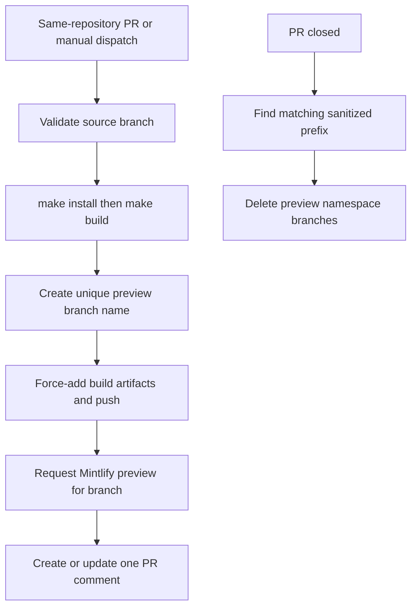

## Automation boundaries

GitHub Actions is the operational layer around two distinct artifacts: the disposable documentation build tree and runnable code samples. The documentation builder owns the transformation from `src/` to `build/`; workflows validate that output or publish it to deployment branches. Do not treat `build/`, `prod`, or a `preview-` branch as an authoring surface. See [Documentation Build System](/openwiki/architecture/build-system.md) for the build contract and [Mintlify Integration](/openwiki/integrations/mintlify.md) for the hosted-rendering boundary.

The workflows use event-specific authority. Core CI has read-only validation jobs; the preview workflow elevates `contents: write` only for the job that pushes generated artifacts and `pull-requests: write` only for the commenting job. The production publisher has `contents: write` because it updates the deployment branch. Fork pull requests do not receive the preview or credentialed-sample paths that need repository writes or secrets.

## Core CI gates

`ci.yml` runs on every pull request, pushes to `main`, and manual dispatch. It calls reusable test, lint, and documentation-link workflows, then separately checks unresolved merge-conflict markers, source cross-references, external integration `docs_url` values, and generated-file drift. Its concurrency group combines the workflow and ref; a newer push cancels an older run for that PR or branch.

| Gate | CI entrypoint | Contract |
| --- | --- | --- |
| Python tests | reusable `_test.yml` | Synchronizes the `test` dependency group and runs `make test` with caller-provided Python version and working directory. |
| Lint | reusable `_lint.yml` | Synchronizes the `test` dependency group and runs `make lint`; lint annotations use GitHub output format. |
| Built-document checks | reusable `_check-links.yml` | Uses read-only contents permission, a 20-minute limit, Node 22, and runs `make broken-links-with-anchors` followed by `make check-openapi`. |
| Repository-specific checks | jobs in `ci.yml` | Detects conflict markers, validates `@[...]` references and integration URLs, and detects drift in generated provider overview content. |

The generated-file gate runs `uv run python pipeline/tools/partner_pkg_table.py` and fails if `src/oss/python/integrations/providers/overview.mdx` changes. Repair the generator or its metadata, regenerate, and commit the result rather than editing the overview directly. The check intentionally bypasses the expected GitHub Actions package-download update and a PR labelled `bypass-auto-check`.

Run the appropriate local command before waiting on CI:

```bash
make test
make lint
make check-cross-refs
make broken-links-with-anchors
make check-openapi
uv run python scripts/refresh_integration_downloads.py --check-docs-urls
uv run python pipeline/tools/partner_pkg_table.py
```

These checks establish different contracts; a successful unit test does not prove generated routes or Mintlify deployment behavior. The [Testing and Validation Overview](/openwiki/testing/test-overview.md) maps change types to the narrowest meaningful check.

## Pull-request preview lifecycle

A Mintlify preview is a generated, short-lived branch handoff for a same-repository pull request. `create-preview-branch.yml` runs for opened, synchronized, reopened, and closed PRs, plus manual dispatch. Its own concurrency key cancels an obsolete preview run for the same Git reference.



This diagram shows the generated-artifact handoff and the independent close-time cleanup path.

### Creation and handoff

The create job excludes fork PRs and closed events, but permits manual dispatch. It derives `SOURCE_BRANCH` and the commit SHA from the PR head when present. Before checkout, it rejects branch names outside `[.a-zA-Z0-9/_-]` and names longer than 100 characters; its abbreviated branch value is only for logging. The preview-name prefix is separately sanitized by removing non-alphanumeric characters and taking the first six characters.

After `make install` and `make build` succeed, the workflow produces `preview-<safe-prefix>-<timestamp>-<short-sha>`, verifies that it does not already exist remotely, and creates it from the checked-out source. It force-adds `build/`, commits it only if artifacts changed, and pushes the branch. The timestamp and seven-character commit prefix reduce collisions; a remote collision is still a hard failure that should be retried, not overwritten.

The next job receives the branch through the create job output. It requires both `MINTLIFY_API_KEY` and `MINTLIFY_PROJECT_ID`, rejects a missing branch value, and POSTs `{"branch":"..."}` to `https://api.mintlify.com/v1/project/preview/${MINTLIFY_PROJECT_ID}` with bearer authentication. Invalid JSON, or an API error without either a status ID or preview URL, fails the job. The deployment request is not a source build: it hands the pushed generated branch to Mintlify.

### PR feedback and cleanup

For a successful non-Dependabot PR preview, the comment job lists changed Markdown/MDX files, excluding `code-samples` and `snippets`. It converts routable `src/` paths to site paths, adds the Python segment for ordinary unversioned OSS paths, ranks pages by diff size, and reports at most five deep links. The comment carries `<!-- mintlify-docs-preview -->`; later preview runs update that bot comment in place and delete duplicate legacy preview comments, avoiding a new subscriber notification on every push.

On a closed or merged PR, cleanup recomputes the same six-character alphanumeric prefix from `github.event.pull_request.head.ref`, searches remote branches matching `preview-<prefix>-*`, and deletes those branches. It refuses to delete a name that does not begin with `preview-`; a failed delete is logged as a warning because the branch may already be gone. The prefix is a practical association rather than a globally unique PR identifier, so retain the namespace guard and review cleanup changes carefully.

## Production publication

`publish.yml` runs on pushes to `main` and manual dispatch. It checks out the repository, synchronizes the test dependency group, runs `make build`, and fails if `build/` was not produced. It copies the tree into `public/build` and uses `peaceiris/actions-gh-pages@v4` with `GITHUB_TOKEN` to publish `public` to the `prod` branch. This is a deployment handoff distinct from a pull-request preview: publication is triggered by `main`, and the generated branch may be force-updated by the publishing action.

## Code-sample automation

`test-code-samples.yml` is the live-example complement to core CI. It runs for PR changes under `src/code-samples/`, manually, and at 00:00 UTC on the first day of each month. Its concurrency policy cancels superseded runs for the same ref. Fork PRs are skipped because some samples need repository secrets; same-repository PRs run only changed eligible `.py`, `.ts`, `.java`, `.kt`, `.go`, and `.sh` files, while scheduled and manual runs test all samples.

The job provisions pgvector PostgreSQL, Python 3.13 and uv, Node 20, Java 21 with JBang, and Go. It invokes `make test-code-samples`, supplying provider credentials, `POSTGRES_URI`, and four concurrent sample workers. PR runs have a 60-minute timeout; scheduled and manual full runs have 150 minutes. The sample step continues after errors so a bounded trace refresh can still run, but a final step fails the workflow if the samples failed.

Full runs enable `CODE_SAMPLE_TRACING=1`. When the sample job was not cancelled, fewer than 20 samples failed, and at least one trace was updated, the workflow runs `make code-snippets`. If the trace manifest or generated snippet MDX changed, it creates or appends to the standing `chore/refresh-code-sample-traces` PR, staging only `src/code-samples/trace-links.json` and `src/snippets/code-samples`. This is a reviewable maintenance output, not an automatic merge. See [Code Sample Lifecycle](/openwiki/workflows/code-sample-lifecycle.md) for authoring, extraction, tracing, and publication rules.

## Safe-change checklist

1. Keep authored content in `src/`; validate or publish generated `build/` output without making it a source of record.
2. Preserve preview branch validation, sanitization, uniqueness checking, and the `preview-` deletion guard when changing the preview workflow.
3. Do not add fork preview execution merely to expose a preview: that path has repository-write and Mintlify-secret requirements.
4. Keep the Mintlify request dependent on a successfully pushed preview branch and fail on missing secrets, metadata, malformed responses, or a response with no usable status or URL.
5. Preserve marker-based in-place preview comments to avoid notification noise, and keep deep-link selection bounded.
6. For generator drift, change inputs or generator code and commit regenerated output.
7. Treat code-sample execution as credentialed integration testing; a fork skip or unavailable secret is missing coverage, not a successful test.

## Related pages

- [Documentation Build System](/openwiki/architecture/build-system.md)
- [Mintlify Integration](/openwiki/integrations/mintlify.md)
- [Quickstart](/openwiki/quickstart.md)
- [Testing and Validation Overview](/openwiki/testing/test-overview.md)
- [Code Sample Lifecycle](/openwiki/workflows/code-sample-lifecycle.md)
