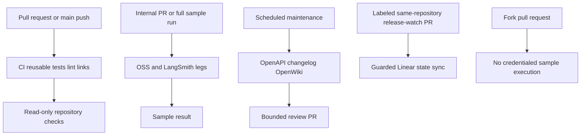
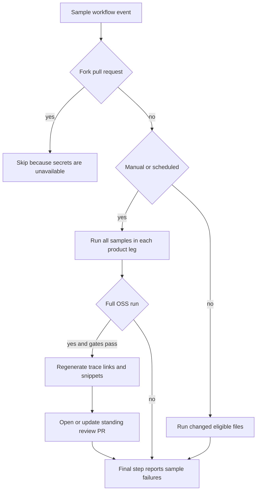
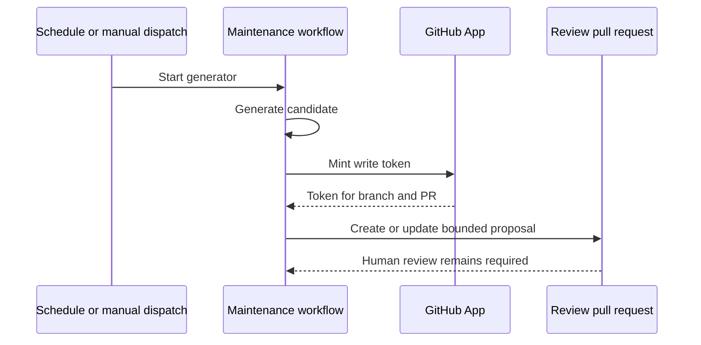

## Operating model

The active automation is split between read-only validation, credentialed sample execution, scheduled generators, and a small number of writers that propose changes through pull requests. The repository default owner for `.github/`, scripts, pipeline tooling, and otherwise unowned files is `@lnhsingh`; integration listings and OSS code samples are assigned to `@npentrel`, while the more specific rules in `.github/CODEOWNERS` win because GitHub applies the last matching rule. There is no `.github/OWNERS` file in this checkout, so ownership claims should be based on `CODEOWNERS` and branch-protection configuration rather than an undocumented owner map.

The local `.github/actions/uv_setup` composite action is the common Python bootstrap. It accepts a `MAJOR.MINOR` Python version, pins `astral-sh/setup-uv@v7` to uv `0.9.26`, and sets `ignore-nothing-to-cache: true` so a job that exits before `uv sync` or `uv run` does not fail during cache cleanup. Reuse it instead of selecting uv independently in a workflow.



*The map distinguishes validation, credentialed sample execution, scheduled writers, and the guarded downstream Linear synchronization path.*

## Core CI

`ci.yml` runs on pull requests, pushes to `main`, and manual dispatch. Its concurrency group is the workflow plus ref, and a newer push cancels an obsolete run. The workflow calls reusable test, lint, and documentation-link workflows, then checks merge-conflict markers, source cross-references, external documentation URL schemes, and generated-file drift. The generated-file job regenerates `src/oss/python/integrations/providers/overview.mdx` and fails if it differs, except for the package-download bot update and the `bypass-auto-check` label.

| Gate | Contract |
| --- | --- |
| Tests | `_test.yml` receives `python-version` and `working-directory`, installs the `test` dependency group, runs `make test`, and additionally runs `make test_integration` when the directory is `./libs/server`. |
| Lint | `_lint.yml` receives the same inputs, installs the test group, runs `make lint`, and sets `RUFF_OUTPUT_FORMAT: github` for annotations. |
| Documentation | `_check-links.yml` has `contents: read`, a 20-minute timeout, Node 22, a pinned Mintlify CLI cache, anchor-link validation, MDX validation, and OpenAPI validation. |
| Repository checks | `ci.yml` uses read-only permissions for merge-marker, cross-reference, external-URL, and generated-file checks. |

The reusable workflows are contracts, not independent triggers: callers choose the Python version and working directory. The current CI caller uses Python 3.13. Run the focused equivalents locally after a documentation or integration-listing change:

```bash
make test
make lint
make check-cross-refs
make broken-links-with-anchors
make check-openapi
uv run python scripts/refresh_integration_downloads.py --check-docs-urls
uv run python pipeline/tools/partner_pkg_table.py
```

Do not hand-edit the generated provider overview; change its generator or package metadata and regenerate it.

## Code-sample matrix and trust boundary

`test-code-samples.yml` runs for relevant internal pull requests, manual dispatch, and at 00:00 UTC on the first day of each month. Fork pull requests are skipped because sample execution requires provider secrets. The matrix has separate `oss` and `langsmith` legs with `fail-fast: false`: OSS owns `langchain`, `langgraph`, and `deepagents`, while LangSmith owns `langsmith`. The path-resolution step fails if a product directory under `src/code-samples/` belongs to no leg, preventing silently untested samples.

Pull-request runs compute the merge-base and pass changed `.py`, `.ts`, `.java`, `.kt`, `.go`, and `.sh` files to `make test-code-samples`; manual and scheduled runs test all samples in each leg. Jobs use PostgreSQL with pgvector, Python 3.13 and pinned uv, Node 22, Java 21/JBang, and Go. Pull-request jobs have a 60-minute timeout; full runs have 150 minutes.



*Only a full manual or scheduled OSS run can refresh trace artifacts; the final step still fails when the sample step failed.*

The sample test step uses `continue-on-error: true` so a bounded trace refresh can finish. Trace regeneration requires the OSS leg, a full run, a non-cancelled test, fewer than 20 sample failures, and changed traces. The writer is limited to `src/code-samples/trace-links.json` and `src/snippets/code-samples`, appends to `chore/refresh-code-sample-traces` when its PR is open, or creates that PR from `main`; it never merges. Afterward the final step fails whenever the sample step outcome is failure.

## Scheduled writers

### Weekly changelog

`changelog-weekly.yml` runs Mondays at 13:00 UTC or by manual dispatch. Its `changelog-weekly` concurrency group does not cancel an active run. Manual `since` and `until` values must be supplied together and match `YYYY-MM-DD`; `dry_run` writes only public candidate entries to the run summary. Non-dry runs use a GitHub App token, generate `changelog/weekly-<UTC-date>`, and create or update a review PR only when tracked changelog state changes.

Before force-pushing a same-day branch, it compares commits against `main` and refuses to overwrite commits whose author is not `github-actions[bot]`. The pipeline uses read-only LangChain Plus access, gateway-backed model credentials, optional read-only Datadog keys, and an encrypted changelog-state key. Its detailed report is not exposed in the public summary or PR body; the PR body contains counts and the Vale tail. A Vale failure is captured with `continue-on-error`, so it does not prevent the proposal.

### LangSmith OpenAPI refresh

`refresh-langsmith-openapi.yml` runs daily at 10:00 UTC or manually, with a 15-minute timeout and write permission for contents and pull requests. It mints a GitHub App token before checkout because App-created PRs allow downstream pull-request workflows to run without manual approval. `scripts/process_langsmith_openapi.py --write` fetches and filters the public specification into `src/langsmith/langsmith-platform-openapi.json`.

The workflow preserves the generated candidate while it checks out `chore/refresh-langsmith-openapi`. It appends to an existing open PR, exits successfully when the specification has no diff, or force-pushes an unreferenced standing branch and opens a PR. It never merges.

### OpenWiki maintenance

`openwiki-update.yml` runs Mondays at 08:00 UTC or manually. It checks out full history because `openwiki code --update` compares against the commit it last documented; shallow history would hide that baseline. It installs `openwiki@0.4.3` with Mermaid and jsdom validation dependencies, runs through the configured gateway, and may trace the run to LangSmith.

The job mints a GitHub App token and uses `peter-evans/create-pull-request` on branch `openwiki/update`. Its `add-paths` allowlist is limited to `openwiki`, `AGENTS.md`, and `.github/workflows/openwiki-update.yml`, so the maintenance writer proposes a bounded documentation change instead of merging arbitrary generated output.



*Scheduled generators produce reviewable proposals; they do not merge their own output.*

## Pull-request integration and failure behavior

**Linear state synchronization** is active in `sync-linear-issue-from-pr.yml`. It observes opened, reopened, draft, ready-for-review, closed, and label events, but runs only for same-repository pull requests labeled `release-watch-agent`; the label event guard handles the race where the label is added after opening. It has read-only GitHub permissions. An unset `LINEAR_API_KEY` is a successful skip, and fork pull requests cannot receive the secret.

The script accepts an explicit `Closes DOC-N` convention or the canonical linked form, then maps draft, ready, merged, and closed-unmerged pull requests to In Progress, In Review, Done, and Canceled. It prefers those state names and falls back to Linear workflow-state types. Missing links, already-correct issues, and dry runs are reported as skips. A missing target workflow state is different: it causes the script to return failure after reporting the result, so configuration drift is visible rather than silently ignored.

The repository also has `create-preview-branch.yml`, `publish.yml`, and other narrowly scoped checks in `.github/workflows/`; they are separate from the seeded workflows described here. Do not infer an active integration-submission or AI documentation-review path from older documentation: neither `integration-submission.yml` nor `docs-ai-review.yml` exists in this checkout.

## Safe-change checklist

1. Reuse `.github/actions/uv_setup` and preserve its uv pin and cache cleanup behavior.
2. Keep validation jobs read-only and retain same-repository guards wherever secrets or write-capable operations are involved.
3. When adding a code-sample product directory, assign it to exactly one matrix leg or the coverage check will fail.
4. Keep trace refresh full-run, OSS-only, bounded by cancellation and failure thresholds, and restricted to its two generated paths.
5. Preserve no-diff, standing-PR, and human-review boundaries for changelog, OpenAPI, OpenWiki, and trace writers.
6. Treat fork skips as lack of credentialed coverage, not as passing sample execution.
7. Keep Linear synchronization limited to same-repository `release-watch-agent` PRs and explicit `Closes DOC-N` links; absent credentials skip, while absent target states fail.
8. Route ownership changes through `.github/CODEOWNERS`; there is no `.github/OWNERS` file to update.

## Related pages

- [Mintlify Integration](/openwiki/integrations/mintlify.md)
- [Testing and Validation Overview](/openwiki/testing/test-overview.md)
- [Weekly Changelog Publication](/openwiki/workflows/changelog-publication.md)
- [Release Watch](/openwiki/workflows/release-watch.md)
