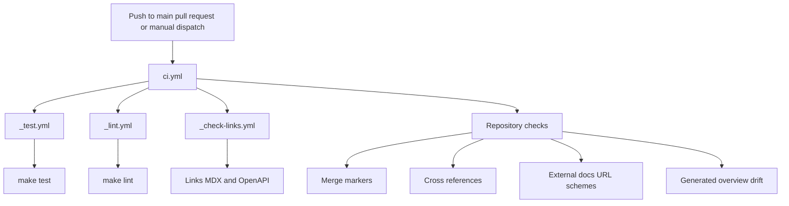
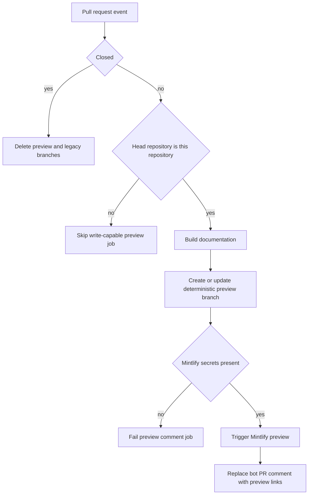
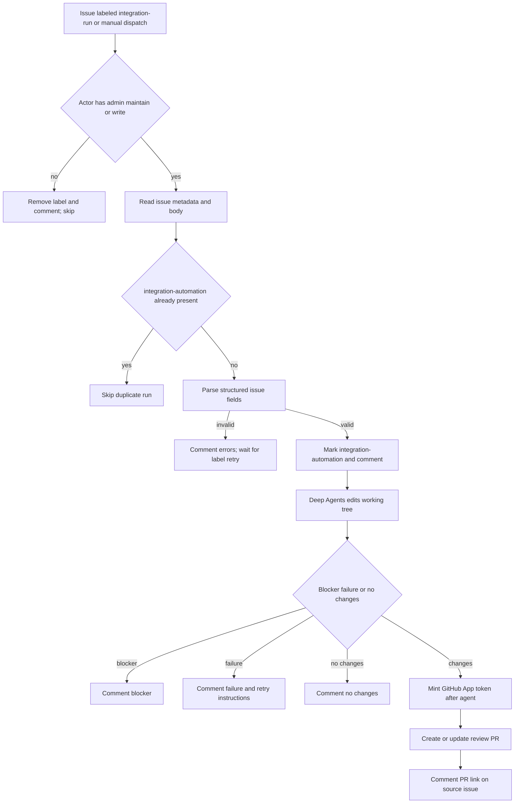

## Operating model

GitHub Actions separates read-only validation from jobs that can write branches, pull requests, comments, or issues. The main entrypoints are:

- `ci.yml` for repository tests, lint, documentation validation, and generated-file checks.
- `create-preview-branch.yml` for building documentation and publishing a deterministic preview branch for pull requests.
- `publish.yml` for manually or automatically publishing `main` to the `prod` branch.
- `integration-submission.yml` for maintainer-authorized, issue-driven integration listing proposals.
- `external-integration-pr-comment.yml` for processing external integration PRs without executing their code.

`.github/CODEOWNERS` gives the default repository and workflow owner role to `@lnhsingh`, assigns integration listing areas to `@npentrel`, and assigns product areas through later, more-specific rules. GitHub applies the last matching rule; branch protection is expected to require Code Owner review. The pull-request template asks contributors to explain the change, identify review notes and related issues, and check documentation, examples, prose-lint, link, and navigation requirements.

## Core CI and reusable workflows

`ci.yml` runs on pushes to `main`, all pull requests, and manual dispatch. Its concurrency group is keyed by workflow and ref, and a newer run cancels an in-progress older run. The current caller uses Python 3.13 and delegates to reusable workflows:

*The CI workflow fans out into reusable validation contracts and read-only repository checks.*

The reusable contracts accept caller-supplied `python-version` and `working-directory`, check out shallowly, and install the `test` dependency group with uv. `_test.yml` runs `make test` and additionally runs `make test_integration` when the working directory is `./libs/server`; `_lint.yml` runs `make lint` with `RUFF_OUTPUT_FORMAT: github`. Each has a 20-minute job timeout.

`_check-links.yml` has `contents: read`, a 20-minute timeout, Node 22, Mintlify CLI version `4.2.1181`, and runs `make broken-links-with-anchors`, `make check-mdx`, and `make check-openapi`. The repository checks in `ci.yml` also use read-only contents permissions. They reject unresolved conflict markers, broken cross-references, invalid `docs_url` schemes, and manual changes to generated `src/oss/python/integrations/providers/overview.mdx`; the generated file must instead be changed through `pipeline/tools/partner_pkg_table.py` or package metadata.

Documentation-specific pull-request checks complement `ci.yml`: `lint-prose.yml` finds changed Markdown and MDX files under `src/` from the merge base and runs the pinned Vale version through `make lint_prose`; `check-external-doc-links.yml` blocks links to retired documentation sites. These jobs check out with read-only permissions and do not execute pull-request code with write credentials.

## Previews and publication

`create-preview-branch.yml` handles `opened`, `synchronize`, `reopened`, and `closed` pull-request events, plus manual dispatch. The workflow defaults to `contents: read` and `actions: read`; only the branch-creating and cleanup jobs receive `contents: write`, and only the comment job receives `pull-requests: write`. Runs share a ref-based concurrency group and cancel superseded runs.

Fork pull requests do not create preview branches because the creator job requires the pull-request head repository to equal the current repository. For an eligible branch, the workflow validates the branch name, builds with Python 3.13, derives `preview-<slug>-<sha256-prefix>` from the source branch, and updates that branch with build artifacts using `--force-with-lease`. Closing a pull request deletes the deterministic branch and matching legacy preview branches, but refuses to delete any branch that does not begin with `preview-`.

After a successful branch build, the comment job requires `MINTLIFY_API_KEY` and `MINTLIFY_PROJECT_ID`, calls Mintlify’s preview API, and replaces earlier bot preview comments. It links at most five changed routable Markdown/MDX pages, excluding code samples and snippets. Missing secrets, a missing branch output, or an invalid API response fails the comment job rather than silently claiming that a preview exists.

*Preview creation is write-capable only for same-repository pull requests; deployment and comments are separate, explicitly scoped jobs.*

`publish.yml` runs on pushes to `main` and manual dispatch. It has `contents: write`, installs the test dependency group with Python 3.13 and the shared uv setup, runs `make build`, verifies that `build/` exists, copies it under `public/build`, and uses `peaceiris/actions-gh-pages@v4` with `GITHUB_TOKEN` to force-update the `prod` branch. The workflow does not describe a separate hosting deployment; its observable publication boundary is the generated content under `/build` on `prod`.

## Privileged integration submission

The integration submission workflow is intentionally not triggered by an issue being opened. It accepts manual dispatch with an issue number, or an issue `labeled` event only when the label added is `integration-run`. Its concurrency group is per issue and does not cancel an active run. The workflow grants `contents: write`, `pull-requests: write`, and `issues: write` at the workflow level, so authorization and input handling are critical.

*Only a maintainer or collaborator with write-level permission can start the privileged agent path; all terminal paths are explicit.*

The metadata step uses the repository `GITHUB_TOKEN` to check the triggering actor’s collaborator permission. Unauthorized issue-triggered runs remove `integration-run`, explain the restriction, set a skip output, and exit successfully. Authorized runs fetch the issue body, reject issues already marked `integration-automation`, and parse the structured fields with `scripts/parse_integration_submission_issue.py`. Parse errors are reported to the issue and stop before the agent.

The parsed values are untrusted metadata. They are passed to the Deep Agents `submit-integration` skill as data, not as workflow instructions. The agent is told to leave changes uncommitted and not to push, open a PR, or comment on GitHub. It receives the gateway key, GitHub token, and a bounded shell allow-list; its step is `continue-on-error: true` so the result handler can distinguish a blocker file, an unsuccessful agent, no file changes, or real edits. A hard blocker is communicated through `integration-submission-error.md`; that file is removed when real edits also exist.

Only after the agent completes successfully with changes does the workflow mint the GitHub App token. This ordering keeps the write-capable App token out of the agent step. `peter-evans/create-pull-request` then creates or updates `integration/issue-<number>`, labels it `integration`, assigns `npentrel`, and includes a review checklist for eligibility, URLs, provider cards, downloads, YAML, `packages.yml`, or hosted MDX. The workflow comments the PR URL on the issue and mentions the submitter on the PR. It does not merge the result.

## External-contributor boundary

`external-integration-pr-comment.yml` uses `pull_request_target` because it must label, comment on, and sometimes close fork pull requests. It grants only `contents: read`, `issues: read`, and `pull-requests: write`, mints an organization-membership App token, and uses the GitHub API to inspect changed files and the pull-request head. It does **not** check out or execute fork code.

The job skips drafts and bot authors, recognizes newly added integration pages under `src/oss/python/integrations/` or `src/oss/javascript/integrations/` (excluding `TEMPLATE.mdx`) and changes to `scripts/data/integration_external_docs.yaml`, then checks whether the author is an active `langchain-ai` member. External contributions receive the `integration` label. A maintainer reopening the PR is an explicit keep-open override; later synchronize events honor the most recent maintainer reopen.

For added MDX pages, featured pages or packages with at least 50,000 monthly downloads are left open. Download eligibility is looked up from npm or PyPI; lookup failures fail the check rather than guessing. Other external integration PRs receive an idempotent redirect comment to the Integration listing issue form and are closed. This complements the issue-driven `integration-submission.yml` path: untrusted PR content is inspected through API responses, while privileged listing generation starts only after maintainer authorization.

## Ownership and safe-change checklist

1. Keep validation jobs read-only and scope write permissions to the job that needs them.
2. Do not move fork-controlled data into a privileged execution context; `pull_request_target` jobs must continue to use API inspection only.
3. Preserve the `integration-run` maintainer gate, duplicate-run marker, parse-before-agent ordering, and post-agent App-token minting.
4. Keep preview branch names deterministic, validate branch input, use `--force-with-lease`, and retain the `preview-` deletion safety check.
5. Treat generated provider overview and publication output as build products; change their generators or inputs, not the generated file by hand.
6. Use the pull-request template’s checklist and route ownership changes through `.github/CODEOWNERS`; the last matching rule wins.

## Related pages

- [Mintlify Integration](/openwiki/integrations/mintlify.md)
- [Testing and Validation Overview](/openwiki/testing/test-overview.md)
- [Integration Listing Automation](/openwiki/workflows/integration-listing-automation.md)
- [Local Development](/openwiki/workflows/local-development.md)
- [Agent Skills](/openwiki/operations/agent-skills.md)
