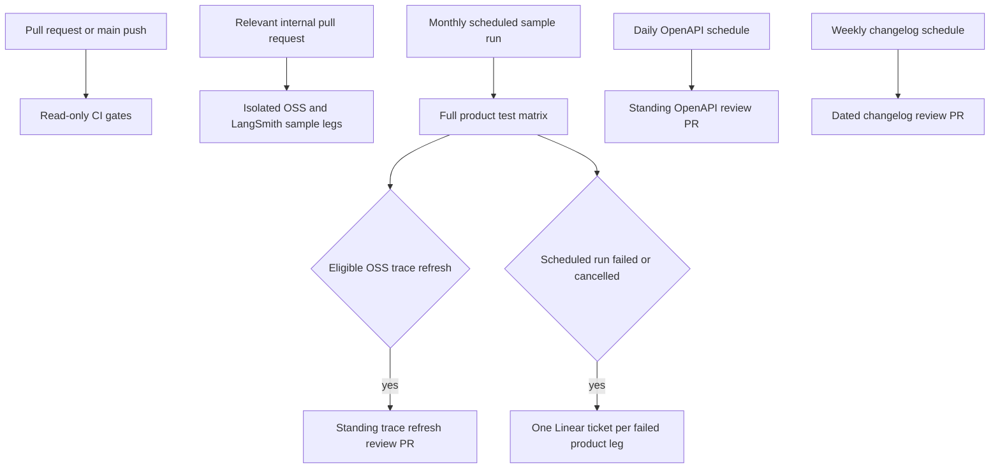
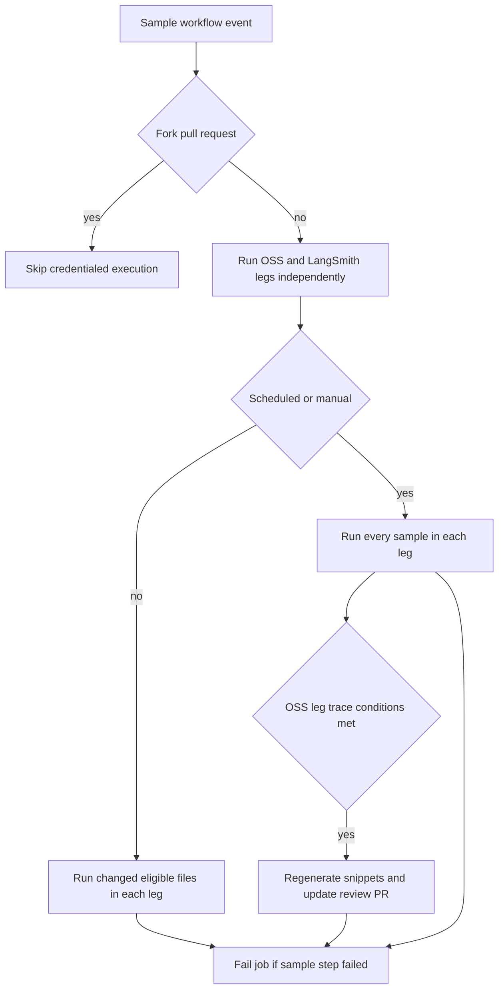

## Automation map and authority

GitHub Actions validates authored documentation and runnable examples, produces generated deployment handoffs, and proposes—not merges—maintenance changes. `src/` is the authoring surface; `build/`, deployment branches, and bot branches are derived outputs. The `make build` target installs npm dependencies and invokes the pipeline build command; the command requires source and build directories and delegates the transformation to `DocumentationBuilder.build_all()`.

Workflows apply authority by event. Core CI jobs are read-only. Workflows that push a branch or create a PR declare repository write permissions only for that purpose. Credentialed code-sample execution skips fork PRs because GitHub does not expose repository secrets to them. Never expose credential values in commands, run summaries, PR bodies, logs, or documentation.



*Automation separates validation from write-capable, review-gated maintenance outputs; scheduled sample failures are observed after the source workflow completes.*

## Core CI gates

`ci.yml` runs on pull requests, pushes to `main`, and manual dispatch. It calls reusable test, lint, and documentation-link workflows, then separately checks unresolved merge-conflict markers, source cross-references, external integration `docs_url` values, and generated-file drift. Its concurrency group combines the workflow and ref and cancels an earlier run when a newer push arrives for the same PR or branch.

| Gate | Mechanism | Important contract |
| --- | --- | --- |
| Python tests | `_test.yml` | Synchronizes the `test` dependency group and runs `make test` in the caller-supplied directory and Python version. |
| Lint | `_lint.yml` | Synchronizes the same group and runs `make lint`; Ruff uses GitHub annotations. |
| Built-document validation | `_check-links.yml` | Has read-only contents permission and a 20-minute timeout; Node 22 runs anchor/redirect link checking and the Agent Server OpenAPI check. |
| Repository checks | Jobs in `ci.yml` | Check conflict markers, `@[…]` references, external documentation URL schemes, and generated provider overview drift. |

The generated-file job regenerates `src/oss/python/integrations/providers/overview.mdx` with `pipeline/tools/partner_pkg_table.py` and fails on a diff. Change the generator or metadata, regenerate, and commit the result; do not hand-edit the derived overview. It bypasses the expected package-download automation and a PR labeled `bypass-auto-check`.

Useful local entrypoints are:

```bash
make test
make lint
make check-cross-refs
make broken-links-with-anchors
make check-openapi
uv run python scripts/refresh_integration_downloads.py --check-docs-urls
uv run python pipeline/tools/partner_pkg_table.py
```

A unit or static check does not prove a generated site or a live provider integration. Choose the narrowest applicable command first, then add build or live validation as described in [Testing and Validation Overview](/openwiki/testing/test-overview.md).

## Runnable code samples: product isolation and scheduled follow-up

**Test Code Samples** runs for code-sample workflow changes and pull requests changing `src/code-samples/`, as well as manual dispatch and monthly schedule at 00:00 UTC on day one. It declares `contents: write` and `pull-requests: write`, but the write path is limited to its reviewed trace-refresh branch/PR. Its concurrency policy cancels superseded runs for the same ref.

The execution job skips fork PRs and uses a non-fail-fast matrix with one leg per product: `oss` covers `langchain`, `langgraph`, and `deepagents`; `langsmith` covers `langsmith`. This isolation means a failure in one product does not make the other leg fail, and an operator can rerun the individual job. The workflow checks that every product directory below `src/code-samples/` is assigned to exactly one leg, so adding a directory requires updating this mapping rather than silently losing coverage.

Internal PR legs compute the merge-base diff and pass only changed eligible `.py`, `.ts`, `.java`, `.kt`, `.go`, and `.sh` files to the runner; scheduled and manual runs test all files in each leg. Each job starts pgvector PostgreSQL and provisions Python 3.13/uv, Node 20, Java 21/JBang, and Go from the sample module. PR runs time out after 60 minutes; full runs have 150 minutes. `make test-code-samples` accepts `FILES` for a narrow run and `CODE_SAMPLE_PATHS` for a product partition.



*The test result remains product-scoped; only a full OSS run can enter the trace publication path.*

### Trace refresh is bounded and review-gated

On scheduled or manual full runs, only the OSS leg enables `CODE_SAMPLE_TRACING`; it uses the public-trace project, whereas LangSmith samples use their own project and do not enter trace collection. The sample step is allowed to continue after an error so a bounded refresh can still occur. Snippet regeneration requires that the test was not cancelled, fewer than 20 samples failed, and at least one trace changed. The final job step still fails whenever the sample step failed.

After successful regeneration, the workflow considers only `src/code-samples/trace-links.json` and `src/snippets/code-samples`. If neither differs, it exits without a commit. Otherwise it appends to an open `chore/refresh-code-sample-traces` PR or creates that PR from `main`; the bot does not merge it. Review the proposed trace links and derived MDX as a publication change. See [Runnable Code Samples and Snippet Generation](/openwiki/workflows/code-sample-lifecycle.md) for trace eligibility and authoring rules.

### Scheduled failures create actionable Linear issues

`test-code-samples-linear.yml` listens to completion of **Test Code Samples**, rather than adding a skipped check to every PR. It runs only when the upstream event was the monthly schedule and the upstream workflow concluded `failure` or `cancelled`. With read-only contents and Actions permissions, it queries the completed run's jobs and identifies failed/non-successful fixed leg names.

When the `LINEAR_TEAM_KEY` repository variable is configured, it uses the Linear API secret to create one issue per affected product: the OSS and LangSmith tickets have distinct scopes and link to the workflow run. If no matrix leg reported, it creates one generic pipeline-completion ticket instead. If the team variable is absent, it emits a warning and files nothing rather than failing the observer. This is downstream escalation, not a retry or repair mechanism; use the linked product job output and rerun that leg to investigate.

## Scheduled content-maintenance PRs

### LangSmith OpenAPI refresh

`refresh-langsmith-openapi.yml` runs daily at 10:00 UTC and by manual dispatch. It has a 15-minute timeout and write permissions for contents and pull requests. It obtains a GitHub App token from repository secrets for checkout and GitHub CLI writes; this deliberately avoids the `GITHUB_TOKEN` behavior that leaves PR workflows awaiting approval. The workflow runs `uv run python scripts/process_langsmith_openapi.py --write`, which fetches the allowed LangSmith API source, applies public-documentation filtering and grouping, and writes `src/langsmith/langsmith-platform-openapi.json`.

The write phase stages only that specification. It preserves a generated candidate while checking out the standing `chore/refresh-langsmith-openapi` branch: an open PR gets an appended commit, a no-diff run is a successful no-op, and otherwise it force-pushes the unreferenced standing branch and opens a PR against `main`. The bot never merges the change. Review the public API surface in that PR; for transformation policy and rendering limits, see [LangSmith OpenAPI Refresh](/openwiki/workflows/langsmith-openapi-refresh.md).

### Weekly changelog proposal

`changelog-weekly.yml` runs at 13:00 UTC on Mondays and accepts manual `since`, `until`, and `dry_run` inputs. It serializes the `changelog-weekly` group without cancelling active work. In non-dry runs, a GitHub App token is used for the dated `changelog/weekly-<UTC-date>` branch and PR because a `GITHUB_TOKEN`-created PR does not automatically trigger pull-request workflows.

Before force-pushing a same-day branch, the job detects commits whose author email is not `github-actions[bot]` and skips instead of overwriting human work. It creates or updates a review PR only if the pipeline changed its tracked outputs; it never merges. The pipeline and its sensitive data sources use secrets, while dry-run summaries expose only candidate public entries—not the detailed report that can name private PRs or unreleased work. See [Weekly Changelog Publication](/openwiki/workflows/changelog-publication.md) for its state, curation, and review contract.

## Preview and production handoffs

Mintlify preview creation runs only for same-repository pull requests or manual dispatch. It validates and builds the source branch before pushing a collision-resistant `preview-` branch; closed-PR cleanup deletes only branches matching the computed preview prefix and protected namespace. The preview request requires Mintlify credentials and a pushed branch, and fails on malformed/unusable API responses. For successful non-Dependabot PRs, the workflow keeps one marker-based bot comment, removes duplicate legacy comments, and limits changed-page deep links to five.

`publish.yml` runs on pushes to `main` or manual dispatch, builds and verifies output, copies it to `public/build`, then publishes `public` to the `prod` branch with the GitHub token. This deployment handoff is distinct from preview branches and should not be used as an authoring surface. See [Mintlify Integration](/openwiki/integrations/mintlify.md) for deployment behavior.

## Safe-change checklist

1. Keep validation workflows read-only and grant write authority only to the narrow job that needs it.
2. Preserve fork exclusion for credentialed samples; skipped fork execution is missing integration coverage, not a pass.
3. When adding a code-sample product directory, assign it to exactly one matrix leg and preserve product-specific rerun isolation.
4. Keep trace refresh OSS-only, full-run-only, bounded by the cancellation/failure/trace gates, and limited to its two generated paths and review PR.
5. Keep Linear escalation downstream of failed or cancelled scheduled runs; do not send PR or manual failures to it, and do not make an unset team variable break observation.
6. Preserve standing-PR, no-diff, and human-review boundaries for OpenAPI, traces, and changelog writers. Do not place secret values or private report content in generated PR material.
7. Preserve preview sanitization, uniqueness, and namespace-delete guards; do not enable credentialed preview paths for forks.

## Related pages

- [Mintlify Integration](/openwiki/integrations/mintlify.md)
- [Testing and Validation Overview](/openwiki/testing/test-overview.md)
- [Weekly Changelog Publication](/openwiki/workflows/changelog-publication.md)
- [Runnable Code Samples and Snippet Generation](/openwiki/workflows/code-sample-lifecycle.md)
- [LangSmith OpenAPI Refresh](/openwiki/workflows/langsmith-openapi-refresh.md)
