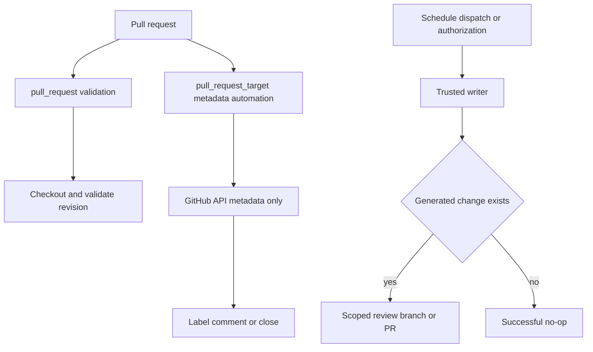
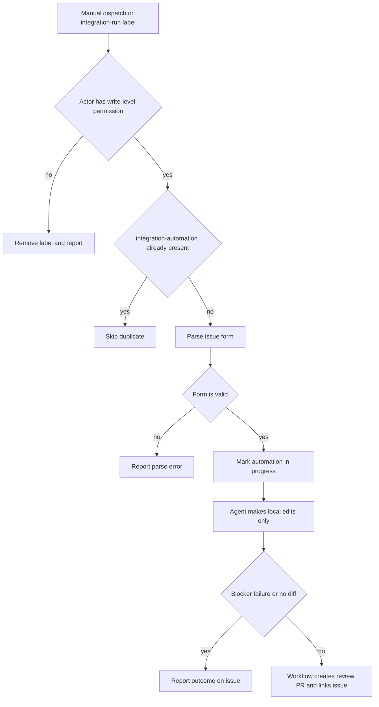
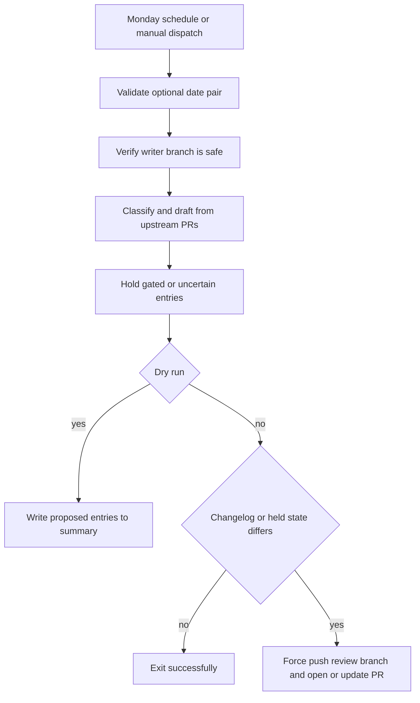

## Trust boundaries

GitHub event selection is a security boundary. The workflows use three distinct roles:

| Role | Entrypoints | Authority and safe boundary |
| --- | --- | --- |
| Revision validation | `pull_request`, push to `main`, or manual dispatch | Check out and validate the proposed revision without repository writes. Core CI is in this category. |
| Metadata-only PR automation | `pull_request_target` | Read base policy and GitHub API metadata to label, comment, request review, or close; never check out, source, or execute fork-head code. |
| Trusted writer | Schedule, manual dispatch, or maintainer authorization | Use narrowly scoped write credentials to create a branch, issue, or review PR; validate inputs, preserve a no-op path, and restrict staged paths. |

*Event type and authorization determine whether a workflow can execute contributed code, mutate PR metadata, or write a review branch.*

Do not use `pull_request_target` as a workaround for testing forks, and do not construct shell commands from untrusted PR or issue-form fields. A credentialed `pull_request` job must explicitly gate fork runs; it must not imply that fork PRs receive provider or repository credentials.

## Core validation

The PR template asks contributors to describe the change and related work and, where applicable, confirm local documentation validation, tested examples, root-relative internal links, and navigation updates. Preview deployment is an optional internal-team action.

`ci.yml` runs on pull requests, pushes to `main`, and manual dispatch. It calls reusable test, lint, and documentation-link workflows and separately checks conflict markers, cross references, external integration `docs_url` values, and generated output. Its concurrency group is the workflow plus ref, so a newer push cancels an obsolete run for the same branch or PR.

The reusable test and lint workflows make shallow checkouts, synchronize the `test` dependency group, and run `make test` or `make lint` with caller-provided Python and working-directory inputs. The link workflow instead has read-only contents permission and a 20-minute limit; it installs Python and Node 22, then runs Mintlify link and OpenAPI checks.

`check-generated-files` regenerates `src/oss/python/integrations/providers/overview.mdx` with `pipeline/tools/partner_pkg_table.py` and fails on a diff. Change `packages.yml` or the generator and commit regenerated output rather than editing the overview. The intended exceptions are a `bypass-auto-check` label and the expected `github-actions[bot]` package-download update.

### Triage validation failures

- **Tests or lint:** reproduce with `make test` or `make lint`; a cancelled run is not evidence for the current commit.
- **Links or OpenAPI:** run `make broken-links-with-anchors` and `make check-openapi`.
- **Cross references or external listing URLs:** run `make check-cross-refs` or `uv run python scripts/refresh_integration_downloads.py --check-docs-urls`.
- **Generated overview:** rerun `uv run python pipeline/tools/partner_pkg_table.py`, inspect the diff, and commit it when metadata changed. Do not use the bypass label to conceal ordinary drift.

## Previews and metadata automation

`create-preview-branch.yml` is an ordinary `pull_request` workflow, not `pull_request_target`. Its default permissions are read-only; only preview creation and closed-PR cleanup receive `contents: write`, and only the comment job receives `pull-requests: write`. Preview creation runs only for an in-repository PR or manual dispatch, never for a fork PR. On PR closure, cleanup derives a sanitized six-character source-branch prefix and deletes only remote branches matching that preview prefix after verifying the `preview-` prefix.

`external-integration-pr-comment.yml` is a metadata-only `pull_request_target` workflow. It does not check out or execute PR code: it uses API file metadata and an organization-membership App token to label qualifying external integration PRs. It reads added MDX only as data to detect featured frontmatter or verify package download eligibility. When no added hosted page is eligible, it posts an idempotent listing-form redirect and closes the PR.

### Maintainer-gated integration submissions

`integration-submission.yml` has repository write permissions because it can create a listing PR, but an issue opening alone cannot start it. The workflow runs only for manual dispatch or application of `integration-run`; it then checks that the triggering actor has `admin`, `maintain`, or `write` permission before checkout. Its per-issue concurrency group does not cancel in-progress runs, and the persistent `integration-automation` label prevents duplicate processing.

After that authorization, the workflow fetches and parses the issue form. Parsed fields remain untrusted listing metadata, not instructions: the generated prompt explicitly limits their use and instructs the agent to leave edits uncommitted, not push, open a PR, or comment on GitHub. The workflow, rather than the agent, owns GitHub mutation.

*Only a maintainer-authorized run with a valid form and a real local diff reaches PR creation.*

Parse failures, blockers, agent failures, and no-diff results are reported on the issue. Only a real diff lets `create-pull-request` create `integration/issue-<number>` and lets the workflow link the PR back to the issue. Reviewers must verify the generated listing, package-download eligibility decision, external URL, and affected YAML, tables, or hosted MDX before merge. See [Integration Listing Automation](/openwiki/workflows/integration-listing-automation.md) for listing-specific policy and artifacts.

## Trusted writers

### Weekly changelog proposal

`changelog-weekly.yml` runs Mondays at 13:00 UTC or manually. A manual window must provide both `since` and `until` as `YYYY-MM-DD` dates, or neither. The repository-wide `changelog-weekly` concurrency group serializes runs without cancelling one in progress.

The workflow defaults to read-only repository contents, then creates a GitHub App token for its checkout and branch/PR operations. It uses separate credentials only for read access to upstream PRs, model and feature-flag services, and encrypted held-state access. Before running the pipeline, a non-dry run verifies that the date-named branch can be force-pushed; on a rerun, it skips rather than overwrite a branch containing a commit not authored by the bot.

A `dry_run` omits `--write` and puts proposed entries in the run summary; it does not open a PR. A normal run records Vale output without making Vale immediately fatal, then checks only the two changelog files and held-list state. No diff exits successfully. A diff is committed to `changelog/weekly-<UTC-date>`, force-pushed, and used to create or update a review PR.

*The weekly writer either reports a dry-run proposal, exits with no change, or creates a review PR from its scoped state.*

The workflow keeps its private pipeline report out of public repository surfaces: dry runs show only proposed entries, and PR bodies use a generated summary and limited Vale output rather than the report. This workflow proposes publication; human review remains the publication gate. For a failed run, distinguish invalid dispatch input, a branch-safety skip, an external-service or configuration failure, and a Vale warning. Inspect the generated PR's wording, held-state change, reviewer material, and Vale output before merge. See [Changelog Publication](/openwiki/workflows/changelog-publication.md) for pipeline-specific lifecycle and recovery details.

### Scheduled maintenance and generated review changes

`update-package-downloads.yml` runs Sundays at 23:59 UTC or manually. Its first job is read-only: it refreshes package counts only when their download timestamp is older than 24 hours, regenerates provider and integration download surfaces, and hands candidate files to a second job in a one-day artifact. The second job alone has contents and pull-request write permission; it exits successfully on no candidate diff or creates a timestamped PR and enables squash auto-merge when there is one.

Hosted-documentation candidate detection creates Linear issues only when both the required issue-service credential and team configuration are available; otherwise it deliberately detects candidates in dry-run mode. It uses the default 50,000 monthly-download threshold and does not create a duplicate while a matching Linear issue remains open.

`openwiki-update.yml` runs daily at 08:00 UTC and can be dispatched manually. It performs a full-history checkout so `openwiki code --update` can compare the current revision with the revision it last documented. Repository-scoped provider, source-connector, and optional tracing credentials are supplied only to the generator; the PR creation step is restricted to `openwiki`, `AGENTS.md`, and its own workflow file on the fixed `openwiki/update` branch. Review the resulting `docs: update OpenWiki` PR like any other generated change.

`docs-release-watch` is separate from GitHub Actions: it is a Managed Deep Agent project. It considers releases published 7–30 days earlier and creates one Linear DOC ticket and one draft documentation PR per needed feature. Its OpenWiki coverage is `src/oss/openwiki/`, not this repository's generated `/openwiki` tree, so the systems have different inputs, outputs, credentials, and review queues.

### Credentialed code-sample execution and trace refresh

`test-code-samples.yml` runs for relevant code-sample or workflow changes in a pull request, by manual dispatch, and monthly on the first day at 00:00 UTC. It has repository and pull-request write permissions, but the credentialed job skips fork PRs because it needs provider API keys. Scheduled and manual runs test all samples and enable tracing; PR runs compute changed supported sample paths and test only those. A PR with no matching sample source exits the test step successfully with zero failures and trace updates.

The job prepares PostgreSQL plus Python, Node, Java/JBang, and Go. It supplies provider and tracing credentials only to the sample test step. `scripts/test_code_samples.py` runs eligible Python, TypeScript, Java, Kotlin, Go, and shell sources with bounded concurrency; fixture-sharing path families are serialized. Ordinary sample failures fail the eventual job, while persistent recognized rate limits are retried and then reported as skipped. Trace collection happens only after a successful sample, is serialized to protect the shared manifest and run ownership, and warns rather than failing the sample suite when collection cannot complete.

On full runs, snippet regeneration requires that the sample step was not cancelled, fewer than 20 samples failed, and at least one trace link was refreshed. Only then can the writer restore regenerated artifacts onto `chore/refresh-code-sample-traces`. It stages only `src/code-samples/trace-links.json` and `src/snippets/code-samples`; no diff is a successful no-op. An existing open PR on that branch receives an appended commit; otherwise the workflow force-pushes the branch and opens the standing review PR. The final step still fails the job when the sample test step failed, so a trace refresh never masks execution failures.

### Onboarding-model drift detection

`check-onboarding-models.yml` is a detect-only scheduled check: it runs Mondays at 08:30 UTC or manually, has `contents: read` and `issues: write`, and checks out without persisted credentials. Its read credential accesses configured onboarding snippets in the upstream product repository; it never edits that repository.

`check_onboarding_models.py` validates the local registry's repository, ref, and source paths before reading the remote Git tree and in-scope files. It recognizes supported model-ID forms, reports outdated supported provider IDs with preferred replacements, and returns `0` when current, `1` on findings, or `2` when its registry or source is unreadable.

The workflow writes the report to its summary. On status `1`, it creates or updates one standing issue titled `Outdated models in LangSmith onboarding snippets`; on status `0`, it closes that issue if present. Status `2` fails before issue mutation, avoiding a false all-clear or accidental closure during an upstream-read outage. Fix the relevant upstream snippets, or deliberately update the checked-in registry or ignore policy after review; do not expect this workflow to rewrite product code.

## Safe-change checklist

1. Keep `pull_request` validation, `pull_request_target` metadata automation, and trusted writers separate.
2. Never check out or execute fork-head code in `pull_request_target`; API-fetched head content is data only.
3. Preserve writer no-op exits, narrow staged paths, review PRs, and explicit credential boundaries.
4. Preserve the integration workflow's maintainer authorization, per-issue serialization, local-edit-only agent boundary, and human review of its output.
5. Preserve changelog input validation, branch-ownership check, dry-run behavior, and its review gate; package-download auto-merge is an explicit exception.
6. Preserve the code-sample fork gate and do not expose provider credentials to general PR validation.
7. Treat onboarding-model status `2` as an operational read failure, not as drift resolution.
8. Keep `/openwiki` update scope separate from product-documentation release watch scope; neither writer should silently broaden the other's paths or publication behavior.

## Related pages

- [Agent Skills](/openwiki/operations/agent-skills.md)
- [Testing Overview](/openwiki/testing/test-overview.md)
- [Changelog Publication](/openwiki/workflows/changelog-publication.md)
- [Integration Listing Automation](/openwiki/workflows/integration-listing-automation.md)
- [LangSmith OpenAPI Refresh](/openwiki/workflows/langsmith-openapi-refresh.md)
