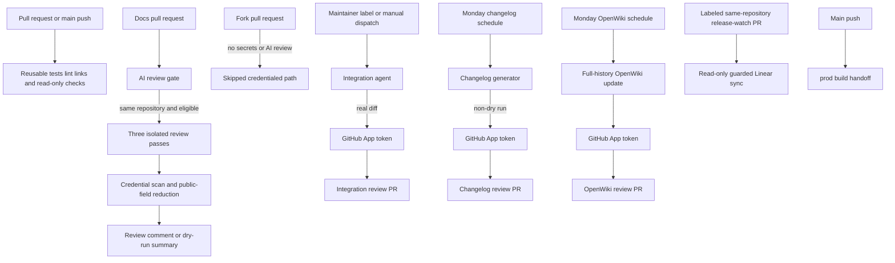
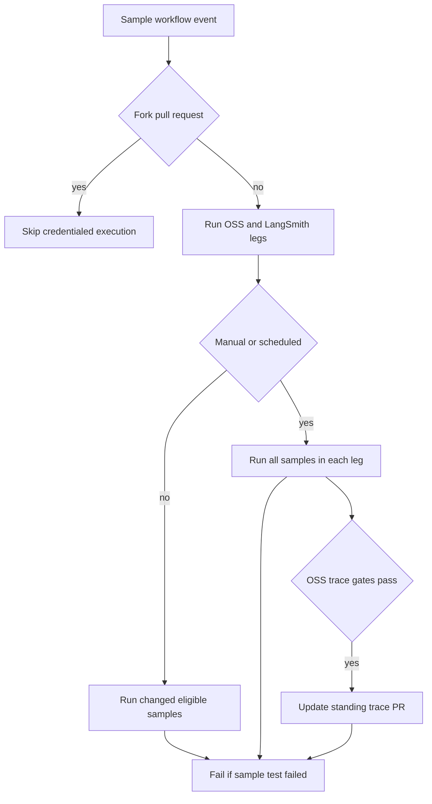

## Authority map

GitHub Actions separates checks that hold only read access to this repository from automation that may write a branch, comment on a pull request, or publish a generated site. Read-only in this map describes GitHub repository authority, not necessarily network isolation: the changed-document version check queries public registries. The source tree is the authoring surface. `build/`, preview branches, `prod`, and maintenance branches are outputs; maintenance writers propose changes for review rather than merge them.

The local composite action `.github/actions/uv_setup` is the common Python bootstrap for current CI and maintenance workflows. It pins `astral-sh/setup-uv@v7` to uv `0.9.26`, requires a major.minor Python version input, and sets `ignore-nothing-to-cache: true` so a job that exits before `uv sync` or `uv run` does not fail during cache cleanup. Reuse this action instead of independently selecting a uv version in a workflow.



*Read-only validation and review analysis do not write repository state; App-token paths create bounded pull requests after generation, while fork paths do not receive credentialed execution.*

### Credential and fork boundary

Credentialed sample execution is deliberately unavailable to fork pull requests: provider API keys are repository secrets, so **Test Code Samples** runs PR jobs only when the head repository is this repository. Mintlify preview creation applies the same same-repository condition before its write-capable build-and-push job. A skipped fork run is absent integration coverage, not a passing credentialed test.

Workflow permissions reinforce that distinction: core checks request read access, while the preview branch, trace-refresh, OpenAPI-refresh, changelog, integration-submission, OpenWiki, and publishing paths have only the write authority needed for their output. Keep secrets in GitHub secrets and do not place their values in shell output, summaries, bot comments, or PR bodies. In particular, issue and PR title/body text is input rather than authority: the integration workflow labels parsed submission values as untrusted metadata, and the Linear workflow parses only a constrained `Closes DOC-N` convention after its workflow-level repository and label guards.

### Pull-request attribution policy

**Check PR AI Attribution** runs on opened, edited, reopened, and synchronized pull requests with no permissions. It rejects the linked `Generated with [Claude Code](` badge and a Claude `Co-Authored-By` trailer using an Anthropic noreply address in the PR description. The failure message directs authors to disclose involvement as a plain sentence instead. This check matters because a squash merge uses the PR description as the commit message and would otherwise carry that badge or trailer into `main` history.

## AI documentation review boundary

`docs-ai-review.yml` is a separate, opt-in review path for authored documentation changes. Pull-request runs cover opened, synchronized, reopened, and ready-for-review events affecting `src/**/*.mdx` or `src/**/*.md`; the repository variable `AI_REVIEW_ENABLED` must be `true`. Manual dispatch accepts a PR number and defaults to a dry run. The gate rejects forks, draft or closed PRs when posting is possible, ordinary bot-authored PRs, the `skip-ai-review` label, and authors listed in the base branch's docs-team entry in `.github/OWNERS`. It uses read-only permissions in the gate and review jobs, and cancels superseded runs for the same PR.

The review job checks out the PR commit but archives the skills, `AGENTS.md`, and review/posting helpers from the base branch. Three passes run concurrently as an unprivileged `aireview` user with only repository reads through the allowlisted `gh-read` helper; model calls go through a local proxy owned by a separate secret-holding user. The agent cannot read the credentials, push, commit, use arbitrary GitHub or network commands, or change the trusted rules. Findings are scanned for credential-shaped values and reduced to public fields before a 30-day artifact is uploaded. The final job, which alone has pull-request and issue write permission, posts the sanitized review or writes it to the run summary for a dry run.

This is intentionally different from `pull_request_target`: untrusted PR metadata is never allowed to replace the base-branch review instructions or gain write-capable secrets. Missing credentials, a failed proxy, or no review pass producing findings fails the workflow; an individual pass may fail while the other passes still produce a reviewable result.

## Core CI gates

`ci.yml` runs on pull requests, pushes to `main`, and manual dispatch. It invokes reusable test, lint, and documentation-link workflows, then separately checks merge-conflict markers, source cross-references, external integration documentation URL schemes, and generated-file drift. Its concurrency group is the workflow plus ref and cancels an obsolete run when a newer push arrives for the same PR or branch.

| Gate | Control flow and contract |
| --- | --- |
| Tests | `_test.yml` takes a Python version and working directory, bootstraps pinned uv, synchronizes the `test` group, and runs `make test`. It conditionally adds server integration tests for `./libs/server`. |
| Lint | `_lint.yml` takes the same inputs, synchronizes the `test` group, runs `make lint`, and uses GitHub-format Ruff output for annotations. |
| Documentation links | `_check-links.yml` is read-only and times out at 20 minutes. It uses pinned uv plus Node 22 and a versioned Mintlify CLI cache to run anchor-link validation, MDX syntax/component validation, and the Agent Server OpenAPI check. |
| Generated overview | `ci.yml` regenerates `src/oss/python/integrations/providers/overview.mdx` and fails on a diff. It bypasses only the expected package-download bot update or a `bypass-auto-check` PR label. |

### Changed-document package-version claims

**Check version claims** is a separate, read-only pull-request workflow. It is triggered when authored `src/**/*.mdx`, its checker, ignore configuration, or workflow definition changes. After a full-history checkout, it finds the merge-base against the PR base and passes only changed MDX files below `src/` to `scripts/check_version_claims.py --files`; if that diff is empty, it succeeds without setting up Python or making registry requests.

The checker is deliberately narrower than an upgrade bot: it collects exact pins (`==`) and minimum floors (`>=`) named in documentation, then verifies that each named release—or a release in a truncated series such as `1.1`—has been published. It does **not** decide that a valid floor should be raised. A scoped package always goes to npm and a package with Python extras always goes to PyPI; otherwise the nearest Python/JavaScript label, a `:::python` or `:::js` fence, and then page-path language determine the registry. This prevents a package published on divergent Python and npm version lines from being checked against the wrong registry.

A registry lookup failure is reported as an unresolved note rather than a bad-version failure, so an outage or unavailable package does not block the PR. A version that resolves but was never published fails unless its exact specifier is a documented exception in `scripts/version_claims_ignore.cfg`. Run the same focused check locally after documentation changes:

```bash
uv run python scripts/check_version_claims.py --files src/path/to/page.mdx
```

`make build` installs npm dependencies and calls the pipeline build command. The command requires the source directory, creates `build/`, and delegates the transformation to `DocumentationBuilder.build_all()`. Use the narrow local entrypoint first:

```bash
make test
make lint
make check-cross-refs
make broken-links-with-anchors
make check-openapi
uv run python scripts/refresh_integration_downloads.py --check-docs-urls
uv run python pipeline/tools/partner_pkg_table.py
```

Do not hand-edit the generated provider overview: change its generator or package metadata, regenerate it, and commit the result. See [Testing and Validation Overview](/openwiki/testing/test-overview.md) for choosing broader validation.

## Code-sample matrix and failure escalation

**Test Code Samples** runs for relevant PR changes, manual dispatch, and at 00:00 UTC on the first of every month. It has non-fail-fast `oss` and `langsmith` legs, so a product failure does not mask the other product or prevent rerunning its individual job. `oss` owns `langchain`, `langgraph`, and `deepagents`; `langsmith` owns `langsmith`. A coverage check fails when a product directory below `src/code-samples/` belongs to neither mapping.

For an eligible internal PR, the workflow finds the merge-base diff and sends changed `.py`, `.ts`, `.java`, `.kt`, `.go`, and `.sh` sample files to the runner. Scheduled and manual events run every sample in the leg. Jobs provision pgvector PostgreSQL, Python 3.13 with pinned uv, Node 20, Java 21 with JBang, and Go. PR jobs have a 60-minute timeout; full runs have 150 minutes. `make test-code-samples` accepts `FILES` and respects the product's `CODE_SAMPLE_PATHS` partition.



*Only a full OSS run can produce trace-link artifacts; its final result still reflects sample failures.*

### Bounded trace refresh

Only the OSS leg of a manual or scheduled full run enables tracing and public trace collection. The test step continues after an error so that a bounded refresh remains possible, but the final step fails the job if the test step failed. Regeneration requires that the test was not cancelled, fewer than 20 samples failed, and traces changed.

The writer considers only `src/code-samples/trace-links.json` and `src/snippets/code-samples`. With no diff it exits; otherwise it appends to the open `chore/refresh-code-sample-traces` PR or creates that branch and PR from `main`. It does not merge. Review the trace links and generated snippets as a publication change; see [Runnable Code Samples and Snippet Generation](/openwiki/workflows/code-sample-lifecycle.md).

### Linear is downstream escalation

`test-code-samples-linear.yml` observes completed **Test Code Samples** runs. It acts only when a scheduled run concludes `failure` or `cancelled`, queries its job list with read-only Actions access, and files separate OSS and LangSmith issues for non-successful fixed-name legs. If no leg reported it files a generic pipeline-completion issue. If `LINEAR_TEAM_KEY` is unset, it warns and files nothing. It is not a retry or repair workflow: investigate and rerun the linked product leg.

## Privileged, maintainer-authorized integration proposals

**Integration submission** is a write-capable workflow, but opening an issue never starts it. It runs only when a maintainer applies `integration-run` to an issue or when a manually dispatched run names an issue; it then verifies that the triggering actor has `admin`, `maintain`, or `write` permission. An unauthorized label application is removed and explained on the issue. The workflow also skips an issue already labeled `integration-automation`, preventing duplicate work.

After fetching the issue body, the workflow parses the structured form into JSON. Parse failures produce an issue comment and stop before agent execution. The resulting prompt explicitly treats field values as untrusted listing metadata, requires the repository's eligibility policy, forbids questions and GitHub side effects, and permits `integration-submission-error.md` only for a hard blocker. The Deep Agents step may edit the checkout but is not given the later GitHub App token.

A blocker, agent failure, or empty diff is reported on the issue rather than turned into a PR. For a real diff, the workflow mints an App token *after* the agent finishes, opens or updates `integration/issue-<number>`, and posts the review link while mentioning the submitter. The PR is deliberately reviewable: its checklist calls out download eligibility, documentation URL/provider card, and generated listing material. It does not merge its output. This delayed-token design is the critical containment boundary for automation that handles untrusted issue text.

## Scheduled writers

### LangSmith OpenAPI refresh

`refresh-langsmith-openapi.yml` runs daily at 10:00 UTC and manually. It creates a GitHub App token for checkout, branch pushes, and PR operations because a `GITHUB_TOKEN`-created PR leaves pull-request workflows awaiting manual approval. The processor permits network fetches only from `api.smith.langchain.com`, filters the source for public documentation, and writes `src/langsmith/langsmith-platform-openapi.json`.

The workflow preserves the generated candidate while it checks out `chore/refresh-langsmith-openapi`. It appends to its open PR, exits successfully when the specification has no diff, or force-pushes an unreferenced standing branch and opens a PR. It never merges it. See [LangSmith OpenAPI Refresh](/openwiki/workflows/langsmith-openapi-refresh.md) for transformation policy.

### Weekly changelog proposal

`changelog-weekly.yml` runs Mondays at 13:00 UTC, serializes the `changelog-weekly` group without cancelling an active run, and allows manual `since`, `until`, and `dry_run` inputs. It validates that manual dates are paired and use `YYYY-MM-DD`. Non-dry runs use a GitHub App token for the dated `changelog/weekly-<UTC-date>` branch and review PR.

Before force-pushing a same-day branch, the workflow refuses to overwrite a branch containing commits not authored by `github-actions[bot]`. It creates or updates a PR only when tracked changelog state changed; it never merges. A dry run writes only candidate public entries to the summary, not the detailed report that can name private PRs or unreleased work. See [Weekly Changelog Publication](/openwiki/workflows/changelog-publication.md).

### OpenWiki maintenance

**OpenWiki Update** runs Mondays at 08:00 UTC or manually. It checks out full history because `openwiki code --update` needs to diff against the commit it last documented; a shallow clone would make that change summary empty. The job installs OpenWiki with Mermaid and jsdom validation support, runs the update through the configured LLM gateway, and optionally traces its own run to LangSmith.

The workflow creates its `openwiki/update` PR with a GitHub App token, limiting the committed paths to `openwiki`, `AGENTS.md`, and its workflow definition. As with the other App-token writers, this allows pull-request workflows to run; it proposes documentation for review rather than merging it.

### Linear state synchronization for release-watch work

**Sync Linear issue from PR** is not the sample-failure ticket workflow. It observes selected lifecycle events only for same-repository PRs labeled `release-watch-agent`, and has read-only GitHub permissions. Fork PRs cannot receive the `LINEAR_API_KEY`; an unset key results in a successful skip. The label condition also handles the race in which a PR is opened before its label is applied.

The script requires `Closes DOC-N` or a matching Linear link in the PR title or body before it contacts Linear. It normalizes a draft PR to **In Progress**, a ready PR to **In Review**, a merged PR to **Done**, and a closed-unmerged PR to **Canceled**; for each team it prefers those names, then falls back to the corresponding Linear workflow-state type. Missing links, missing matching states, and already-correct issues are reported as skips, not inferred from arbitrary PR text. See [Release Watch](/openwiki/workflows/release-watch.md).

## Previews and publication

Mintlify preview creation is restricted to same-repository PRs or manual dispatch. It validates the source branch, builds documentation, creates a collision-resistant `preview-` branch containing `build/`, and invokes the Mintlify preview API only after the branch is pushed. On PR closure, cleanup selects the derived prefix and refuses to delete a non-`preview-` branch.

For a successful non-Dependabot PR, the comment job needs Mintlify credentials and the preview-branch output; malformed JSON or an API error with neither a status ID nor preview URL fails the job. It deletes all bot comments carrying the current marker or recognized legacy preview wording, then creates one replacement marker comment. If Mintlify supplies a preview URL, that comment includes the site URL, a deployment-readiness notice, and deep links for up to five largest changed routable Markdown or MDX files. Files outside `src/`, code-sample and snippet paths, and non-routable names are excluded; `index` maps to its directory and shared OSS paths map to the Python route unless already language-specific. Without a preview URL, the replacement still records the generated branch but has no page deep links. See [Mintlify Integration](/openwiki/integrations/mintlify.md).

`publish.yml` runs on a `main` push or manual dispatch. It builds documentation, verifies `build/`, copies it beneath `public/build`, then uses the GitHub token to publish `public` to `prod`. This production handoff is separate from preview branches and is not an authoring surface.

## Safe-change checklist

1. Use `.github/actions/uv_setup` for a workflow's Python/uv bootstrap; do not silently drift its uv pin.
2. Preserve read-only validation and the same-repository guard wherever secrets or write-capable GitHub operations are involved.
3. Keep the AI-attribution check's PR-body policy aligned with squash-merge commit-history policy.
4. When adding a sample product directory, assign it to exactly one matrix leg.
5. Keep trace refresh OSS-only, full-run-only, bounded by its cancellation/failure/trace gates, and restricted to its two generated paths and review PR.
6. Keep Linear escalation downstream of failed or cancelled scheduled runs. An unset team variable must warn rather than fail observation.
7. Preserve no-diff, standing-PR, human-edit, and review boundaries for OpenAPI, changelog, trace, and OpenWiki writers. Do not expose secrets or private reports in generated material.
8. Preserve preview branch sanitization and deletion guards; do not enable credentialed preview paths for forks.
9. Keep integration submissions opt-in by a verified maintainer, parse the form before agent execution, treat its values as untrusted, and mint the App token only after the agent has produced a real diff.
10. Keep Linear state writes scoped to same-repository, `release-watch-agent` PRs with an explicit `Closes DOC-N` link; absent credentials or target states must skip rather than guess.
11. Keep package-version validation scoped to changed authored MDX and publication existence; do not turn it into automated dependency-floor upgrades or make registry outages a false failure.

## Related pages

- [Mintlify Integration](/openwiki/integrations/mintlify.md)
- [Testing and Validation Overview](/openwiki/testing/test-overview.md)
- [Weekly Changelog Publication](/openwiki/workflows/changelog-publication.md)
- [Runnable Code Samples and Snippet Generation](/openwiki/workflows/code-sample-lifecycle.md)
- [LangSmith OpenAPI Refresh](/openwiki/workflows/langsmith-openapi-refresh.md)
- [Release Watch](/openwiki/workflows/release-watch.md)
