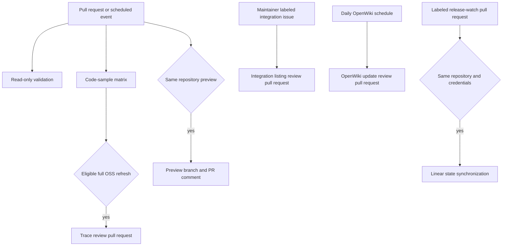
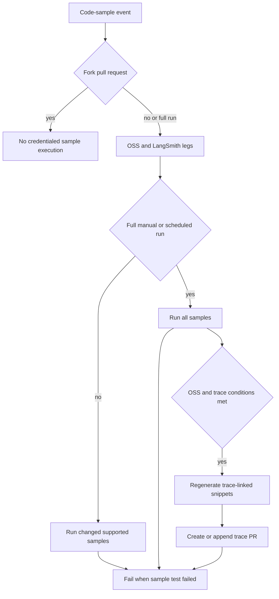

# GitHub Actions and CI Automation

GitHub Actions is the repository's execution boundary, not its authoring surface. Authors change source files; workflows validate them or create deliberately bounded outputs: a preview branch, a review pull request, a bot comment, or an external issue-state update. A green read-only check does not prove a credentialed integration worked, and a job skipped for a fork is **not** passing coverage.

## Authority map and trust boundaries

The workflows separate ordinary validation from jobs that can change GitHub state or call credentialed services.

| Class | Workflows and authority | Fork and failure boundary |
| --- | --- | --- |
| Read-only checks | `ci.yml`, reusable test/lint/link checks, and the release-watch trigger inspect repository state and report results. `ci.yml` cancels superseded runs for the same ref. | These checks may run for pull requests, but do not write branches, comments, or issues. |
| Credentialed sample execution and trace writer | `test-code-samples.yml` has repository write permissions because a successful eligible full OSS run may update its trace review PR. Sample execution receives provider/service credentials. | Pull-request sample jobs run only when the head is not a fork. A fork therefore has no credentialed sample result. |
| Preview writer | `create-preview-branch.yml` gives write permission only to the preview-branch job and PR-comment permission only to the comment job. The latter calls Mintlify with repository secrets. | Creation is restricted to same-repository PRs or manual dispatch; do not interpret a fork skip as a successful preview. |
| Maintainer-initiated automation | Integration submission, OpenWiki update, and Linear synchronization can write repository/issue state or an external Linear issue. | Their trigger and credential gates are part of the authorization boundary; keep untrusted issue or PR text out of shell interpretation and never disclose secret values. |

The shared `.github/actions/uv_setup` action is the Python bootstrap where it is used: it requires a major.minor Python input, pins `astral-sh/setup-uv@v7` and uv `0.9.26`, and tolerates an empty cache during post-cleanup. Prefer that action over a new, drifting Python/uv setup in workflows that need this convention.



*The diagram distinguishes checks from write-capable handoffs; every writer has an explicit eligibility gate and produces reviewable or externally visible state.*

## Core validation and local entrypoints

The central `ci.yml` workflow runs on pull requests, pushes to `main`, and manual dispatch. It calls reusable test, lint, and documentation-link workflows, then performs merge-conflict, cross-reference, external documentation URL, and generated-provider-overview checks. Its concurrency group is the workflow and ref, with cancellation enabled, so an older run is abandoned when a newer push targets the same PR or branch.

Reusable test and lint jobs synchronize the `test` dependency group and invoke `make test` or `make lint` for caller-supplied Python and working-directory inputs. The reusable documentation check has read-only contents permission and a 20-minute timeout; it runs the anchor-link and Agent Server OpenAPI checks. The generated-file job regenerates `src/oss/python/integrations/providers/overview.mdx` and fails on a diff, except for the specified package-download automation or a `bypass-auto-check` PR label.

For a targeted local approximation of these gates, use the Makefile targets rather than modifying generated output:

```bash
make test
make lint
make check-cross-refs
make broken-links-with-anchors
make check-openapi
make build
```

`make build` installs npm dependencies and invokes the pipeline build command. The command requires the source directory, creates `build/`, and delegates the source-to-build transformation to `DocumentationBuilder.build_all()`. See [Testing and Validation Overview](/openwiki/testing/test-overview.md) for selecting the smallest check that proves a change.

## Code-sample matrix, trace refresh, and escalation

**Test Code Samples** starts for code-sample workflow/paths changes on a pull request, manually, and monthly at 00:00 UTC on the first day. It uses independent, non-fail-fast `oss` and `langsmith` matrix legs: OSS owns `langchain`, `langgraph`, and `deepagents`; LangSmith owns `langsmith`. The workflow fails when a directory below `src/code-samples/` belongs to neither mapping, preventing a new product from silently escaping the matrix.

An eligible PR computes its merge-base with the base branch and passes changed supported `.py`, `.ts`, `.java`, `.kt`, `.go`, and `.sh` paths to both legs. The runner filters paths using that leg's `CODE_SAMPLE_PATHS`. Scheduled and manual invocations set `RUN_ALL` and execute every sample in each leg. Each leg provisions PostgreSQL plus the Python, Node, Java/JBang, and Go environments required by the sample runner; PR jobs allow 60 minutes and full jobs allow 150 minutes. Locally, `make test-code-samples` runs all samples or accepts `FILES="..."`; `CODE_SAMPLE_PATHS` supplies the same product partition used in CI.



*The continued test step permits a bounded artifact refresh, but it never converts a failed sample run into a successful job.*

### Bounded trace writer

Only a scheduled or manually dispatched **OSS** leg enables tracing and public trace collection. The test step uses `continue-on-error` so trace processing can be considered, but the final step fails the job when that test step failed. Snippet regeneration requires all of the following: the test was not cancelled, fewer than 20 samples failed, and traces were updated. It then runs `make code-snippets`.

The write step considers only `src/code-samples/trace-links.json` and `src/snippets/code-samples`. If those paths do not differ, it exits without a commit. Otherwise it appends to the open `chore/refresh-code-sample-traces` PR, or creates that branch and a PR against `main`; it does not merge. Review this generated output as a documentation change. [Runnable Code Samples and Snippet Generation](/openwiki/workflows/code-sample-lifecycle.md) owns the source, extraction, and trace-link lifecycle.

A separate observer watches completed **Test Code Samples** runs. It acts only on failed or cancelled scheduled runs, reads their job list, and creates separate OSS and LangSmith Linear tickets for non-successful product legs. When no product leg reported, it files a generic pipeline-completion ticket. If the `LINEAR_TEAM_KEY` repository variable is unset, it warns and files no ticket; this is an intentionally absent escalation, not a successful Linear write.

## Deterministic Mintlify previews

The preview workflow reacts to opened, synchronized, reopened, and closed pull requests, as well as manual dispatch. Its default permission is read-only; the creation job alone has `contents: write` and runs only for a same-repository PR or manual dispatch that is not a close event. It validates the source branch's allowed characters and length, checks out that source, installs dependencies, and runs `make build` before any branch write.

The preview branch is deterministic: `preview-<normalized-and-truncated-source-slug>-<eight-character-SHA-256-prefix>`. The source branch alone determines it, preserving the Mintlify preview URL across pushes; the hash distinguishes distinct long names that share a truncated slug. A run commits `build/` and either creates the branch or updates it with `--force-with-lease`, which rejects a concurrent remote movement rather than silently overwriting it. On PR closure, cleanup recomputes that name and also finds legacy matching branches, but refuses to delete anything without the `preview-` prefix.

The dependent comment job runs only after creation succeeds and excludes Dependabot. It has only `pull-requests: write`, requires a preview branch and Mintlify credentials, and invokes Mintlify's preview API. Missing inputs, invalid JSON, or an API error with neither status ID nor preview URL fail this credentialed job; they must not be described as a deployed preview. On success, the workflow removes bot-authored comments bearing the current marker or known legacy preview wording, then creates one replacement comment. When a preview URL exists, it adds deep links for at most five largest changed routable Markdown/MDX pages, excluding snippets and code samples. See [Mintlify Integration](/openwiki/integrations/mintlify.md) for the renderer and preview deployment boundary.

## Maintainer-gated integration listings

**Integration submission** turns a structured Integration listing issue into a proposed documentation change, not a direct merge. Applying `integration-run` starts it; opening an issue alone does not. The workflow also supports manual dispatch with an issue number. Before checkout or agent execution it verifies that the actor is an `admin`, `maintain`, or `write` collaborator. An unauthorized labeling attempt is removed and annotated, while an issue already labeled `integration-automation` is skipped to avoid duplicate work.

The workflow fetches the issue body, parses the recognized issue-form headings to JSON, and comments parsing errors rather than sending malformed data to the agent. The parser validates required fields and package requirements implied by a Python, TypeScript, or Both language selection; it does not execute field values. The agent receives the JSON explicitly as untrusted listing metadata, uses the `submit-integration` skill, leaves edits uncommitted, and is instructed not to push, open a PR, or comment on GitHub.

Only after a successful agent result with actual changes does the workflow mint a GitHub App token and create/update the `integration/issue-<number>` review PR. The token is deliberately created after the agent step, so the agent cannot access it. The workflow comments the issue and PR link for review; blocker files, agent failures, and no-change results receive an issue comment with retry guidance instead. This is a write-capable, maintainer-authorized path and should retain its narrow skill allow-list and review boundary. [Agent Instructions and Authoring Skills](/openwiki/operations/agent-skills.md) describes the skill contract.

## Scheduled OpenWiki maintenance

`openwiki-update.yml` runs daily at 08:00 UTC and on manual dispatch with contents and pull-request write permissions. It fetches full history because `openwiki code --update` needs to compare `HEAD` with the previously documented commit; a shallow checkout would make the update appear as an empty change summary. It installs Node 22, OpenWiki, Mermaid, and jsdom, then runs `openwiki code --update --print` using configured provider and connector credentials.

If the update produces changes, a GitHub App token opens or updates the `openwiki/update` PR. Its allowed paths are explicitly limited to `openwiki`, `AGENTS.md`, and the workflow itself. The App token ensures the resulting PR can trigger normal pull-request workflows; the workflow proposes changes for review rather than merging them. This job is credentialed and write-capable, so failures such as unavailable provider credentials or a failed update are failures to investigate, not evidence that documentation is current.

## Release-watch pull request to Linear lifecycle

`sync-linear-issue-from-pr.yml` is a small downstream synchronizer for release-watch delivery; it does not create documentation PRs or Linear issues. It listens to opened, reopened, draft/ready-for-review, closed, and relevant label events, with read-only repository and pull-request permissions. It runs only when the PR comes from this repository, has `release-watch-agent`, and—in the label case—the label that triggered the event is that label. This avoids exposing the Linear credential to fork PRs and avoids the race where a PR opens before its label is applied.

The job first checks whether its Linear credential is configured. If it is absent, it explicitly records a skip and does not attempt synchronization. Otherwise it uses the shared uv setup action and runs `scripts/sync_linear_issue_from_pr.py --json`, placing the result in the job summary.

The script reads the PR title/body from environment variables, recognizes `Closes DOC-N` or the canonical linked form, and only then extracts unique `DOC-<number>` identifiers. It derives the intended lifecycle from GitHub state: draft maps to **In Progress**, ready-for-review to **In Review**, merged to **Done**, and unmerged closed to **Canceled**. For each issue it prefers those state names from that issue's own Linear team and falls back to the corresponding workflow-state type. It records an already-target issue as skipped; it fails only when an intended update has no matching team state. Linear/API failures are surfaced rather than treated as successful synchronization. For the release selection and draft-PR producer, see [Documentation Release Watch](/openwiki/workflows/release-watch.md).

## Safe-change checklist

1. Keep read-only checks separate from secret-bearing or write-capable jobs, and state skips as missing coverage rather than success.
2. Preserve the same-repository guards around credentialed samples, Mintlify previews, and release-watch Linear synchronization.
3. When adding a code-sample product directory, assign it to exactly one matrix mapping and retain the uncovered-directory failure.
4. Keep trace refresh OSS-only, full-run-only, bounded by cancellation/failure/trace gates, restricted to its two generated paths, and reviewable through its standing PR.
5. Do not change the preview naming algorithm without changing both creation and cleanup; stable names are the preview URL contract.
6. Keep integration automation maintainer-gated, parse issue data before agent use, and mint write credentials only after untrusted agent work completes.
7. Retain full-history checkout and the bounded PR paths for OpenWiki updates.
8. Keep the release-watch `release-watch-agent`, same-repository, credential, and `Closes DOC-N` gates together; a missing credential means no synchronization occurred.

## Related pages

- [Mintlify Integration](/openwiki/integrations/mintlify.md)
- [Agent Instructions and Authoring Skills](/openwiki/operations/agent-skills.md)
- [Testing and Validation Overview](/openwiki/testing/test-overview.md)
- [Runnable Code Samples and Snippet Generation](/openwiki/workflows/code-sample-lifecycle.md)
- [Documentation Release Watch](/openwiki/workflows/release-watch.md)
