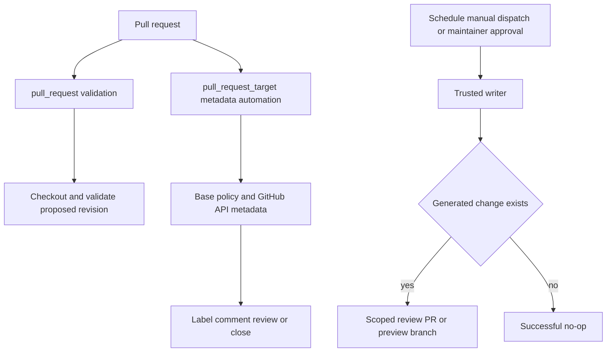
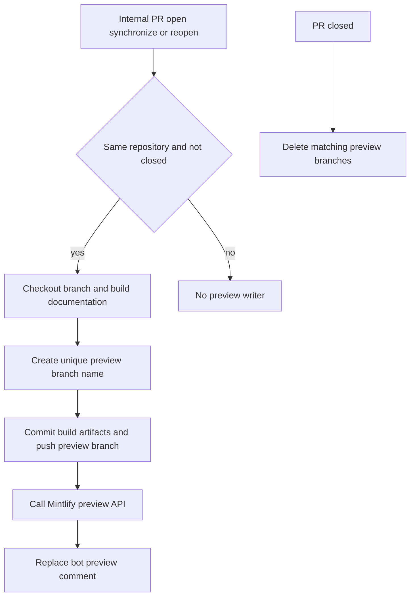

## Trust boundaries

GitHub Actions in this repository have three distinct roles. The event is a security boundary, not just a trigger choice.

| Role | Entrypoints | What it may do | Boundary |
| --- | --- | --- | --- |
| Revision validation | `pull_request`, push to `main` | Check out and test the proposed revision. | Treat fork code as untrusted; do not rely on secrets or repository writes. |
| Metadata-only PR automation | `pull_request_target` | Read base policy and GitHub API metadata; label, comment, request review, or close. | Never check out, source, or execute fork-head code. PR fields and fetched head-file content are data. |
| Trusted writer | Schedule or maintainer `workflow_dispatch` / authorization in the repository | Generate a narrowly scoped branch or review PR with write credentials. | Validate inputs, preserve no-op exits and review, and limit changed paths. |



This diagram distinguishes execution of a proposed revision from privileged PR mutation and trusted repository writes.

Do not use `pull_request_target` as a workaround for testing a fork. In particular, do not add a fork-head checkout or execute a PR-provided script there, and do not build shell commands from untrusted titles, bodies, branches, or issue-form fields.

## Core validation

The PR template asks contributors to describe the change and related work and, where applicable, confirm local documentation validation, tested examples, root-relative internal links, and navigation updates. It identifies preview deployment as an optional internal-team action.

`ci.yml` runs on pull requests, pushes to `main`, and manual dispatch. It calls reusable test, lint, and documentation-link workflows and also checks conflict markers, cross references, external integration `docs_url` values, and generated output. Its concurrency key is the workflow plus ref, so a newer push cancels an obsolete run for the same branch or PR.

The reusable test and lint workflows use shallow checkouts, sync the `test` dependency group, and run `make test` or `make lint` with caller-supplied Python and working-directory inputs. The link workflow has read-only contents permission and a 20-minute limit; it installs Python and Node 22, then runs Mintlify link validation and the OpenAPI check.

`check-generated-files` regenerates `src/oss/python/integrations/providers/overview.mdx` with `pipeline/tools/partner_pkg_table.py` and fails on a diff. Update `packages.yml` or the generator and commit regenerated output rather than editing the overview. The intended exceptions are a `bypass-auto-check` label and the expected `github-actions[bot]` package-download update.

Useful local counterparts are:

```bash
make test
make lint
make broken-links-with-anchors
make check-cross-refs
uv run python scripts/refresh_integration_downloads.py --check-docs-urls
uv run python pipeline/tools/partner_pkg_table.py
```

### Triage validation failures

* **Tests or lint:** reproduce with `make test` or `make lint` after syncing dependencies; do not assume a cancelled prior CI run is evidence for the current commit.
* **Links or OpenAPI:** run `make broken-links-with-anchors` and `make check-openapi`; link validation uses the documentation build rather than only static Markdown parsing.
* **Cross references or external listing URLs:** run `make check-cross-refs` or `uv run python scripts/refresh_integration_downloads.py --check-docs-urls` respectively.
* **Generated overview:** rerun `uv run python pipeline/tools/partner_pkg_table.py`, inspect the diff, and commit it when it reflects the changed metadata. Do not use the bypass label to conceal ordinary drift.

## Documentation previews

`create-preview-branch.yml` is an ordinary `pull_request` workflow, not a `pull_request_target` workflow. Its default permissions are read-only; only the preview-creation and closed-PR cleanup jobs receive `contents: write`, and only the comment job receives `pull-requests: write`. Preview creation runs only for an in-repository PR or manual dispatch, never for a fork PR, and checks out the named current branch before running `make install` and `make build`.



This lifecycle shows that preview deployment is restricted to trusted repository branches while closed PRs trigger cleanup.

The branch name contains a sanitized six-character source prefix, a timestamp, and a short SHA; an existing remote branch is rejected. The workflow uploads the resulting name as an artifact, asks Mintlify to deploy that branch using `MINTLIFY_API_KEY` and `MINTLIFY_PROJECT_ID`, and replaces prior bot preview comments with the site URL plus at most five highest-change routable Markdown deep links. Missing Mintlify secrets, a missing branch output, API errors without a status or preview URL, or a duplicate branch name fail the job.

On a closed PR, cleanup derives the same sanitized prefix, fetches remote branches, and deletes branches matching `preview-<prefix>-*` only after checking the `preview-` prefix. This is intentionally limited to preview names, but the six-character prefix is not a unique PR identity; investigate unexpected cleanup by comparing branch names and workflow logs. Preview branches are deployment artifacts and must not be merged into `main`.

## Metadata-only PR automation

`pr-welcome-comment.yml` is a `pull_request_target` workflow that reads `OWNERS` from the PR base ref and changed-file metadata through GitHub APIs. It applies last-match ownership rules and can request only opted-in owners other than the author without checking out PR code.

`external-integration-pr-comment.yml` also uses `pull_request_target` and does not check out or execute PR code. For non-draft, non-bot PRs that add integration pages or change the external-listing YAML, it uses an organization-membership App token and GitHub API file metadata to determine whether the author is external and applies the `integration` label. It reads added MDX from the head repository only as bytes: featured frontmatter or a verified package with at least 50,000 monthly downloads avoids closure. Otherwise, it creates or updates one marked redirect comment and closes the open PR. An unavailable or invalid package-download lookup fails eligibility checking rather than silently treating the page as eligible.

## Maintainer-approved integration listings

`integration-submission.yml` is a trusted writer, but an issue opening alone cannot start it. It begins only from manual dispatch or application of `integration-run`, and checks that the triggering actor has `admin`, `maintain`, or `write` permission before checkout. Unauthorized label application is removed and explained on the issue; an existing `integration-automation` label suppresses duplicate work.

After authorization, the workflow retrieves and parses the issue form, marks the issue in progress, and passes the parsed values to the agent explicitly as untrusted listing metadata. The agent is instructed to leave edits uncommitted and not push, open PRs, or comment. The workflow, not the agent, owns publication: parse failure, blocker file, agent failure, and no-diff outcomes are reported on the issue; only a real diff creates `integration/issue-<number>` and links the review PR.

For retry triage, inspect the issue's marker comment and workflow logs. Correct form fields for parse errors; resolve the reported blocker or agent failure; then remove `integration-automation` and have a maintainer reapply `integration-run`. Review the resulting PR's eligibility decision, docs URL, provider card, and generated table or hosted page before merge.

## Trusted scheduled and manual writers

### Weekly changelog

`changelog-weekly.yml` runs Mondays at 13:00 UTC or manually. The manual window either supplies both `since` and `until` as `YYYY-MM-DD` dates or neither; invalid or half-specified windows fail before the pipeline runs. A repository-wide changelog concurrency group serializes runs without cancelling an active one.

The workflow has contents and pull-request write permission because it writes a review branch. It invokes `scripts/changelog_pipeline.py weekly` with read access to upstream PRs and configured model/feature-flag credentials. `dry_run` omits `--write` and places generated entries and the reviewer list in the run summary. A normal run lints the three generated changelog state files with Vale (recording rather than immediately failing its result), exits cleanly when there is no diff, and otherwise force-pushes `changelog/weekly-<UTC-date>` and opens a PR. The PR body includes the reviewer list and recent Vale output because release/flag and internal-system decisions require human review.

### Package-download maintenance

`update-package-downloads.yml` runs Sundays at 23:59 UTC or manually. Its first job has read-only contents permission: it refreshes package counts only when their timestamp is older than 24 hours, regenerates the provider overview and integration download tables, and uploads only those candidate files with one-day retention. A separate job downloads that artifact and is the only job with contents and pull-request write permission. It exits successfully if the candidate paths do not differ; otherwise it opens a timestamped PR and enables squash auto-merge.

Hosted-documentation candidate detection creates Linear issues only when both `LINEAR_API_KEY` and `LINEAR_TEAM_KEY` are available; missing configuration deliberately runs it in dry-run mode. Candidates use the default 50,000 monthly-download threshold and avoid duplicates when the matching Linear issue remains open.

## Safe-change checklist

1. Keep `pull_request` validation, `pull_request_target` metadata automation, and trusted writers separate.
2. Never check out or execute fork-head code in `pull_request_target`; API-fetched head content must remain data-only.
3. Do not grant a preview writer to fork PRs or move preview secrets into general PR validation.
4. Preserve changelog input validation, dry-run behavior, no-diff exits, scoped generated paths, and review PRs; the package-download auto-merge is an explicit exception.
5. Preserve maintainer authorization and the workflow-owned commit/PR boundary for integration submissions.
6. Treat failures by layer: reproduce validation locally, inspect workflow logs and issue marker comments for automation, and review all generated writer diffs before merge.

## Related pages

- [Quickstart](/openwiki/quickstart.md)
- [Testing Overview](/openwiki/testing/test-overview.md)
- [Changelog Publication](/openwiki/workflows/changelog-publication.md)
- [Integration Listing Automation](/openwiki/workflows/integration-listing-automation.md)
- [LangSmith OpenAPI Refresh](/openwiki/workflows/langsmith-openapi-refresh.md)
- [Local Development](/openwiki/workflows/local-development.md)
