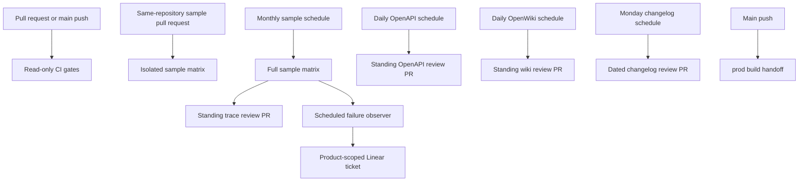
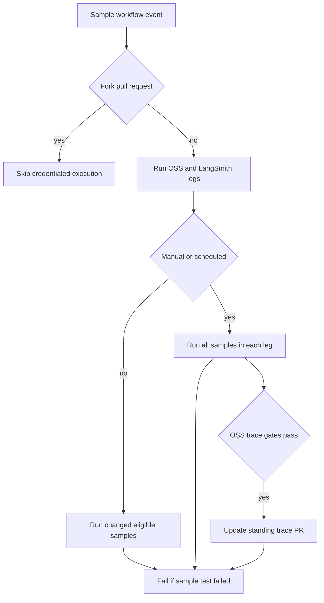

## Authority map

GitHub Actions separates read-only validation from automation that may write a branch, comment on a pull request, or publish a generated site. The source tree is the authoring surface. `build/`, preview branches, `prod`, and maintenance branches are outputs; maintenance writers propose changes for review rather than merge them.

The local composite action `.github/actions/uv_setup` is the common Python bootstrap for current CI and maintenance workflows. It pins `astral-sh/setup-uv@v7` to uv `0.9.26`, requires a major.minor Python version input, and sets `ignore-nothing-to-cache: true` so a job that exits before `uv sync` or `uv run` does not fail during cache cleanup. Reuse this action instead of independently selecting a uv version in a workflow.



*Validation does not write repository state; the write-capable paths produce bounded deployment or review artifacts.*

### Credential and fork boundary

Credentialed sample execution is deliberately unavailable to fork pull requests: provider API keys are repository secrets, so **Test Code Samples** runs PR jobs only when the head repository is this repository. Mintlify preview creation applies the same same-repository condition before its write-capable build-and-push job. A skipped fork run is absent integration coverage, not a passing credentialed test.

Workflow permissions reinforce that distinction: core checks request read access, while the preview branch, trace-refresh, OpenAPI-refresh, changelog, and publishing paths have only the write authority needed for their output. Keep secrets in GitHub secrets and do not place their values in shell output, summaries, bot comments, or PR bodies.

### Pull-request attribution policy

**Check PR AI Attribution** runs on opened, edited, reopened, and synchronized pull requests with no permissions. It rejects the linked `Generated with [Claude Code](` badge and a Claude `Co-Authored-By` trailer using an Anthropic noreply address in the PR description. The failure message directs authors to disclose involvement as a plain sentence instead. This check matters because a squash merge uses the PR description as the commit message and would otherwise carry that badge or trailer into `main` history.

## Core CI gates

`ci.yml` runs on pull requests, pushes to `main`, and manual dispatch. It invokes reusable test, lint, and documentation-link workflows, then separately checks merge-conflict markers, source cross-references, external integration documentation URL schemes, and generated-file drift. Its concurrency group is the workflow plus ref and cancels an obsolete run when a newer push arrives for the same PR or branch.

| Gate | Control flow and contract |
| --- | --- |
| Tests | `_test.yml` takes a Python version and working directory, bootstraps pinned uv, synchronizes the `test` group, and runs `make test`. It conditionally adds server integration tests for `./libs/server`. |
| Lint | `_lint.yml` takes the same inputs, synchronizes the `test` group, runs `make lint`, and uses GitHub-format Ruff output for annotations. |
| Documentation links | `_check-links.yml` is read-only, times out at 20 minutes, builds the docs through its Make target, then uses Node 22 and Mintlify to check anchors, redirects, and the Agent Server OpenAPI file. |
| Generated overview | `ci.yml` regenerates `src/oss/python/integrations/providers/overview.mdx` and fails on a diff. It bypasses only the expected package-download bot update or a `bypass-auto-check` PR label. |

`make build` installs npm dependencies and calls the pipeline build command. The command requires the source directory, creates `build/`, and delegates the transformation to `DocumentationBuilder.build_all()`. Use the narrow local entrypoint first:

```bash
make test
make lint
make check-cross-refs
make broken-links-with-anchors
make check-openapi
uv run python scripts/refresh_integration_downloads.py --check-docs-urls
uv run python pipeline/tools/partner_pkg_table.py
```

Do not hand-edit the generated provider overview: change its generator or package metadata, regenerate it, and commit the result. See [Testing and Validation Overview](/openwiki/testing/test-overview.md) for choosing broader validation.

### Changed-document version claims

**Check version claims** is a separate, read-only pull-request gate. It is triggered only when `src/**/*.mdx`, its checker or ignore configuration, or its workflow changes. With full Git history it computes the merge-base against the PR base and passes only changed `src/` MDX files to `scripts/check_version_claims.py`; when no such files changed, it succeeds without setting up Python.

The checker verifies the narrow claim that every named `>=` or `==` package version exists on the appropriate registry. It does not raise a stated version floor merely because a newer release exists: the feature requirement remains a human judgment. Its language/fence, nearest-label, scoped-package, extras, and path rules select PyPI or npm before the registry lookup.

## Code-sample matrix and failure escalation

**Test Code Samples** runs for relevant PR changes, manual dispatch, and at 00:00 UTC on the first of every month. It has non-fail-fast `oss` and `langsmith` legs, so a product failure does not mask the other product or prevent rerunning its individual job. `oss` owns `langchain`, `langgraph`, and `deepagents`; `langsmith` owns `langsmith`. A coverage check fails when a product directory below `src/code-samples/` belongs to neither mapping.

For an eligible internal PR, the workflow finds the merge-base diff and sends changed `.py`, `.ts`, `.java`, `.kt`, `.go`, and `.sh` sample files to the runner. Scheduled and manual events run every sample in the leg. Jobs provision pgvector PostgreSQL, Python 3.13 with pinned uv, Node 20, Java 21 with JBang, and Go. PR jobs have a 60-minute timeout; full runs have 150 minutes. `make test-code-samples` accepts `FILES` and respects the product's `CODE_SAMPLE_PATHS` partition.



*Only a full OSS run can produce trace-link artifacts; its final result still reflects sample failures.*

### Bounded trace refresh

Only the OSS leg of a manual or scheduled full run enables tracing and public trace collection. The test step continues after an error so that a bounded refresh remains possible, but the final step fails the job if the test step failed. Regeneration requires that the test was not cancelled, fewer than 20 samples failed, and traces changed.

The writer considers only `src/code-samples/trace-links.json` and `src/snippets/code-samples`. With no diff it exits; otherwise it appends to the open `chore/refresh-code-sample-traces` PR or creates that branch and PR from `main`. It does not merge. Review the trace links and generated snippets as a publication change; see [Runnable Code Samples and Snippet Generation](/openwiki/workflows/code-sample-lifecycle.md).

### Linear is downstream escalation

`test-code-samples-linear.yml` observes completed **Test Code Samples** runs. It acts only when a scheduled run concludes `failure` or `cancelled`, queries its job list with read-only Actions access, and files separate OSS and LangSmith issues for non-successful fixed-name legs. If no leg reported it files a generic pipeline-completion issue. If `LINEAR_TEAM_KEY` is unset, it warns and files nothing. It is not a retry or repair workflow: investigate and rerun the linked product leg.

## Scheduled writers

### OpenWiki update proposal

`openwiki-update.yml` runs daily at 08:00 UTC or on manual dispatch. It checks out full history because `openwiki code --update` compares the current commit to the commit it last documented; a shallow checkout would make the change summary empty. The job installs the OpenWiki CLI and diagram-validation dependencies, then updates the wiki before creating or updating the fixed `openwiki/update` review PR.

The update run receives provider and optional tracing credentials only through GitHub secrets. Branch and PR writes use a GitHub App token, rather than `GITHUB_TOKEN`, so ordinary pull-request workflows can run on the generated PR. The PR action limits staged paths to `openwiki`, `AGENTS.md`, and this workflow. Review its proposed documentation changes before merge; the workflow opens a PR and does not merge it.

### LangSmith OpenAPI refresh

`refresh-langsmith-openapi.yml` runs daily at 10:00 UTC and manually. It creates a GitHub App token for checkout, branch pushes, and PR operations because a `GITHUB_TOKEN`-created PR leaves pull-request workflows awaiting manual approval. The processor permits network fetches only from `api.smith.langchain.com`, filters the source for public documentation, and writes `src/langsmith/langsmith-platform-openapi.json`.

The workflow preserves the generated candidate while it checks out `chore/refresh-langsmith-openapi`. It appends to its open PR, exits successfully when the specification has no diff, or force-pushes an unreferenced standing branch and opens a PR. It never merges it. See [LangSmith OpenAPI Refresh](/openwiki/workflows/langsmith-openapi-refresh.md) for transformation policy.

### Weekly changelog proposal

`changelog-weekly.yml` runs Mondays at 13:00 UTC, serializes the `changelog-weekly` group without cancelling an active run, and allows manual `since`, `until`, and `dry_run` inputs. It validates that manual dates are paired and use `YYYY-MM-DD`. Non-dry runs use a GitHub App token for the dated `changelog/weekly-<UTC-date>` branch and review PR.

Before force-pushing a same-day branch, the workflow refuses to overwrite a branch containing commits not authored by `github-actions[bot]`. It creates or updates a PR only when tracked changelog state changed; it never merges. A dry run writes only candidate public entries to the summary, not the detailed report that can name private PRs or unreleased work. See [Weekly Changelog Publication](/openwiki/workflows/changelog-publication.md).

## Previews and publication

Mintlify preview creation is restricted to same-repository PRs or manual dispatch. It validates the source branch, builds documentation, creates a collision-resistant `preview-` branch containing `build/`, and invokes the Mintlify preview API only after the branch is pushed. On PR closure, cleanup selects the derived prefix and refuses to delete a non-`preview-` branch. The comment job requires Mintlify credentials, rejects malformed or unusable API responses, maintains one marker-based bot comment for successful non-Dependabot PRs, removes old duplicates, and lists at most five changed routable Markdown pages by diff size. See [Mintlify Integration](/openwiki/integrations/mintlify.md).

`publish.yml` runs on a `main` push or manual dispatch. It builds documentation, verifies `build/`, copies it beneath `public/build`, then uses the GitHub token to publish `public` to `prod`. This production handoff is separate from preview branches and is not an authoring surface.

## Safe-change checklist

1. Use `.github/actions/uv_setup` for a workflow's Python/uv bootstrap; do not silently drift its uv pin.
2. Preserve read-only validation and the same-repository guard wherever secrets or write-capable GitHub operations are involved.
3. Keep the AI-attribution check's PR-body policy aligned with squash-merge commit-history policy.
4. When adding a sample product directory, assign it to exactly one matrix leg.
5. Keep trace refresh OSS-only, full-run-only, bounded by its cancellation/failure/trace gates, and restricted to its two generated paths and review PR.
6. Keep Linear escalation downstream of failed or cancelled scheduled runs. An unset team variable must warn rather than fail observation.
7. Preserve no-diff, standing-PR, human-edit, and review boundaries for OpenAPI, changelog, and trace writers. Do not expose secrets or private reports in generated material.
8. Preserve preview branch sanitization and deletion guards; do not enable credentialed preview paths for forks.
9. When a PR adds or changes a workflow, script, Make target, PR check, scheduled job, or skill, invoke `docs-tooling-notion` before handoff. It records the operational change in its assigned internal documentation home; this follow-up does not justify duplicating secret values in the repository.

## Related pages

- [Mintlify Integration](/openwiki/integrations/mintlify.md)
- [Testing and Validation Overview](/openwiki/testing/test-overview.md)
- [Weekly Changelog Publication](/openwiki/workflows/changelog-publication.md)
- [Runnable Code Samples and Snippet Generation](/openwiki/workflows/code-sample-lifecycle.md)
- [LangSmith OpenAPI Refresh](/openwiki/workflows/langsmith-openapi-refresh.md)
