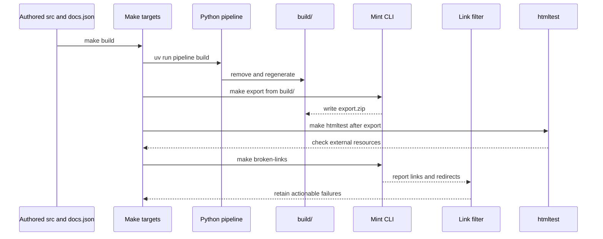

# Mintlify Integration

Mintlify is the site renderer and deployment integration for [docs.langchain.com](https://docs.langchain.com). Authors own `src/`, the Python pipeline, and `src/docs.json`; Mintlify consumes the generated `build/` tree. Edit authored files, not `build/`, preview branches, or OpenAPI endpoint pages created during deployment. A full build removes and recreates `build/`, so generated output is handoff state, not durable authoring state.

*This flow shows the local source-to-validation handoffs; hosted deployment remains the boundary for deployment-generated OpenAPI routes and other hosted-only output.*

## Configuration, navigation, and routes

`src/docs.json` is the Mintlify site configuration and the explicit navigation/redirect manifest. The builder copies it into `build/docs.json` with shared assets. It configures the Aspen theme, branding, fonts, contextual actions, GTM, canonical metadata, injected `src/style.css` and chat script, footer, navbar, navigation, OpenAPI groups, and redirects. Navigation is explicit rather than a directory scan: a route change normally requires generated output, a navigation entry, and any compatibility redirect to be updated together.

The route boundary is enforced before Mintlify renders the tree:

- Versioned OSS content is emitted under `/oss/python/...` and `/oss/javascript/...`; eligible `/oss/` links are rewritten for the target language. Shared pages build according to their language navigation, while language-specific source files build only for the matching tree.
- Managed Deep Agents pages are emitted under `/langsmith/python/...` and `/langsmith/javascript/...`. Legacy unversioned `/langsmith/managed-deep-agents...` paths redirect to the Python routes.
- Deep Agents Code and OpenWiki are language-agnostic and emit once at `/oss/deepagents/code/...` and `/oss/openwiki/...`. Link rewriting leaves those families unversioned.

Choose the output family before adding links. Source location alone does not always determine the public URL.

Redirects are part of the compatibility surface, not an implicit consequence of moving a file. `scripts/check_removed_pages_redirects.py` compares navigation between a base and head `docs.json`, requires a redirect when a removed page no longer has a source file, and verifies that every navigation page maps to an `.md` or `.mdx` source (including shared OSS mappings). Its wildcard handling supports redirects such as `:path*`. Run this check when removing or renaming a navigated page, then validate destinations with Mint's redirect-aware link check.

## Build and local development

`make build` runs `PYTHONPATH=$(CURDIR) uv run pipeline build`. `build_command` validates that `src/` exists, then `DocumentationBuilder.build_all()` deletes the existing build directory and emits the two OSS language trees, unversioned products, LangSmith content, Managed Deep Agents variants, shared files, and npm snippet components. The shared-file pass copies `docs.json`, CSS, scripts, images, fonts, and other supported assets. Npm snippet components are copied afterward, so the generated tree can contain the published `@langchain/docs-sandbox` components rather than source-tree copies.

`make dev` installs npm dependencies and runs `uv run pipeline dev`. Unless `--skip-build` is selected, it builds first, then starts a `FileWatcher` over `src/` and `mint dev --port 3000` in `build/`. Initial-build failure, a nonzero Mint exit, or an unexpected watcher stop fails the command; interruption shuts down both processes. `--skip-build` only warns when `build/` is absent and therefore does not prove that the generated tree is usable.

## Export and validation boundaries

The Make targets intentionally validate different artifacts:

| Target | Input and working directory | Result |
| --- | --- | --- |
| `make build` | `src/`, repository root | Replaces `build/` with a fresh generated tree. |
| `make export` | Fresh `build/`, then `build/` for Mint | Runs `mint export` and writes `build/export.zip` by default. It requires a Mint CLI with `export`, Node 20 or 22 rather than Node 25+, and an Enterprise Mintlify plan. |
| `make htmltest` | Existing `EXPORT_ZIP` | Unpacks the archive and checks external URLs, anchors, images, scripts, metadata, and generic HTML. It intentionally disables internal-link checking because Mint export is not a complete page set, and it does not run `make export`. |
| `make broken-links` | Fresh `build/`, then `build/` for Mint | Runs `mint broken-links --check-redirects`, filters documented false positives, and fails if indented link entries remain. |
| `make broken-links-with-anchors` | Fresh `build/`, then `build/` for Mint | Adds `--check-anchors` to the previous check. |
| `make check-mdx` | Fresh `build/`, then `build/` for Mint | Runs Mint validation for unknown components and foreign syntax. |
| `make check-openapi` | Fresh `build/`, then `build/` for Mint | Runs `mint openapi-check langsmith/agent-server-openapi.json`. |

For route, redirect, or anchor changes, run `make broken-links-with-anchors`. The redirect flag matters: it validates redirect destinations as well as ordinary generated-tree links. `make htmltest` is complementary archive checking, not a replacement for generated-tree navigation checks.

## Broken-link filtering

Mint checks snippet MDX as standalone files. Snippet links are emitted as absolute, language-prefixed paths and resolve when imported into a page, so the filter drops complete `snippets/` report sections. It removes only documented false-positive substrings: deployment-generated OpenAPI paths (`/langsmith/agent-server-api/`, `/langsmith/smith-api`, `/langsmith/tool-gateway-api/`, and `/api-reference/`) and known legacy relative paths. In anchor mode it additionally removes only the verified SmithDB migration and environment-variable anchors encoded by `KNOWN_ANCHOR_RE`; unrelated anchors remain failures. Unit tests verify that real missing links, unknown anchors, and unrelated paths stay actionable.

The filter is deliberately line-oriented: the Make targets fail only when filtered output still contains an indented link entry. It is not a general broken-link allowlist; extend it only when the excluded case is understood and current generated OpenAPI or snippet behavior explains why it cannot be checked locally.

## OpenAPI and hosted-only pages

`docs.json` configures four OpenAPI groups:

| Group | Input | Configured directory |
| --- | --- | --- |
| Agent Server API | `langsmith/agent-server-openapi.json` in generated output | `langsmith/agent-server-api` |
| Control Plane API | `https://api.host.langchain.com/openapi.json` fetched by Mintlify | None in the repository tree |
| LangSmith REST API | `langsmith/langsmith-platform-openapi.json` copied into generated output | `langsmith/smith-api` |
| Tool Gateway API | `langsmith/tool-gateway-openapi.json` copied into generated output | `langsmith/tool-gateway-api` |

Mintlify creates endpoint routes from these specifications during deployment. Those endpoint pages are absent from the local build, which is why the local broken-link filter excludes their reports. Do not add placeholder repository pages to satisfy that absence; inspect a hosted preview or production site instead. The external SDK reference at `reference.langchain.com` is a separate site and is not generated by this integration.

The committed Agent Server specification is the one validated by `make check-openapi`. The LangSmith REST and Tool Gateway specifications are generated or refreshed inputs; review changes as public-reference changes rather than silently patching endpoint pages into `build/`.

## Preview and production handoff

Preview and production workflows publish generated trees, not authoring state. A same-repository pull request builds `build/`, derives a deterministic `preview-<slug>-<hash>` branch from the source branch, force-adds the generated tree, and calls Mintlify's preview API. Fork pull requests cannot create previews because the workflow needs repository write access. Preview cleanup recomputes the branch and deletes it, while also guarding legacy timestamp-style names with the `preview-` prefix.

PR deep links are best-effort guesses from changed Markdown or MDX paths. The generator strips `src/` and extensions, converts `index` to a directory, and adds `oss/python/` to an unprefixed OSS path; it does not consult navigation, redirects, generated output, or language-selection rules. Treat the preview root and actual built route as authoritative, especially for shared pages, unversioned products, Managed Deep Agents, redirects, and OpenAPI routes.

Production builds publish `build/` through `public/build` to the `prod` branch. That branch, like preview branches, is a deployment handoff and not an authoring location.

## Hosted `llms.txt`

Mintlify generates `llms.txt` and nested `/_llms/` indexes on the deployed site. The scheduled checker crawls the served indexes, follows same-site index links, normalizes landing-page URLs, and compares discovered pages with `sitemap.xml`; it fails when a sitemap page is unreachable. A failure should first be checked for an accidentally authored custom `llms.txt`, then treated as a deployed Mintlify integration issue rather than a missing local page.

## Safe change checklist

1. Change `src/` and `src/docs.json`; run `make build` and never patch `build/` directly.
2. Select the output family before changing navigation or links.
3. When removing or moving a navigated page, add or update its compatibility redirect and run `scripts/check_removed_pages_redirects.py` against the base and head configuration.
4. Run `make broken-links-with-anchors` for moved routes, redirects, or anchors; filtering must reflect current generated OpenAPI and snippet behavior.
5. Use `make check-openapi` for Agent Server specification changes and review REST or Tool Gateway refresh changes.
6. Use `make export-htmltest` for the export/archive check, remembering that it does not prove internal navigation.
7. Validate deployment-generated OpenAPI routes and `llms.txt` in a hosted preview or production site.

## Related concepts

- [Build system](/openwiki/architecture/build-system.md) — generated-tree lifecycle and ownership.
- [Versioning](/openwiki/concepts/versioning.md) — language-specific route behavior.
- [Local development](/openwiki/workflows/local-development.md) — local preview setup.
- [Reference docs](/openwiki/integrations/reference-docs.md) — the separate external SDK reference boundary.
