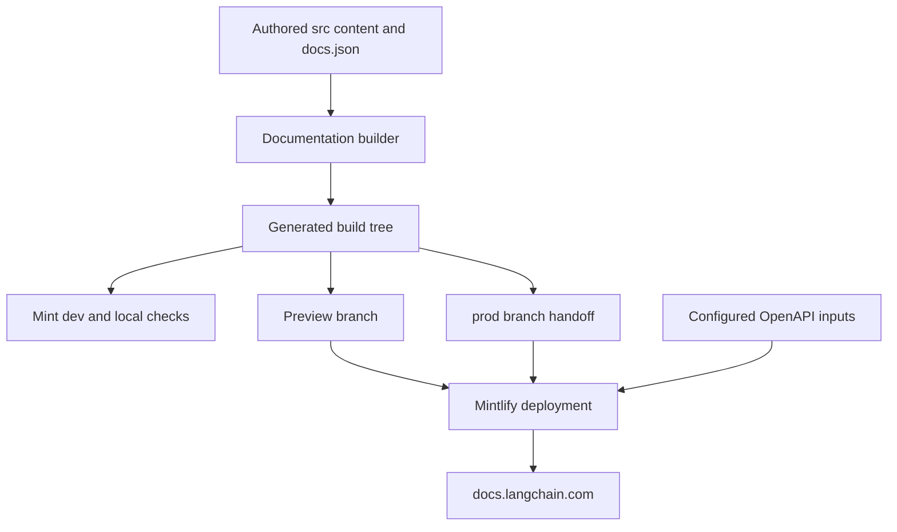

# Mintlify Integration

Mintlify renders the generated documentation tree from `/build/` for [docs.langchain.com](https://docs.langchain.com). The repository owns content in `src/`, the builder, and the reproducible handoff; Mintlify owns serving, rendering behavior, and deployment-generated artifacts. Edit `src/` and `/src/docs.json`, never `/build/`, a preview branch, or an endpoint page Mintlify creates from an OpenAPI input. A full builder run deletes and recreates `build/` before producing its language-specific, language-agnostic, and shared output, so that directory has no durable authoring state.



The diagram shows the repository-to-Mintlify handoff, including the hosted-only OpenAPI output.

## Configuration and navigation contract

`src/docs.json` is Mintlify's site configuration and navigation manifest; the builder copies shared files, including it, into `build/`. It declares the `aspen` theme; colors; light and dark logo and favicon assets; Tabler icons; TWK Lausanne headings and Inter body font; contextual actions; GTM; canonical metadata; injected CSS and chat script; footer and navbar; navigation; and redirects. Navigation is an explicit projection of routes, not a directory scan. Consequently, adding or moving a page requires both a generated route and the applicable navigation and redirect changes.

The builder establishes output route families before Mintlify reads the tree:

- Ordinary OSS documentation is emitted into both `/oss/python/...` and `/oss/javascript/...` trees. It rewrites eligible `/oss/` links for the target language.
- Managed Deep Agents pages emit only at `/langsmith/python/...` and `/langsmith/javascript/...`; `docs.json` redirects legacy unversioned URLs to Python so Mintlify does not serve orphaned unversioned copies.
- Deep Agents Code and OpenWiki are language-agnostic OSS products. Deep Agents Code is emitted once at `/oss/deepagents/code/...`, and link rewriting leaves that prefix unversioned.

These are builder rules, not Mintlify conventions. Choose the output family before adding navigation or links.

## Local development and validation

`make dev` installs local npm dependencies and invokes `uv run pipeline dev`. The command builds first unless `--skip-build` is set, starts `FileWatcher` for `src/` to `build/`, and launches the separately installed global Mint CLI as `mint dev --port 3000` from `build/`. If Mint exits nonzero, the watcher ends unexpectedly, or the initial build fails, the command fails; interruption shuts down the watcher and Mint subprocess. `--skip-build` merely warns when `build/` is missing and does not establish that the tree is valid.

For navigation, redirect, route, or anchor changes, use:

```bash
make broken-links
make broken-links-with-anchors
make check-openapi
```

Both link targets rebuild first and run `mint broken-links` in `build/`; they enable redirect checking, and the latter additionally enables anchors. The filter removes complete standalone snippet sections because snippets' rewritten language-prefixed links resolve only when imported; it also removes deployment-time OpenAPI routes and known legacy relative-path reports. Only anchor mode additionally removes the three exact SmithDB migration anchors and the exact imported `n_jobs_per_worker` anchor. The Make target fails only when filtered output still has an indented link entry. Unit tests cover both the section-level exclusion and the narrow anchor boundary; the reusable CI workflow uses Node 22 and runs the anchor target plus `make check-openapi`.

`make check-openapi` runs `mint openapi-check langsmith/agent-server-openapi.json` after building. It validates only the Agent Server source, not the remote Control Plane input or the committed LangSmith REST input.

A separate pull-request workflow prevents authored `.md` and `.mdx` from linking to retired documentation hosts. It runs for documentation changes targeting `main`, scans all authored files under `src/` rather than just changed lines, permits the Helm repository exception, and directs replacements to relative site routes or `https://reference.langchain.com/` for API reference. This guard is distinct from Mint's generated-tree checker: it protects the authored-source link policy before build output exists.

`make export` is separate from link checking. It builds, requires a global Mint CLI that supports `mint export`, Node 20 or 22, and an Enterprise Mintlify plan, then writes `build/export.zip` by default. `make htmltest` unpacks that archive and checks external content links with internal paths and hashes disabled: Mint export does not contain a complete page set, so it cannot establish internal navigation correctness.

## OpenAPI reference boundary

Mintlify configuration has three OpenAPI groups:

| Group | Input | Configured directory |
| --- | --- | --- |
| Agent Server API | `langsmith/agent-server-openapi.json` in the generated tree | `langsmith/agent-server-api` |
| Control Plane API | `https://api.host.langchain.com/openapi.json` fetched by Mintlify during deployment | None |
| LangSmith REST API | committed `src/langsmith/langsmith-platform-openapi.json`, copied into the generated tree | `langsmith/smith-api` |

Mintlify creates endpoint routes for these groups when it deploys. They are not authored Markdown or MDX files and, in particular, absent local endpoint paths must not be created or documented as authored repository pages. The local link checker intentionally filters `/langsmith/agent-server-api/`, `/langsmith/smith-api`, and `/api-reference/` reports; inspect a hosted preview or production deployment to validate the rendered endpoint surface. This generated endpoint surface is also separate from the externally built SDK reference at `reference.langchain.com`.

The LangSmith REST specification is refreshed daily. The refresh job fetches only the allow-listed `api.smith.langchain.com` host, hides Fleet, internal, and selected health operations, normalizes endpoint titles (including visible non-sandbox v2 labels), assigns and orders human-readable tag groups, and writes the committed specification. If it differs, the job appends to the existing `chore/refresh-langsmith-openapi` pull request or creates one; if it is unchanged, it makes no commit. Treat the resulting PR as a public-reference change.

## Preview and production lifecycle

For same-repository pull requests, the preview workflow validates source branch characters and length, runs `make build`, creates a collision-resistant `preview-` branch name from a sanitized prefix, timestamp, and commit SHA, and force-adds the generated `build/` tree to that branch. It then calls Mintlify's preview API only after checking the API key, project ID, and branch name. A non-JSON response—or an error response with neither status ID nor preview URL—fails the workflow. Fork PRs are skipped because the workflow needs repository write access. On PR close, cleanup finds matching preview branches and refuses to delete a name without the `preview-` prefix.

On pushes to `main` or manual dispatch, the production workflow builds the tree, copies it to `public/build`, and publishes `public` to the `prod` branch. Both preview and `prod` branches are generated deployment handoffs, not authoring locations.

## Hosted-only `llms.txt`

Mintlify generates `llms.txt` and, when required, nested `/_llms/` indexes only on the deployed site. The weekly coverage job crawls these served indexes from `https://docs.langchain.com`, follows same-site index links, normalizes landing-page URLs, and compares the discovered pages with `sitemap.xml`. It fails if a sitemap page is unreachable from the index. The checker uses `langchain-docs-llms-check` as its user agent, a 30-second timeout, and three attempts for connection failures; HTTP errors fail immediately. A gap is a deployed integration issue after first confirming that no custom `llms.txt` was placed in the build.

## Safe change checklist

1. Change `src/` and `src/docs.json`, then run `make build`; do not patch generated output or deployment-created endpoint routes.
2. Select the intended output family before modifying links or navigation, especially dual-language OSS and Managed Deep Agents pages.
3. Update a moved route, navigation entry, and compatibility redirects together; run `make broken-links-with-anchors`.
4. Keep authored links off retired doc sites; use relative docs routes or `https://reference.langchain.com/` for the external SDK reference.
5. Run `make check-openapi` for Agent Server input changes and review LangSmith REST refresh PRs as public API documentation changes.
6. Use a Mintlify preview or production deployment to inspect generated OpenAPI endpoints and `llms.txt` coverage.

## Related concepts

- [Build system](/openwiki/architecture/build-system.md) — generated-tree lifecycle and ownership.
- [Reference documentation](/openwiki/integrations/reference-docs.md) — API-reference boundaries.
- [CLI tools](/openwiki/operations/cli-tools.md) — command-line validation entry points.
- [Test overview](/openwiki/testing/test-overview.md) — validation coverage.
- [Local development](/openwiki/workflows/local-development.md) — developer setup and watch workflow.
