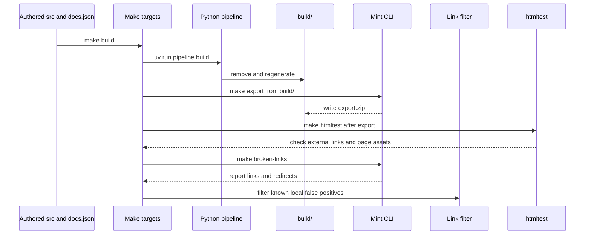

# Mintlify Integration

Mintlify is the static-site renderer and deployment integration for [docs.langchain.com](https://docs.langchain.com). Repository authors own `src/`, the builder, and the reproducible handoff; Mintlify consumes the generated `/build/` tree and `docs.json`, renders the site, and creates some deployment-only output. Edit `src/` and `src/docs.json`, not `build/`, a preview branch, or an OpenAPI endpoint page created by Mintlify. A full build deletes and recreates `build/`, so it has no durable authoring state.



The sequence shows the inspected local handoffs; Mintlify deployment remains the boundary for hosted OpenAPI routes and other deployment-generated output.

## Configuration and route contract

`src/docs.json` is Mintlify's site configuration and navigation manifest. The builder copies it with shared files into `build/docs.json`. It sets the `aspen` theme, colors, logos and favicon, Tabler icons, TWK Lausanne heading and Inter body fonts, contextual actions, GTM, canonical metadata, injected CSS and chat script, footer, navbar, navigation, and redirects. Navigation is explicit rather than a directory scan: a route change usually needs matching generated output, navigation, and compatibility redirects.

The builder—not Mintlify—chooses the route family before Mintlify sees output:

- It builds `/oss/python/...` and `/oss/javascript/...` trees and rewrites eligible `/oss/` links for the target language. A shared OSS page present in exactly one language navigation builds only for that language; one in both or neither builds for both. A language-specific source file builds only for its matching tree.
- Managed Deep Agents source pages emit only at `/langsmith/python/...` and `/langsmith/javascript/...`. `docs.json` redirects legacy unversioned Managed Deep Agents routes to Python.
- Deep Agents Code and OpenWiki emit once at `/oss/deepagents/code/...` and `/oss/openwiki/...`, respectively. OSS link rewriting deliberately leaves both route families unversioned.

Choose the output family before adding a route or link. In particular, source location alone does not always identify a public URL.

## Local development and validation

`make dev` installs local npm dependencies and invokes `uv run pipeline dev`. Unless `--skip-build` is selected, the command builds first, then starts a `FileWatcher` from `src/` to `build/` and the globally installed Mint CLI as `mint dev --port 3000` in `build/`. The command fails when the initial build fails, Mint exits nonzero, or the watcher ends unexpectedly; interruption shuts down both processes. `--skip-build` only warns if `build/` is absent, so it does not prove a usable generated tree exists.

The Make targets have deliberately different boundaries:

| Target | Input and working directory | What it validates or produces |
| --- | --- | --- |
| `make build` | `src/`, repository root | Runs `uv run pipeline build`; the Python builder replaces `build/` with a fresh generated tree. |
| `make export` | Fresh `build/`, then `build/` for the Mint command | Depends on `build`, runs `mint export` from `build/`, and writes `build/export.zip` by default. |
| `make htmltest` | An existing `EXPORT_ZIP` | Unpacks the archive and checks external links, anchors, images, scripts, metadata, and generic HTML; it does not check internal links. It does not run `make export` itself. |
| `make broken-links` / `make broken-links-with-anchors` | Fresh `build/`, then `build/` for Mint | Runs Mint's generated-tree link check with redirects, optionally anchors, filters only documented false positives, and fails on remaining indented link entries. |

For route, redirect, or anchor changes, run:

```bash
make broken-links
make broken-links-with-anchors
make check-openapi
```

The link targets rebuild first and run `mint broken-links` in `build/` with redirect checking; the second also checks anchors. The filter drops entire standalone `snippets/` report sections because their language-prefixed links work only after import, deployment-time OpenAPI paths, and known legacy relative-path reports. Anchor mode additionally drops only the exact SmithDB migration anchors and the exact `n_jobs_per_worker` anchor. The target fails only when filtered output retains an indented link entry. Unit tests protect these exclusions. The reusable CI workflow pins Mint CLI `4.2.1181` on Node 22 and runs the anchor check, MDX validation, and the Agent Server OpenAPI validation.

`make check-openapi` builds and runs `mint openapi-check langsmith/agent-server-openapi.json`. It validates the Agent Server input only—not the remote Control Plane input or committed LangSmith REST input.

A separate pull-request check scans every authored Markdown and MDX file under `src/` for retired documentation hosts. It allows the Helm repository exception and requires relative documentation paths or `https://reference.langchain.com/` for API-reference links. This source-policy guard is distinct from Mint's generated-tree check.

`make export` is also separate from link checking. It rebuilds and writes `build/export.zip` by default, requiring a Mint CLI with `export`, Node 20 or 22 rather than Node 25 or later, and an Enterprise Mintlify plan. `make htmltest` checks the unpacked archive with internal paths and hashes disabled because Mint export is not a complete page set; it cannot demonstrate internal navigation correctness.

## OpenAPI reference boundary

`docs.json` configures three OpenAPI groups:

| Group | Input | Configured directory |
| --- | --- | --- |
| Agent Server API | `langsmith/agent-server-openapi.json` in generated output | `langsmith/agent-server-api` |
| Control Plane API | `https://api.host.langchain.com/openapi.json`, fetched by Mintlify at deployment | none |
| LangSmith REST API | committed `src/langsmith/langsmith-platform-openapi.json`, copied into generated output | `langsmith/smith-api` |

Mintlify generates endpoint routes for these inputs when it deploys. They are not authored Markdown or MDX and endpoint routes are absent from the local build. The local filter therefore excludes `/langsmith/agent-server-api/`, `/langsmith/smith-api`, and `/api-reference/` reports. Inspect a hosted preview or production deployment for that rendered surface; do not create repository pages merely to satisfy its local absence. The endpoint surface is separate from the externally built SDK reference at `reference.langchain.com`.

The LangSmith REST specification refreshes daily. Its processor only fetches the allow-listed `api.smith.langchain.com` host, marks Fleet, internal, and selected health operations hidden, assigns and orders human-readable tag groups, and normalizes operation titles, including visible non-sandbox v2 labels. The workflow makes no commit if the processed specification is unchanged; otherwise it appends to an open `chore/refresh-langsmith-openapi` PR or creates one. Review that PR as a public-reference change.

## Preview and production handoff

For a same-repository pull request, the preview workflow validates branch syntax and length, runs `make build`, and derives `preview-<slug>-<hash>` from the source branch: the slug is normalized and capped, and the hash distinguishes names with the same truncated slug. The branch is therefore deterministic for a source branch, keeping its Mintlify preview URL stable across pushes. The workflow force-adds the generated `build/` tree; it creates the preview branch initially and updates it with `--force-with-lease` thereafter, so a concurrent move is rejected rather than silently overwritten. It then invokes Mintlify's preview API after verifying the API key, project ID, and branch name. A non-JSON response, or an error without a status ID or preview URL, fails the API step. Fork PRs do not create previews because the job needs repository write access.

On close, cleanup recomputes and deletes the deterministic branch and also searches for legacy timestamp-style preview names matching the source branch's first six alphanumeric characters. Every deletion is guarded by the `preview-` prefix. Preview branches are generated deployment handoffs, not durable source.

The PR comment can include a site URL and up to five deep links for changed Markdown or MDX files, ranked by diff size. These are **best-effort source-path guesses**, not a build-manifest lookup: it strips `src/` and extensions, converts `index` to its directory, and adds `oss/python/` to an unprefixed OSS path. It excludes paths outside `src/`, non-Markdown files, and files in `code-samples` or `snippets`; it does not consult navigation, generated output, redirects, or the builder's language rules. As a result, the guessed link can be wrong or unlisted for a shared page emitted only for JavaScript, an unversioned OpenWiki or Deep Agents Code page, a language-prefixed Managed Deep Agents page, a redirect, or deployment-generated OpenAPI output. Treat the preview root and the actual built route as authoritative when reviewing those changes.

On pushes to `main` or manual dispatch, the production workflow builds, copies `build/` to `public/build`, and publishes `public` to the `prod` branch. The `prod` branch is a deployment handoff, not an authoring location.

## Hosted-only `llms.txt`

Mintlify generates `llms.txt` and nested `/_llms/` indexes only on the deployed site. A weekly job crawls the served indexes from `https://docs.langchain.com`, follows same-site index links, normalizes landing-page URLs, and compares discovered pages with `sitemap.xml`; it fails when a sitemap page is unreachable. The checker uses the `langchain-docs-llms-check` user agent, a 30-second timeout, and three attempts for connection failures, while HTTP errors fail immediately. If coverage fails, first confirm that no custom `llms.txt` was added to the build, then treat it as a deployed Mintlify integration issue.

## Safe change checklist

1. Change `src/` and `src/docs.json`, run `make build`, and do not patch generated output or deployment-created endpoints.
2. Select the output family before changing navigation or links, especially for dual-language OSS, Managed Deep Agents, and unversioned OSS products.
3. Update moved routes, navigation, and compatibility redirects together; run `make broken-links-with-anchors`.
4. Keep authored links off retired documentation sites and use `https://reference.langchain.com/` for the external SDK reference.
5. Run `make check-openapi` for Agent Server input changes and review LangSmith REST refresh PRs.
6. Use a hosted preview or production deployment to validate generated OpenAPI routes and `llms.txt`; do not rely on PR deep links for exceptional route families.

## Related concepts

- [Build system](/openwiki/architecture/build-system.md) — generated-tree lifecycle and ownership.
- [Versioning](/openwiki/concepts/versioning.md) — language-specific route behavior.
- [GitHub Actions](/openwiki/integrations/github-actions.md) — automation and branch handoff.
- [Test overview](/openwiki/testing/test-overview.md) — validation coverage.
- [LangSmith OpenAPI refresh](/openwiki/workflows/langsmith-openapi-refresh.md) — managed REST specification updates.
- [Local development](/openwiki/workflows/local-development.md) — local preview setup.
