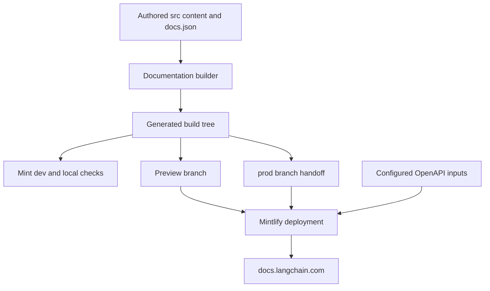

# Mintlify Integration

Mintlify renders the generated documentation tree from `/build/` for [docs.langchain.com](https://docs.langchain.com). The repository owns content in `src/`, the builder, and the reproducible handoff; Mintlify owns serving, rendering behavior, and deployment-generated artifacts. Edit `src/` and `src/docs.json`, never `/build/`, a preview branch, or an endpoint page Mintlify creates from an OpenAPI input.



The diagram shows the repository-to-Mintlify handoff and the hosted outputs that are not ordinary source files.

## Configuration and route contract

`src/docs.json` is Mintlify's site configuration and navigation manifest; the builder copies shared files, including it, into `build/`. It specifies the `aspen` theme, branding assets and colors, Tabler icons, TWK Lausanne and Inter fonts, contextual actions, Google Tag Manager, canonical metadata, injected CSS and chat script, site chrome, navigation, and redirects. Navigation is an explicit projection of routes rather than a directory scan. Adding or moving a page therefore requires a generated route and the applicable navigation and redirect changes.

The builder establishes output route families before Mintlify reads the tree:

- Ordinary OSS documentation is emitted into both `/oss/python/...` and `/oss/javascript/...`; eligible `/oss/` links are rewritten for the target language.
- Managed Deep Agents pages emit only at `/langsmith/python/...` and `/langsmith/javascript/...`; `docs.json` redirects legacy unversioned URLs to Python.
- Deep Agents Code and OpenWiki are language-agnostic OSS products. Deep Agents Code is emitted once at `/oss/deepagents/code/...`, and link rewriting leaves that prefix unversioned.

These are builder rules, not Mintlify conventions. Select the intended output family before adding navigation or links.

## Install and develop locally

Run `make install` for the repository's Python and npm dependencies and the global Mint CLI. Its Mint installation retries `npm install -g mint@latest` up to three times. `make dev` itself runs `npm install` and `uv run pipeline dev`; it assumes `mint` is already on `PATH`.

The development command builds first unless `--skip-build` is set, starts `FileWatcher` from `src/` to `build/`, and launches `mint dev --port 3000` from `build/`. It forwards Mint logs and returns a failure when the initial build fails, Mint exits nonzero, or the watcher stops unexpectedly. Interruption shuts down the watcher and Mint subprocess; if the graceful Mint wait exceeds five seconds, the command kills it. `--skip-build` only warns when `build/` is absent, so it does not prove that an existing tree is valid.

## Link and input validation

For route, redirect, or anchor changes, run:

```bash
make broken-links
make broken-links-with-anchors
make check-openapi
```

Both link targets rebuild first, run `mint broken-links` from `build/`, and enable redirect checking; the anchor variant also supplies `--check-anchors`. The targets capture the Mint report, filter known non-actionable output, and fail only when a remaining indented link entry is present. The filter drops entire standalone `snippets/` report sections because their rewritten language-specific links resolve only when snippets are imported. It also drops deployment-time OpenAPI paths, specified legacy relative paths, and—in anchor mode only—the two known SmithDB migration anchors. Unit tests protect the distinction between these exclusions and ordinary failures.

The reusable link-validation workflow runs the anchor target and `make check-openapi` on Node 22. `make check-openapi` rebuilds and runs `mint openapi-check langsmith/agent-server-openapi.json`; it does **not** validate the remote Control Plane input or committed LangSmith REST input.

## Export is an external-link check, not a site build check

`make export` rebuilds and invokes `mint export` from `build/`, writing `build/export.zip` unless `MINT_EXPORT_ARGS` changes the Mint output path. It rejects an unavailable CLI, a CLI without `mint export`, and Node 25 or later; the documented prerequisites are a recent Mint CLI, Node 20 or 22, and an Enterprise Mintlify plan.

After exporting, `make htmltest` requires `htmltest`, `unzip`, and the export archive, then unpacks it beneath `build/` and checks it with `htmltest-mint-export.yml`. That configuration checks external content URLs but disables internal paths and hashes because the export is not a complete page set. It is useful for exported-content and external-link regressions, but cannot establish internal navigation correctness.

## OpenAPI reference boundary

Mintlify configuration has three OpenAPI groups:

| Group | Input | Configured directory |
| --- | --- | --- |
| Agent Server API | `langsmith/agent-server-openapi.json` in the generated tree | `langsmith/agent-server-api` |
| Control Plane API | `https://api.host.langchain.com/openapi.json`, fetched by Mintlify at deployment | None |
| LangSmith REST API | committed `src/langsmith/langsmith-platform-openapi.json`, copied into the generated tree | `langsmith/smith-api` |

Mintlify generates endpoint routes for these groups at deployment. They are not authored Markdown or MDX files and are absent from local build output. The local link checker intentionally filters reports for `/langsmith/agent-server-api/`, `/langsmith/smith-api`, and `/api-reference/`; use a hosted preview or production deployment to inspect the rendered endpoint surface.

The LangSmith REST specification refreshes daily. The processor fetches only the allow-listed `api.smith.langchain.com` host, hides Fleet, internal, and selected health operations, standardizes operation titles—including visible non-sandbox v2 labels—and assigns and orders human-readable tag groups. The workflow writes the committed specification only when it changes; it then appends to an open `chore/refresh-langsmith-openapi` pull request or creates one. Review that PR as a public-reference change.

## Preview and production lifecycle

For a same-repository pull request, the preview workflow validates source-branch syntax and length, runs `make build`, creates a collision-resistant `preview-` branch from a sanitized prefix, timestamp, and commit SHA, and force-adds `build/` to that branch. It invokes Mintlify's preview API only after checking the API key, project ID, and generated branch name. A non-JSON response, or an error response with neither a status ID nor preview URL, fails the workflow. Fork PRs are skipped because the workflow needs repository write access. When a PR closes, cleanup finds matching branches but refuses to delete a branch without the `preview-` prefix.

On a push to `main` or manual dispatch, the production workflow builds the tree, copies it to `public/build`, and publishes `public` to the `prod` branch. Preview and `prod` branches are generated deployment handoffs, not authoring locations.

## Hosted-only `llms.txt`

Mintlify generates `llms.txt` and, once it exceeds 100,000 characters, nested `/_llms/` indexes only on the deployed site. The weekly coverage job crawls the served root and nested indexes from `https://docs.langchain.com`, follows same-site index links, normalizes landing-page URLs, and compares discovered pages with `sitemap.xml`. It fails when a sitemap page is unreachable from the index.

The checker uses `langchain-docs-llms-check` as its user agent, a 30-second timeout, and up to three attempts for connection-level failures; HTTP errors fail immediately. A coverage gap is a hosted integration issue after first confirming that no custom `llms.txt` was added to the build.

## Safe-change checklist

1. Change `src/` and `src/docs.json`, then run `make build`; do not patch generated output or deployment-created endpoint routes.
2. Choose the output family before modifying links or navigation, especially for dual-language OSS and Managed Deep Agents pages.
3. Update a moved route, navigation entry, and compatibility redirects together; run `make broken-links-with-anchors`.
4. Run `make check-openapi` for Agent Server input changes and review LangSmith REST refresh PRs as public API documentation changes.
5. Use a Mintlify preview or production deployment to inspect generated OpenAPI endpoints and `llms.txt` coverage.

## Related concepts

- [Build system](/openwiki/architecture/build-system.md) — generated-tree lifecycle and ownership.
- [Reference documentation](/openwiki/integrations/reference-docs.md) — API-reference boundaries.
- [CLI tools](/openwiki/operations/cli-tools.md) — command-line tooling and setup.
- [Test overview](/openwiki/testing/test-overview.md) — validation entry points.
- [Local development](/openwiki/workflows/local-development.md) — developer setup and watch workflow.
