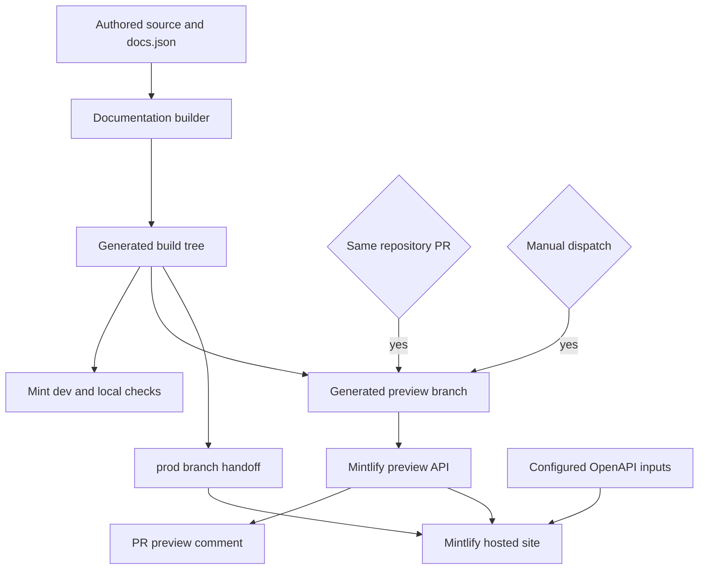

# Mintlify Integration

Mintlify renders the generated documentation tree at `/build/` for [docs.langchain.com](https://docs.langchain.com). The repository owns the authored content in `src/`, the builder, and the reproducible handoff; Mintlify owns hosted rendering, deployment-time OpenAPI routes, and hosted `llms.txt` indexes. Edit `src/` and `src/docs.json`, not `/build/`, generated deployment branches, or endpoint pages Mintlify derives from an OpenAPI input. A full build deletes and recreates `build/`, so it is not durable authoring state.



The preview path only pushes generated artifacts from a same-repository PR or a manual run; a PR comment is a separate PR-only step.

## Configuration and output contract

`src/docs.json` is Mintlify's site configuration and navigation manifest. The builder copies shared files, including this configuration, to `build/`. It defines the `aspen` theme, colors, logos and favicon, Tabler icons, TWK Lausanne headings, Inter body text, contextual actions, GTM, canonical metadata, injected CSS and chat script, footer and navbar content, navigation, and redirects. Navigation is explicit rather than a directory scan: a new or moved page needs a generated route and applicable navigation and redirect updates.

The builder determines route families before Mintlify consumes the tree:

- Ordinary OSS documents are emitted under both `/oss/python/...` and `/oss/javascript/...`; eligible `/oss/` links are rewritten for the selected language.
- Managed Deep Agents pages emit only under `/langsmith/python/...` and `/langsmith/javascript/...`. `docs.json` redirects their unversioned URLs to Python rather than leaving orphaned pages.
- Deep Agents Code and OpenWiki are language-agnostic OSS products. They emit once at `/oss/deepagents/code/...` and `/oss/openwiki/...`, and link rewriting preserves those unversioned prefixes.

These are builder policies, not Mintlify conventions. Select the intended route family before adding navigation or links.

## Local development and validation

`make dev` installs local npm dependencies and runs `uv run pipeline dev`. Unless `--skip-build` is set, the command performs a full build, starts `FileWatcher` for `src/` and `build/`, then launches the globally installed Mint CLI as `mint dev --port 3000` from `build/`. An initial build failure, nonzero Mint exit, or an unexpected watcher stop fails the command; interruption shuts down the watcher and Mint subprocess. `--skip-build` only warns if `build/` is absent, so it does not prove that an existing tree is usable.

For route, redirect, navigation, or anchor work, run:

```bash
make broken-links
make broken-links-with-anchors
make check-openapi
```

The link targets build first and run `mint broken-links` in `build/` with redirect checking; the anchor target also enables anchor checking. A filter removes whole standalone snippet report sections because their language-prefixed links only resolve after import, deployment-time OpenAPI paths, and specific legacy relative-path reports. In anchor mode it additionally excludes only three SmithDB migration anchors and the exact imported `n_jobs_per_worker` anchor. The target fails only when filtered output still contains an indented link entry. Unit tests lock down the section-level exclusions and the narrow anchor exceptions. The reusable CI workflow uses Node 22 and runs the anchor check plus `make check-openapi`.

`make check-openapi` builds and runs `mint openapi-check langsmith/agent-server-openapi.json`. It does not validate the remote Control Plane input or the committed LangSmith REST input.

A separate PR workflow protects authored source before build output exists. For documentation changes targeting `main`, it scans every Markdown and MDX file under `src/` for retired documentation hosts, permits the Helm repository exception, and requires relative docs routes or `https://reference.langchain.com/` for API reference. This is distinct from Mint's generated-tree link checker.

`make export` is also separate from local link checking. It builds, requires a global Mint CLI with `mint export`, Node 20 or 22, and an Enterprise Mintlify plan, then writes `build/export.zip` by default. `make htmltest` checks the unpacked archive's external content links with internal paths and hashes disabled because the export is not a complete page set.

## OpenAPI reference boundary

Mintlify configuration declares three OpenAPI groups:

| Group | Input | Configured directory |
| --- | --- | --- |
| Agent Server API | `langsmith/agent-server-openapi.json` in the generated tree | `langsmith/agent-server-api` |
| Control Plane API | `https://api.host.langchain.com/openapi.json`, fetched during deployment | none |
| LangSmith REST API | committed `src/langsmith/langsmith-platform-openapi.json`, copied to the generated tree | `langsmith/smith-api` |

Mintlify generates endpoint routes for these inputs during deployment. They are not authored Markdown or MDX files. The local link filter intentionally removes reports for `/langsmith/agent-server-api/`, `/langsmith/smith-api`, and `/api-reference/`; use a hosted preview or production deployment to inspect the endpoint surface. This surface is separate from the SDK reference hosted at `reference.langchain.com`.

The LangSmith REST specification is refreshed daily. Its processor accepts only `api.smith.langchain.com`, hides Fleet, internal, and selected health operations, assigns human-readable ordered tag groups, and normalizes endpoint titles, including visible non-sandbox v2 labels. A changed specification is committed to the standing `chore/refresh-langsmith-openapi` PR when one exists, or opens that PR; an unchanged one produces no commit. Review it as a public-reference change.

## Preview lifecycle and trust boundary

The `Create Preview with Mintlify` workflow runs for PR events and manual dispatch, with concurrency keyed by the ref name. The job that builds and pushes has `contents: write`, but it is gated to same-repository PRs or manual dispatch and excludes closed PRs. Fork PRs cannot cause a build artifact push because they do not have repository write access.

For an eligible run, the workflow validates the source branch syntax and 100-character limit, checks out the source ref, runs `make install` and `make build`, then creates a `preview-` branch name from an alphanumeric six-character source prefix, epoch timestamp, and seven-character commit SHA. It refuses an existing remote name, creates the branch from the checked-out source, force-adds `build/`, and pushes it. These branches are generated deployment handoffs, not merge targets or authoring locations.

The PR-only `comment-on-pr` job runs after successful preview-branch creation except for Dependabot. It requires only `pull-requests: write`; it receives the generated branch name and sends it to `POST https://api.mintlify.com/v1/project/preview/${MINTLIFY_PROJECT_ID}` using `MINTLIFY_API_KEY`. Missing secrets or branch name fail before the request. A response must be JSON, and an API error without either `statusId` or `previewUrl` fails the job. When Mintlify returns a preview URL, the workflow upserts one bot comment, warning that deployment may still be starting and linking up to five largest changed routable Markdown files. It excludes files in `code-samples` and `snippets`; unprefixed OSS paths are projected to Python preview paths.

On PR close, a separate write-enabled cleanup job derives the same sanitized six-character prefix, lists `origin/preview-<prefix>-*`, and deletes matches. Before deletion it refuses any branch that does not start with `preview-`; a deletion failure is only logged because the branch may already be gone. The prefix-based lookup means maintainers should keep the `preview-` convention and branch-name derivation aligned if changing preview naming.

Production is a separate generated handoff: on a `main` push or manual dispatch, the publishing workflow runs `make build`, copies `build/` to `public/build`, and publishes `public` to the `prod` branch. Do not manually patch `prod`, preview branches, or `build/`; change source and rebuild instead.

## Hosted-only `llms.txt`

Mintlify generates `llms.txt` and nested `/_llms/` indexes only on the deployed site. A weekly job crawls the served root index at `https://docs.langchain.com`, follows same-site nested index links, normalizes landing-page URLs, and compares its page set to `sitemap.xml`. It fails when a sitemap page is unreachable. The checker uses the `langchain-docs-llms-check` user agent, a 30-second timeout, and up to three attempts for connection failures; HTTP errors fail immediately. If it finds a gap, first confirm no custom `llms.txt` has been placed in the build, then treat it as a hosted Mintlify integration issue.

## Safe change checklist

1. Modify `src/` and `src/docs.json`, then run `make build`; never patch generated build output, deployment branches, or deployment-created endpoint pages.
2. Choose the route family before changing links or navigation, particularly dual-language OSS, Managed Deep Agents, and language-agnostic OpenWiki pages.
3. Update routes, navigation, and compatibility redirects together; run `make broken-links-with-anchors`.
4. Keep authored links off retired doc sites and use relative site routes or `https://reference.langchain.com/` for SDK reference.
5. Run `make check-openapi` for Agent Server changes and review LangSmith REST refresh PRs as public API documentation changes.
6. Use the trusted same-repository PR preview to review hosted OpenAPI routes and Mintlify-generated `llms.txt`; do not expect those artifacts in the local tree.

## Related concepts

- [Build system](/openwiki/architecture/build-system.md) — generated-tree lifecycle and ownership.
- [Source map](/openwiki/architecture/source-map.md) — authored paths and generated routes.
- [GitHub Actions](/openwiki/integrations/github-actions.md) — workflow permissions and automation.
- [CLI tools](/openwiki/operations/cli-tools.md) — command-line entry points.
- [Quickstart](/openwiki/quickstart.md) — local setup.
- [Test overview](/openwiki/testing/test-overview.md) — validation coverage.
