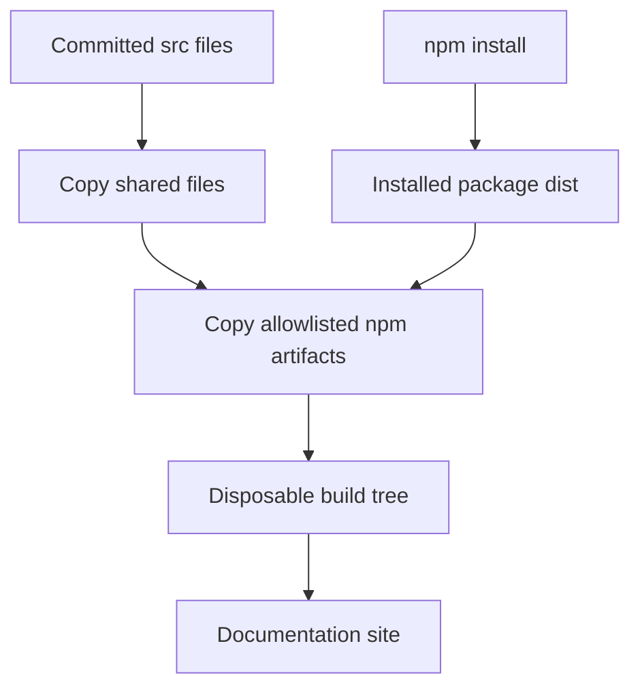

## Overview

The repository has distinct ownership and lifecycle rules for reusable snippet content:

| Kind | Source of truth | Build treatment | Language behavior |
| --- | --- | --- | --- |
| Local JSX/TSX component | A committed `.jsx` or `.tsx` file in `src/snippets/` | Copied as a shared file to the same relative `build/` path | One shared component asset |
| Package component | An explicitly mapped file in `node_modules/@langchain/docs-sandbox/dist/` | Copied during the full-build npm overlay | One shared component asset |
| Authored MDX snippet | A committed `.md` or `.mdx` file in `src/snippets/` | Preprocessed into a default and two language-specific copies | Imports are rewritten for Python or JavaScript pages |
| Generated code-sample snippet | Generated `.mdx` under `src/snippets/code-samples/` from `src/code-samples/` | Thereafter handled as snippet MDX | Follows the MDX-snippet path, not the component path |

The committed source files are the changeable inputs. `node_modules/` is the installed package state, and `build/` is disposable generated output. Component files are copied assets, not Markdown passed through `preprocess_markdown()`. MDX imports the public `/snippets/...` output path rather than importing the package directly.

## Full-build flow and precedence

`make build` runs `npm install` before `PYTHONPATH=$(CURDIR) uv run pipeline build`. The build command constructs a `DocumentationBuilder` for `src` and `build`, then calls `build_all()`. A full build removes any existing `build/`, creates Python and JavaScript routed documentation plus unversioned documentation families, copies shared files, and finally overlays the allowlisted npm artifacts. It does not generate `llms.txt` indexes.



This diagram shows the full-build ordering: the npm overlay runs after shared-file copying, so a package artifact replaces a source-tree fallback at the same generated path.

The builder treats `.jsx` and `.tsx` as direct-copy component extensions. Because paths containing `snippets` are shared, a local file such as `src/snippets/event-selection-graph.jsx` becomes `build/snippets/event-selection-graph.jsx` without an allowlist entry. This is the committed local-component path.

The npm integration is intentionally narrower. `package.json` declares `@langchain/docs-sandbox` as `^0.0.24`; the lockfile resolves `0.0.24`, with peer dependencies React `^18 || ^19` and Zod `^4.3.6`. `_copy_npm_snippets()` reads `node_modules/@langchain/docs-sandbox/dist/` and copies only these class-level mappings:

| Package `dist/` artifact | Generated location | Consumer |
| --- | --- | --- |
| `PatternEmbed.jsx` | `build/snippets/pattern-embed.jsx` | MDX import from `/snippets/pattern-embed.jsx` |
| `ExampleEmbed.jsx` | `build/snippets/example-embed.jsx` | MDX import from `/snippets/example-embed.jsx` |
| `ChatLangChainEmbed.js` | `build/ChatLangChainEmbed.js` | Deferred script in `docs.json` |

Publishing another file in the package does not expose it automatically. To add one safely, update the appropriate allowlist, select its generated destination, update the importing MDX or site configuration, and add focused coverage. Because the overlay is last, an allowlisted package artifact wins over a local fallback with the same output path.

## Page consumption and component contracts

Pages consume the emitted public paths:

```jsx
import { PatternEmbed } from "/snippets/pattern-embed.jsx"

<PatternEmbed pattern="branching-chat" />
```

```jsx
import { ExampleEmbed } from "/snippets/example-embed.jsx"

<ExampleEmbed example="copilotkit" minHeight={700} />
```

These patterns are represented in `branching-chat.mdx` and `integrations/copilotkit.mdx`. The identifiers and props are contracts of the installed component implementation, so verify supported values when upgrading the package. The root-level `ChatLangChainEmbed.js` has a separate consumption route: `src/docs.json` loads `/ChatLangChainEmbed.js` with `defer`, while the overlay supplies the generated root script.

## Language routing: MDX versus components

The regular Markdown path preprocesses content, then for a language build rewrites only imports from `/snippets/` whose paths end in `.md` or `.mdx`. An unscoped Markdown import becomes `/snippets/python/...` or `/snippets/javascript/...`; an already scoped import is preserved. JSX and TSX imports do not match this Markdown-only pattern, so local components and `PatternEmbed`/`ExampleEmbed` remain at one shared `/snippets/*.jsx` path for both documentation variants.

Snippet Markdown is emitted in three forms: a Python-default copy at the original path, plus language-specific copies under `build/snippets/python/` and `build/snippets/javascript/`. This lets versioned pages consume content processed for their target language while unversioned consumers use the default. Do not add a language prefix to component imports unless the rewrite and output contract are intentionally extended together.

## Generated code samples are not npm components

`make code-snippets` extracts marked regions from executable files under `src/code-samples/`, writes intermediates under `src/code-samples-generated/`, and renders MDX into `src/snippets/code-samples/`. The renderer documents that output directory, and the generated files then follow the ordinary language-aware MDX path. Change executable samples in `src/code-samples/`, not generated MDX; see [Code Sample Lifecycle](/openwiki/workflows/code-sample-lifecycle.md).

## Failure and refresh behavior

The npm overlay is best-effort:

- If `node_modules/@langchain/docs-sandbox/dist/` is absent, it warns to run `npm install` and returns.
- If an allowlisted artifact is absent, it warns and continues with the remaining mappings.
- Therefore, a successful pipeline invocation does not prove that every package-provided component exists in `build/`.

The development watcher rebuilds changed source paths through `build_file()`. It does not call `build_all()` and therefore does not rerun `_copy_npm_snippets()`. After installing or upgrading the package, or changing an allowlist, run a full build:

```bash
make build
```

For a missing package component, inspect the installed `dist/` filename, run the full build, and check the mapped output path and importing route. For a local component, check its source-relative `build/snippets/` path. Do not edit `node_modules/` or `build/`; installation and a full build replace those states.

## Tests and safe changes

Focused builder tests verify that a local TSX snippet is copied and that language rewriting changes Markdown imports while preserving JSX imports and already language-scoped Markdown imports. There is currently no direct unit test for `_copy_npm_snippets()`.

When changing npm artifacts, add coverage for the mapping output, overwrite precedence over a source-tree fallback, and both missing-directory and missing-artifact warnings. Keep this separate from MDX import-rewrite tests: the latter protect the intentional boundary between language-versioned Markdown snippets and shared JSX/TSX components.

For broader context, see [Build System Architecture](/openwiki/architecture/build-system.md), [Mintlify](/openwiki/integrations/mintlify.md), and [CLI Tools](/openwiki/operations/cli-tools.md).
