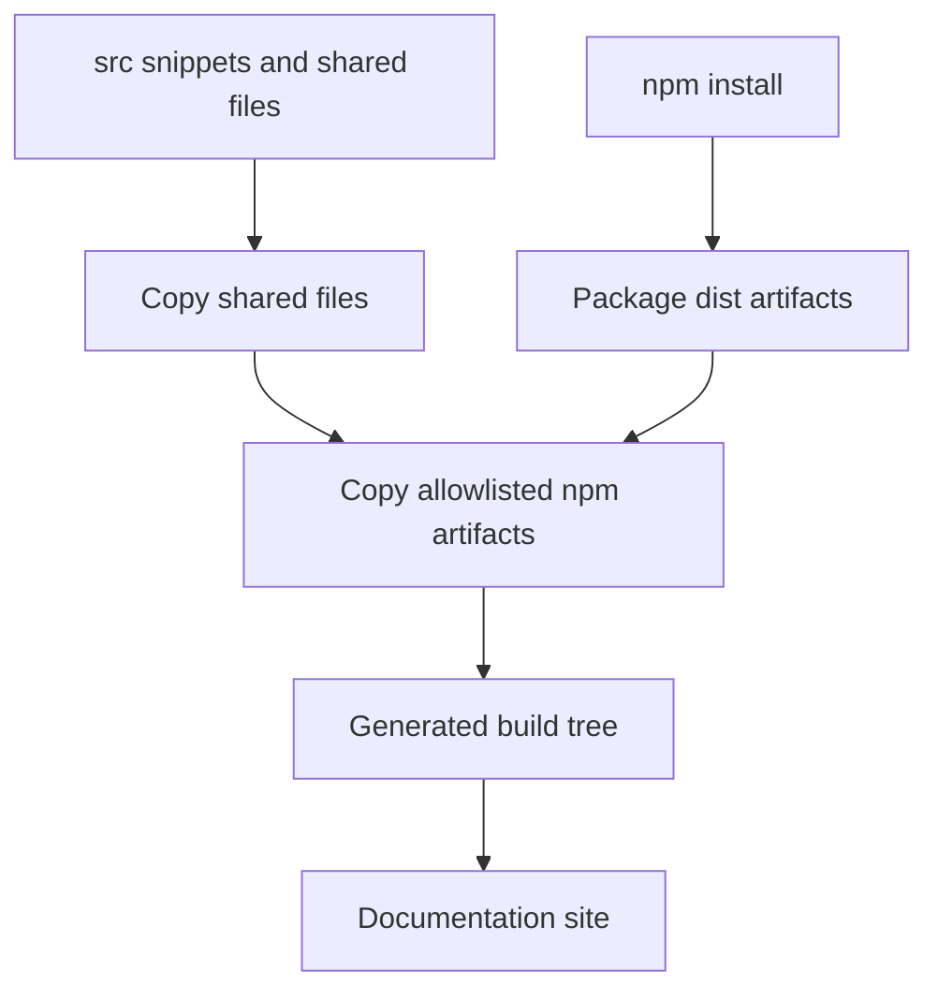

## Overview

The site has three materially different kinds of reusable content under `src/snippets/`:

| Kind | Source of truth | Build treatment | Language behavior |
| --- | --- | --- | --- |
| Local JSX/TSX component | A `.jsx` or `.tsx` file in `src/snippets/` | Copied as a shared file to the same relative `build/` path | One shared component asset |
| Package component | An explicitly mapped file in `node_modules/@langchain/docs-sandbox/dist/` | Copied during the full-build npm overlay | One shared component asset |
| Authored MDX snippet | A `.md` or `.mdx` file in `src/snippets/` | Preprocessed into a default and two language-specific copies | Imports are rewritten for Python or JavaScript pages |
| Generated code-sample snippet | Generated `.mdx` under `src/snippets/code-samples/` from `src/code-samples/` | Thereafter handled as an authored MDX snippet | Follows the MDX-snippet path, not the component path |

Component files are deliverable assets, not Markdown content processed by `preprocess_markdown()`. A local component can use repository-owned implementation, such as `EventSelectionGraph`; package components let the documentation site consume an implementation published by `@langchain/docs-sandbox`. In both cases, MDX imports the generated public `/snippets/...` path rather than a package path.

## Full-build flow and precedence

`make build` runs `npm install` and then `uv run pipeline build`. The command constructs a `DocumentationBuilder` for `src` and `build` and calls `build_all()`. A full build deletes and recreates `build/`, produces the documentation families, copies shared files, and finally applies the npm overlay. It does not generate `llms.txt` indexes.



This is the full-build order: package artifacts copied by the overlay replace a source-tree file at the same output path.

The builder recognizes `.jsx` and `.tsx` as component extensions in its direct-copy set. Consequently, a local file such as `src/snippets/event-selection-graph.jsx` is copied to `build/snippets/event-selection-graph.jsx` during shared-file collection. This is a general source-tree mechanism—no mapping is needed for a local component.

The npm integration is deliberately narrower. `package.json` declares `@langchain/docs-sandbox` as `^0.0.24`; the lockfile resolves `0.0.24`, whose peer dependencies include React `^18 || ^19` and Zod `^4.3.6`. `_copy_npm_snippets()` reads its `dist/` directory from the repository's `node_modules` and copies only the class-level allowlists:

| Package `dist/` artifact | Generated location | Consumer |
| --- | --- | --- |
| `PatternEmbed.jsx` | `build/snippets/pattern-embed.jsx` | MDX import from `/snippets/pattern-embed.jsx` |
| `ExampleEmbed.jsx` | `build/snippets/example-embed.jsx` | MDX import from `/snippets/example-embed.jsx` |
| `ChatLangChainEmbed.js` | `build/ChatLangChainEmbed.js` | Deferred script in `docs.json` |

Publishing another file in the package does not make it available to the site. To add one, update the relevant allowlist, choose a stable generated name and destination, update the importing MDX or site configuration, and add focused coverage. The overlay runs after shared-file copying specifically so a package artifact wins over a local fallback with the same generated path.

## How pages consume package components

Pages use the emitted paths, for example:

```jsx
import { PatternEmbed } from "/snippets/pattern-embed.jsx"

<PatternEmbed pattern="branching-chat" />
```

```jsx
import { ExampleEmbed } from "/snippets/example-embed.jsx"

<ExampleEmbed example="copilotkit" minHeight={700} />
```

`pattern`, `example`, and component props are contracts of the installed component implementation. Confirm that an identifier remains supported when upgrading the package. The root-level `ChatLangChainEmbed.js` follows a different consumption route: `src/docs.json` includes it in `head` with `defer`, and shared-file copying places that configuration in the generated tree before the overlay supplies the script.

## Why components are not language-scoped

The regular Markdown path first calls `preprocess_markdown()`, which resolves cross-references, CTA attribution, and `:::python`/`:::js` blocks. For a language build, the builder then rewrites only imports from `/snippets/` ending in `.md` or `.mdx`. An unscoped Markdown snippet import becomes `/snippets/python/...` or `/snippets/javascript/...`; an already scoped one is preserved.

Markdown snippets themselves are emitted three ways: a Python-default copy at the original snippet path plus copies under `build/snippets/python/` and `build/snippets/javascript/`. This ensures that nested versioned pages use a snippet with routes and conditional content resolved for their target language, while unversioned consumers use the default.

JSX and TSX imports do not match the Markdown-only rewrite pattern. Thus local component imports and `PatternEmbed`/`ExampleEmbed` imports stay at a single `/snippets/*.jsx` path, shared by both documentation variants. Do not add a language prefix to component imports unless the builder's import rewrite and output contract are intentionally extended together.

Generated code samples are also different from components. `make code-snippets` extracts marked regions from executable files under `src/code-samples/`, produces intermediates under `src/code-samples-generated/`, and renders MDX into `src/snippets/code-samples/`. Once generated, that MDX is ordinary snippet Markdown: it is handled by the language-aware MDX-copy path. Changes to executable samples belong in `src/code-samples/`, not in the generated MDX; see [Code Sample Lifecycle](/openwiki/workflows/code-sample-lifecycle.md).

## Failure and refresh behavior

The npm overlay is best-effort:

- If `node_modules/@langchain/docs-sandbox/dist/` is absent, it logs a warning to run `npm install` and returns.
- If an allowlisted file is absent, it warns and continues with the remaining mappings.
- A successful pipeline invocation therefore does not prove that every interactive component exists in `build/`.

The development watcher rebuilds changed source paths through `build_file()`. It does not call `build_all()` and therefore does not rerun `_copy_npm_snippets()`. Use a full build after a package install, package upgrade, or allowlist change:

```bash
make build
```

For a missing package-provided component, inspect the installed `dist/` filename, run the full build, then check its mapped output path and the importing route. For a local component, check the source-relative `build/snippets/` path. Do not edit `node_modules/` or `build/`: installation and a full build replace them.

## Tests and safe changes

Focused builder tests establish that a local TSX snippet is copied and that language rewriting changes Markdown imports while preserving `.jsx` and already language-scoped Markdown imports. There is no direct unit test for `_copy_npm_snippets()`.

When changing npm artifacts, add tests for the mapping's output, overwrite precedence over a source-tree fallback, and both missing-directory and missing-artifact warnings. Keep the existing MDX import-rewrite coverage separate: it protects the intentional boundary between versioned Markdown snippets and shared JSX/TSX components.

For broader context, see [Build System Architecture](/openwiki/architecture/build-system.md) and [Preprocessing and Link Resolution](/openwiki/concepts/preprocessing.md).
