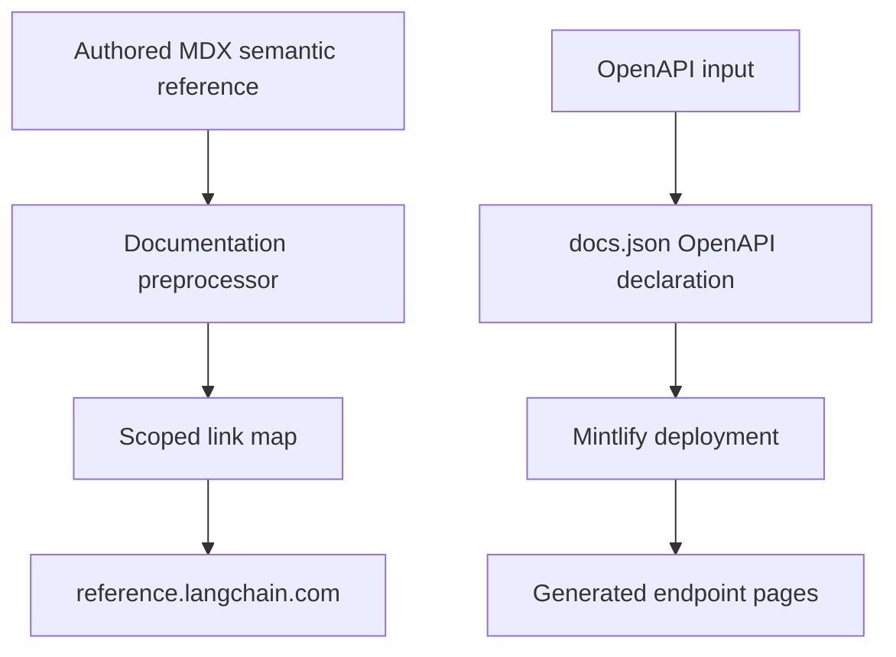
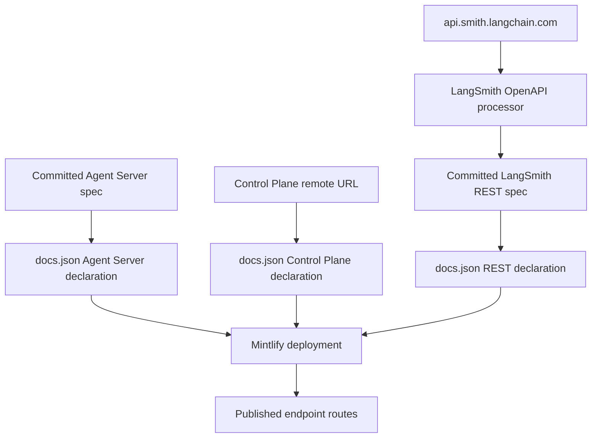

# Reference Documentation Boundaries

This repository builds the authored documentation site at `docs.langchain.com`. It **does not build** [reference.langchain.com](https://reference.langchain.com/python/): generated API reference for LangChain, LangGraph, LangSmith, and integration packages is built and deployed elsewhere, with separate [Python](https://reference.langchain.com/python/) and [JavaScript/TypeScript](https://reference.langchain.com/javascript/) sites.

There are two different reference integrations:

1. Authored Markdown and MDX use semantic `@[symbol]` markers that preprocess into links to the external SDK reference site.
2. `src/docs.json` declares OpenAPI inputs that Mintlify turns into endpoint pages during deployment.



This diagram shows the separate SDK-link and OpenAPI publication paths. Do not hand-author endpoint MDX as a substitute for a generated OpenAPI route.

## Link to the external SDK reference

Use semantic markers rather than hard-coded SDK-reference URLs:

```markdown
@[StateGraph]
@[Build a graph][StateGraph]
@[`StateGraph`]
```

The preprocessor resolves these forms through `SCOPE_LINK_MAPS`. Its Python and JavaScript maps associate symbol names with `reference.langchain.com` URLs. Add or correct a map entry when an SDK symbol must be linkable; do not duplicate a destination in authored pages.

Autolinking runs before conditional rendering. It begins in the page default scope, switches inside `:::python` or `:::js` fences, and resets to the default at a bare `:::`. Ordinary fenced code is unchanged, and `\@[StateGraph]` renders as a literal marker after the escape is removed. An unknown name logs an informational message and remains unchanged rather than receiving a guessed URL. The unhandled `global` scope logs an error and falls back to Python.

### Validate cross-references

```bash
make check-cross-refs
```

This source-level check scans Markdown and MDX beneath `src/` with the same marker and fence patterns. It ignores ordinary code fences, escaped markers, `snippets/code-samples/`, and `node_modules`. Files in `oss/python/` and `oss/javascript/` are checked in their respective scopes; a shared `oss/` file is checked in both. Consequently, an unfenced reference in shared OSS content must resolve in every emitted language scope, while a language fence narrows the requirement. The command exits nonzero for unresolved names.

This is distinct from rendered-site link checking: passing a Mintlify link check does not establish that every semantic marker has a scoped mapping. The `check-cross-refs` CI job provisions Python with `uv sync --group test` and runs this target, so unresolved source markers are a separate merge-time failure from rendered-link or OpenAPI checks.

## Declare OpenAPI inputs, not endpoint pages

`src/docs.json` is the contract between each OpenAPI input and Mintlify route generation. The three LangSmith sections differ in source ownership and lifecycle:

| Section | Input and lifecycle | Safe change path | Generated route directory |
| --- | --- | --- | --- |
| Agent Server API | Committed `src/langsmith/agent-server-openapi.json`; updated through specification-update PRs from `langgraph-api`. | Obtain or review the upstream Agent Server specification update. | `langsmith/agent-server-api` |
| Control Plane API | `https://api.host.langchain.com/openapi.json`, fetched by Mintlify at deployment; no local specification file exists. | Correct the service-owned source; do not commit a local copy. | Mintlify default, `/api-reference/` |
| LangSmith REST API | Committed `src/langsmith/langsmith-platform-openapi.json`, produced by scheduled automation. | Fix upstream content or processor policy, regenerate, and review the refresh PR. Never patch the JSON manually. | `langsmith/smith-api` |



This diagram distinguishes committed generated inputs from the deployment-fetched Control Plane input. Mintlify generates all endpoint pages at deployment; they are not repository-authored Markdown or MDX sources and do not exist in the local `build/` output. **Do not hand-author endpoint MDX.**

### Keep generated sections with authored context

Generated sections sit beside authored overview pages. The LangSmith deployment **Reference** group contains `langsmith/server-api-ref` with the Agent Server declaration and `langsmith/api-ref-control-plane` with the Control Plane declaration. The LangSmith product **Reference** tab contains `langsmith/smith-api-ref` with the LangSmith REST declaration. Keep the overview, group placement, and OpenAPI declaration aligned when changing a section.

The overviews provide product context and examples; the declarations produce the endpoint reference. For example, the Agent Server overview points readers to a deployment's `/docs` endpoint, the Control Plane overview describes deployment automation, and the REST overview describes platform access. Do not move endpoint-specific documentation into invented generated-route source files.

### Validate the committed Agent Server input

Agent Server changes are independent of the LangSmith REST refresh. The committed specification is updated by `langgraph-api` PRs titled `Update Agent ServerOpenAPI spec for API version X.Y.Z`.

```bash
make check-openapi
```

Despite its broad name, this target builds the documentation and runs `mint openapi-check langsmith/agent-server-openapi.json` from `build/`. It validates **only the Agent Server** specification. The CI link-check workflow runs the anchor-aware rendered link check and then this target. Do not interpret it as validation of the deployment-fetched Control Plane API or the LangSmith REST specification.

### Refresh and shape the committed LangSmith REST input

Do **not** hand-edit `src/langsmith/langsmith-platform-openapi.json`. The refresh workflow runs daily at 10:00 UTC and can be manually dispatched. It runs:

```bash
uv run python scripts/process_langsmith_openapi.py --write
```

By default, the processor fetches `https://api.smith.langchain.com/openapi.json`. Network fetching accepts only the allow-listed `api.smith.langchain.com` host and uses a 30-second timeout. `--input` supplies controlled local input for reproduction or policy work. `--output` selects a destination, but the processor writes there only with `--write`; otherwise, it prints processed JSON to standard output.

The processor curates the upstream specification for public Mintlify documentation. It hides configured Fleet, product-feedback, internal, infrastructure, metrics, health, and path-selected operations; assigns human-readable tag groups and group order; and normalizes operation titles. Visible non-sandbox v2 operations receive `(v2)` labels. Existing Beta and v2 markers are removed before normalized markers are reapplied, so repeated processing is idempotent.

The workflow saves the candidate specification, restores the checkout, then reuses the `chore/refresh-langsmith-openapi` branch when its PR is open or creates it otherwise. It stages only the specification and exits without a commit when that file has no diff. Treat the PR as the review boundary for externally sourced public-reference changes. For an unexpected exposure, omission, title, or group, change the upstream API description or explicit processor policy and regenerate.

## Understand rendered link-check exclusions

`make broken-links` and `make broken-links-with-anchors` build first, run Mintlify in `build/` with redirect validation, filter the report through `scripts/filter_mint_broken_links.py`, and fail only when filtered output still contains an indented link report. The anchor-aware command also requests anchor checking; CI uses it before the Agent Server OpenAPI check.

The filter deliberately removes known local-build false positives:

- all reports for deployment-generated destinations under `/langsmith/agent-server-api/`, `/langsmith/smith-api`, and `/api-reference/`;
- entire standalone `snippets/` report sections, because snippet links resolve only when imported; and
- selected legacy relative paths.

With `--check-anchors`, it additionally removes only the named SmithDB migration anchors `traces-query`, `runs-query`, and `exceptions`, plus `/langsmith/env-var-cloud#n_jobs_per_worker`. Other broken links and anchors remain failures. Therefore a passing local command does not prove the excluded deployment-time routes or named anchors work; inspect the generated endpoint surface in a hosted preview or deployment rather than creating local endpoint files.

Focused cross-reference checker tests cover scope selection, shared-file validation, custom-title and backtick forms, multiple references, and the code-block, escaped-marker, and code-sample exclusions. Resolver tests separately cover replacement outside code blocks, backtick and tilde code-fence protection, conditional-fence handling, and escaped markers. Filter tests confirm that genuine failures and non-exempt anchors remain after filtering.

## Route issues to the owning system

For missing pages, broken links, or incorrect signatures on `reference.langchain.com`, open the [Reference Documentation issue](https://github.com/langchain-ai/docs/issues/new?template=04-reference-docs.yml). The template requires an issue type, language, and detailed description, and collects a product plus an optional reference-page URL for routing. Fixes belong in external reference-generation tooling, not this repository.

Change this repository for an authored marker, scoped map entry, preprocessor or source-check behavior, a `docs.json` declaration, an Agent Server specification update, or a reviewed LangSmith REST refresh. Preserve the boundary: external SDK reference is owned elsewhere; committed OpenAPI inputs retain their own update policy; and Mintlify, not hand-authored endpoint MDX, creates endpoint documentation.

## Related documentation

- [Source Map](/openwiki/architecture/source-map.md) — repository ownership and generated-source boundaries.
- [GitHub Actions](/openwiki/integrations/github-actions.md) — CI checks and scheduled refresh automation.
- [Mintlify Integration](/openwiki/integrations/mintlify.md) — deployment, previews, hosted artifacts, and rendered-site checks.
- [Test Overview](/openwiki/testing/test-overview.md) — test layers and focused validation.
- [LangSmith OpenAPI Refresh](/openwiki/workflows/langsmith-openapi-refresh.md) — processor policy and refresh-PR lifecycle.
