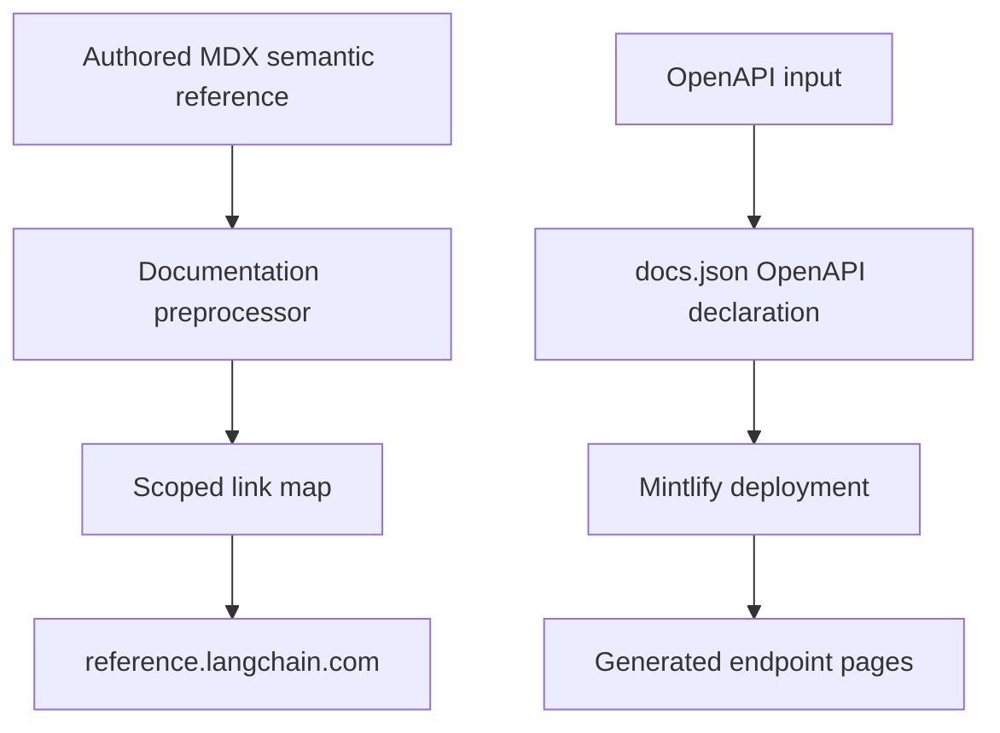
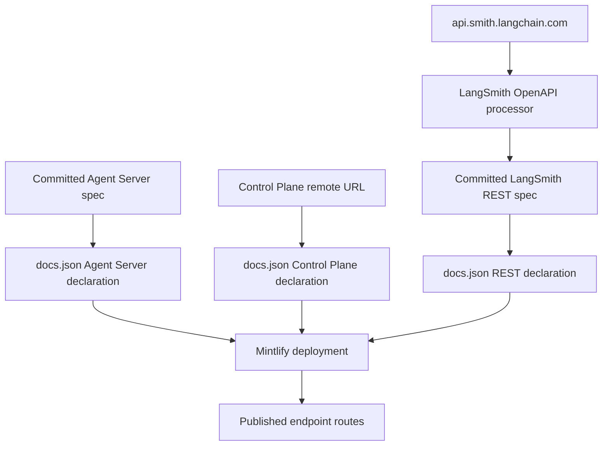

# Reference Documentation Boundaries

This repository builds the authored documentation site at `docs.langchain.com`. It **does not build** [reference.langchain.com](https://reference.langchain.com/python/): generated API reference for LangChain, LangGraph, LangSmith, and integration packages is built and deployed elsewhere, with separate [Python](https://reference.langchain.com/python/) and [JavaScript/TypeScript](https://reference.langchain.com/javascript/) sites.

Two separate integrations connect this repository to reference material:

1. Semantic `@[symbol]` markers in authored Markdown and MDX become links to the external SDK reference site during preprocessing.
2. OpenAPI declarations in `src/docs.json` supply Mintlify with API specifications, from which it creates endpoint pages at deployment.



This shows distinct publication paths: SDK links leave this repository for an externally owned reference site, while OpenAPI inputs produce Mintlify endpoint pages. Do not hand-author replacements for deployment-generated endpoint pages.

## Semantic SDK cross-references

Use semantic markers instead of hard-coded SDK-reference URLs:

```markdown
@[StateGraph]
@[Build a graph][StateGraph]
@[`StateGraph`]
```

The preprocessor resolves these forms through `SCOPE_LINK_MAPS`. Its Python and JavaScript maps associate symbol names with their respective `reference.langchain.com` URLs. Adding or correcting a map entry is the extension point for a newly linkable SDK symbol; do that instead of duplicating a destination across authored pages.

Autolinking runs before conditional rendering. It starts in the page's default scope, switches inside `:::python` or `:::js` fences, and resets to the default scope at a bare `:::`. Regular fenced code is left unchanged. An escaped marker such as `\@[StateGraph]` remains literal after the escape is removed. If a name is not in the active map, preprocessing logs an informational message and retains the marker rather than guessing a URL. The unhandled `global` scope logs an error and falls back to Python.

### Validate cross-references

```bash
make check-cross-refs
```

This source-level check scans Markdown and MDX below `src/` with the same marker and fence patterns. It ignores regular code fences, escaped markers, `snippets/code-samples/`, and `node_modules`. Files under `oss/python/` and `oss/javascript/` are checked in their respective scopes; a shared `oss/` file is checked in both. Therefore, an unfenced marker in shared OSS content must resolve in every emitted language scope, while a language fence narrows the requirement. The command exits nonzero for unresolved names.

This check is independent of rendered-site link checking: a passing Mintlify link check does not establish that every semantic marker has a scoped mapping.

## Mintlify OpenAPI sections

`src/docs.json` is the contract between each OpenAPI input and Mintlify route generation. The three LangSmith sections have different source owners and update paths:

| Section | Input and lifecycle | Safe change path | Mintlify route directory |
| --- | --- | --- | --- |
| Agent Server API | Committed `src/langsmith/agent-server-openapi.json`; updated through specification-update PRs from `langgraph-api`. | Obtain or review the upstream Agent Server update. | `langsmith/agent-server-api` |
| Control Plane API | `https://api.host.langchain.com/openapi.json`, fetched by Mintlify at deployment; no local specification file exists. | Correct the service-owned source; do not commit a copy here. | Mintlify default (`/api-reference/`) |
| LangSmith REST API | Committed `src/langsmith/langsmith-platform-openapi.json`, produced by scheduled automation. | Fix upstream content or processor policy, regenerate, and review the refresh PR. Never patch the JSON manually. | `langsmith/smith-api` |



The diagram distinguishes committed inputs, a deployment-fetched input, and a transformed generated input. Mintlify generates endpoint pages at deployment, so they are not manually maintained Markdown or MDX sources.

### Navigation and authored context

Generated sections sit alongside authored overview pages. In the LangSmith deployment **Reference** group, `langsmith/server-api-ref` precedes the Agent Server declaration and `langsmith/api-ref-control-plane` precedes the Control Plane declaration. The LangSmith product **Reference** tab similarly includes `langsmith/smith-api-ref` in the **LangSmith REST API** group with its OpenAPI declaration. Keep the overview, group placement, and declaration aligned when changing a section.

### Agent Server validation

Agent Server changes are independent of the LangSmith REST refresh. The committed specification is updated by `langgraph-api` PRs titled `Update Agent ServerOpenAPI spec for API version X.Y.Z`.

```bash
make check-openapi
```

Despite its broad name, this target builds the documentation and runs `mint openapi-check langsmith/agent-server-openapi.json` from `build/`. It validates **only the Agent Server** specification. The reusable link-check workflow runs the anchor-aware rendered link check and then this target. Do not treat it as validation of the deployment-fetched Control Plane API or the LangSmith REST specification.

### LangSmith REST refresh and shaping

Do **not** hand-edit `src/langsmith/langsmith-platform-openapi.json`. The refresh workflow runs daily at 10:00 UTC and can be manually dispatched. It invokes:

```bash
uv run python scripts/process_langsmith_openapi.py --write
```

By default, the processor fetches `https://api.smith.langchain.com/openapi.json`. Network fetching permits only the allow-listed `api.smith.langchain.com` host and uses a 30-second timeout. `--input` supplies controlled local input for reproduction or policy work; `--output` selects a destination; without `--write`, the processed JSON is printed to standard output.

The processor curates the upstream specification for public Mintlify documentation. It marks configured Fleet, product-feedback, internal, infrastructure, metrics, health, and path-selected operations as hidden; assigns human-readable tag groups and their order; and normalizes operation titles. Visible non-sandbox v2 operations receive `(v2)` labels. Existing Beta and v2 markers are removed before normalized markers are reapplied, making repeated processing idempotent.

The workflow creates a candidate specification, restores the checkout, then reuses the `chore/refresh-langsmith-openapi` branch when its PR is open or creates it otherwise. It stages only the specification and exits without a commit when that file has no diff. Treat the PR as the review boundary for externally sourced public-reference changes. For an unexpected exposure, omission, label, or group, change the upstream API description or explicit processor policy and regenerate.

## Rendered link checks and their exclusions

`make broken-links` and `make broken-links-with-anchors` build first, run Mintlify in `build/` with redirect validation, filter the report through `scripts/filter_mint_broken_links.py`, and fail only when filtered output still contains an indented link report. The anchor-aware command also asks Mintlify to check anchors; CI uses it before the Agent Server OpenAPI check.

The filter intentionally removes known local-build false positives:

- all reports for deployment-generated destinations under `/langsmith/agent-server-api/`, `/langsmith/smith-api`, and `/api-reference/`;
- entire standalone `snippets/` report sections, because snippet links resolve only when imported; and
- selected legacy relative paths.

With `--check-anchors`, it additionally removes only the explicitly named SmithDB migration anchors `traces-query`, `runs-query`, and `exceptions`, plus `/langsmith/env-var-cloud#n_jobs_per_worker`. Other broken links and anchors remain failures. A passing local command consequently does not prove those excluded deployment-time routes or named anchors work; inspect the generated endpoint surface in a hosted preview or deployment rather than creating local endpoint files.

Focused tests confirm that snippet-only failures and the exempt paths are removed, while real broken links and non-exempt anchors remain in output.

## Route issues to the owning system

For missing pages, broken links, or incorrect signatures on `reference.langchain.com`, open the [Reference Documentation issue](https://github.com/langchain-ai/docs/issues/new?template=04-reference-docs.yml). The template requires an issue type, language, and detailed description, and collects a product plus an optional reference-page URL for routing. The correction belongs in external reference-generation tooling, not this repository.

Change this repository for an authored marker, scoped map entry, preprocessor or source-check behavior, a `docs.json` declaration, an Agent Server specification update, or a reviewed LangSmith REST refresh. Keep the distinction explicit: the external SDK reference is owned elsewhere, each OpenAPI input retains its configured lifecycle, and Mintlify—not an authored page—creates endpoint documentation.

## Related documentation

- [Mintlify Integration](/openwiki/integrations/mintlify.md) — deployment, previews, hosted artifacts, and rendered-site checks.
- [Adding and Maintaining Documentation Pages](/openwiki/operations/adding-pages.md) — selecting a source owner and changing generated surfaces safely.
- [Cross-References and Links](/openwiki/operations/cross-references.md) — scoped marker syntax and source-versus-rendered validation.
- [LangSmith OpenAPI Refresh](/openwiki/workflows/langsmith-openapi-refresh.md) — processor policy and refresh-PR lifecycle.
