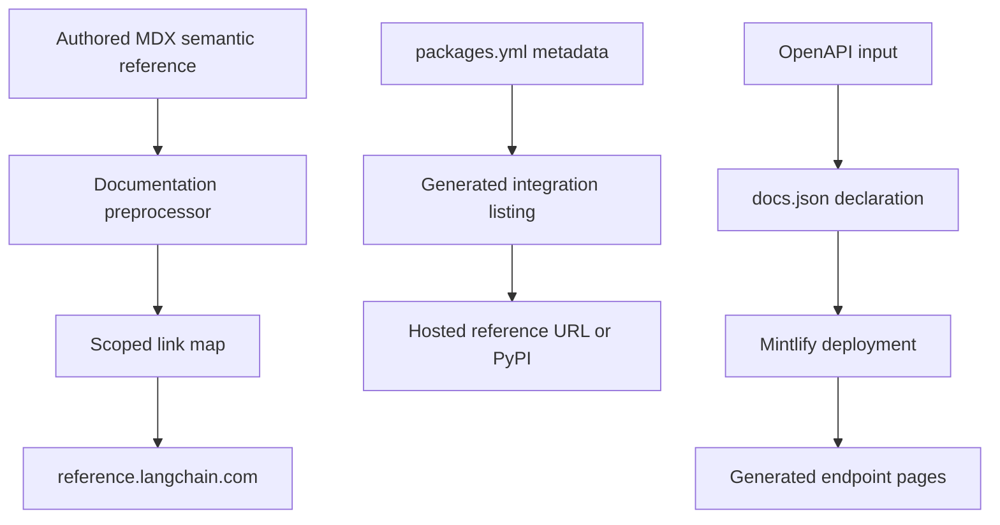
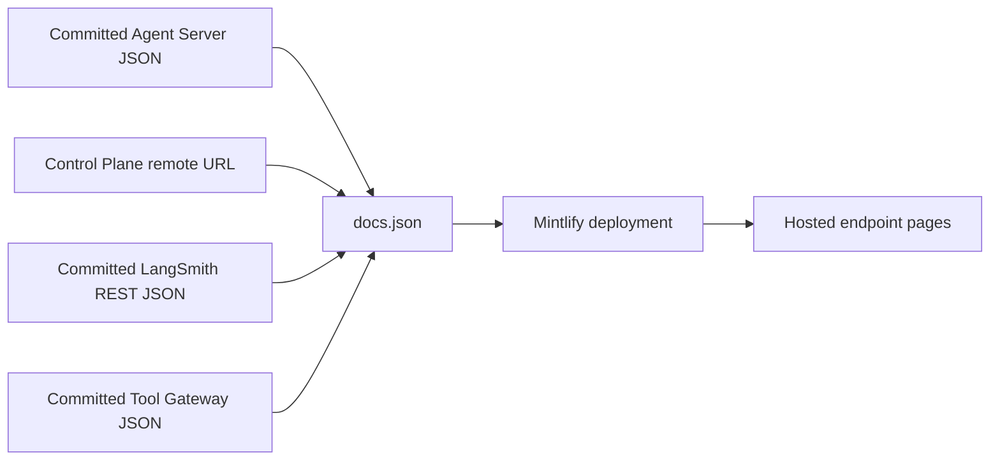

# Reference Documentation Integration

This repository builds the authored `docs.langchain.com` site. It does **not** build [reference.langchain.com](https://reference.langchain.com/python/): generated API reference for LangChain, LangGraph, LangSmith, and integrations is built and deployed elsewhere as separate [Python](https://reference.langchain.com/python/) and [JavaScript/TypeScript](https://reference.langchain.com/javascript/) sites.

There are three related boundaries:

1. Authored Markdown and MDX use semantic `@[symbol]` markers that preprocess into links to the external SDK reference site.
2. `src/docs.json` declares OpenAPI inputs that Mintlify turns into endpoint pages at deployment.
3. `packages.yml` supplies package metadata used by the generated integration listing to choose a hosted reference URL or a PyPI fallback. It is routing metadata, not a generator for package reference pages.



*This separates SDK links, package destination selection, and deployment-time OpenAPI publication.*

## Semantic links to the external SDK reference

Use semantic markers rather than hard-coded SDK-reference URLs:

```markdown
@[StateGraph]
@[Build a graph][StateGraph]
@[`StateGraph`]
```

The preprocessor resolves these forms through `SCOPE_LINK_MAPS`, assembled from scoped `LINK_MAPS` entries in `pipeline/preprocessors/link_map.py`. Python and JavaScript maps associate symbol names with `reference.langchain.com` URLs; some LangSmith entries instead resolve to local `docs.langchain.com` routes for this repository's OpenAPI-generated surface. Add or correct a map entry when a symbol must be linkable; do not duplicate the destination in authored pages.

Autolinking starts in the page's default scope, switches inside `:::python` or `:::js` fences, and resets at a bare `:::`. Ordinary fenced code is unchanged. An escaped marker such as `\\@[StateGraph]` is emitted as literal text after the escape is removed. An unknown name logs an informational warning and remains unchanged; the `global` scope logs an error and falls back to Python.

Run the source-level validator:

```bash
make check-cross-refs
```

It scans Markdown and MDX under `src/` with the shared reference and fence patterns, ignoring ordinary code fences, escaped markers, `snippets/code-samples/`, and `node_modules`. `oss/python/` defaults to Python, `oss/javascript/` to JavaScript, shared `oss/` files to both, and non-OSS content to Python. A language fence narrows validation, so an unfenced shared reference must resolve in every applicable map. This check establishes local map membership; it does not prove that a rendered route, redirect, anchor, or external destination is reachable.

## Package metadata chooses destinations

`packages.yml` describes package identity and publication metadata, including `repo`, optional `path`, display-name overrides, integration visibility, JavaScript package names, download data, provider-page overrides, and `has_reference_docs`. The latter opts eligible third-party packages into hosted reference documentation; without it, the package URL falls back to PyPI.

`pipeline/tools/partner_pkg_table.py` enriches this metadata and generates the provider overview. Monorepo and `langchain-ai` packages use `reference.langchain.com`; eligible third-party packages require `has_reference_docs`; otherwise `package_url` uses PyPI. Integration links use the canonical top-level `/python/<package>` path. The generated provider overview is refreshed by `uv run python pipeline/tools/partner_pkg_table.py` and must not be hand-edited: change `packages.yml` or table policy, then regenerate and review the result.

## OpenAPI inputs versus generated endpoint pages

Mintlify generates endpoint pages at deployment from declarations in `src/docs.json`. Those pages are not repository-authored Markdown or MDX and are absent from the local `build/` output. Do not create placeholder endpoint pages or patch generated routes locally.

| API section | Input ownership and lifecycle | Generated route |
| --- | --- | --- |
| Agent Server API | Committed `src/langsmith/agent-server-openapi.json`; copied into update PRs by the private `langchainplus` monorepo's `langgraph-api-sync-openapi.yml` workflow. The standalone `langgraph-api` repository is archived. | `/langsmith/agent-server-api/` |
| Control Plane API | Remote `https://api.host.langchain.com/openapi.json`, fetched by Mintlify at deployment; no local specification file. | `/api-reference/` |
| LangSmith REST API | Committed `src/langsmith/langsmith-platform-openapi.json`, refreshed by scheduled automation. | `/langsmith/smith-api/` |
| Tool Gateway API | Committed `src/langsmith/tool-gateway-openapi.json`. | `/langsmith/tool-gateway-api/` |



*The repository owns declarations and selected inputs; Mintlify owns the endpoint-page generation step.*

The navigation keeps authored overview pages beside their generated sections: Agent Server and Control Plane are in the LangSmith deployment **Reference** group, the LangSmith REST overview is in the product **Reference** tab, and Tool Gateway has its own product setup Reference section. The overview pages provide context; the OpenAPI declarations produce endpoint reference pages.

## Update and validate each input through its owner

### Agent Server

`src/langsmith/agent-server-openapi.json` is updated by PRs opened by the private `langchainplus` workflow, titled `Update Agent ServerOpenAPI spec for API version X.Y.Z`; that workflow copies `langgraph-api/api/openapi.json`. Do not edit it by hand.

`make check-openapi` builds the docs and runs `mint openapi-check langsmith/agent-server-openapi.json` from `build/`. Despite its name, the Make target currently checks the Agent Server specification only. The CI link-check workflow invokes this target after the rendered link check. It does not validate the deployment-fetched Control Plane API, LangSmith REST API, or Tool Gateway API.

### LangSmith REST

Do **not** hand-edit `src/langsmith/langsmith-platform-openapi.json`. The workflow runs daily at 10:00 UTC and on demand:

```bash
uv run python scripts/process_langsmith_openapi.py --write
```

By default the processor fetches `https://api.smith.langchain.com/openapi.json`, allows only that host, and uses a 30-second timeout. `--input` supplies controlled local JSON; `--output` selects a destination, but writing occurs only with `--write`. Without `--write`, transformed JSON is printed to standard output.

The processor shapes the public document by hiding configured Fleet, feedback, internal, infrastructure, metrics, health, and selected system operations; grouping and ordering tags; and normalizing operation titles. Visible non-sandbox v2 operations receive `(v2)` labels. Existing Beta and v2 markers are removed before normalized markers are reapplied, making repeated processing idempotent.

The refresh workflow stages only the committed platform specification, reuses an open `chore/refresh-langsmith-openapi` PR or creates it, and makes no commit when the generated file is unchanged. Review the PR as the publication boundary for externally sourced reference changes. Change upstream API content or explicit processor policy, not the generated JSON, when exposure, titles, or groups are wrong.

## Rendered link checks and known boundaries

`make broken-links` and `make broken-links-with-anchors` build first, run Mintlify from `build/` with redirect validation, filter through `scripts/filter_mint_broken_links.py`, and fail when filtered output still contains an indented link report. The anchor-aware command additionally checks anchors and is used by CI.

The filter excludes reports for all four deployment-generated destinations—`/langsmith/agent-server-api/`, `/langsmith/smith-api`, `/langsmith/tool-gateway-api/`, and `/api-reference/`—because those routes are absent locally. It also removes complete standalone `snippets/` sections and selected legacy relative paths. Anchor mode additionally removes only the named SmithDB migration anchors, two feedback annotation-queue anchors, and three `env-var-cloud` anchors. Other broken links and anchors remain failures. A passing local check therefore does not prove a hosted OpenAPI route or an excluded anchor; inspect a Mintlify preview or deployment for those surfaces.

Focused tests cover Python and JavaScript scope selection, shared-file validation, unresolved/custom-title/backtick/multiple references, and code-block, escaped-reference, and code-sample exclusions. Filter tests preserve genuine failures and non-exempt anchors while checking the OpenAPI and snippet exclusions.

## Route issues to the owning system

For missing pages, broken links, or incorrect signatures on `reference.langchain.com`, open the [Reference Documentation issue](https://github.com/langchain-ai/docs/issues/new?template=04-reference-docs.yml). The template requires an issue type, language, and detailed description and collects a product plus an optional reference-page URL. Fixes belong in external reference-generation tooling, not this repository.

Change this repository for authored markers and map entries, preprocessing or source-check behavior, package metadata or listing policy, `docs.json` declarations, Agent Server input updates through their owning workflow, or a reviewed LangSmith REST refresh. Preserve the boundary: external SDK reference is owned elsewhere, committed OpenAPI inputs retain their own update policy, remote inputs stay remote, and Mintlify—not hand-authored endpoint MDX—creates endpoint documentation.

## Related documentation

- [Repository Source Map](/openwiki/architecture/source-map.md) — ownership and generated-artifact boundaries.
- [Mintlify Integration](/openwiki/integrations/mintlify.md) — deployment, previews, hosted artifacts, and rendered-site checks.
- [Cross-References and Link Resolution](/openwiki/operations/cross-references.md) — semantic markers and scoped validation.
- [LangSmith OpenAPI Refresh](/openwiki/workflows/langsmith-openapi-refresh.md) — processor policy and refresh-PR lifecycle.
