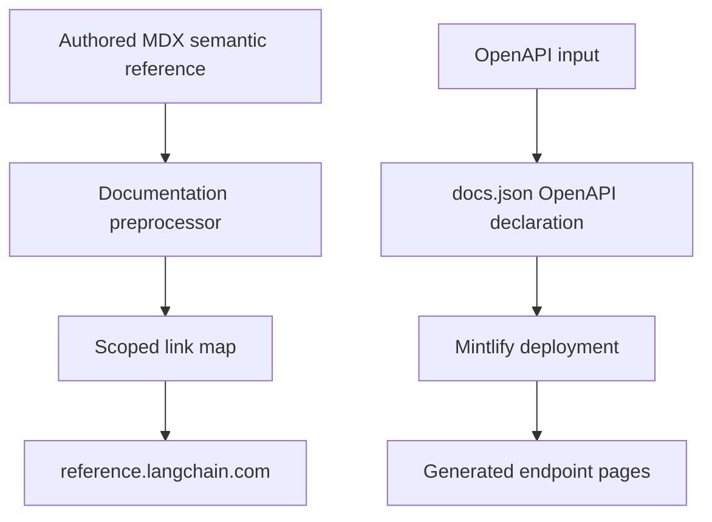
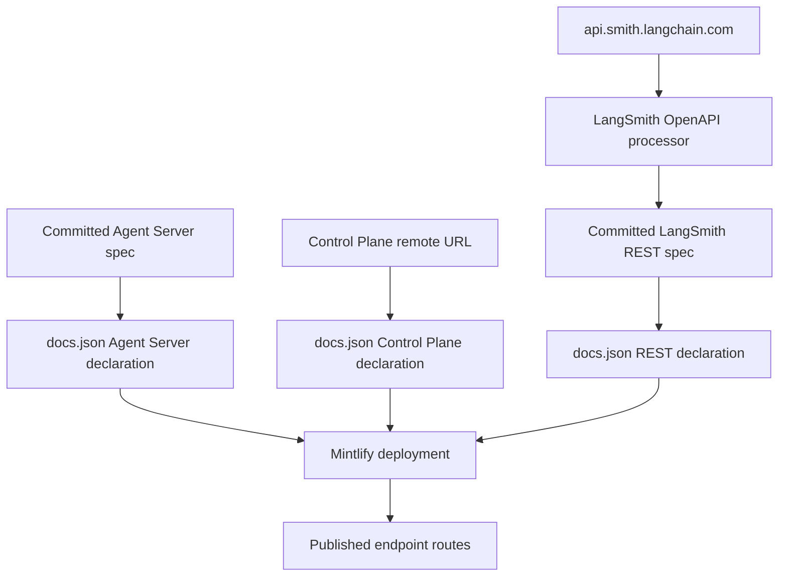

# Reference Documentation Integrations

## Ownership boundary

This repository builds the authored documentation site at `docs.langchain.com`. It **does not build** [reference.langchain.com](https://reference.langchain.com/python/): generated API reference for LangChain, LangGraph, LangSmith, and integration packages is built and deployed outside this repository, with separate [Python](https://reference.langchain.com/python/) and [JavaScript/TypeScript](https://reference.langchain.com/javascript/) sites.

Two different integrations connect this repository to reference material:

1. Authors use semantic `@[symbol]` markers that the documentation preprocessor converts to links on the externally owned SDK reference site.
2. `src/docs.json` declares OpenAPI inputs for Mintlify, which generates endpoint pages when it deploys the documentation site.



This shows the separate paths: SDK cross-references leave the repository for the external reference site, while OpenAPI inputs become Mintlify endpoint pages only at deployment. Deployment-generated endpoint pages must **not** be hand-authored.

## Semantic SDK cross-references

Use semantic markers rather than hard-coded SDK-reference URLs:

```markdown
@[StateGraph]
@[Build a graph][StateGraph]
@[`StateGraph`]
```

The preprocessor resolves these forms through `SCOPE_LINK_MAPS`, whose Python and JavaScript maps associate symbol names with their respective `reference.langchain.com` URLs. A mapping is the extension point for a newly linkable symbol; add or correct it in the link map rather than duplicating a destination across authored files.

Autolinking runs before conditional rendering. It begins in the page default scope, changes scope inside `:::python` or `:::js` fences, and resets at a bare `:::`. Ordinary fenced code is ignored. An escaped marker such as `\@[StateGraph]` remains literal after its escape is removed. If a marker cannot be found, preprocessing logs an info-level message with location and leaves the marker unchanged; it does not invent a URL. The runtime `global` scope is not fully supported: it logs an error and falls back to Python.

### Validate cross-references

```bash
make check-cross-refs
```

This source check scans Markdown and MDX below `src/` using the same marker and fence patterns. It excludes normal code fences, escaped markers, `snippets/code-samples/`, and `node_modules`. Files under `oss/python/` and `oss/javascript/` are checked in their respective scopes; shared `oss/` files are checked in both. Consequently, an unfenced marker in shared OSS content must resolve in **every** emitted language scope, while an explicit language fence narrows the requirement. The command exits nonzero for unresolved names.

This is distinct from rendered-site link checking. A successful Mintlify link check does not prove that each authored semantic marker has a scoped mapping.

## LangSmith OpenAPI sections

`src/docs.json` is the contract between OpenAPI inputs and Mintlify route generation. The three LangSmith sections have deliberately different owners and lifecycles:

| Section | Source and lifecycle | Change path | Mintlify route directory |
| --- | --- | --- | --- |
| Agent Server API | Committed `src/langsmith/agent-server-openapi.json`; updates arrive through `langgraph-api` spec-update PRs. | Obtain or review the upstream Agent Server update. | `langsmith/agent-server-api` |
| Control Plane API | `https://api.host.langchain.com/openapi.json`, fetched by Mintlify at deployment; no local file exists. | Correct the service-owned source. Do not commit a copy here. | Mintlify default (`/api-reference/`) |
| LangSmith REST API | Committed `src/langsmith/langsmith-platform-openapi.json`, generated by scheduled automation. | Fix upstream content or processor policy, regenerate, and review the refresh PR. Never patch the JSON manually. | `langsmith/smith-api` |



The diagram distinguishes committed inputs, a deployment-fetched input, and a transformed generated input. Endpoint pages for all three are deployment-generated and absent from the local build, so do not create Markdown or MDX replacements for them.

### Navigation and authored context

Each generated section remains alongside an authored overview rather than replacing one. In the LangSmith deployment **Reference** group, `langsmith/server-api-ref` precedes the Agent Server declaration and `langsmith/api-ref-control-plane` precedes the Control Plane declaration. The LangSmith product **Reference** tab similarly places `langsmith/smith-api-ref` in the **LangSmith REST API** group with its OpenAPI declaration. Keep the overview, group placement, and declaration aligned when changing a reference section.

### Agent Server update and validation

Agent Server changes are independent of the LangSmith REST refresh. The committed input is updated through `langgraph-api` PRs titled `Update Agent ServerOpenAPI spec for API version X.Y.Z`.

```bash
make check-openapi
```

Despite its broad name, this target builds documentation and runs `mint openapi-check langsmith/agent-server-openapi.json` from `build/`; it validates **only the Agent Server** input. The reusable link-check workflow runs the anchor-aware link check and then this target. Validate another input explicitly when needed; do not assume `make check-openapi` covers the remote Control Plane API or the LangSmith REST specification.

### LangSmith REST refresh and shaping

Do **not** hand-edit `src/langsmith/langsmith-platform-openapi.json`. The refresh workflow runs daily at 10:00 UTC and can also be manually dispatched. It invokes:

```bash
uv run python scripts/process_langsmith_openapi.py --write
```

By default, the processor fetches `https://api.smith.langchain.com/openapi.json`. Network fetching permits only the allow-listed `api.smith.langchain.com` host and uses a 30-second timeout. `--input` provides controlled local input for reproduction or policy work; `--output` selects a destination; without `--write`, the processed JSON is printed to standard output.

The processor curates the upstream specification for public Mintlify documentation. It hides configured Fleet, internal, infrastructure, health, and path-selected operations; adds or updates tag metadata with human-readable groups and order; and normalizes operation titles. Visible non-sandbox v2 operations receive `(v2)` labels, while Beta and v2 markers are stripped before normalized markers are reapplied, so repeated processing is idempotent.

The workflow first produces the candidate spec, restores the checkout, then reuses the `chore/refresh-langsmith-openapi` branch when its PR is open or creates it otherwise. It commits only the spec and exits without a commit when there is no diff. Treat the PR as the review boundary for an externally sourced public-reference update. If its output needs changing, modify the upstream API description or explicit processor policy and regenerate.

## Rendered link checks

`make broken-links` and `make broken-links-with-anchors` build first, run Mintlify in `build/`, filter its report with `scripts/filter_mint_broken_links.py`, and fail only when filtered output still contains an indented link report. CI uses the anchor-aware target before the Agent Server OpenAPI check.

The filter removes known local-build false positives: deployment-generated destinations under `/langsmith/agent-server-api/`, `/langsmith/smith-api`, and `/api-reference/`; standalone `snippets/` report sections; and selected legacy relative paths. With `--check-anchors`, it additionally removes only the named SmithDB migration anchors `traces-query`, `runs-query`, and `exceptions`. Other broken links and anchors remain failures. Validate the generated endpoint surface in a hosted preview or deployment, not by authoring local endpoint files.

Focused unit tests cover cross-reference scope selection, shared-file rules, marker formats, and code/escape exclusions. Filter tests assert that real broken links and non-exempt anchors survive filtering.

## Route issues to the owning system

For missing pages, broken links, or incorrect signatures on `reference.langchain.com`, open the [Reference Documentation issue](https://github.com/langchain-ai/docs/issues/new?template=04-reference-docs.yml). The template requires an issue type, language, and detailed description, and collects product plus an optional reference-page URL for routing. The correction belongs in the external reference generation tooling, not this repository.

Change this repository for an authored marker, scoped map entry, preprocessor or source-check behavior, a `docs.json` declaration, an Agent Server input update, or a reviewed LangSmith REST refresh. Keep the boundary explicit: external SDK references are owned elsewhere, remote and committed OpenAPI sources retain their configured lifecycles, and Mintlify—not an authored page—creates the endpoint documentation.

## Related documentation

- [Source Directory Map](/openwiki/architecture/source-map.md) — source, navigation, and generated-route ownership.
- [Mintlify Integration](/openwiki/integrations/mintlify.md) — deployment, preview, and hosted-artifact boundary.
- [Repository Wiki Quickstart](/openwiki/quickstart.md) — choosing a durable owner and smallest validation.
- [LangSmith OpenAPI Refresh](/openwiki/workflows/langsmith-openapi-refresh.md) — detailed processor policy and review-PR lifecycle.
