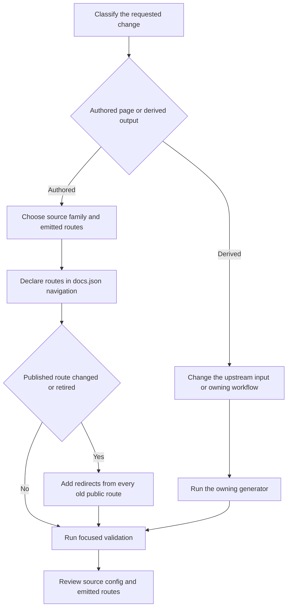

# Adding and Moving Documentation Pages

A documentation change is complete only when the authored input, its emitted public route, `src/docs.json` navigation, compatibility redirects, and rendered output agree. Start by determining who owns the surface. Manual pages are authored below `src/`; `build/` is regenerated output and must not be edited.



This decision flow separates durable source changes from derivative output and makes retiring a route an explicit compatibility decision.

## Establish the source owner and route family

Use the `add-docs-page` procedure for additions, moves, renames, and deletions. For an in-place edit on a named PR, use its head branch and the `docs-edit` procedure. Related pages identify inbound links and possible contradictions, but implementation and other owning inputs—not sibling documentation—establish factual behavior.

Choose a directory by the source family, rather than by its reader-facing menu. For example, **No-code agents** is sourced from `src/langsmith/fleet/`; Build mixes OSS and LangSmith content.

| Source family | Authored location | Emitted routes and navigation consequence |
| --- | --- | --- |
| Shared OSS | `src/oss/`, excluding language-owned and unversioned product directories | The builder emits `/oss/python/...` and/or `/oss/javascript/...`. A page listed in one language navigation builds only there; a page listed in both or neither builds both. Use one source file with `:::python` and `:::js` sections. |
| Language-owned OSS | `src/oss/python/` or `src/oss/javascript/` | One matching language route; put it in that language's navigation branch. |
| OpenWiki and Deep Agents Code | `src/oss/openwiki/` or `src/oss/deepagents/code/` | One unversioned `/oss/openwiki/...` or `/oss/deepagents/code/...` route. These are not duplicated. |
| Ordinary LangSmith | `src/langsmith/` | One unversioned `/langsmith/...` route. Place it in the lifecycle or product menu that owns the reader journey. |
| Managed Deep Agents | Direct `src/langsmith/managed-deep-agents*.mdx` files | Python and JavaScript routes under `/langsmith/python/...` and `/langsmith/javascript/...`; expose the relevant route in both language tabs. |

Shared OSS pages use one source file rather than copied language pages. Preprocessing retains the matching conditional block, and language builds rewrite ordinary root-relative `/oss/...` links to the active language route. A shared page intentionally listed only in one language must not be added to the other language's navigation; add a redirect for the other URL if it was ever published.

OpenWiki and Deep Agents Code are deliberate exceptions. Their conditional blocks resolve using the Python target, and `/oss/openwiki/...` and `/oss/deepagents/code/...` links stay unprefixed even when the linking page is versioned. Conversely, Managed Deep Agents sources are excluded from ordinary unversioned LangSmith output and emitted for both languages. Unversioned Managed Deep Agents aliases redirect to Python; do not add a duplicate unversioned page.

## Add an authored page to current navigation

`src/docs.json` is the route and navigation contract. The current hierarchy begins `navigation.products[]` → `menu[]`. A menu item can have direct `pages`, `tabs`, or—under Build—`dropdowns[]` with `tabs[]`; a `pages` list can contain strings and recursively nested group objects. Locate the adjacent page in the actual menu branch before editing.

1. Create the `.md` or `.mdx` source in the selected owner directory. Give it required frontmatter and a plain-text `description`—no Markdown, links, or backticks.
2. Add the extensionless path relative to `src` to the appropriate `pages` array. For example, `src/langsmith/sandboxes.mdx` becomes `langsmith/sandboxes`.
3. Add every entry required by the output family: normally one for a language-owned or unversioned page, and the appropriate Python and JavaScript entries for a shared OSS or Managed Deep Agents page. A route may intentionally appear in more than one discovery location.
4. Put an index route first when creating a group. For an existing integration component, update its `index.mdx`; change `docs.json` only when creating the component group.
5. Treat changed headings as route changes for fragments. Search inbound `#anchor` links first. Capitalization-only changes retain the lowercased slug; otherwise update consumers or preserve a component landing point with an explicit `id`.

## Move or retire a public page

Preview a source move before changing files:

```bash
uv run docs mv src/langsmith/evaluation.mdx src/langsmith/deploy/evaluation.mdx --dry-run
```

`docs mv` scans Markdown, MDX, and notebook Markdown cells, updating relative links and recognized site-absolute routes. It also changes navigation values and redirect destinations in `docs.json`, but intentionally leaves redirect sources unchanged. Review every `Left ... links unchanged` warning: the mover did not find a safe replacement. A real run logs the move in `link_changes.jsonl`, moves the source, and recalculates relative links in the moved document.

The mover does not decide discovery placement or create redirects. After a move, rename, or retirement:

1. Inspect the actual `menu` branch and move or remove its route entry.
2. Search for remaining old root-relative URLs and fragment links, including warnings from the mover.
3. Add a top-level `redirects` entry for every old published URL. Add one per language-specific route when applicable, and preserve or replace Managed Deep Agents' unversioned alias to Python.

```json
{ "source": "/langsmith/evaluation", "destination": "/langsmith/deploy/evaluation" }
```

Use site paths beginning with `/`. The removed-pages script is useful additional protection, but not sufficient proof for the current navigation: its extractor handles direct product pages, legacy tabs, dropdown tabs, and groups, but does not traverse the present `products[].menu[]` layer. Manually inspect the changed menu branch and validate the built site.

```bash
python3 scripts/check_removed_pages_redirects.py --base-ref origin/main src/docs.json
```

## Change inputs owned by generators

Do not hand-edit generated surfaces. In particular, `build/` is validation output; the weekly workflows own the LangSmith and Fleet changelogs, the Helm changelog bot owns the self-hosted changelog, and workflows or upstream repositories own the LangSmith platform and Agent Server OpenAPI specifications. Change the upstream input or owner, then regenerate.

Reusable blocks belong in `src/snippets/` and should use `from '/snippets/...'` imports, which the builder rewrites to language-specific copies. Testable examples belong in `src/code-samples/`; `make code-snippets` derives files in `src/code-samples-generated/` and `src/snippets/code-samples/`. Edit and test the source sample, then regenerate; do not patch derived artifacts. The extractor rejects unclosed snippet or removal regions.

Integration listing tables likewise derive from hosted integration-page frontmatter plus external discovery records. External records link through `docs_url`, and the refresh script rejects unsafe URL schemes. OpenAPI groups in `docs.json` are Mintlify-generated endpoint sections; their endpoint pages are not authored MDX and may not appear in a local build.

## Validate the emitted contract

Choose checks that exercise the input you changed. For a normal authored page lifecycle change, run focused prose linting, a clean build, and an anchor-aware link and redirect check:

```bash
make lint_prose FILES="src/path/to/page.mdx"
make build
make broken-links-with-anchors
```

- `make broken-links` builds first, checks redirects as well as links, filters expected reports for deployment-generated OpenAPI pages and standalone snippets, and fails on the remaining reports. Use `make broken-links-with-anchors` when a heading or fragment changed.
- Run `make check-cross-refs` after changing `@[...]` references. Run the owning sample or generator command after changing its inputs.
- Use `make dev` for rendered inspection. It performs an initial build, watches `src`, and serves `build` through `mint dev`; inspect both language outputs where the family emits both.
- When modifying lifecycle tooling itself, run the focused suite with `make test TEST_FILE=<test-path>` as well as its end-to-end command.
- Run `docs-review` after finished prose edits; skip it for a navigation-only reorder or redirect-only fix.

A successful build is evidence, not source ownership. Before completion, review authored files, `src/docs.json`, redirect destinations, generator inputs and regenerated artifacts, plus the relevant emitted routes.

## Completion checklist

- [ ] The change is in authored source or a generator input, never `build/` or deployment-generated output.
- [ ] The source family and navigation entries match every intended emitted route.
- [ ] Frontmatter descriptions are plain text, and a new integration follows its component-index convention.
- [ ] Each moved or retired public route, including applicable language variants and aliases, redirects to a maintained destination.
- [ ] Inbound fragment links were checked before heading changes.
- [ ] Generated snippets, samples, listings, changelogs, and specifications were regenerated by their owners.
- [ ] Focused linting, build, link/redirect checks, and source/output review completed.

## See also

- [Build system](/openwiki/architecture/build-system.md)
- [Source directory map](/openwiki/architecture/source-map.md)
- [Versioning](/openwiki/concepts/versioning.md)
- [Testing overview](/openwiki/testing/test-overview.md)
- [Versioned content workflow](/openwiki/workflows/versioned-content.md)
